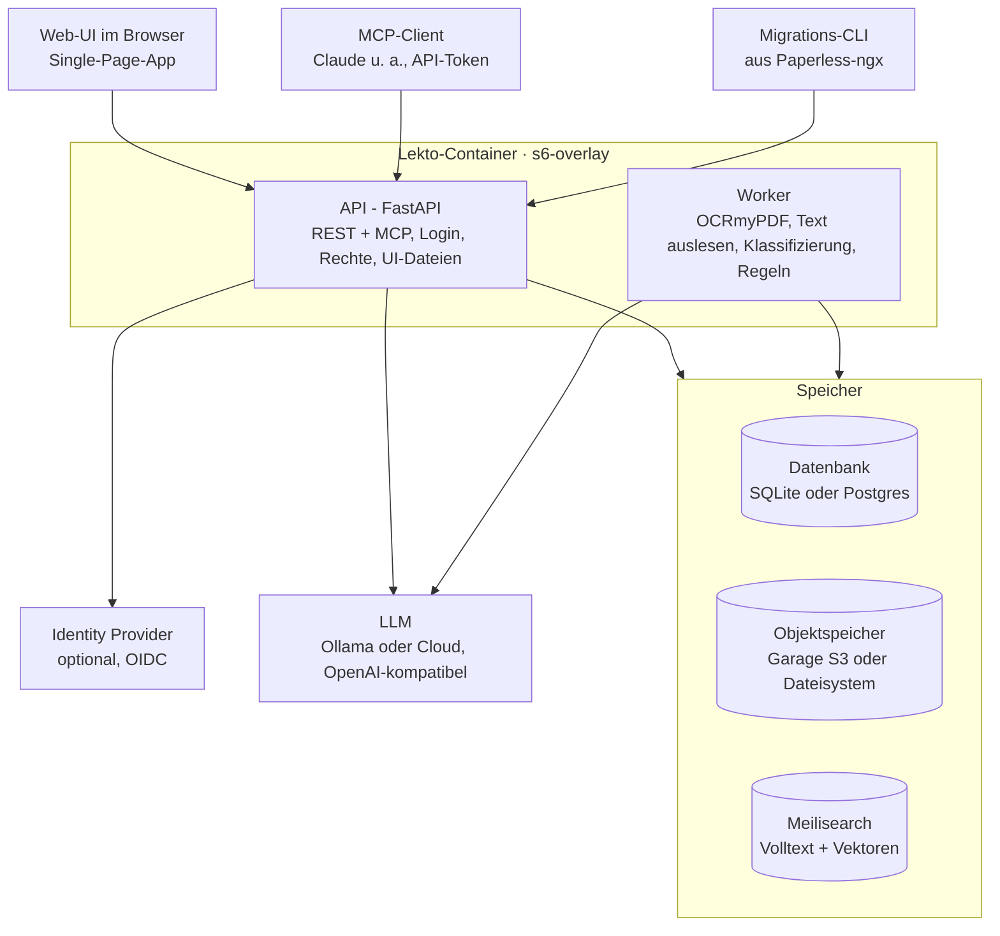

# Lekto – Architektur

Stand: 06.10.2026 · Tobias

## Ziel und Rahmen

Lekto ist ein selbst gehostetes, headless Dokumentenmanagementsystem als Ersatz für Paperless-ngx – Open Source, kostenlos, als Docker-Stack.

- Multi-User mit nativen Logins, keine Mandanten
- Headless: alle Funktionen nur über die API; Web-UI, MCP und Migrations-CLI sind Clients
- LLM lokal und in der Cloud nutzbar
- Erster Wurf mit 100 Dokumenten; Migration aus Paperless-ngx folgt als eigener Client

**Name:** Lekto (von Lektor, lat. *lector*, der Leser: jedes Dokument wird gelesen und zusammengefasst). Anzeigename **Lekto DMS** (README-Titel, OpenAPI-Titel, Seitentitel der UI). Technische Namen ohne „DMS“, durchgehend klein `lekto`: Pakete `lekto` und `lekto_migration`, Präfix `LEKTO_`, Cookies, Tokens (`lekto_…`), Image, MCP-Server, Logger, Hostnamen; Repository `tb1337/lekto-dms`. Die Wortmarke ist vorerst der Schriftzug „lekto“ in der Typografie der früheren Wortmarke. Favicon (Tobi, 21.10.2026, Variante E des Canvas „Lekto Favicon“): eine Lupe über drei Textzeilen, weiß auf Petrol (`web/static/favicon.svg`; `apple-touch-icon.png` daraus, 180 px, eckig).

**Umbenennung** (Tobi, 19.10.2026, Issue #60): Bis 0.4 hieß das Projekt Papiq (`p:api:q`); ab 0.5 Lekto, als neue Minor-Version ohne Übergang. Kein alter Name wird mehr gelesen: weder das Präfix `PAPIQ_` noch die alten Cookies (alle melden sich einmal neu an), der Suchindex `papiq-documents`, die SQLite-Datei `papiq.db`, das Format des Klassifikators (einmal neu trainieren) oder die Zustandsdatei des Migrationsclients. API-Tokens mit `papiq_` gelten weiter, weil nur ihr Hash zählt. Das Compose-Projekt des Devcontainers hieß zunächst weiter `papiq-dev` (Arbeitsverzeichnis `/workspaces/papiq`), damit dessen Volumes bleiben; seit 21.10.2026 heißt es `lekto-dev` (`/workspaces/lekto`), die Daten der Volumes sind umgezogen. Was eine Installation tun muss, steht in `deploy/README.md` („Upgrading from Papiq“). Domains und Marken für Lekto sind noch offen.

**Logo-Konzept:** Wortmarke p:a~~p~~i:q mit grafisch durchgestrichenem mittlerem p. Ein Wort, vier Lesarten: **PAP**(er), p**API**q, pa~~p~~**I** (AI), pap**IQ**; das durchgestrichene p verweist zugleich auf „paperless“. Das Durchstreichen gibt es nur im Logo, nicht im Fließtext.

## Gesamtarchitektur

Lekto läuft als ein Docker-Container (API, Worker, Auslieferung der Web-UI, überwacht von s6-overlay) neben drei Speichern; LLM und Identity Provider sind extern.



Web-UI, MCP-Client und Migrations-CLI greifen ausschließlich über die API zu. Der Worker verarbeitet Dokumente als Jobs im Hintergrund und nutzt dieselben Speicher. API und Worker laufen als überwachte Dienste im selben Container (siehe Betrieb).

## Architekturprinzip: Ports und Adapter

Lekto ist hexagonal aufgebaut: Der fachliche Kern kennt keine Datenbank, kein S3, keinen Suchdienst und kein LLM – nur Schnittstellen (Ports), die er selbst definiert. Jede Technik steckt in einem austauschbaren Adapter.

- **Kern:** Dokumente, Spaces, Rechte, Regeln, Lanes, Pipeline-Ablauf. Reines Python, keine Framework-Abhängigkeiten.
- **Ports:** Python-Protocols, vom Kern definiert.
- **Adapter:** implementieren die Ports; welcher Adapter läuft, entscheidet die Konfiguration an einer zentralen Stelle beim Start.
- **Tests:** Jeder Port hat In-Memory-Adapter für Kern-Tests und eine Vertragstest-Suite, die jeder echte Adapter bestehen muss.

**Eingehende Adapter (rufen den Kern auf):** REST-API (FastAPI), MCP-Server, Worker (führt Jobs aus), Evaluation (Bewertungssatz durch Klassifizierung und Suche: `evaluate`, `evaluate-search`), Migrations-CLI.

**Ausgehende Ports (der Kern ruft auf):**

| Port | Adapter im ersten Wurf | Austauschbar gegen (Beispiele) |
| --- | --- | --- |
| Repository (Metadaten) | SQLAlchemy: SQLite, Postgres | andere Datenbank |
| Objektspeicher | S3 (Garage), lokales Dateisystem – gleichwertig, per Konfiguration | anderer S3-Server (z. B. SeaweedFS) |
| Suchindex | Meilisearch | Typesense, Postgres-Volltext |
| LLM | OpenAI-kompatible API | Anbieter-spezifische API |
| Embeddings | OpenAI-kompatible API | lokales Modell |
| Klassifikator | scikit-learn (TF-IDF, logistische Regression), Modell als `npz` | anderes Verfahren |
| OCR | OCRmyPDF mit Tesseract; auf Wunsch einer Person ein VLM als Texterkennung (OpenAI-kompatibel, als Plugin von OCRmyPDF) | entfernter OCR-Dienst |
| Parser | PDFium: der Text der Textebene, wie er gesetzt ist (Layout-Text) | anderer Parser |
| Job-Queue | Job-Tabelle in der Datenbank | Valkey/Redis-basierte Queue |
| Event-Bus | Outbox-Tabelle in der Datenbank, Verteilung im Prozess | Valkey Streams, NATS |
| Identität | nativer Login, OIDC | weitere Anbieter |
| Vorschau | PDFium (erste Seite als WebP) | anderer Renderer |
| Fundstellen (Zitat → Seite und Box) | PDFium (Textebene des Archiv-PDFs) | anderer Locator |
| Codes (Bar- und QR-Codes der Seiten) | zxing-cpp auf den Seiten des Archivs, mit PDFium in 300 dpi gerendert | anderer Leser |
| Datei-Metadaten (Reiter „Eigenschaften“) | pikepdf (PDF-Infos, XMP, PDF/A), Pillow (Bilder, EXIF) | anderer Leser |
| Mustersuche (Regeln) | `regex` mit Zeitlimit | eigener Dienst |
| Templates (Regeln, Titelmuster) | Liquid (`python-liquid`), mit Grenzen für Schleifen und Ausgabe | andere Template-Sprache |
| Webhook-Versand | httpx2 | andere HTTP-Bibliothek |
| Uhr | Systemuhr | feste Uhr in Tests |
| Passwort-Hash, Geheimnis-Verschlüsselung, TOTP | Argon2id, AES-GCM, pyotp | andere Verfahren |

Webhook-Versand ist ein ausgehender Adapter, der Ereignisse vom Event-Bus abonniert. Jeder Port
hat einen In-Memory-Adapter für die Kern-Tests. Ausnahmen: die Mustersuche und die Templates. Der
Vertrag der Mustersuche verlangt eine Suche, die ein Zeitlimit abbricht und den Event-Loop nicht
blockiert; das kann die `regex`-Engine, Pythons `re` nicht. Der `regex`-Adapter braucht keinen
Dienst und läuft auch im Speicher-Container (Tobi, 12.10.2026). Ebenso der `liquid`-Adapter der
Templates: Ein Nachbau der Sprache im Speicher wäre ein zweiter Interpreter (Tobi, 14.10.2026).

Hexagonal betrifft den inneren Aufbau, nicht die Zahl der Container: Ein Adapter kann lokal laufen oder einen entfernten Dienst ansprechen, ohne dass sich der Kern ändert.

## Technologie-Stack

Backend und Worker in Python; ein Container mit s6-overlay als Prozessüberwachung.

| Bereich | Wahl | Status |
| --- | --- | --- |
| API | FastAPI, Pydantic | entschieden |
| Nebenläufigkeit | durchgängig async (FastAPI, SQLAlchemy async mit asyncpg bzw. aiosqlite) | entschieden |
| Ereignisse | Transactional Outbox in der Datenbank; kein Broker zum Start | entschieden |
| Datenzugriff | SQLAlchemy 2, Alembic | entschieden |
| Datenbank | SQLite oder Postgres, per Konfiguration | entschieden |
| Objektspeicher | Garage (S3) oder lokales Dateisystem, per Konfiguration | entschieden |
| Suche | Meilisearch Community Edition (MIT) | entschieden |
| OCR | OCRmyPDF | entschieden |
| VLM (Seiten lesen) | OpenAI-kompatible Schnittstelle mit Bildern, als Texterkennung in OCRmyPDF; nur auf Wunsch einer Person (Tobi, 15.10.2026); gemessen mit Claude Sonnet 5.5 über Open WebUI | entschieden |
| Parsing | Layout-Text aus der Textebene mit PDFium (statt Docling, Tobi 14.10.2026, siehe Ingest-Workflow) | entschieden |
| Datei-Metadaten | `pikepdf` (MPL-2.0), über OCRmyPDF ohnehin im Image, jetzt direkte Abhängigkeit (Tobi, 16.10.2026) | entschieden |
| Codes | `zxing-cpp` 3.1 (Apache-2.0; Pakete für amd64 und arm64, keine Systempakete): QR, Data Matrix, Aztec, PDF417, Code 128/39, EAN, ITF. Verworfen: `pyzbar` (Systempaket `libzbar0`, kein Data Matrix, zuletzt 2022), `pylibdmtx` (nur Data Matrix), OpenCV (groß, kein Data Matrix), `pyzxing` (Java) (Tobi, 15.10.2026) | entschieden |
| LLM | OpenAI-kompatible Schnittstelle (Ollama, Cloud) | entschieden |
| Klassifikator | scikit-learn, Vorhersage mit numpy | entschieden |
| Templates | Liquid (`python-liquid` 2.3, mit Babel): Regeln schreiben auch Nutzer, Liquid ist für Templates von Endnutzern gebaut (nur übergebene Daten, Grenzen für Schleifen und Ausgabe), die Syntax gleicht Jinja (Tobi, 14.10.2026; Jinja2 verworfen: Ausbrüche aus der Sandbox 2024/2025, keine Schleifengrenze) | entschieden |
| LLM-Modell (lokal) | `qwen3:8b` über Ollama mit 8192 Token Kontext (NUC, nur CPU); Bewertung siehe unten | entschieden |
| Embedding-Modell (lokal) | Qwen3-Embedding 4B (`hf.co/Qwen/Qwen3-Embedding-4B-GGUF:Q8_0` in Ollama, hinter LiteLLM), 2560 Dimensionen, vor jeder Anfrage eine Anweisung mit `Query:` in eigener Zeile (Tobi, 21.10.2026; davor `snowflake-arctic-embed2` mit `query: `); Bewertung unter „Suche“ | entschieden |
| Jobs | eigene Job-Tabelle über SQLAlchemy | entschieden |
| Authentifizierung | Argon2id, TOTP, Authlib (OIDC) | entschieden |
| Web-UI | SvelteKit (Svelte 5), Tailwind, shadcn-svelte; Ziel: cleanes, modernes Interface | entschieden |
| Template-Editor | CodeMirror 6 (`state`, `view`, `autocomplete`, `commands`) mit eigener Liquid-Färbung, nachgeladen nur wo ein Template steht; `lang-liquid` verworfen, es zöge HTML, CSS und JavaScript mit (Tobi, 15.10.2026) | entschieden |
| Container | ein Lekto-Image, Prozessüberwachung mit s6-overlay | entschieden |

Nicht verwendet: MySQL (gestrichen), LangGraph (kein Bedarf, siehe Ingest-Workflow), Procrastinate (nur Postgres).

## Datenhaltung

Drei Speicher mit klarer Aufgabe: Datenbank für Metadaten, Objektspeicher für Dateien, Meilisearch für die Suche.

**Datenbank (SQLite oder Postgres)**

- Enthält Metadaten, Stammdaten, Regeln, Jobs und Verarbeitungsprotokoll.
- SQLite nur auf lokalem Volume im WAL-Modus, nie auf Netzlaufwerk oder S3.
- Tests in CI gegen beide Datenbanken.

**Objektspeicher (S3 oder Dateisystem)**

- Zwei gleichwertige Adapter: S3 (erster Server: Garage) oder lokales Dateisystem.
- Lekto nutzt keine Speicher-Events. Ereignisse entstehen ausschließlich in der Outbox; so bleibt der Adapter frei tauschbar (Garage und Dateisystem kennen keine Events).
- Originale unveränderlich, Objekt-Key = SHA-256 des Inhalts; Dubletten werden darüber erkannt. Jede Datei gibt es einmal je Installation, global eindeutig (Tobi, 22.10.2026: eine Installation ist ein eigenes Ökosystem, in dem Leute gemeinsam archivieren; bis 0.4 je Besitzer, am 21.10.2026 kurz je Space). Liegt sie schon in Lekto, wird ein Upload abgelehnt: mit Link, wenn der Einstellende das Dokument lesen darf; sonst erfährt er nur, dass es sie gibt („Diese Datei liegt schon in Lekto, in einem Space, den du nicht siehst“, ohne Namen des Space und ohne Mitglieder). Verschieben, Übergeben, Bestätigen und Regeln treffen nie auf eine Dublette.
- Daneben die Derivate: Archiv-PDF mit Textlayer, der ausgelesene Text (`content.txt`, Klartext wie gesetzt) mit seiner Struktur (`content.json`: Seiten, Zeilen und Wörter mit Boxen), die Codes der Seiten (`codes.json`), Seitenbilder und Vorschau, die Anfragen an das Sprachmodell; dazu die Modelle des Klassifikators (`classifier/model-<n>.npz`) und die Logos der Kontakte (`contacts/<id>/logo.webp`).

**Suche (Meilisearch)**

- Hybride Suche: Volltext und Vektoren in einem Aufruf.
- Index ist abgeleitet und jederzeit aus Datenbank und S3 neu aufbaubar; Aktualisierung per Job, daher kurz verzögert.
- Nur API und Worker sprechen mit Meilisearch: der Worker schreibt den Index (Jobs, Abgleich, Neuaufbau), die API sucht; jede Suche wird auf die Reichweite des Nutzers gefiltert (Admins mit `all_users`: alle Dokumente).
- Deutsche Komposita werden zerlegt; Stemming nach Kenntnisstand nicht vorhanden, die semantische Suche fängt das ab ([Quelle](https://www.meilisearch.com/docs/resources/internals/typo_tolerance.md)).

## Datenmodell

Angelehnt an Paperless-ngx, ohne Speicherpfade, mit Spaces als Ablage- und Rechte-Einheit (bis 0.2: Schubladen; Tobi, 16.10.2026: „Space“ auf Deutsch und Englisch, wie die Unterkonten bei N26). Gespeicherte Blicke auf die Dokumente heißen Lens, Mehrzahl Lenses, ebenfalls auf Deutsch und Englisch (Tobi, 20.10.2026; nicht „Saved View“ wie in Paperless-ngx): ein Space ist, wo Dokumente liegen, eine Lens, wie man sie ansieht.

| Begriff | Bedeutung | Regeln |
| --- | --- | --- |
| Dokument | Datei mit Metadaten | genau ein Space, „eingestellt von“ (nur Auskunft, trägt keine Rechte), höchstens ein Kontakt, höchstens ein Typ, höchstens ein Thema (eines, das sein Kontakt führt), Hash, Dokumentdatum |
| Kontakt | Gegenseite des Dokuments (Paperless: Korrespondent) | höchstens einer pro Dokument (leer, bis das Urteil oder eine Person einen setzt); global, ohne Besitzer; Aliase und Kennungen (IBAN, USt-IdNr, Kundennummer, Personalnummer, E-Mail-Domain); beliebig viele Kontaktgruppen; die Themen, die er führt; ein Logo |
| Dokumenttyp | Art des Dokuments | global; bringt zugeordnete Felder mit, je Pflicht oder optional; optional ein Titelmuster; beliebig viele Typgruppen; ein Icon |
| Tag | Merkmal mit einer Art (`scope`) | global; Arten `document` (am Dokument, beliebig viele), `contact` (Kontaktgruppe), `document_type` (Typgruppe), `topic` (Thema); verschachtelbar; Icon und Farbe; trägt keine Rechte |
| Thema | worum es mit einem Kontakt geht (Arbeit, Krankenversicherung, Girokonto) | ein Tag der Art `topic`: globaler Katalog, am Kontakt freigeschaltet; höchstens eines pro Dokument |
| Feld | frei definierbares Feld (Paperless: Custom Field) | Geltungsbereich global oder je Dokumenttyp; fester Datentyp; Pflicht oder optional (je Typ, ein globales mit eigenem Schalter); optional eine Beschreibung, was hineingehört (für das Modell); „nur von Hand“: das Modell wird nie danach gefragt |
| Space | Ablage- und Rechte-Einheit (bis 0.2: Schublade), ein Tresor | Mitglieder mit der Rolle Lesen oder Bearbeiten, kein Besitzer (bis 0.4: Besitzer und Freigaben); ein geteilter Space behält mindestens einen Bearbeiter, sein Name ist unter den geteilten eindeutig; eine Beschreibung für das Modell (bis 300 Zeichen); jeder Nutzer hat genau einen persönlichen Space: dort landen seine Uploads, teilbar, nicht löschbar, die Mitglieder bestimmt nur er (Tobi, 21.10.2026) |
| Nutzer | Person mit Login | Rolle Admin oder Nutzer; ein Profil: Anzeigename, Aliasse, Geburtsdatum, E-Mail, Kennungen (Steuer-ID, Sozialversicherungs-, Krankenversichertennummer, IBAN, E-Mail-Adresse; die Personalnummer bleibt eine Kennung des Arbeitgebers, die den Nutzer nennt: Abweichung bei der Umsetzung, 22.10.2026); das Profil sehen nur der Nutzer selbst und Admins, andere den Anzeigenamen (Tobi, 21.10.2026). Ein Anzeigename ist über alle Nutzer eindeutig und nie der Benutzername eines anderen; Aliasse sind privat und dürfen sich wiederholen (eine Ablehnung verriete, wessen Alias es ist; Vorgabe von Claude nach dem Review, 22.10.2026) |
| Lens | gespeicherter Blick auf die Dokumente: Filter, Suchworte, Sortierung, Gruppierung, Darstellung, Kartenfelder, Frist | gehört einem Nutzer, nur er sieht und ändert sie; Name je Nutzer eindeutig; höchstens drei Kartenfelder; die Frist ist ein Datumsfeld; enthält nichts, ein Dokument steht in vielen Lenses zugleich |

- Stammdaten (Kontakte, Typen, Tags aller Arten, Felder) pflegen nur Admins. Ausnahme: Wählt eine Person in der Prüfansicht einen Kontakt für ein offenes Kontaktfeld, lernt der Kontakt den vom Modell gelesenen Namen als Alias, gleich welche Rolle sie hat (Tobi, 10.10.2026).
- Felddatentypen: Text, Zahl, Betrag (Dezimalzahl mit ISO-4217-Währung je Wert), Datum, Ja/Nein, Auswahl (eine Option aus fester Liste), Link (absolute http(s)-URL), Zeitraum (Anfang und Ende, beide Tage eingeschlossen; ob Tag, Kalenderwoche, Monat, Quartal, Jahr oder frei, folgt aus den Enden).

**Tags, Gruppen und Themen** (Tobi, 16.10.2026)

- Jedes Merkmal eines Dokuments ist entweder ein Klassifizierungsmerkmal, das Lekto selbst ermittelt, oder eines, das nur ein Mensch festlegen kann. Dafür hat jeder Tag (wie jedes Feld, siehe Felder) einen Schalter: `auto` (die Signale schlagen vor und setzen) oder `manual` (nur Personen und Regeln setzen ihn, etwa Status-Tags wie „zu bezahlen“, „Wiedervorlage“). Kontakt- und Typgruppen sind immer `manual`.
- Arten (`scope`): `document` – Merkmal am Dokument, wie bis 0.2; `contact` – Kontaktgruppe („Versicherung“, „Arbeitgeber“), ein Kontakt in beliebig vielen; `document_type` – Typgruppe („Rechnung“ über „Arztrechnung“ und „Handwerkerrechnung“), ein Typ in beliebig vielen; `topic` – Thema. Namen sind je Art eindeutig: „Versicherung“ darf Kontaktgruppe und Thema zugleich sein.
- Die Gruppe sagt, wer schreibt; das Thema, worum es geht. Der Lohnzettel der Versicherung, bei der man arbeitet, liegt in der Kontaktgruppe „Versicherung“ und im Thema „Arbeit“.
- Hierarchie: Ein Tag hat höchstens einen Elterntag derselben Art; keine Zyklen, höchstens fünf Ebenen. Gespeichert wird nur der gesetzte Tag, seine Vorfahren sind abgeleitet: Das Dokument findet sich über den Tag und alle Vorfahren, Filter und Regelbedingungen treffen die Nachfahren mit. Setzt man Kind und Elternteil, bleibt das Kind; ein Elterntag darf auch allein gesetzt werden. Bekommt ein Tag oder eine Gruppe einen anderen Elterntag, behalten Dokumente (bei Gruppen Kontakte und Typen), die danach einen Tag und einen seiner Vorfahren tragen, nur den Nachfahren, als wären sie neu gesetzt: ein Job über die betroffenen Zeilen, der weder Bestätigung noch Lane ändert und die Sucheinträge erneuert (Tobi, 17.10.2026). Ein Tag mit Kindern oder in Gebrauch lässt sich nicht löschen.
- Ein Dokument erbt die Kontaktgruppen seines Kontakts und die Typgruppen seines Typs mit ihren Vorfahren (abgeleitet, nicht gespeichert); am Dokument lassen sie sich nicht entfernen.
- Themen: ein globaler Katalog; ein Admin schaltet sie am Kontakt frei, im Kontaktdialog oder indem er am Dokument ein Thema wählt, das der Kontakt noch nicht führt. Das Feld Thema hat ein Dokument nur, wenn sein Kontakt Themen führt: es erscheint, sobald ein solcher Kontakt gewählt ist, und fehlt ohne Kontakt oder bei einem ohne Themen, auch für Admins; ein Thema, das das Dokument schon trägt, bleibt sichtbar (Tobi, 20.10.2026). Ein Dokument trägt höchstens ein Thema, eines, das sein Kontakt führt; wechselt der Kontakt, bleibt es nur, wenn der neue es auch führt. Die Freischaltung lässt sich nicht entfernen, solange Dokumente des Kontakts das Thema tragen. Kennungen eines Kontakts können auf eines seiner Themen zeigen (siehe Kontakte).
- Anzeige: je Tag „am Dokument zeigen“, die Vorgabe folgt der Art (Gruppen aus, Themen und Dokument-Tags an). Ausgeblendete Tags sehen Filter, Suche, Regeln und Templates weiter. Am Dokument steht nur das Blatt; den Pfad („Versicherung › Krankenversicherung“) zeigen Tooltip und Auswahlfeld, am Handy ein Tippen. Die Gruppen stehen, wenn eingeblendet, beim Kontakt und beim Typ.
- Aussehen: Tags und Typen tragen ein Icon aus Lucide (eine Auswahl von 170 nach Lebensbereichen, die übrigen über die Suche, alles aus dem eigenen Build), Tags eine Farbe: zwölf Hauptfarben, je für hell und dunkel abgestimmt, oder hinter „Mehr Farben“ eine eigene als `#rrggbb`; die Schrift des Chips folgt dem Kontrast. Kontakte zeigen ihr Logo, sonst ihre Initialen.
- Personen (wen ein Dokument betrifft) sind keine Tags und kein gespeichertes Merkmal am Dokument (Tobi, 21.10.2026): Nutzer tragen in ihrem Profil, woran man sie in Dokumenten erkennt, und `signal_facts` findet sie als Beleg dafür, wessen Dokument es ist und in welchen Space es gehört (siehe Berechtigungen, Signale, Urteil). Nicht jedes Dokument nennt einen Empfänger, und Empfänger, Betroffener und wer es sehen soll sind drei Fragen: die Arztrechnung des Kindes geht an den Versicherungsnehmer, betrifft das Kind, sehen sollen sie beide Eltern.

## Berechtigungen

Rechte hängen am Space, nie am einzelnen Dokument. Ein Space ist ein Tresor: Ein Dokument liegt in genau einem Space, und was jemand mit ihm darf, sagt allein seine Rolle in diesem Space (Tobi, 21.10.2026, Umbau in 0.5.0). Bis 0.4 entschieden drei Dinge nebeneinander – der Besitzer des Dokuments, der Besitzer des Space und Freigaben je Nutzer („lesen“, „lesen/schreiben“) –, schwer zu handhaben und zu verstehen: In einem Space lag ein Dokument, das sein Besitzer weder löschen noch verschieben durfte, eine entzogene Freigabe wirkte nur halb, Gelbes sah nur der Besitzer. Verworfen: Spaces als gespeicherte Filter über die eigenen Dokumente (undurchsichtig, und jede Umklassifizierung änderte still, wer ein Dokument sieht); Gruppen und Rechte je Nutzer (ein geteilter Space ist die Gruppe).

- **Rollen im System:** Admin und Nutzer. Admins haben alle Rechte und sehen alles (Tobi, 08.10.2026, gilt weiter): Sie lesen und ändern alle Dokumente in jeder Lane, lesen das Verarbeitungsprotokoll, wiederholen, verarbeiten neu, bestätigen, verschieben und löschen; sie sehen und verwalten alle Spaces und legen in jeden ab; sie lesen und ändern alle Regeln und Webhooks; dazu Nutzer und Stammdaten. Ein Admin ist zugleich ein Nutzer mit eigenem persönlichem Space. Ein deaktivierter Nutzer hat keine Rechte, auch ein Admin.
- **Rollen im Space** (Tobi, 21.10.2026): zwei, keine dritte zum Verwalten.
  - **Lesen:** sieht die grünen Dokumente des Space (nicht in Verarbeitung, nicht gelb oder rot), mit Dateien, Text und Angaben.
  - **Bearbeiten:** sieht alle Dokumente des Space in jeder Lane; ändert, prüft, bestätigt, wiederholt, verarbeitet neu, lässt mit dem VLM lesen, verschiebt und löscht sie; pflegt die Regeln des Space, seine Mitglieder und seinen Namen und löscht ihn, wenn er leer ist („ein geteilter Space ist ein geteilter Space“). Leser pflegen keine Regeln: Sie änderten sonst über eine Regel, was sie von Hand nicht ändern dürfen. Ein geteilter Space behält mindestens einen Bearbeiter.
- **Persönlicher Space:** Jeder Nutzer hat genau einen; dort landen seine Uploads. Er ist nicht löschbar, aber teilbar (Tobi, 21.10.2026: bis 0.4 war der Standard-Space privat); seine Mitglieder bestimmt nur sein Nutzer, der immer Bearbeiter ist. Er heißt für seinen Nutzer „Persönlich“, für andere wie sein Nutzer. Wer etwas ganz für sich will, legt einen Space ohne weitere Mitglieder an; jeder Nutzer legt Spaces an und ist darin Bearbeiter.
- **Eingestellt von:** Wer ein Dokument einstellt, steht am Dokument, als Auskunft ohne Rechte; wird der Nutzer gelöscht, bleibt es leer. Einen Besitzer des Dokuments gibt es nicht mehr.
- **Reichweite:** die Dokumente der Spaces, in denen man Mitglied ist, nach Rolle (Lesen: Grünes; Bearbeiten: alles). Listen, Posteingang und Suche zeigen die Reichweite; Admins schalten auf alle Nutzer um (`all_users`), in der Web-UI über „Alle Nutzer einbeziehen“ im Benutzermenü, im Browser gemerkt und am Avatar angezeigt; es gilt für Dokumente, Suche, Posteingang mit seiner Zahl, Regeln und die Zahlen an den Stammdaten (Tobi, 16.10.2026), seit 22.10.2026 auch für die Spaces (`GET /spaces`): Ohne den Schalter arbeitet ein Admin wie jeder Nutzer, die Spaces-Seite zeigt „Spaces anderer Nutzer“ nicht, und Verschieben, Bestätigen und „Gilt für“ an Regeln bieten nur seine eigenen Spaces und „Übergeben an …“ an, das jedem Nutzer offensteht (Tobi, 22.10.2026). Seine Rechte reichen trotzdem in jeden Space. Webhooks melden nur Dokumente in der Reichweite ihres Besitzers, auch bei Admins; SSE erhalten Admins zu allen Dokumenten.
- **Einstellen:** Ein Upload landet immer im persönlichen Space des Einstellenden; die Web-UI fragt nicht nach einem Space (Tobi, 21.10.2026: Lekto soll smart sein und dem Nutzer Arbeit abnehmen, eine Grundregel). Die API behält `space_id` (nur in einen Space, in dem der Aufrufer bearbeitet) und `uploaded_by` (nur Admins; Migration und Skripte).
- **Verschieben** in einen anderen Space: wer im Quell-Space bearbeitet, in einen Space, in dem er ebenfalls bearbeitet. **Übergeben** (Tobi, 21.10.2026): in den persönlichen Space eines anderen Nutzers, ohne dort Mitglied zu sein, von Hand oder per Regel; danach sieht man das Dokument nur noch, wenn man dort Mitglied ist, beim Empfänger steht es als neu im Posteingang. Das ersetzt den Wechsel des Besitzers. Admins verschieben jedes Dokument in jeden Space.
- **Wohin ein Dokument gehört**, schlägt Lekto vor (Tobi, 21.10.2026): Der Ziel-Space zieht seine Dokumente an, aus Erfahrung (Klassifikator und Nachbarn lernen den Space) und mit seiner Beschreibung für das Modell, belegt durch die Personen, die das Dokument nennt (siehe Signale und Urteil); die Regeln des Space, in dem das Dokument liegt, schieben es weiter („Kontaktgruppe Versorger → Haushalt“, auch Übergeben). Bedingungen am Space gibt es nicht: Deterministisch sind nur Regeln. Teilen nach Kontakt und Typ ist damit eine Regel oder ein gelernter Vorschlag.
- **Mehr Sichtbarkeit nur mit Klick** (Tobi, 21.10.2026): Wird ein Dokument für mehr Personen sichtbar (der Ziel-Space hat Mitglieder, die der Quell-Space nicht hat), müssen die Werte, auf denen der Schritt beruht, von einer Person bestätigt sein; sonst wird es gelb mit dem Vorschlag und den neuen Lesern („Haushalt (sichtbar für Anna)“), und ein Klick bestätigt und verschiebt. Einengen geht ohne Rückfrage. So ändert sich Sichtbarkeit nie still durch eine Fehlklassifizierung, nur mit Klick.
- **Posteingang:** Gelbe, rote und Dokumente in Verarbeitung sehen die Bearbeiter ihres Space (und Admins), bis sie gelöst sind: Wer im Space mitarbeitet, hilft beim Klären. Was im Posteingang steht, ist je Nutzer (siehe Verarbeitung › „Posteingang“).
- **Dubletten:** einmal je Installation, global eindeutig (Tobi, 22.10.2026: eine Installation ist ein Ökosystem); wer eine Datei einstellt, die in einem Space liegt, den er nicht sieht, erfährt nur, dass es sie gibt (siehe Datenhaltung).
- **Nutzer löschen** (Tobi, 22.10.2026): nur Admins, und in einem Schritt mit den Spaces, die der Nutzer allein hält. Der Dialog nennt sie (`GET /users/{id}/removal`) und fragt je Space: der persönliche Space mit Dokumenten verschiebt sie in einen anderen Space; ein geteilter Space, den der Nutzer allein bearbeitet, geht leer mit („Mit dem Nutzer löschen“), verschiebt seine Dokumente und geht, oder bekommt einen neuen Bearbeiter und bleibt. Ein Klick löscht den Nutzer und erledigt alles, ganz oder gar nicht; die Dokumente wandern, wie ein Admin sie von Hand verschiebt. Ohne Entscheidung zu einem dieser Spaces lehnt die API ab (409 mit den Spaces).
- **Stammdaten** sind global sichtbar – Kontaktnamen sehen alle Nutzer (bewusst akzeptiert). Das Profil eines Nutzers (Geburtsdatum, Kennungen) sehen nur er und Admins, andere seinen Anzeigenamen; persönliche Daten gehen nie an das Modell. Die Kennungen eines Kontakts nicht alle (Issue #82, Tobi 24.10.2026: „wenn Datenschutz dann richtig“): von Hand eingetragene ohne Nutzer sehen alle, eine Nummer, die einen Nutzer nennt, nur er und Admins, eine gelernte nur die Mitglieder der Spaces, aus deren Dokumenten sie gelernt ist, eine verworfene nur Admins (siehe Ingest-Workflow › Kontakte: Aliase und Kennungen).

## Authentifizierung

Native Logins sind der Standard; ein externer Identity Provider ist optional.

| Zugang | Verfahren |
| --- | --- |
| Web-UI | Benutzername + Passwort (Argon2id), 2FA per TOTP optional pro Nutzer; Session-Cookie (HTTP-only) |
| Web-UI mit IdP | OIDC-Login (Authlib), verknüpft mit dem lokalen Konto |
| CLI, lokaler MCP-Client | persönliche API-Tokens mit Stufen: lesen / lesen + schreiben |
| MCP von außen (später) | OAuth: die API gibt Tokens aus; Transport (HTTP, Bearer-Token) und Prüfung bleiben gleich |

## Ingest-Workflow

Stand 0.2 (M14 Graph, M15 Verstehen; Zielbild und Entscheidungen in `ingest-v2.md`). Seitenbilder liest ein VLM nur auf Wunsch einer Person (Issue #53); die Eskalation (M18) fehlt noch.

Zielbild (Tobi, 25.10.2026, `webhooks-und-auftraege.md`, M20/M21, noch nicht umgesetzt): `signal_llm` und `fields` lassen sich an einen Webhook eines Admins auslagern (Kontext statt Prompt, Antwort per Rückruf), ein Knoten, der auf eine Antwort wartet, steht auf „Läuft extern“ (`delegated`), und `signal_llm` bekommt die Kante `pages → signal_llm`.

Die Verarbeitung ist ein Graph aus Knoten; jeder Knoten ist ein Job mit Wiederholung, Knoten ohne gegenseitige Abhängigkeit laufen parallel, und das Ergebnis landet in einer von drei Lanes.

```
receive ─┬─► pages ──────────────────────────────────────────────────────────┐
         └─► ocr ─► parse ─┬─► signal_llm ────────┐                            │
                           ├─► signal_classifier ─┤                            │
                           ├─► signal_neighbours ─┼─► judge ─► fields ─► relate ─► apply_rules ─► file
                           └─► signal_facts ──────┘
```

**Drei Ebenen**

1. Technische Pipeline, fest im Code: Empfangen (Hash, Dublette, Objektspeicher) → OCR und Seitenbilder → Parsen.
   - OCR: Seiten mit eigenem Text bleiben, wie sie sind (`--skip-text`). Eine unsichtbare Textschicht ist aber die einer anderen OCR (Scanner, älteres Archiv wie ecoDMS), womöglich schlecht und ohne Angabe, wie gut sie las: Ein solches PDF liest OCRmyPDF selbst neu (`--redo-ocr`, sichtbarer Text bleibt, ohne `--deskew`, das OCRmyPDF dabei nicht erlaubt; Tobi, 14.10.2026). Ist der Text eines PDFs nicht lesbar (mindestens 30 % der Zeichen einer Seite stehen für nichts: eine Schrift ohne Zeichentabelle, wie sie der PDF-Drucker von ecoDMS schreibt, liefert Steuerzeichen), erkennt OCRmyPDF jede Seite aus ihrem Bild (`--force-ocr`); das Archiv trägt die Seiten dann als Bilder, das Protokoll nennt den Grund (Tobi, 15.10.2026). Hat eine Datei einen Farbraum, den PDF/A nicht fassen kann (etwa DeviceN oder CMYK ohne Profil), läuft OCRmyPDF ein zweites Mal und lässt Ghostscript die Farben des Archivs nach RGB umrechnen (`--color-conversion-strategy RGB`); das Archiv wird PDF/A, das Original bleibt unverändert, das Protokoll vermerkt die Umrechnung. Erst wenn auch das scheitert, ist das Archiv ein gewöhnliches PDF und die Texterkennung unsicher (Tobi, 22.10.2026).
   - VLM als Texterkennung (Tobi, 15.10.2026): Ein Dokument an ein VLM zu senden, ist immer die Entscheidung eines Menschen. Bearbeiter des Space und Admins haben den Knopf „Mit VLM lesen“, sobald `LEKTO_VLM_*` eingerichtet ist; empfohlen ist er, wo die Texterkennung das Dokument rot (kein Text) oder gelb (eine schwach gelesene Seite) macht, eine eigene Schwelle gibt es nicht. Dann wird das ganze Dokument ab OCR neu verarbeitet: OCRmyPDF erkennt jede Seite aus ihrem Bild (`--force-ocr`), Drehung und Schräglage bestimmt weiter Tesseract, den Text liest das VLM als Texterkennung (ein Plugin von OCRmyPDF): jede Zeile mit ihrer Box in Pixeln des gesendeten Bildes, höchstens 1,15 Megapixel (Boxen in Tausendsteln liefen im Versuch weg). Der Text zählt als OCR und steht in der Textebene des Archivs; Prüfungen wie sonst, was das VLM als unleserlich markiert, zählt als unsicheres Wort. Das Archiv ist der Speicher (seine Metadaten nennen das VLM als Texterkennung): Neu verarbeiten ab Parse und `reparse` behalten die Lesung. Neu verarbeiten ab OCR fragt bei einem Dokument, das zuletzt das VLM las, ob es wieder liest, vorausgewählt; abgewählt liest Tesseract, und die Lesung geht verloren (Tobi, 15.10.2026). Der Dialog nennt Endpunkt und Modell, bevor Seiten hinausgehen; das Protokoll nennt Modell, Prompt und Tokens, die Aufrufe liegen wie die des Sprachmodells beim Dokument. Kein MCP-Werkzeug.
2. Verstehen: vier Signale schlagen vor, das Urteil entscheidet Kontakt, Typ, Tags und Datum, der Felder-Knoten liest die Felder des entschiedenen Typs und den Titel, `relate` findet die Bezüge (#145), dann die Regeln.
3. Mensch im Ablauf: der Posteingang für alles Neue (siehe „Posteingang“).

**Parsen: der Text, wie er gesetzt ist (Tobi, 14.10.2026; statt Docling).** Der Parse-Knoten liest die Textebene des Archiv-PDFs mit PDFium: jede Zeile so, wie sie gedruckt ist, ihre Wörter in Spalten auf dem Raster der Seite, sodass eine Beschriftung bei ihrem Betrag bleibt und Zahlenspalten untereinander stehen. Ausdrucke in Festbreitenschrift behalten ihre Spalten genau; eine Seite, deren Text quer läuft, wird in dieser Richtung gelesen; Kopf- und Fußzeilen bleiben im Text. Wörter enden an den Lücken zwischen den Zeichen, nicht an Leerzeichen (manche PDFs setzen keine). Ergebnis ist Klartext (`content.txt`, Seiten durch einen Seitenvorschub getrennt) und eine eigene Struktur (`content.json`: Seiten, Zeilen, Wörter mit Boxen). Ein Lauf von Leerzeichen zählt im Eingabebudget des Modells einmal.

Begründung (Vergleich in `ocr_test`, vier echte und fünf synthetische Dokumente mit bekanntem Text): Docling ließ Kopf- und Fußzeilen weg (in einer Stichprobe von 250 Dokumenten standen bei 89 Kennungen nur dort), legte die Zeilen von Formularen in Zellen zusammen (die Lohnabrechnung: Brutto falsch, Zitat nicht im Text), polsterte Tabellen so, dass das Budget den Text abschnitt, und brauchte bis zu einer Minute und 2 GB je Dokument. Der Layout-Text verlor nichts gegenüber der Textebene, hielt Beträge bei ihren Beschriftungen und braucht Millisekunden. MarkItDown verklebte die Wörter eines Briefs ganz; Docling mit eigener OCR las schlechter als OCRmyPDF. Schlechte Scans und Fotos kann keine dieser Varianten retten, weil sie von der OCR abhängen; dort las nur ein VLM (Issue #53).

Bestand: Ein Dokument von vor 0.2 behält Doclings Markdown (`content.md`, wird solange gelesen), bis `reparse` (Befehl, `POST /pipeline/reparse`, Admins) seinen Text neu ausliest; Knoten, Lane und Metadaten bleiben, der Suchindex bettet neu ein, danach wird der Klassifikator neu trainiert.

**Zustand und Protokoll**

- Jeder Knoten hat einen Zustand (wartet, läuft, fertig, übersprungen) und ein Ergebnis: *ok*, *unsicher (mit Grund)* oder *fehlgeschlagen*.
- Protokoll je Knoten: Eingabe, Ergebnis, Konfidenz, Grund, Modell- und Pipeline-Version, Dauer; die Signale schreiben ihre Vorschläge, Urteil und Felder je Feld eine Prüfung mit gereihten Kandidaten und ihren Quellen. Jede Quelle trägt ihren gemessenen Wert und die Schwelle, ab der sie einen Wert nennt (Klassifikator: Wahrscheinlichkeit; Sprachmodell: wie genau der gelesene Name zum Kontakt passt, denn das Modell gibt keine Wahrscheinlichkeit; Nachbarn: Stimmen und höchste Ähnlichkeit). Die Konfidenz eines Felds ist nur die Zusammenfassung der Regel (1, bei Unsicherheit höchstens 0,89); die Oberfläche zeigt statt ihrer die Werte der Quellen (Tobi, 14.10.2026).
- In der UI: der Graph live mit Zustand und Dauer, jedes Zwischenergebnis, sobald es vorliegt; „ab Knoten X neu“ setzt X und alle Nachfolger zurück; ab `judge` laufen auch die Signale ohne Modellaufruf neu (Fakten, Klassifikator, Nachbarn), damit ein neuer Alias, eine neue Kennung oder ein neues Modell wirkt; die Antwort des Sprachmodells bleibt.

**Lanes**

| Lane | Bedeutung | Auslöser |
| --- | --- | --- |
| Grün | sauber durchgelaufen | alle Knoten ok, alle Prüfungen bestanden |
| Gelb | Mensch muss bestätigen | ein Wert nicht sicher genug, Widerspruch zwischen Signalen, neue Gegebenheit |
| Rot | Mensch muss eingreifen | technischer Fehler nach allen Wiederholungen, oder das Modell antwortete und nichts wurde erkannt |

Die Lane eines Dokuments ist das schlechteste Ergebnis aller Knoten. Solange die Verarbeitung läuft, hat ein Dokument keine Lane; die Leser seines Space sehen es erst, wenn es grün ist. Gelbe und rote Dokumente bleiben im Posteingang der Bearbeiter ihres Space, bis sie gelöst sind.

Das Dokument merkt sich, in welcher Lane sein erster Lauf von selbst endete (`first_lane`, Tobi, 22.10.2026): grün lief ohne Menschen durch, gelb musste geprüft werden, rot schlug fehl. Gesetzt beim ersten Halt des ersten Laufs, danach nie geändert, weder durch Bestätigen noch durch Wiederholen oder neu Verarbeiten; daraus lässt sich berichten, wie viel direkt durchlief. Solange der erste Lauf läuft, ist sie leer, ebenso bei Bestandsdokumenten, deren Protokoll nichts darüber sagt (Revision 0036 liest sie sonst aus Lane und Protokoll zurück). Die API nennt sie in `DocumentDetails.first_lane`, die Web-UI unter den Meilensteinen im Tab Eigenschaften.

Dazu hält Lekto für die Seite „System“ je Dokument fest, wie die Verarbeitung lief, in dem Moment, in dem es geschieht, und ändert es danach nie (Tobi, 24./25.10.2026; `domain.first_runs`, Port `ProcessingFacts`, Revision 0042). **Erster Lauf** (`first_runs`): wann das Empfangen begann, wann der erste Lauf zuerst hielt und wie lange jeder Knoten darin arbeitete; geschrieben, wenn `first_lane` gesetzt wird. **Urteile je Feld** (`field_verdicts`): beim ersten Entscheid einer Person über ein Feld (Kontakt, Typ, Thema, Datum, Space, Tags, eigene Felder), was sie aus dem Wert der Automatik machte – übernommen, Vorschlag angenommen, korrigiert, ergänzt, oder `early`, wenn sie entschied, bevor der erste Lauf hielt –, und je Signal (Sprachmodell, Klassifikator, Nachbarn, Fakten), ob es ihren Wert nannte. Bestätigen im Posteingang entscheidet alle Felder, eine bestätigende Änderung die gesetzten und die, die die Automatik sicher gesetzt hatte, ein Verschieben den Space; ein beim Upload gewählter Space (außer der Judge fragt seitdem nach dem Space: die Antwort darauf ist das Urteil) und der Abgleich der Migration (`confirm=false`) entscheiden nichts. Vorschläge neben einem sicheren Ergebnis (Tags oder ein Thema, die die Signale nannten, aber nicht setzten; ein Space, in dem es liegen könnte) zählen als angenommen, wenn die Person sie nimmt; ein Space, den die Automatik weder wählte noch vorschlug, bekommt kein Urteil (Review, 25.10.2026). Ein Feld behält sein erstes Urteil, auch wenn es später geändert, ein Kontakt zusammengeführt oder das Dokument neu verarbeitet wird. Die Zahlen rechnet die Datenbank live (Zähler je Lane, Monat, Feld und Signal; die Zeiten als Werte, Median und P90 rechnet die Domäne); Revision 0042 trägt beides für Bestandsdokumente aus dem Protokoll nach, so weit es reicht.

**Posteingang (Tobi, 17./18.10.2026)**

Der Posteingang ist der Eingang: Dort stellt ein Nutzer Dokumente ein, und dort steht alles Neue, bis ein Mensch es gesehen oder entschieden hat. Gelb und Rot sind Aufgaben (die Verarbeitung hält vor der Ablage an), ein von selbst grünes Dokument ist eine Nachricht (abgelegt, Regeln gelaufen, nichts zu tun).

- **Einstellen:** nur im Posteingang, per Knopf (am Handy mit Kamera und Fotos des Systems, kein eigener Scan) oder durch Ziehen auf die Seite; beides ohne Wahl eines Space: Alles landet im persönlichen Space, Lekto schlägt den Ziel-Space vor, Regeln schieben weiter (Tobi, 21.10.2026; bis 0.4 ein Dialog mit Space und, für Admins, Besitzer). Mehrere Dateien und ganze Ordner, rekursiv, ohne ihre Struktur; andere Dateitypen und versteckte Dateien werden übersprungen; das Limit setzen die Worker. Das Ergebnis („12 hochgeladen, 1 Dublette, 3 übersprungen“, eine Dublette mit Link) steht nur im Browser, bis man es wegklickt.
- **In Verarbeitung:** ein neues Dokument steht sofort im Posteingang, mit seiner Fortschrittsleiste.
- **Prüfen und Eingreifen:** gelbe und rote Dokumente, bis ein Mensch bestätigt; danach sind sie für alle erledigt und werden für niemanden neu (auch nicht für die übrigen Bearbeiter, wenn einer von ihnen oder ein Admin bestätigte).
- **Neu:** ein Dokument, das ohne menschliche Entscheidung grün wurde, steht wie eine ungelesene Mail, je Nutzer: Öffnen der Dokumentansicht zählt als gesehen (die Web-UI meldet es; ein Abruf über API oder MCP nicht), dazu „Gesehen“ in der Zeile und „Alle als gesehen markieren“. Gesehen ist kein Bestätigen und wirkt nicht aufs Training; wer beim Ansehen korrigiert, bestätigt wie bisher. Nichts fällt von selbst heraus. Endet eine erneute Verarbeitung (Wiederholen, neu Verarbeiten) von selbst grün, ist das Dokument neu, wenn es vorher nicht grün war (gelb, rot, in Verarbeitung), auch mit unveränderten Metadaten; war es grün, nur wenn sich Kontakt, Typ, Thema, Tags, Datum oder Felder geändert haben (Tobi, 18.10.2026). Entscheidet eine Person im Lauf (Bestätigen, Ändern, übernommene Metadaten einer Migration), wird es nicht neu. Beim Update auf 0.4 ist nichts neu. Kommt ein Dokument durch Verschieben oder Übergeben in einen Space, ist es dort neu für jeden Bearbeiter, der es vorher nicht sehen konnte (Tobi, 21.10.2026).
- **Erledigt:** was in den letzten 14 Tagen meinen Posteingang verlassen hat, mit wie (bestätigt oder gesehen), wann und von wem, zuletzt Verlassenes zuerst (Tobi, 18.10.2026); ein gesehenes lässt sich „wieder als neu“ markieren Ein Verschieben markiert das Dokument für alle, die es schon kannten, still als gesehen (Tobi, 22.10.2026): neu ist es für sie nicht, unter „Erledigt“ steht es aber auch nicht, bis sie es öffnen; das gilt auch für die Marken, mit denen Revision 0033 frühere `read_write`-Freigaben vor „neu“ bewahrt.
- **Wessen** (Tobi, 21.10.2026): die Dokumente der Spaces, in denen ich bearbeite; Admins mit „Alle Nutzer“ alle. Leser bekommen nichts in den Posteingang. Bis 0.4 der Posteingang des Besitzers.
- **Reiter:** Alle · Neu · Prüfen · Eingreifen · In Verarbeitung · Erledigt; „Alle“ zeigt alles außer „Erledigt“.
- **Badge** am Menüpunkt: zählt alle Fälle; sein Hintergrund hat die Farbe der schlechtesten Lane darin (Rot vor Gelb vor Grün, grau, wenn nur Dokumente in Verarbeitung darin sind), die Zahl bleibt lesbar; der Screenreader nennt, was darin steht.
- **Archiv** (Dokumente): zeigt alles in Reichweite, die Suche findet alles. Ohne Lane-Filter, Lane-Abzeichen und Fortschritt in Raster und Liste; ein Dokument, das im Posteingang steht, trägt „Im Posteingang“; der Link öffnet das Dokument wie aus dem Posteingang, mit Vor und Zurück dort (Tobi, 20.10.2026: zum Dokument, nicht in den Posteingang). Die Dokumentansicht zeigt die Lane weiter, die API behält den Filter `lane`.

**Form der Anfragen an das Sprachmodell** (Tobi, 25.10.2026, `fakten.md` Entscheidungen 11 und 12; umgesetzt mit #145, PR 2): Jeder Aufruf hat dieselbe Form: `messages[0]` der Systemprompt, für alle Aufrufe gleich (Daten statt Anweisungen, ein JSON-Objekt, nichts erfinden, Zitat, Beschriftung); `messages[1]` das Dokument in seinem Marker, eine Nachricht des Nutzers, nie im Systemprompt; `messages[2]` die Aufgabe (Listen, Felder, was jeder Teil der Antwort ist); eine Wiederholung nach einer unpassenden Antwort hängt sich hinten an. So beginnen Aufrufe zu einem Dokument gleich, und ein Endpunkt mit Prompt-Caching rechnet Systemprompt und Dokument einmal. Lekto bleibt neutral gegenüber dem Anbieter und setzt keine Cache-Marken; für Anthropic setzt sie der LiteLLM-Proxy. Befund bei der Umsetzung (Claude, 25.10.2026, Tobi bestätigt noch): OpenAI stellt das Schema aus `response_format` vor den Systemprompt, bei Claude bricht ein anderes Schema den Cache ebenso, und Lektos Schema unterscheidet sich je Dokument und Aufruf; mit `LEKTO_LLM_RESPONSE_FORMAT=json_object` geht das Schema als Nachricht nach der Aufgabe, und der Anfang bleibt gleich. Gecachte Tokens stehen im Protokoll, wo der Endpunkt sie meldet (`output.tokens[].cached`). Der Vertrag der Modellaufrufe über Webhooks (`propose-ext-1`, `extract-ext-1`) bleibt unverändert: Er folgt nicht der Form des Prompts, die Regeltexte bleiben wortgleich.

**Signale**

Signale bestimmen die Lane nicht: Sie enden ok, auch wenn sie sich enthalten (der Grund steht in der Ausgabe); fehlschlagen kann nur `signal_llm`, nach zwei unpassenden Antworten.

| Signal | Vorschlag |
| --- | --- |
| `signal_llm` | Ein Aufruf des Sprachmodells (Prompt `propose-6`, seit #145 in der Form System, Dokument, Aufgabe; davor `propose-5`, bis 0.4 `propose-4`): Absender und Empfänger, Typ, Tags (die automatischen der Art `document`), das Thema (unter den Themen der vorausgewählten Kontakte), Datum, Titel, Sprache, dazu die Felder des gewählten Typs und die globalen, je mit Zitat und Beschriftung, und den Space unter den infrage kommenden, je mit seiner Beschreibung (im Prompt als Schlüssel, nicht als Name; Tobi, 21.10.2026). Der Prompt beschreibt jedes Feld einmal und nennt bei jedem Typ nur seine Schlüssel (ein Feld kann zu mehreren Typen gehören; Tobi, 19.10.2026). Der Absender wird Kontakt, der Empfänger nie; das Urteil gleicht den Empfänger mit Namen und Aliassen der Nutzer ab (Personen). Ohne Modell enthält es sich. Danach ein zweiter Aufruf auf demselben Anfang (System und Dokument, Prompt `facts-2`, bis 0.8 `facts-1`, #145 PR 5): die Fakten des Dokuments mit Rolle, je Art, Wert wie geschrieben, Zitat und Beschriftung; Arten einer Person und was die Muster sicher lesen (IBAN, USt-IdNr., E-Mail) fragt er nicht. Seit 0.8 nennt er außerdem den Inhaber jeder IBAN und Gläubiger-ID, die die Muster im gesendeten Text lesen (gelistet; Absender, Empfänger, Dritter, unklar, mit Name und Zitat). Scheitert er, steht das im Ergebnis, das Signal scheitert nicht. Ein Webhook für `propose` liest keine Fakten (keine Art `facts` für Webhooks). |
| `signal_classifier` | Klassifikator aus TF-IDF (Wörter und Wortpaare, keine reinen Ziffern) und logistischer Regression je Ziel: Kontakt, Typ, Thema, je automatischem Tag und Space (Tobi, 21.10.2026). Ein Modell für alle Nutzer: Der persönliche Space des Einstellenden ist eine eigene Klasse („eigener persönlicher Space“), der Space lernt nur aus Dokumenten, deren Space eine Person bestätigt hat, und die Vorhersage zählt nur die infrage kommenden Spaces, neu normiert. Ohne trainiertes Modell enthält es sich. |
| `signal_neighbours` | Die fünf ähnlichsten bestätigten Dokumente, die der Einstellende lesen darf (Vektor des ersten Abschnitts gegen den Suchindex); ihr Kontakt, Typ, Thema, ihre Tags und ihr Space (nur infrage kommende) aus der Datenbank, dazu was die bestätigten Dokumente überhaupt tragen. Ohne Embeddings oder Index enthält es sich. |
| `signal_facts` | Harte Beweise in Text und Codes: Name oder Alias eines Kontakts ganz im Text, Kennungen von Kontakten (eine Kennung mit Thema belegt auch das Thema), unbekannte IBANs und USt-IdNr als Hinweis. Es liest die Bar- und QR-Codes der Seiten des Archivs einmal (`codes.json`, die OCR löscht die Datei mit einem neuen Archiv): Eine Kennung aus einem Code zählt wie eine im Text, der Empfänger eines GiroCodes wie ein Name und schlägt allein nichts vor. Welche Kennungen das Dokument zeigt, hält es als Fakten fest (`document_facts`, seit #145 PR 3, bis Revision 0047 `document_identifiers`; Tobi, 15.10.2026): Art, normalisierter Wert, Rolle (nach Art; liest das Sprachmodell den Fakt, seine), Herkunft (Muster, Code, Modell), wie geschrieben und Stelle im Text, Stand; ein neuer Lauf ersetzt die gefundenen, Entscheidungen einer Person bleiben. Eine IBAN oder Gläubiger-ID hat dazu ihren Inhaber (Umsetzungsplan „Inhaber von IBANs und Gläubiger-IDs“, PR 2, Revision 0051; `domain.holders`): Absender, Empfänger (eine Person), Dritter oder unklar, mit dem Namen, den das Dokument nennt, und der Quelle (Regel, Modell). Seit 0.8 haben auch USt-IdNr. und E-Mail-Domain einen Inhaber (Umsetzungsplan „Inhaber von USt-IdNr. und E-Mail-Domains“, Tobi 29.10.2026), nur nach der Regel (das Modell wird weiter nur nach IBANs und Gläubiger-IDs gefragt, `MODEL_HOLDER_KINDS`): Die USt-IdNr. liest sie wie eine IBAN, aber nie als Teil einer Buchung oder Liste („Ihre/unsere USt-IdNr.“, ein bekannter Name daneben, das Label einer Zeile darüber nur, wenn diese keine eigene Nummer trägt, am Fuß der Seite der Absender), und steht nur eine im Dokument, gehört sie dem Absender. Die E-Mail-Domain bestimmt ihr Name (`domain_holder`): eine Freemail-Domain ist niemandes, die Domain einer Adresse einer Person die des Empfängers, eine, die ein Kontakt von Hand trägt oder in deren Namen ein Wort eines Kontaktnamens steht (ab drei Buchstaben, ohne Rechtsform; bei Gleichstand keiner), die dieses Kontakts, sonst unklar. Eine unklare Domain lernt das Training nicht (`SURE_HOLDER_KINDS`, `unlearned`); im Reiter Kennungen bleibt sie beim Kontakt offen. Einer Person schlägt der Reiter nur Arten vor, die eine Person hat. Die feste Regel liest je Fundstelle die Zeile, die drei Zeilen darüber und die Höhe auf der Seite, deutsch und englisch: Beschriftungen auf der Zeile, ein bekannter Name daneben oder darüber in ihrer Spalte (in einer Buchung oder Liste ein Dritter), der Name einer Person im Block, ein unbekannter Name nur in einer Buchung oder Liste, Beschriftungen darüber, Liste, Fuß der Seite. Eine Nummer aus einem Profil gehört der Person, der Empfänger eines GiroCodes hält dessen IBAN. Ein Empfänger an einer Fundstelle gilt für die Nummer; Absender und Dritter zugleich heißen unklar. Ein genannter Absender ist der Kontakt des Dokuments nur, wenn der Name dessen Name oder ein Alias ist; das prüft, wer den Inhaber nutzt. Genutzt wird er dreimal (PR 4a): Das Urteil nimmt eine IBAN oder Gläubiger-ID eines Kontakts nicht als Beleg für ihn, wo sie im Dokument einer Person oder einem Dritten gehört (im Protokoll unter `foreign_identifiers`); das Training zählt sie in einem bestätigten Dokument nur, wo sie dessen Kontakt gehört, und lernt keine, die irgendwo einer Person gehört; im Reiter Kennungen ist eine unbekannte nur offen, wo sie dem Kontakt ihres Dokuments gehört. Ein Fakt ohne Inhaber (von vor 0.8, nicht neu gelesen) zählt wie bisher. Den Inhaber, den das Sprachmodell nennt (`facts-2`, PR 3), prüft Lekto: eine der gelisteten Nummern, ein Zitat aus dem Text, das sie zeigt, und ein genannter Name im Text nahe der Nummer (400 Zeichen); sonst gilt die Regel. Sagt eine Seite Absender und die andere Empfänger oder Dritter, ist der Inhaber unklar; sagt das Modell unklar, gilt die Regel; sonst gilt das Modell (Quelle `model`). Das Modellsignal liest keine Seiten und behält die Inhaber der Regel, die schon gehalten sind; für den Bestand bestimmt sie „Fakten neu lesen“ (`read-facts`, bis 0.8 „Codes lesen“, `read-codes`; Tobi, 28.10.2026). Die Fakten des Modells prüft es wie Feldwerte (bekannte Art, Wert der Art im Text, Zitat aus dem Text, das ihn zeigt); gleiche Art und gleicher Wert wie ein Muster sind ein Fakt mit beiden Herkünften in der Rolle des Modells. Beide Signale laufen nebeneinander: Wer sein Ergebnis zuletzt speichert, hält die Fakten beider Leser fest (`kept_facts`: das Faktensignal nimmt die des Modells aus dem Protokoll, das Modellsignal die Codes, die schon gehalten sind; eine Sperre je Dokument). Fakten des Modells werden auch abgewiesen, wenn ihr Wert einer Person gehört (unter welcher Art auch immer) oder Art und Rolle nicht gefragt waren. Entscheidungen einer Person (#145 PR 6, `POST /documents/{id}/facts/decisions`; Bearbeiter des Space und Admins, Arten allein einer Person nur Admins): ergänzen, Wert oder Rolle korrigieren (ein neuer Wert sind zwei Entscheidungen: der alte verworfen, der neue korrigiert), verwerfen, zurücknehmen (der Fakt ist, wie die Quellen ihn jetzt finden, einer nur von einer Person geht). Ein verworfener Fakt belegt keinen Kontakt mehr, das Training lernt aus ihm keine Kennung (aus einem ergänzten oder korrigierten schon). Admins korrigieren eine Kennungsart auf Wunsch auch beim Kontakt des Dokuments: der alte Wert dort verworfen, der neue an seiner Stelle, von Hand oder, wo der alte gelernt war, gelernt mit denselben Spaces und demselben Nutzer (#82). Die erste Entscheidung über die Fakten eines Dokuments ist ein Urteil in `field_verdicts` (Feld `facts`), Bestätigen im Posteingang übernimmt sie. Personen (Tobi, 21.10.2026): die Nutzer, die das Dokument nennt oder belegt – Name oder Alias aus ihrem Profil schwach, Geburtsdatum mittel, eine ihrer Kennungen hart; eine Vertragskennung am Kontakt, die einen Nutzer nennt, belegt auch ihn. Das Ergebnis steht im Protokoll, nicht am Dokument; Profildaten gehen nie an das Modell. Kein eigener Knoten: Ein neuer Knoten hieße, jedes Dokument zu migrieren, und Fakten laufen bei jedem „ab `judge` neu“ mit. |

Infrage kommende Spaces eines Dokuments (Tobi, 21.10.2026) sind die, in denen der Einstellende bearbeitet, und die persönlichen Spaces aller anderen Nutzer (Übergeben); nie einer, den er nur liest.

Übernommene Dokumente (Migration) durchlaufen die Signale ohne Modellaufruf; das Urteil übernimmt die Metadaten aus Paperless.

**Urteil (Grün-Regel, Tobi 13.10.2026)**

Nicht hundertprozentig sicher heißt kein Grün. Ein Signal *nennt* einen Wert, wenn es sicher ist: das Modell, wenn sein Absender einem Kontakt (Name oder Alias, Rechtsform und Satzzeichen beiseite) zu mindestens 0,9 gleicht und kein anderer nahe kommt, bzw. einen Typ oder Tag aus der Liste; der Klassifikator mit seiner besten Klasse ab `LEKTO_CLASSIFIER_THRESHOLD` (0,8); die Nachbarn mit mindestens zwei Stimmen und mehr als der Hälfte der gefundenen, einen Kontakt nur, wenn kein anderer Kontakt ebenfalls zwei Stimmen hat (Tobi, 14.10.2026: Nachbarn, die sich auf mehrere Absender verteilen, gleichen sich durch das Formular, bei Lohnabrechnungen durch den Angestellten, nicht durch den Absender; sie nennen dann keinen und widersprechen nicht).

- **Widerspruch** ist immer gelb, mit allen Kandidaten und ihren Quellen: ein Signal nennt einen anderen Wert (auch einen, den es nicht hätte nennen können), der Empfänger des Modells ist der Kontakt, die Kennung eines anderen Kontakts steht im Text, oder der Absender des Modells ist kein Kontakt und hat mit dem Kandidaten nichts zu tun. Beim Kontakt widersprechen Klassifikator und Nachbarn nur, wenn ein Beleg ihres Kontakts im Text steht – sein Name, ein Alias oder eine Kennung (Tobi, 22.10.2026: „harte Beweise schließen JUKO hier faktisch bereits aus“; Annas Lohnabrechnung mit Personalnummer und Namen ihres Arbeitgebers, die ähnlichen Dokumente Tobis Lohnabrechnungen von seinem). Das Modell widerspricht weiter immer. Die Web-UI markiert „Widerspruch“ nur an Kandidaten, die ein Signal nennt; einer, den keines nennt (ein Klassifikator mit 29 %), steht nur in der Liste.
- **Kontakt** grün ohne Widerspruch, wenn ein harter Beweis (Kennung, Name oder Alias im Text) vorliegt und ein Signal ihn nennt, oder wenn der Absender des Modells ihm zu mindestens 0,75 gleicht und Klassifikator oder Nachbarn ihn nennen. Eine Kennung allein ergibt einen gelben, gereihten Vorschlag; ein Name im Text schlägt allein nichts vor (Kontoauszüge nennen Zahlungsempfänger, Lohnnachweise den Angestellten).
- **Typ** grün ohne Widerspruch, wenn zwei Signale ihn nennen, oder wenn nur das Modell ihn nennt und kein anderes Signal ihn abdeckt (Kaltstart je Wert). Ein Signal deckt einen Wert ab, wenn es ihn hätte nennen können: der Klassifikator, wenn er auf ihn trainiert ist; die Nachbarn, wenn sie welche fanden und ein bestätigtes Dokument den Wert trägt.
- **Tags** (die automatischen der Art `document`) machen nie gelb: gesetzt, wenn zwei Signale sie nennen oder nur das Modell und kein anderes Signal sie abdeckt; sonst ein Vorschlag. Manuelle Tags schlägt kein Signal vor.
- **Thema** (Tobi, 16.10.2026) nach dem Kontakt und nur unter dessen Themen: gesetzt, wenn der Kontakt grün ist und eine Kennung des Paares aus Kontakt und Thema im Text steht und ein Signal das Thema nennt, oder wenn zwei Signale es nennen. Sonst ein Vorschlag; nennen Signale verschiedene Themen, bleibt es leer mit allen Kandidaten. Ein Thema macht nie gelb.
- **Datum**: Der Wert muss im Text stehen und plausibel sein. Zweistellige Jahre (Tobi, 22.10.2026): Lekto setzt kein festes Jahr, das die Jahrhunderte trennt (bis 0.4: 00–69 als 20xx); maßgeblich ist ISO 8601 mit vier Stellen. „12.03.24“ im Text ergibt beide Lesarten, 1924 und 2024, und das Datum des Modells wird mit ihnen verglichen. Muss Lekto selbst eine Lesart wählen (ein zweistelliges Jahr im Wert, das der Text nicht entscheidet, ein Zeitraum nur aus dem Text), gilt die, die dem Eingang des Dokuments am nächsten liegt („zahlbar bis 15.01.27“, eingegangen 2026: 2027); ohne Eingang keine. Geburtsdaten werden nur verglichen: „15.06.80“ trifft ein bekanntes Geburtsdatum, wenn Tag, Monat und die beiden Ziffern des Jahres passen.
- **Space** (Tobi, 21.10.2026; bis 0.4 schlugen die Signale keinen Space vor, `ingest-v2.md` Entscheidung 6): Klassifikator, Nachbarn und Modell schlagen unter den infrage kommenden Spaces vor. Nur ein genügend sicherer Vorschlag zählt; ist keiner sicher, bleibt der Space, ohne Gelb: Lekto fragt nicht bei jedem Dokument. Engt der Vorschlag die Sichtbarkeit ein, wird verschoben; weitet er sie (der Vorschlag ist ein Wert des Modells, nie bestätigt), wird das Dokument gelb mit dem Vorschlag und den neuen Lesern („Haushalt (sichtbar für Anna)“), Bestätigen übernimmt ihn. Ebenso nur als Vorschlag mit Klick: ein Space, den der Einstellende nicht sieht, und der persönliche Space eines anderen Nutzers – Lekto legt das Übergeben nahe, übergibt aber nie selbst, auch nicht beim Einengen (Vorgabe von Claude nach dem Review, 22.10.2026, Tobi bestätigt noch). Ist sich das Urteil sicher, dass das Dokument bleibt, wo es liegt, ist das kein Wert des Modells: Regeln legen dann ab wie sonst. Gründe und Kandidaten im Protokoll nennen keinen Space und keine Person (die Bearbeiter des Dokuments sehen sie womöglich nicht); die Web-UI nennt, was ihr Betrachter sieht. Widerspricht eine Regel dem Vorschlag, wird es gelb wie bei Kontakt und Typ; legen die Regeln es in den vorgeschlagenen Space, ist der Vorschlag erledigt. Personen (umgesetzt in Paket 3, 22.10.2026; die Einzelheiten sind Vorgabe von Claude, Tobi bestätigt noch): Der Einstellende zählt nur mit, wenn eine seiner Kennungen neben denen anderer steht (das gemeinsame Konto). Harte Belege (eine Kennung der Person) stützen den einen Space, dessen Mitglieder genau die belegten Personen sind (eine andere Person allein: ihr persönlicher Space, also Übergeben; sonst der eine kleinste Space, der es allen zeigt, etwa der Haushalt mit dem Kind), wie eine Kennung einen Kontakt; nennt ein Signal ihn, ist er sicher. Ein harter Beleg gegen einen sicheren Space, der es der belegten Person nicht zeigt, oder – ist keiner sicher – gegen den Space, in dem es liegt, macht es gelb mit dem gestützten Space als Vorschlag („an Anna übergeben“); passt kein Space, bleibt es bei einer Warnung, gegen einen sicheren Space gelb ohne Vorschlag. Mittlere Belege (Geburtsdatum, der Empfänger des Modells, abgeglichen mit Anzeigenamen und Aliassen) warnen nur: Die Prüfung nennt, wer genannt ist und es dort nicht sieht (`unseen_by`, nur IDs; die Web-UI: „Genannt, sieht es dort aber nicht: Anna Busch“). Ausnahme (Tobi, 22.10.2026): Schlägt das Modell den persönlichen Space eines anderen Nutzers vor und ist sein Empfänger dieser Nutzer, nach dessen Anzeigenamen (was jeder wissen darf), legt Lekto das Übergeben nahe, auch wenn ähnliche Dokumente oder der Klassifikator für den Space des Einstellenden stimmen – gelb mit „Vorschlag: Übergeben an Anna“, nie von selbst. Anlass: Annas Lohnabrechnung unter Tobis Lohnabrechnungen; die ähnlichen Dokumente lagen alle bei Tobi, weil es niemand anderen gab. Nennt der Empfänger auch den Einstellenden (ein Brief an beide), ist das kein Übergeben. Der Kandidat trägt an der Quelle des Modells `recipient`. Schwache Belege (ein Name) entscheiden nur zwischen Spaces, die die Signale gleich nennen. Personen verschieben nie von selbst.
- Ohne den Vorschlag des Modells ist das Urteil unsicher (eine Person klassifiziert); rot nur, wenn das Modell antwortete und kein Signal etwas erkannte.

**Felder (`fields`)**

- Gelesen werden die Felder des entschiedenen Typs und die globalen. Hat das Modell nach dem Typ gefragt, den das Urteil entschied, werden seine Werte übernommen; sonst (nach einer Korrektur des Typs) fragt der Knoten das Modell nach den fehlenden (Prompt `extract-6`, bis #145 `extract-5`).
- Nur von Hand (Tobi, 16.10.2026, Issue #52): Ein Feld „nur von Hand“ fragt Lekto nie beim Modell an, weder in `signal_llm` noch in `fields`; Personen und Regeln setzen es. Ist es für den Typ Pflicht, bleibt das Dokument gelb, bis eine Person es setzt (etwa die Archivnummer vom Papier).
- Ein Feld ist je Zuordnung zu einem Typ Pflicht oder optional, ein globales mit eigenem Schalter; nach der Übernahme ist alles optional (Tobi, 13.10.2026). Pflicht: der Wert muss gefunden und geprüft sein, sonst gelb. Optional: ohne Wert bleibt das Feld leer; ein Wert, der die Prüfung nicht besteht, macht gelb.
- Werte werden gelesen, wie Menschen sie schreiben (`2.111,68 €`, `12. März 2026`, `ja`); eine mehrdeutige Zahl so, wie der Text sie zeigt, sonst nach der Sprache des Dokuments. Der Wert muss im Text stehen; ein Datumsfeld gleich dem Dokumentdatum ist nur ein Vorschlag, weil Modelle das Dokumentdatum für fehlende Daten wie die Fälligkeit einsetzen.
- Beschreibung (Tobi, 14.10.2026): Feldnamen vergeben wir intern (`LA_Brutto`), so stehen sie auf keinem Dokument. Die Beschreibung eines Felds sagt dem Modell, was hineingehört (bis 300 Zeichen, in beiden Prompts hinter Name und Optionen; in der Feldverwaltung und im Formular unter dem Feld).
- Das Zitat muss wörtlich im Text stehen und den Wert zeigen. Der Prompt verlangt es Zeichen für Zeichen, Zahlen unverändert, ohne Wörter aus verschiedenen Stellen zu verbinden; stehen Beschriftung und Wert getrennt (Tabelle, Formular mit Kästen), die Zeile des Werts. Die Prüfung bleibt streng: Eine gelockerte (die Wörter des Zitats nahe beim Wert) hätte in der Devinstanz zehn von elf falschen Werten grün gemacht (Tobi, 14.10.2026).
- Ein Wert, der wörtlich dastehen kann (Betrag, Zahl, Datum, Text, Link; auch das Dokumentdatum), braucht ein Zitat, das ihn selbst zeigt; ein Betrag zählt dort nur als Betrag, mit Nachkommastellen oder Währung daneben (`620,00`, `620 €`, nicht eine nackte `620`). Sonst ist er nur ein Vorschlag. Anlass: Auf einem zerfallenen Scan zitierte das Modell nur die Beschriftung und machte aus einer einzelnen Zahl zehn Zeilen tiefer den Wert, und beides bestand die Prüfung (Tobi, 14.10.2026).
- Lesesicherheit (Tobi, 19.10.2026): Ein geprüfter Wert ist nur ein Vorschlag, außer beides gilt:
  - **Die Stelle des Werts ist nicht schwach gelesen, gezählt wird nur Inhalt.** Werden die Wörter des Werts gefunden (zweite Bedingung), ist seine Stelle seine Umgebung: die `SURROUNDING` = 20 Inhaltswörter, die ihnen am nächsten stehen, ohne die Wörter des Werts. Ab drei unsicheren unter ihnen (15 %; Tobi, 19.10.2026, 11.1: unter 20 Wörtern ist ein Ausreißer schon 5 %, zwei machten ein sicher gelesenes Datum gelb; die Seite behält `LEKTO_POOR_READING_THRESHOLD`) gilt sie als schwach gelesen. Kein Layout wird angenommen, auch keine Blöcke von Tesseract (Dokumente sind unstrukturiert): Nähe ist der Abstand der Wortboxen auf der Seite, euklidisch zwischen den nächsten Kanten, senkrecht in Zeilenhöhen (Median von `x_size` über den Inhalt, ohne Größen der Boxhöhe), waagerecht in Zeichen (Median der Zeichenbreite in den Boxen des Inhalts) zu je einer halben Zeilenhöhe, etwa der Breite eines Zeichens für seine Schriftgröße; gleiche Abstände (auf ein Millionstel einer Zeile) nach Lesereihenfolge. So liegt das nächste Wort der Zeile meist näher als die Zeile darunter, ein Wort zwei Zeilen tiefer etwa so weit wie eines mit drei Zeichen Lücke auf derselben Zeile; die Form der Seite zählt nicht (Zeile und Zeichen werden auf ihr gemessen, ein Kassenbon wie ein Brief). Mit weniger als 20 anderen Inhaltswörtern auf der Seite, ohne die Wörter des Werts (keine Fundstelle, kein `reading.json`, der Wert steht nicht wörtlich da) und beim VLM ist die Stelle die Seite des Zitats (ohne Fundstelle: irgendeine gelesene Seite), schwach gelesen ab demselben Anteil unsicherer Inhaltswörter, mit mindestens zehn. Steht das Zitat auf einer Seite mehrmals und werden die Wörter des Werts an einer Stelle gefunden, gilt deren Umgebung für die Seite (die Boxen der Textschicht und die von Tesseract weichen am Zeilenrand ab). Die OCR schreibt je Seite, die Tesseract liest, alle Wörter und die unsicheren (unter 60 % Sicherheit, aus dem hOCR) und dieselben Zahlen der Inhaltswörter ins Protokoll. Rauschen zählt weder als Wort noch als unsicher: ein Wort mit weniger als der Hälfte Buchstaben oder Ziffern (Linien, Zeichen), eine Punkt-, Strich- oder Unterstrich-Führung (`Datum..........`), auch als Buchstaben gelesen (`«oso:`, `see`, `EEE`: eine Box unter 35 % der Zeilenhöhe), ein oder zwei Zeichen ohne Ziffer (`gy`, `TI`, `j`), ein Wort direkt neben einer Führung in seiner Zeile, höchstens eine Zeilenhöhe entfernt (Tobi, 19.10.2026, 11.2a: Tesseract liest ein sauberes Label neben seinen Punkten unsicher, `Krankenkasse` 38 %; als Ziffern gelesene Führungen gelten seit 0.8 auch als Führung, Punkt 20 vom 29.10.2026: unsicher, mindestens fünf Zeichen, vier von fünf davon 0, 1, Punkt, Komma oder Doppelpunkt, höchstens zwei verschiedene Ziffern, vier Einsen oder Nullen in Folge, `02.00.0000.`; ein unsicheres Datum oder ein Betrag bleibt Inhalt) und die Wörter einer Zeile unter 60 % der typischen Zeilenhöhe der Seite (hOCR `x_size`, Median über die Wörter: Kleindruck eines Briefkopfs; Zeilen einer Schrift liegen bis zu einem Fünftel auseinander, Fußnoten bleiben Inhalt). Tesseract ist sich auch bei Fehllesungen sicher, darum zählt weiter die Stelle, nicht nur das Wort.
  - **Der Wert selbst ist sicher gelesen.** Jedes Wort, das Tesseract las und das in den Boxen der Fundstelle den Wert bildet (die kürzesten Folgen der Wörter dort, die ihn zeigen, gelesen wie die Zitatprüfung), hat mindestens 60 %. Lassen sich diese Wörter nicht finden (keine Fundstelle, keine Wörter, die Wörter zeigen den Wert nicht, wie er dasteht), entfällt diese Bedingung, und die Seite ist die Stelle. Die Wörter mit Sicherheit, Box und Zeilenhöhe liegen beim Archiv (`documents/{id}/reading.json`, wie `codes.json`, neu mit jedem Archiv).
  - Liest das VLM, zählen alle Wörter, die Stellen, die es als unleserlich markiert, als unsicher; es gibt keine Sicherheit je Wort, die zweite Bedingung entfällt. Vorher gelesene Dokumente behalten die Regel aller Wörter, bis sie ab OCR neu verarbeitet werden; eines mit `reading.json` bekommt die Regel der Umgebung schon beim Neuverarbeiten ab einem Knoten nach der OCR (Judge und Felder lesen die Wörter bei jedem Lauf, ohne neue OCR). Die Begründung nennt, was fehlte: die Umgebung (`'Betrag': the text around the value was poorly read (3 of 20 content words unsure)`), die Seite (`page 1 was poorly read (9% of its content words unsure)`) oder den Wert (`'Betrag': the value was read unsure (32%)`).
  - Anlass: Das richtig gelesene Datum einer Lohnabrechnung (96 %) blieb gelb, weil 10 % der Wörter der Seite unsicher waren, fast alle Rauschen (Führungspunkte, Briefkopf, Striche, Tabellenlinien); zwei Beträge waren wirklich unsicher (31 %, 32 %), einer mit 79 % falsch gelesen. Nach Inhalt gezählt blieb das Datum (95 %) gelb: Im Kopf waren 0 von 17 Inhaltswörtern unsicher, auf der Seite 11 von 126 (9 %), weil die Tabelle der Beträge wirklich schlecht gelesen war (12–17 % je Band); darum zählt die Umgebung (Entscheidung 10.2).
  - Zuerst (Tobi, 19.10.2026, vor Entscheidung 10.2): Die Seite des Zitats entschied allein, nach Inhalt gezählt.
  - Bis 19.10.2026 (Tobi, 14.10.2026): Ab `LEKTO_POOR_READING_THRESHOLD` unsicheren Wörtern, alle gezählt, galt eine Seite als schwach gelesen; ein Wert, dessen Zitat dort stand, war nur ein Vorschlag. Die Prüfung, ob die Beschriftung beim Wert steht, ist Issue #55.
  - Fundstelle und Wert finden (Tobi, 19.10.2026, 12.1/12.2): Die Fundstelle eines Zitats wird auch über Zeilen gesucht, wie der Parser sie liest; die Textschicht eines OCR-Scans hält Tesseracts Blöcke nacheinander, sodass eine Zeile über zwei Blöcke (links der Titel, rechts das Datum) dort keine Zeichenfolge ist. Hat ein Zitat trotzdem keine Fundstelle (vom Modell zusammengesetzt), wird der Wert selbst unter Tesseracts Wörtern gesucht: Steht er genau einmal auf den Seiten, entscheiden seine Wörter wie an einer Fundstelle; mehrfach oder gar nicht, die Seite.
- **Beschriftung beim Wert** (Tobi, 19.10.2026, Issue #55, Schritt 1: gemessen, nicht durchgesetzt): Ein Zitat der falschen Zeile besteht jede Prüfung oben (auf einer Lohnabrechnung das Grundgehalt statt des Gesamtbruttos, eine Jahressumme weit unter der Beschriftung des Monatsbeitrags). Darum gibt das Modell zu jedem Feldwert die Beschriftung, wie sie im Dokument steht (`label` im Eintrag des Felds, wörtlich kopiert wie das Zitat, null ohne; Prompts `propose-4` und `extract-5`, sonst unverändert; eine Antwort ohne `label` gilt als ohne Beschriftung). Geprüft werden nur Werte der Typen Betrag, Zahl, Datum und Zeitraum; Text, Auswahl, Ja/Nein und Link tragen die Beschriftung ungeprüft (`unknown`), das Dokumentdatum des Urteils hat keine. Ohne Beschriftung keine Prüfung (`no_label`); ein Feld ohne Wert hat keine.
  - **Gefunden:** Die Beschriftung wird in den Wörtern des geparsten Texts gesucht (`content.json` mit Wortboxen, digital wie gescannt), wie der Locator Zitate sucht, aber als ganze Wörter: Groß- und Kleinschreibung und Abstände ausgeglichen, dann nur Buchstaben und Ziffern (ab drei); „Brutto“ steht nicht in „Steuerbrutto“, „Gesamtbrutto“ steht in „**Gesamtbrutto:**“. Sonst `label_missing`. Eine Beschriftung über zwei Zeilen zählt mit der Zeile, auf der sie endet.
  - **Beim Wert:** Der Wert steht, wo seine Wörter stehen: in der Fundstelle des Zitats die Wörter, die ihn zeigen (wie bei der Lesesicherheit); ohne solche, jede Stelle, an der er auf den Seiten steht (`value_runs`; Tobi, 29.10.2026, #55 19.3: ein Betrag in der Tabelle und noch einmal im Satz steht bei seiner Beschriftung, wenn eine der Stellen es tut), ohne jede Stelle `unknown`. Er steht bei der Beschriftung auf ihrer Zeile rechts davon oder darunter in ihrer Spalte (überlappend, oder sein linker Rand höchstens `LABEL_COLUMN` = 4 Zeichen vom linken Rand der Beschriftung) innerhalb von `LABEL_LINES` = 3 Zeilen. Kein Layout darüber hinaus: Die Zeile (der übliche Abstand der Zeilen der Seite, Median) und das Zeichen (Median der Zeichenbreite in den Wortboxen) werden auf der Seite selbst gemessen. Steht die Beschriftung mehrmals, genügt eine Stelle beim Wert (`beside`), sonst `apart`; ohne Wörter mit Boxen `unknown`.
  - **Schritt 1:** Das Ergebnis steht in der Prüfung des Felds im Protokoll (`label: {"text": …, "outcome": "beside"}`), in `FieldCheckOut.label` (Review, Posteingang) und als Zeile des Feldknotens im Protokoll der Web-UI, ohne Farbe („Beschriftung: „Gesamtbrutto“ – steht beim Wert“). Es ändert kein Ergebnis, keine Lane, keinen Grund und nicht die Prüfkarte; eine Beschriftung, die kein Text ist, gilt als keine, und ein Fehler der Prüfung (Speicher nicht lesbar, Fehler in ihr) lässt sie `unknown` oder weg, ohne den Knoten scheitern zu lassen. Die Evaluation zählt die Ergebnisse je Fall und gesamt. Schritt 2 (nicht beim Wert ist ein Grund für Gelb) folgt nach der Messung in der Devinstanz, in einem eigenen Branch.
- **Zeitraum** (Tobi, 15.10.2026): Den Bezug eines Dokuments auf einen Zeitraum, der nicht sein Datum ist (ein Zeitnachweis vom Oktober für den September, eine Lohnabrechnung „für September 2019“), trägt ein Feld vom Typ Zeitraum, kein eingebautes Feld: Der Admin legt etwa „Bezugszeitraum“ an und ordnet es den Typen zu, Pflicht oder optional je Typ, die Beschreibung sagt dem Modell, was gemeint ist. Das Modell gibt ihn als `{start, end}` (`extract-5`) oder wie geschrieben (`September 2026`, `KW 38/2026`, `Q3 2026`, `2025`, `01.09.–30.09.2026`, ein Datum als dieser Tag). Er wird geprüft wie ein Datum: lesbar, plausibel, das Zitat zeigt ihn, wie er dasteht oder mit erstem und letztem Tag. Ohne Jahr nimmt er das des Dokumentdatums und ist nur ein Vorschlag; ein einzelner Tag gleich dem Dokumentdatum ebenso. Die Feldregeln gelten sonst unverändert. Filter in Liste und Suche kommen später. Geschrieben wird ein Zeitraum in der Web-UI und in Templates nach ISO 8601, ein Quartal wie üblich als `2026-Q3` (ISO kennt dafür keine Kurzform): `2026`, `2026-Q3`, `2026-09`, `2026-W38`, ein Tag als `2026-09-15`, sonst seine Enden `2026-09-01/2026-09-14` (Tobi, 16.10.2026). Das Feld „Zeitraum“ im Formular nimmt diese Formen und die deutschen an (`KW 38/2026`, `Q3 2026`, `09/2026`, `September 2026`, `15.09.2026`, eine Spanne aus zweien), setzt Von und Bis und zeigt geänderte Enden wieder an. Der Suchindex hält beide Schreibweisen. Einfache Datumsangaben bleiben, wie sie sind.
- **Titel**: der Titel des Modells, solange das Dokument noch den Dateinamen oder den Titel der Maschine trägt. Regeln setzen den Titel weiter und ersetzen den der Maschine ohne Gelb.
- **Titelmuster** (Tobi, 14.10.2026): Ein Titelmuster ist die Abkürzung für eine vorgefertigte Regel. Setzt ein Admin am Typ ein Muster, entsteht im selben Schritt eine globale Regel des Typs: „Dokumenttyp ist X → Titel setzen“, beim Eingang und bei Änderungen (`title_pattern_rules`, `RuleOut.managed_by_document_type_id`). Sie folgt dem Muster (neue Version bei jeder Änderung, gelöscht mit Muster oder Typ, Name = Name des Typs) und ist sonst schreibgeschützt (409); unter Regeln steht sie mit einem Link zum Typ, „auf bestehende Dokumente anwenden“ geht wie bei jeder Regel. Sie ist die einzige globale Regel, die den Titel setzt, und weicht einer anderen Regel, die ihn setzt (Notiz `yielded`, kein Konflikt); hat eine Person den Titel gesetzt, gilt `overruled`. Fehlt ein Wert, den das Muster schreibt, setzt sie nichts: Der Titel des Modells bleibt. Beim Bestätigen laufen die Regeln wieder und rendern das Muster mit den entschiedenen Werten.

**Kontakte: Aliase und Kennungen**

- Aliase (Tobi, 10.10.2026): weitere Namen eines Kontakts („Nord Krankenversicherung AG“ für „Nord Versicherungsgruppe“), über alle Kontakte eindeutig zusammen mit den Namen. Wählt die Person in der Prüfansicht einen bestehenden Kontakt, wird der gelesene Name dessen Alias, sofern er mit Name oder Alias ein Wort (ab drei Buchstaben) teilt oder so ähnlich ist wie ein Kontaktvorschlag; war er Alias eines anderen Kontakts, wandert er. Ein automatisch grüner Kontakt lernt keinen Alias. Aliase stehen auf einer Zeile (höchstens 100 je Kontakt, gelernte höchstens 100 Zeichen); die Listen im Prompt gelten wie der Text als Daten. Keine Aliase für Tags; Paperless-Match-Regeln werden nicht übernommen.
- Kennungen (IBAN mit Prüfziffer, USt-IdNr, Kundennummer und Personalnummer hinter einer Beschriftung, E-Mail-Domain ohne Freemail), eindeutig über alle Kontakte und Nutzer (Tobi, 21.10.2026). Die Personalnummer (Tobi, 15.10.2026) belegt den Arbeitgeber, dessen Lohnabrechnungen und Zeitnachweise sie tragen: „Personalnummer“, „Personal-Nr.“, „Pers.-Nr.“, „Mitarbeiternummer“, „Employee ID“; 3 bis 30 Buchstaben und Ziffern, ohne führende Nullen verglichen („00012345“ = „12345“). Admins pflegen sie von Hand; das Training lernt weitere: eine Kennung, die in mindestens zwei bestätigten Dokumenten steht, alle eines Kontakts (die eigene IBAN steht bei vielen und wird nie gelernt; trägt ein Nutzer sie in seinem Profil, ist sie seine Kennung und nicht mehr „unbekannt“). Kennungen von Nutzern lernt kein Kontakt. Eine verworfene gelernte Kennung bleibt gesperrt; eine gelernte kann von Hand übernommen werden. Eine gelernte Kennung merkt sich die Spaces ihrer Dokumente und ist nur für deren Mitglieder (und Admins) sichtbar (Issue #82, Tobi 24.10.2026): Aus den Lohnabrechnungen im persönlichen Space lernt der Arbeitgeber eine Personalnummer, die nur dieser Nutzer sieht, aus Kontoauszügen dort eine IBAN, die niemanden nennt und trotzdem privat bleibt. Vor Revision 0040 gelernte sehen bis zum nächsten Training nur Admins.
- Arten der Fakten (#145, PR 4; `fakten.md`, Rollen): Zu den Kennungen kommen Gläubiger-ID (mit Prüfziffer), Handelsregisternummer und Steuernummer eines Unternehmens (zeigen auf den Kontakt); Vertrags-, Policen-, Mitglieds-, Zähler-, Darlehensnummer, Mandatsreferenz und Kfz-Kennzeichen (zeigen auf ein Bezugsziel, Kennungen eines Kontakts, die einen Nutzer nennen können); Rechnungs-, Gutschrift-, Bestell- und Auftragsnummer (kennzeichnen das Dokument); Aktenzeichen, „Unser Zeichen“, Schaden- und Ticketnummer (verbinden einen Strang); „Ihr Zeichen“ (verweist); Kindergeldnummer (eine Person). Jede Art nach ihren Beschriftungen; nach „Ihr“, „Ihre“, „your“ verweist eine Nummer auf das Dokument eines anderen (Rolle `refers`). Die Kundennummer verliert die Beschriftungen von Vertrag, Police und Mitgliedschaft; der Bestand bleibt Kundennummer, eine Kundennummer eines Kontakts gleicht weiter Nummern dieser Arten mit ihrem Wert, und ein Admin ändert die Art im Kontaktdialog (Vorschlag aus dem Plan, umgesetzt von Claude, Tobi bestätigt noch).
- Kennungen von Nutzern (Tobi, 21.10.2026): Im Profil stehen Steuer-ID (mit Prüfziffer), Sozialversicherungs- und Krankenversichertennummer, IBAN und ganze E-Mail-Adressen; der Nutzer pflegt sie selbst, Admins auch (mit einer Sitzung; ein API-Token eines Admins setzt nur Anzeigename und E-Mail, wie die Migration). Eine Kennung eines Kontakts kann zusätzlich den Nutzer nennen, dem der Vertrag gehört („HUK, Vertrag 123: Anna“), und belegt dann auch die Person; so auch die Personalnummer beim Arbeitgeber (Abweichung bei der Umsetzung: kein eigenes Feld im Profil). Eine solche Nummer ist privat wie das Profil (Issue #82, Tobi 24.10.2026; vorher sahen alle den Wert, nur nicht wessen): Nur der Nutzer und Admins sehen sie, auch am Kontakt; der Nutzer pflegt seine Nummern bei Kontakten selbst im Profil („Nummern bei Kontakten“: eintragen, ändern, entfernen; eine für ihn gelernte übernehmen oder mit „Nicht meine“ verwerfen), Admins im Kontaktdialog und im Profil. Das Training gibt einer gelernten Kunden- oder Personalnummer den Nutzer, dem jedes ihrer Dokumente sicher allein gehört (im persönlichen Space oder mehr als nur mit dem Namen genannt: eigene Kennung, eine von Hand eingetragene Nummer, die ihn nennt, Geburtsdatum); sonst nennt sie niemanden. Ein Konflikt nennt den anderen Kontakt nur, wer die Kennung dort sieht; sonst heißt es „schon vergeben“. Wird ein Nutzer gelöscht, gehen seine Nummern mit (sie würden sonst für alle sichtbar). Eine IBAN nennt nie einen Nutzer: Die Konto-IBAN schützt die Sichtbarkeit nach den Spaces ihrer Dokumente (Tobi: „Nicht nennen“). Eine Kundennummer, die eine Nummer einer Person ist oder in ihr steht („Versicherungsnummer: 65 170839 J 003“ der Rentenversicherung), ist keine Kennung eines Kontakts (Vorgabe von Claude nach dem Review, 22.10.2026).
- Personen im Protokoll und in den Fakten (Vorgabe von Claude nach dem Review, 22.10.2026, Tobi bestätigt noch): Was an einer Person privat ist (Aliasse, Geburtsdatum, Kennungen, die Kennung eines Kontakts, die sie nennt), findet sie nur für Admins und für sie selbst. Andere Bearbeiter sehen einen Nutzer nur, wo der Text seinen Anzeigenamen trägt (oder der Empfänger ihn nennt), und seine Nummern als unbekannte Kennungen. Hingenommen: Ein Vorschlag „an Anna übergeben“ verrät dem Einstellenden, dass etwas darin Anna gehört.
- Anheften (Tobi, 15.10.2026): Eine Kennung ohne Kontakt, die ein Dokument zeigt (im Text oder in einem Code), heftet ein Admin in den Fakten des Dokuments an dessen Kontakt oder einen anderen (`POST /contacts/{id}/identifiers`, eine Kennung von Hand; 409, wenn ein anderer Kontakt sie von Hand trägt). Steht sie auch auf bestätigten Dokumenten anderer Kontakte, warnt die Zeile vorher: vermutlich das eigene Konto (`document_facts`, bis Revision 0047 `document_identifiers`; nur für Admins gezählt). Das Dokument wird danach nicht neu bewertet; die nächste Verarbeitung nutzt die Kennung.
- Offene Kennungen (Tobi, 27.10.2026; Umsetzungsplan „Übersicht und Kennungen“): Stammdaten haben einen fünften Reiter „Kennungen“ mit allen Kennungen, die noch keine Person bestätigt hat: die gelernten aller Kontakte und die unbekannten, also Fakten einer Kontakt-Art (`CONTACT_KINDS`, keine Rechnungs- oder Bestellnummern) in bestätigten Dokumenten mit Kontakt, die kein Kontakt kennt (weder eingetragen noch gelernt noch verworfen; Werte einer Person und Freemail-Domains nie). Sortiert nach der Zahl der Dokumente, dann nach dem jüngsten; filterbar nach Herkunft, Art und Wörtern (Wert, wie geschrieben, Kontaktname). Nur Admins (`GET /identifiers/open`, `/summary`, `/detail`). „Übernehmen“ trägt eine Kennung beim Kontakt von Hand ein (eine gelernte beim eigenen, mit Thema und Nutzer; eine unbekannte beim einzigen Kontakt ihrer Dokumente, bei mehreren wählt die Person), „Verwerfen“ nimmt eine gelernte heraus oder merkt eine unbekannte beim Kontakt mit den meisten Dokumenten als verworfen: Das Training lernt sie nicht. Beides geht einzeln im Dialog (mit den Fundstellen in den fünf jüngsten Dokumenten) und für viele auf einmal (`POST /identifiers/open/decisions`); jede Entscheidung ist eine Änderung ihres Kontakts für sich, eine, die nicht geht, nennt ihren Grund, die anderen gelten. Eine eingetragene Kennung lässt sich dort nicht verwerfen (das bleibt der Kontaktdialog). **Vorschläge** (Tobi, 28.10.2026; Umsetzungsplan „Inhaber von IBANs und Gläubiger-IDs“, PR 4b): eine IBAN oder Gläubiger-ID, die sonst nirgends offen ist und deren Inhaber ein bestätigtes Dokument nennt. Für eine Person, wo sie dem Empfänger gehört: die Person, die der genannte Name trifft, sonst die, in deren persönlichem Space das Dokument liegt; zeigen die Dokumente auf zwei Personen, nichts. Für einen Kontakt, wo ein Dritter oder Absender genannt ist, dessen Name genau einen anderen Kontakt trifft als den des Dokuments (die Miete beim Vermieter in den Buchungen der Kontoauszüge). „Übernehmen“ trägt sie beim Kontakt von Hand oder im Profil ein, „Verwerfen“ merkt sie beim Kontakt als verworfen oder im Profil als abgelehnt (`Profile.declined`, `user_declined_identifiers`, Revision 0052: findet niemanden, wird nicht wieder vorgeschlagen). Entscheidungen über Personen brauchen eine Sitzung, wie andere Änderungen eines Profils.
- Kennungen und Themen (Tobi, 16.10.2026): Eine Kennung gehört weiter genau einem Kontakt und kann zusätzlich auf eines seiner Themen zeigen (Personalnummer → „Arbeit“, Versicherungsscheinnummer → „Krankenversicherung“); sie belegt dann Kontakt und Thema. Admins wählen das Thema je Kennung im Kontaktdialog und beim Anheften (vorbelegt mit dem Thema des Dokuments). Das Training gibt einer gelernten Kennung ein Thema nur, wenn alle ihre bestätigten Dokumente dasselbe Thema tragen; sonst bleibt sie ohne.
- Logo (Tobi, 16.10.2026): Ein Admin lädt es hoch (PNG, JPEG oder WebP bis 1 MB; kein SVG, es kann Skripte tragen); Lekto legt es auf 128 px als WebP im Objektspeicher ab. Mit `LEKTO_LOGO_FETCH=true` (Vorgabe aus: Lekto fragt sonst nie ungefragt nach außen) holt der Worker es von der eigenen Website des Kontakts, sobald er eine eingetragene Domain als Kennung hat (von Hand, angeheftet oder eine gelernte übernommen; eine nur gelernte Domain fragt Lekto nicht, bis jemand sie bestätigt, auch nicht auf Knopfdruck oder mit `fetch-logos`: Tobi, 27.10.2026), dazu auf Knopfdruck und für den Bestand mit `fetch-logos`: `apple-touch-icon`, Web-App-Manifest, `<link rel="icon">`, `/favicon.ico`, das größte Rasterbild ab 64 px. Ein hochgeladenes Logo hat Vorrang und wird nie überschrieben. Bekommt ein Kontakt mit abgerufenem Logo eine neue eingetragene Domain, holt der Worker das Logo von dort neu; findet er keines, bleibt das alte. Ein Job `contacts.logo`, der läuft, während `LEKTO_LOGO_FETCH` aus ist, endet sofort mit einem Vermerk, ohne zu warten und ohne Wiederholung; der Knopf antwortet weiter 503 (Tobi, 17.10.2026). Weil auch eingetragene Domains aus Dokumenten stammen können, geht der Abruf nur über HTTPS an öffentliche Adressen (jede Weiterleitung neu geprüft, höchstens drei; höchstens 1 MB und 10 s). Logo-Dienste Dritter werden nicht gefragt; sie erführen, mit wem man zu tun hat.
- Das Modell sieht eine Vorauswahl von höchstens 20 Kontakten, deren Namen der Text am stärksten zeigt.

**Bezüge zwischen Dokumenten** (Tobi, 25.10.2026, `bezuege.md` Entscheidungen 1–7, 19, 20; umgesetzt mit #145, PR 9): Ein Dokument bezieht sich auf ein anderes (die Korrektur auf das Original, die Mahnung auf die Rechnung, die Rechnung auf den Vertrag); beide bleiben eigene Dokumente. Bezüge sind n:m und haben keine eigene Art, die Typen an beiden Enden geben den Sinn. Ein Bezug zeigt vom neueren Dokument auf das ältere (nach dem Dokumentdatum, ohne Datum nach dem Eingang) und steht in `document_relations` mit Herkunft (Person oder Lekto), Zustand (gesetzt, Vorschlag, verworfen) und dem Beleg, den Lekto hatte. Sichtbar ist er nur, wer beide Dokumente lesen darf; setzen, annehmen und entfernen darf, wer das neuere bearbeiten und das ältere lesen darf. Ein verworfener Vorschlag bleibt als verworfen stehen und kommt nicht wieder, ein entfernter Bezug einer Person verschwindet. Ein Bezug macht nie gelb; die erste Entscheidung über die Bezüge eines Dokuments geht als Urteil in `field_verdicts` (Feld `relations`, am neueren Dokument). MCP liefert die sichtbaren Bezüge mit `get_document`, setzt aber keine. Ereignisse (Tobi, 29.10.2026; #145 PR 14): Entsteht, ändert sich oder geht ein Bezug (der Knoten `relate`, der Job nach einer Änderung, eine Person), bekommen beide Dokumente `document.updated` mit `fields: ["relations"]`; hören davon nur, wer beide Enden liest (SSE, Webhooks bei der Verteilung und vor jedem Versuch). Das andere Dokument steht nur intern im Ereignis (`related`), nicht in der Nachricht. Der Lauf `lekto relate` über den Bestand meldet nichts. Bezugsziel (Entscheidung 8; umgesetzt mit #145, PR 10): Ein Admin markiert einen Dokumenttyp als Bezugsziel (Schalter „Bezugsziel“ im Typdialog, `relation_target`); eine gemeinsame Vertrags- oder Kundennummer verbindet nur mit Dokumenten eines solchen Typs. Erkennen (Entscheidungen 7–9; umgesetzt mit #145, PR 11, Vorgaben von Claude, Tobi bestätigt noch): Der Knoten `relate` nach `fields` und vor den Regeln (Revision 0050; Dokumente von vorher haben ihn übersprungen) sucht in beide Richtungen: eine Nummer, auf die das Dokument verweist, als eigene Nummer eines anderen (Rechnungs-, Gutschrift-, Bestellnummer) und umgekehrt; eine Vertrags-, Policen- oder Kundennummer bei einem Dokument eines Bezugsziel-Typs und, ist es selbst eines, die Dokumente mit seiner Nummer; gleicher Kontakt, Typ und Zeitraum (ein Feld vom Typ Zeitraum) bei anderem Dokumentdatum, außer andere Personal-, Kunden-, Vertragsnummern oder Nummern einer Person (Steuer-ID) sagen, dass es zwei Personen sind; das Datum eines Schreibens, auf das es antwortet (`letter_date`), als Dokumentdatum eines Dokuments desselben Kontakts und umgekehrt. Ein Treffer desselben Kontakts setzt den Bezug, mehrere oder ein Dokument ohne Kontakt geben Vorschläge, ein anderer Kontakt keinen. Zwei Bezugsziele verbindet keine Kundennummer, eine Vertragsnummer nur als Vorschlag. Was eine Person entschieden hat, bleibt; ein Vorschlag von Lekto wird gesetzt, wenn eine Quelle jetzt sicher ist, und ein Bezug von Lekto, den keine Person entschieden hat, geht, wenn keine Quelle ihn mehr findet (nach dem Review, Vorgabe von Claude). Der Knoten ist nie gelb. Außerhalb des Laufs sucht ein Job `pipeline.relate` die Bezüge neu, wenn eine Person Kontakt, Typ, Datum, Felder oder Fakten entschieden oder das Dokument im Posteingang bestätigt hat, und für den Bestand der Befehl `lekto relate`. Die Regeln sehen die gesetzten Bezüge auf Dokumente, die der Autor der Regel lesen darf (Bedingung „Bezug“: auf irgendein, auf kein Dokument, auf eines der Typen). Bestätigt eine Person ein Dokument mit Bezügen, die Lekto gesetzt hat, zählt das als übernommen (`field_verdicts`); ein Vorschlag bleibt ihre Entscheidung. Lekto verbindet über Spaces hinweg; sehen kann einen Bezug nur, wer beide Enden liest.

**Serien und Erwartet** (Tobi, 25.10.2026, `bezuege.md` Entscheidungen 10–12; umgesetzt mit #145, PR 12, Einzelheiten Vorgabe von Claude, Tobi bestätigt noch): Eine Serie sind Dokumente eines Kontakts und Typs, dazu derselben Vertrags- oder Kundennummer, wo sie eine zeigen (zuerst eine Nummer mit Rolle `target`, sonst die Kundennummer; verglichen nach dem Wert, gleich welcher Art; ein Dokument ohne gelesene Nummer gehört zur einzigen nummerierten Serie seines Kontakts und Typs; die Nummer einer Person nennt keine), mindestens drei mit Dokumentdatum in festem Abstand. Der Abstand ist der Median der Lücken, als Kalenderschritt, wo er einer ist (Woche, Monat, Quartal, Halbjahr, Jahr; Monatsletzte bleiben Monatsletzte), sonst in Tagen (höchstens 60, vier Dokumente, genau eingehalten). Eine Lücke von mehreren Schritten sind verpasste Dokumente, ein Einzelstück innerhalb eines Schritts bleibt außen vor (beides nur wenige); die Streuung ist, wie weit ein Dokument vom Schritt abwich, gegen das vorige oder gegen den Rhythmus (mindestens 2 Tage; in längerer Geschichte ohne den schlechtesten Schritt); über einem Drittel des Schritts (einem Fünftel bei drei Dokumenten) ist es keine Serie (nach dem Review: zufällige Daten ergaben sonst zu oft eine Serie, ein fehlender Monat beendete eine echte). Zwei Dokumente eines Tages oder eines Zeitraums (eine Korrektur) zählen einmal. Das nächste wird einen Schritt nach dem letzten erwartet (mit dem nächsten Zeitraum, wo die Serie einen trägt), ist nach seiner Streuung überfällig und die Serie nach zwei verpassten Terminen beendet. Abgeleitet bei jedem Aufruf über die Dokumente, die der Nutzer liest (`GET /expected`, Admins mit `all_users`; MCP `list_expected`), nichts gespeichert, keine Ereignisse. Die Übersicht zeigt unter „Erwartet“ Überfällig und Nächste 30 Tage, auf Wunsch Später und Beendet; „heute“ in der Zeitzone des Browsers (`tz`). Bis 27.10.2026 war „Erwartet“ eine eigene Ansicht mit Menüpunkt (Beta); sie ist in der Übersicht aufgegangen (Tobi: „eher nur eine Info“). Wo Menü und Suchfeld im Kopf stehen: `web/DESIGN.md` (Navigation).

**Stream** (Tobi, 25.10.2026, `bezuege.md` Entscheidungen 13–17; umgesetzt mit #145, PR 13, Einzelheiten Vorgabe von Claude, Tobi bestätigt noch): Dritte Darstellung der Dokumentliste und einer Lens (`layout: stream`), nach den Filtern der Liste (Kontakt, Kontaktgruppe, Thema oder jeder andere; eine Suche nach Wörtern zeigt ihre Treffer als Liste). `GET /documents/stream` liefert Spuren: eine Serie mit dem Bezugsziel, auf das sich ihre Dokumente beziehen, am Anfang (ein Vertrag kann mehreren Serien voranstehen) und dem erwarteten Dokument am Ende; Abzweige (Dokumente mit Bezug auf ein Serien-Dokument oder sein Bezugsziel, die nicht zur Serie gehören, mit der Kette ihrer Bezüge); Ketten von Dokumenten, die sich nur untereinander beziehen; der Rest in „Einzeln“, Dokumente in Verarbeitung eingeschlossen. Höchstens die 500 neuesten Dokumente (darüber bittet die Ansicht, enger zu filtern); ab 24 Spuren aus Serien und Ketten kommt der Rest mit seinen Abzweigen zusammengeklappt („n weitere Spuren“), nichts fällt weg (Review zu PR 13, Tobi 26.10.2026). Auf breitem Bildschirm laufen die Monate von links nach rechts, geöffnet am neuesten Ende, Strecken ohne Dokumente zu einer Lücke „…“ gezogen; auf dem Handy jede Spur von oben nach unten, neueste oben. Ein Abzweig heißt nach Typ und Monat seines ersten Dokuments („Reklamation · Aug. 26“). Die Dokumentansicht führt mit „Im Stream zeigen“ zum Stream ihres Kontakts.

**Training und Rückkopplung**

- Trainingsbeispiele sind Dokumente, deren Metadaten eine Person gesetzt oder bestätigt hat (`confirmed_at`: Bestätigen im Posteingang, Änderung von Kontakt, Typ, Thema, Tags, Datum oder Feldern, die Übernahme); automatisch grüne trainieren nicht. Ändert die Verarbeitung Kontakt, Typ, Thema oder Tags, gilt das Dokument nicht mehr als bestätigt.
- Der Space trainiert nur, wo eine Person ihn bestätigt hat (Tobi, 21.10.2026): Bestätigen im Posteingang, Verschieben oder Übergeben durch eine Person, die Übernahme. Eine Korrektur nur des Space ist ein Trainingsbeispiel für den Space und zählt fürs Nachtrainieren.
- Manuelle Tags bestätigen nicht (Tobi, 17.10.2026): Eine Änderung, die nur Tags „nur von Hand“ hinzufügt oder entfernt und sonst nichts Bestätigendes ändert, setzt `confirmed_at` nicht; ein Status-Tag wie „zu bezahlen“ sagt nichts über Kontakt und Typ. Berührt sie auch einen automatischen Tag oder einen anderen bestätigenden Wert, bestätigt sie wie bisher.
- Ein wiederkehrender Job prüft alle zehn Minuten, ob genug neue Bestätigungen da sind (`LEKTO_CLASSIFIER_RETRAIN_AFTER`, erstes Modell ab `LEKTO_CLASSIFIER_MIN_EXAMPLES`), und reiht das Training ein; `train` und `POST /classifier/train` stoßen es sofort an. Das Modell liegt als `npz` ohne Pickle im Objektspeicher (die Dateien der letzten drei bleiben; die Zeile jedes Modells mit dem, was es lernte und wie genau es war, bleibt für den Verlauf auf der Seite „System“, Tobi 24.10.2026), die Vorhersage rechnet mit numpy allein.
- Jede Korrektur hält fest, was eine Person wirklich geändert hat (`corrected`); daraus das Rückkopplungsmaß je Feld, der Anteil automatisch gesetzter Werte, die später korrigiert wurden. Es steht im Bewertungsbericht; Anzeige im Betrieb und Kalibrierung der Schwellen kommen mit M18.

**Bewertung des lokalen Modells (07.10.2026):** `qwen3:8b` mit 8192 Kontext auf dem NUC, 5 Dokumente des Bewertungssatzes: kein falsches Grün, keine Änderung ohne bestandene Prüfung, Kontakt, Typ, Datum und Beträge richtig, Anweisungen im Text ohne Wirkung. Zweimal grün mit falscher Fälligkeit (Dokumentdatum eingesetzt), daraufhin die Regel oben. Laufzeit 3 bis 10 Minuten pro Dokument (Median 190 s); empfohlen ist daher `LEKTO_LLM_TIMEOUT=600`.

LangGraph wird nicht eingesetzt: Der Graph ist fest, die Verzweigung je Dokumenttyp deterministisch, Regeln müssen in der UI änderbar sein. Das Signal des Sprachmodells bleibt austauschbar, falls es später agentisch werden soll.

## Suche

Hybride Suche in Meilisearch: Wörter und Bedeutung (Vektoren) in einer Anfrage, `GET /documents/search`.

- **Sortierung und Filter** (Tobi, 16.10.2026): Liste (`GET /documents`) und Suche sortieren nach Dokumentdatum, Eingang oder Titel, je auf- oder absteigend (`sort`); die Suche nach Relevanz als Vorgabe, die Liste nach Eingang wie bisher. Dokumente ohne Datum stehen in beiden Richtungen am Ende. Titel sortieren nach einem Schlüssel ohne Groß- und Kleinschreibung und Akzente (`title_key`). In Meilisearch steht die Sortierung vor den übrigen Ranking-Regeln, Relevanz entscheidet bei Gleichstand. Beide filtern nach einem Feld mit Wert (`field_id`) und nach Fakten (`fact` als `art:wert:rolle`, jeder Teil offen; #145 PR 7): in SQL über `document_facts`, im Suchindex über Tokens je Fakt (Layout 7), die Werte normalisiert durchsuchbar; Fakten einer Person (Arten allein einer Person, Rolle `person`) nur für Admins, auch in einer Lens, und ihre Werte sind keine Wörter der Suche (wie die Sichtbarkeit der Kennungen, #82). Eine Lens hält die Fakten mit. Der Themenfilter `topic_id` ist wiederholbar wie `tag_id`; weil ein Dokument höchstens ein Thema trägt, heißen mehrere „eines davon“, jedes mit den Themen darunter (Tobi, 17.10.2026). Die Liste blättert weiter mit der ID des letzten Dokuments; das Repository vergleicht dessen Wert des Sortierschlüssels. Die Web-UI zeigt seit 0.8 Seiten zu 50 Dokumenten (Tobi, 29.10.2026; `offset` neben `cursor`, die Zahl aus `GET /documents/count`, bei der Suche ihre Schätzung; die Seite steht im Link, `?page=`, eine andere Suche, andere Filter oder Sortierung führen auf Seite 1).
- **Fakten in Regeln** (#145 PR 8): Bedingung „Fakt“ (Art, Rolle oder jede; vorhanden, fehlt, ist, eine von, Muster gegen jeden Wert, wie der Text ihn schreibt); verworfene zählen nicht, eine Fakt-Bedingung ist nie unbekannt. Templates sehen `facts.<art>` (eigener Wert, der erste in Lesereihenfolge, wie geschrieben), `facts.refers.<art>`, `facts.girocode.*` und `fact_list` (`kind`, `value`, `written`, `role`, `origin`); Arten allein einer Person und Fakten mit Rolle „Person“ nicht (eine Regel schreibt, was andere lesen). Ein Wert steht auf einer Zeile (Zeilenumbruch als Leerzeichen, ohne weiches Trennzeichen). Auch die Templates der Webhooks sehen sie. Nach dem Review (Vorgabe von Claude, Tobi bestätigt noch): Regeln auf Fakten einer Person (Art allein einer Person oder Rolle „Person“) schreiben und rückwirkend anwenden nur Admins, wie beim Filter; die Entscheidung einer Person über einen Fakt lässt die Änderungsregeln laufen (Fakten vorher und nachher), damit ein Feld, das eine Regel aus einem Fakt füllt, ihr folgt; ein korrigierter Wert, den der Text nicht zeigt, bleibt so geschrieben, wie die Person ihn schrieb.

- **Index folgt den Dokumenten.** Jedes Dokument-Ereignis erzeugt einen Job; er liest den aktuellen Stand aus Datenbank und Objektspeicher, schreibt ihn in den Index und prüft danach, ob sich das Dokument inzwischen geändert hat. Fehlgeschlagene Jobs wiederholen sich mit wachsendem Abstand (etwa drei Stunden insgesamt); fällt nur das Embedding aus, steht das Dokument sofort mit seinen Wörtern im Index. Der Index enthält nichts, was nicht in der Datenbank steht: Ein Abgleich (alle sechs Stunden und bei jedem Start des Workers) und ein vollständiger Neuaufbau (`POST /search/reindex`, `reindex`) stellen ihn jederzeit wieder her; der Neuaufbau läuft neben dem aktiven Index und wird getauscht.
- **Rechte.** Der Index kennt Space und Lane und filtert danach (Spaces, in denen der Nutzer bearbeitet: alles; Spaces, die er liest: nur Grünes; ein Admin mit `all_users` alles; Tobi, 21.10.2026, bis 0.4 nach Besitzer); jeder Treffer wird zusätzlich gegen die Datenbank geprüft. Eine entzogene Mitgliedschaft wirkt damit sofort. Dokumente in Verarbeitung stehen im Index und sind nur für die Bearbeiter ihres Space sichtbar.
- **Abschnitte.** Der Text wird in Abschnitte von etwa 1500 Zeichen geteilt (höchstens 8, zusammen höchstens 200 000 Zeichen im Index); jeder bekommt einen Vektor, der erste beginnt mit Titel, Kontakt, Typ, Thema und Tags. Der Text dahinter ist per Wörtern auffindbar, aber ohne Vektor.
- **Namen im Index.** Kontakt, Typ, Thema und Tags stehen als Namen und IDs im Index, Tags und Thema mit ihren Vorfahren, dazu die Kontakt- und Typgruppen mit Vorfahren (Tobi, 16.10.2026). Eine Umbenennung, ein anderer Elterntag oder geänderte Gruppen an Kontakt oder Typ stoßen die betroffenen Dokumente neu an.
- **Aufbau des Eintrags.** Jeder Eintrag trägt die Nummer seines Aufbaus (`layout`). Ändert sich der Aufbau (Layout 2: die IDs der Felder mit Wert, der Sortierschlüssel des Titels, Zeiträume auch in ISO; Layout 3: Space statt Schublade; Layout 4: Tags mit Vorfahren und die Gruppen von Kontakt und Typ; Layout 5: das Thema; Layout 6: ohne Besitzer), schreibt der Abgleich ältere Einträge neu und behält ihre Vektoren, solange sich der eingebettete Text nicht ändert.
- **Ausfälle.** Ohne Embedding-Dienst (oder bei zu langsamer Anfrage-Einbettung) sucht Lekto nur mit Wörtern. Ein Ausfall der Suche macht `/health` `degraded`, nicht `503`.
- **Rückmeldung** (Tobi, 24.10.2026: „Ich erhalte aber kein Feedback, ob die Suche von Meilisearch erfolgreich war und wenn nein, warum nicht“; „behalte eine Fallback-Suche bei“): Die Wortsuche ist der Rückfall und bleibt immer. Jede Suche sagt, wie sie gesucht hat (`mode`: `hybrid` oder `words`) und warum nur mit Wörtern (`reason` mit Code: keine Embeddings, Zeit überschritten, Dienstfehler, andere Vektorlänge); die Web-UI zeigt das über den Treffern, nach 1,5 s ohne Antwort „Die Suche nach Bedeutung braucht gerade länger …“. Ist der Index nicht erreichbar, sagt die Meldung, dass Liste und Filter ohne ihn weiter funktionieren, und bietet die Liste ohne Suchwort an. Eine zweite Suche in der Datenbank gibt es nicht (Empfehlung Claude, Tobi einverstanden: sie fände nur Angaben, nicht den Text, und doppelte Rechte, Filter und Seiten). War die Bedeutung nicht rechtzeitig bereit, wird sie im Hintergrund zu Ende berechnet, der Vektor zehn Minuten im API-Prozess gehalten und dem Suchenden `search.meaning_ready` geschickt (nur an seine Event-Streams, nicht über die Outbox); die Web-UI bietet dann „Mit Bedeutung neu suchen“ an, als Knopf, und sucht bis dahin für diese Anfrage weiter nur mit Wörtern, damit sich die Liste nicht unter den Händen ändert. Sobald jemand ins Suchfeld tippt, wärmt die Web-UI das Modell vor (`POST /documents/search/warm`, höchstens einmal pro Minute): Ollama entlädt ein unbenutztes Modell, das Laden dauert bei Qwen3-Embedding 4B etwa sieben Sekunden. Ohne Embeddings sieht man im UI nichts davon: keinen Hinweis, keinen Wartetext, kein Vorwärmen (Tobi, 24.10.2026; `GET /pipeline`: `meaning_search`).

**Neue Bewertung (21.10.2026):** Der Satz hatte inzwischen 45 Dokumente, und acht Anfragen nannten nur einen Teil ihrer Antworten; dazu kamen 43 schwerere Anfragen (das richtige unter ähnlichen Dokumenten, Fragen, Zweck ohne die Wörter des Dokuments, Englisch), zusammen 91. Ollama mit zwei vGPUs, Gewicht 0,5: Treffer an erster Stelle `snowflake-arctic-embed2` 92 %, `bge-m3` 95 %, Qwen3-Embedding 0.6B 88 %, 4B 99 %, 8B 97 % (unter den ersten drei 99, 98, 96, 100, 100 %); ähnliche Dokumente 94, 94, 89, 100, 100 %. Kosten je Abschnitt von 1500 Zeichen 0,57 s gegen 3,75 s (4B) und 5,75 s (8B), je Anfrage 0,14 s gegen 0,47 s und 0,69 s. Tobi wählte Qwen3-Embedding 4B in `Q8_0`; Anweisung vor der Anfrage: `Instruct: Given a search query, retrieve the German personal documents (letters, invoices, statements, contracts) that answer it`, Zeilenumbruch, `Query:` (in der Umgebungsvariable als `\n`). Die Einbettungen gehen wie zuvor über LiteLLM (dort `ollama/Qwen3-Embedding-4B-GGUF:Q8_0`). Ein Wechsel braucht einen Neuaufbau des Index (bei 1500 Dokumenten etwa acht Stunden).

**Bewertung der Embedding-Modelle (07.10.2026):** 28 Dokumente und 48 Anfragen des Bewertungssatzes (`backend/evaluation/search/`: Wörter, Nummern, Komposita, Tippfehler, Umschreibungen, englische Anfragen, Stellen hinter den Abschnitten), Ollama auf dem NUC, Meilisearch 1.54.3. Treffer in den ersten drei, Standardgewicht 0,5 (Wörter und Bedeutung gleich): `bge-m3` 100 %, `snowflake-arctic-embed2` 100 %, `qwen3-embedding:0.6b` 100 %; Hit@1 98 %, 100 %, 98 %. Reine Wortsuche findet nur 69 %. Bei reiner Bedeutungssuche liegt `snowflake-arctic-embed2` vorn (Hit@3 98 % gegen 92 %, bei Nummern 100 % gegen 40 % bzw. 60 %). Indexieren auf der CPU des NUC: 0,55 s (`bge-m3`), 0,58 s (`snowflake-arctic-embed2`), 1,39 s (`qwen3-embedding:0.6b`) je Abschnitt; im Schnitt 1,2 Abschnitte je Dokument. Tobi wählte `snowflake-arctic-embed2` (`LEKTO_EMBEDDING_MODEL=snowflake-arctic-embed2`, `LEKTO_EMBEDDING_QUERY_PREFIX=query:`, `LEKTO_EMBEDDING_DIMENSIONS=1024`). Der Satz ist klein: Unterschiede von einer Anfrage sind keine Aussage. Die Berichte liegen in `backend/evaluation/search/reports/`. Ein Modellwechsel braucht einen Neuaufbau des Index.

## Regel-Engine

Regeln sind Daten in der Datenbank, keine Code-Änderung; sie werden in der Web-UI gepflegt.

Zielbild (Tobi, 25.10.2026, `webhooks-und-auftraege.md`, M19/M20, noch nicht umgesetzt): Die Aktionen einer Regel werden eine lineare Folge von Schritten: Aktion, „Webhook senden“, „Webhook fragen“ (nur beim Eingang; die Antwort steht späteren Schritten als `steps.<name>` zur Verfügung) und Bedingung. Jede Regel sieht, was ihre eigenen Schritte gesetzt haben; zusammengeführt wird wie unten beschrieben.

**Zugehörigkeit und Wirkungsbereich** (Tobi, 21.10.2026: Nutzer ← Space → Regeln)

| Art | Angelegt von | Wirkt auf | Erlaubte Aktionen |
| --- | --- | --- | --- |
| Globale Regel | Admin | alle Dokumente | alle Aktionen, auch Space setzen (Tobi, 21.10.2026: keine Einschränkung für Admins; bis 0.4 nichts, was Sichtbarkeit ändert) |
| Regel eines Titelmusters | entsteht am Dokumenttyp | Dokumente des Typs | nur Titel setzen; schreibgeschützt, folgt dem Muster |
| Space-Regel | die Bearbeiter des Space | die Dokumente im Space; läuft, wenn ein Dokument hineinkommt (Eingang in den persönlichen Space, Verschieben, Bestätigen) | alle Aktionen; Space setzen in einen Space, in dem der zuletzt Speichernde bearbeitet, oder in den persönlichen Space eines anderen Nutzers (Übergeben); verliert er das Recht, greift die Regel nicht, und das Dokument wird gelb |

Die Nutzer-Regeln bis 0.4 („nur eigene Dokumente“) sind Regeln des persönlichen Space ihres Besitzers geworden; beim Eingang wirken sie wie zuvor, rückwirkend nur noch auf Dokumente dieses Space.

**Umhängen** (Tobi, 22.10.2026): Der Space einer Regel lässt sich beim Bearbeiten ändern („Gilt für“), auch zwischen einem Space und global. Wer umhängt, muss die Regel dort ändern dürfen, wo sie ist, und den neuen Space bearbeiten (global: Admins). Das Umhängen ist eine neue Version; jede Version nennt den Space ihrer Regel, der Verlauf zeigt so, wer sie wann von wo nach wo gehängt hat. Die Ziele von „Space setzen“ werden wie bei jedem Speichern für den Speichernden geprüft.

**Aufbau einer Regel**

| Teil | Inhalt |
| --- | --- |
| Auslöser | Eingang eines Dokuments, jede Dokumentänderung |
| Bedingungen | Baum aus UND/ODER-Gruppen, jede Gruppe negierbar; jede Bedingung = Feld + Operator + Wert |
| Felder | Kontakt, Kontaktgruppe, Dokumenttyp, Typgruppe, Thema, Tags, Eingangskanal (Web, API, Migration; später weitere wie E-Mail), Text, Felder, Dokumentdatum |
| Operatoren (je nach Datentyp) | ist, ist eines von, enthält, Muster (Regex), größer/kleiner, vorhanden/fehlt; ein Zeitraum: ist, überschneidet (einen Zeitraum), beginnt nach, endet vor (einem Datum); ein Tag, eine Gruppe oder ein Thema trifft seine Nachfahren mit |
| Aktionen | Space setzen, Kontakt setzen, Typ setzen, Thema setzen, Titel setzen (Template), Tags hinzufügen/entfernen, Feld setzen (jeder Typ, fester Wert oder Template), Prüfung erzwingen (→ Posteingang, Grund als Template) |

Gespeichert als JSON, geprüft mit Pydantic; die UI bietet einen Baukasten.

**Templates** (Tobi, 14.10.2026): Titel, Werte von Feldern und Gründe erzwungener Prüfungen sind Liquid-Templates (`{{ contact }}`, `…`, Filter mit `|`); die Bedingungen bleiben ein Baukasten. Ein Template sieht `title`, `filename`, `original_filename`, `contact`, `document_type`, `document_date`, `added`, `tags` (die gesetzten), `topic`, `contact_groups`, `document_type_groups`, `space` (bis 0.2: `drawer`; ein persönlicher Space heißt wie sein Nutzer), `uploaded_by` (bis 0.4: `owner`), `channel`, `pages` und `field.<schlüssel>`, wie die Regeln das Dokument hinterlassen (Kontakt, Typ, Thema, Space, Felder, Tags). Der Schlüssel eines Felds kommt aus seinem Namen (`LA_Brutto` → `la_brutto`, Umlaute als ae/oe/ue), ist eindeutig und steht in der Feldverwaltung; Umbenennen schreibt Muster und Regeln um (neue Version), ein Feld, das ein Template nutzt, lässt sich nicht löschen und nicht aus dem Geltungsbereich eines Typs nehmen, dessen Muster es nutzt. Daten und Beträge schreiben Templates in `LEKTO_TEMPLATE_LOCALE` (`datetime`, `currency`, `decimal`; ein Betrag als `3.650,00 EUR`, ein Zeitraum nach ISO 8601 als das, was er ist: `2026-09`, `2026-W38`, `2026-Q3`, `2026-09-01/2026-09-14` (Tobi, 16.10.2026); `.start` und `.end` sind seine Tage, in Worten über `datetime`). Gibt ein Template einen fehlenden Wert aus, setzt die Aktion nichts (vermerkt, ohne Gelb); eine erzwungene Prüfung hält mit dem Grund, wie er dasteht. Beim Speichern werden Syntax und Werte geprüft; einfache geschweifte Klammern (`{contact}`, die Schreibweise vor 0.2.0) sind gewöhnlicher Text (Tobi, 15.10.2026). `POST /templates/preview` zeigt ein Template an einem Dokument, mit dessen Werten, wie ein Template sie schreibt (`values`).

**Feld setzen** (Tobi, 25.10.2026, `fakten.md` Entscheidung 8; umgesetzt mit #145, PR 1): Regeln setzen jedes Feld, nicht nur Textfelder. Ein Wert als Text ist für jeden Typ ein Template; was es schreibt, liest Lekto, wie es Werte liest (`fields.read_written`): zuerst in den Formen, die Templates selbst schreiben (Dezimaltext `1234.5`, also `1.234` als 1,234; Tag und Zeitraum nach ISO 8601, `2026-Q3`; `true`/`false`; Betrag mit oder ohne Währungscode), sonst wie ein Mensch schreibt (`2.111,68 €`, `14. März 2026`, `KW 38/2026`, `ja`), eine mehrdeutige Zahl nach der Sprache von `LEKTO_TEMPLATE_LOCALE`, ein Betrag ohne Währung in `LEKTO_DEFAULT_CURRENCY`, ein zweistelliges Jahr dem Eingang am nächsten. Ein Zeitraum ohne Jahr wird nicht gelesen (eine Regel rät kein Jahr), eine Auswahl muss eine Option sein, wie sie dasteht. Was sich nicht lesen lässt, setzt nichts (vermerkt als `template_unreadable`, ohne Gelb, wie ein fehlender Wert). Feste Werte bleiben gültig: Betrag, Zeitraum und Ja/Nein als JSON; feste Werte, deren JSON-Form Text ist (Zahl, Datum, Auswahl, Link), schreiben sich selbst und lesen sich wie zuvor. Text ohne Markup liest Lekto schon beim Speichern (422, wenn nicht). Im Baukasten hat ein Feld, das kein Text ist, einen Umschalter „Wert | Template“; der Template-Editor zeigt, was das Feld vom Referenzdokument bekäme (`POST /templates/preview` mit `field_id`: `read`, `unreadable`). Entscheidungen bei der Umsetzung (Claude, 25.10.2026, Tobi bestätigt noch): die eigenen Formen zuerst, der Umschalter, kein neues Attribut (ein Text ist das Template).

**Templates bearbeiten** (Tobi, 15.10.2026): Jedes Template ist in der Web-UI ein kleines Editorfeld: eingefärbt, mit Vervollständigung nach `{{`, `{%` und `|` (Werte, Feldschlüssel, Filter, Tags), rot nur, wenn der Server es als ungültig meldet, mit dem Grund darunter. Daneben öffnet der Template-Editor von rechts: das Template groß, ein Referenzdokument (Vorgabe das neueste des Typs, sonst das neueste lesbare; Suche über die Worte), Werte und Felder mit dem Wert des Dokuments zum Einfügen, Filter als Chips und das Ergebnis darunter; „Übernehmen“ schreibt zurück. Wo eine Regel gelesen wird, sind ihre Templates gleich eingefärbt. Der Editor sitzt in einem Shadow Root: CodeMirror schreibt seine Styles sonst in ein `<style>`-Element, das die CSP (`style-src 'self'`) sperrt; im Shadow Root nimmt es ein konstruiertes Stylesheet.

**Auswertung**

- **Position:** Regeln laufen nach der LLM-Klassifizierung und sehen deren Ergebnis.
- **Reihenfolge:** Alle zutreffenden Regeln laufen, sortiert nach Priorität; Tags werden vereinigt.
- **Konflikte → Gelb:** Setzen zwei Regeln unterschiedliche Werte für ein Einzelfeld (Space, Kontakt, Typ, Thema, Feld), oder widerspricht eine Regel dem LLM-Ergebnis, geht das Dokument auf Gelb. Regeln überschreiben das LLM nicht stillschweigend. Gründe nennen Kontakte, Typen, Themen, Spaces, Tags und Felder beim Namen und Feldwerte, wie sie geschrieben werden; die IDs bleiben in der strukturierten Ausgabe (Tobi, 17.10.2026).
- **Schleifenschutz:** Regeln laufen pro Änderung einmal; eine Regel-Aktion löst keine weiteren Regeln aus. Ausnahme ist der Einzug (Tobi, 21.10.2026): Kommt das Dokument in einen anderen Space, laufen dessen Regeln. In einer Kette von Verschiebungen kommt jeder Space höchstens einmal vor; will eine Regel zurück in einen Space der Kette, hält die Kette an, und das Dokument wird gelb („Regeln schieben hin und her: Persönlich → Haushalt → Persönlich“), gleich ob zwischendurch ein Klick nötig war.
- **Misstrauen (M7):** Kontakt, Typ und Tags, die das Modell gesetzt und niemand bestätigt hat, gelten als unsicher. Trifft eine Regel nur deshalb zu, verschiebt sie nicht dorthin, wo mehr Personen das Dokument sehen (der Ziel-Space hat Mitglieder, die der Quell-Space nicht hat); die unsicheren Werte werden gelb, ein Klick bestätigt sie, dann verschiebt die Regel (Tobi, 21.10.2026: mehr Sichtbarkeit nur mit bestätigten Werten, der Klick ist in Ordnung; bis 0.4 „nicht in einen geteilten oder fremden Space“). Einengen ist frei.
- **Gelb nur in der Pipeline (M7):** Konflikte und „Prüfung erzwingen" machen ein Dokument nur beim Eingang gelb. Bei einer Änderung durch eine Person bleibt es grün; nicht Anwendbares wird nur gemeldet (ein abgelegtes Dokument verschwände sonst für andere).
- **Änderungs-Regeln flankengesteuert (M7):** Eine Regel mit Auslöser Änderung wirkt nur, wenn sie nach der Änderung zutrifft und vorher nicht. Was die Person in dieser Änderung oder vorher im selben Verarbeitungslauf entschieden hat, ändert keine Regel (die Person gewinnt).
- **Probelauf:** Vor dem Speichern einer Dokumentänderung zeigt die UI die Folgen, z. B. „Dokument wandert in Space Z – sichtbar für User B“ (aus den Mitgliedern des Ziel-Space).
- **Nachvollziehbarkeit:** Regeln sind versioniert; das Verarbeitungsprotokoll hält fest, welche Regel in welcher Version was geändert hat.

**Sichtbarkeit (M7, M11b):** Globale Regeln lesen alle, ändern nur Admins. Die Regeln eines Space lesen und ändern seine Bearbeiter und Admins (Tobi, 21.10.2026: „Geteilter Space ist geteilter Space“; bis 0.4 Nutzer-Regeln nur ihr Besitzer); Leser und andere Nutzer erfahren nicht, dass es sie gibt.

**Rückwirkendes Anwenden (erster Wurf)**

Regeln wirken nicht automatisch auf bestehende Dokumente. Anlegen oder Ändern einer Regel betrifft nur künftige Eingänge und Änderungen.

Rückwirkend nur auf ausdrücklichen Wunsch: Button „Auf bestehende Dokumente anwenden" an der Regel. Eine Regel eines Space wenden seine Bearbeiter und Admins an, auf die Dokumente des Space; eine globale Regel jeder, auf die Dokumente der Spaces, in denen er bearbeitet (Admins: alle). Ein Auswahldialog listet die betroffenen Dokumente mit den jeweiligen Änderungen; der Nutzer wählt aus, was angewendet wird. Dokumente, bei denen die Regel einen Konflikt erzeugt, sind markiert; wählt der Nutzer sie trotzdem aus, gilt das als bewusste Entscheidung und der Regelwert wird ohne Umweg über Gelb übernommen. Die Vorschau zeigt auch die Kette (Tobi, 22.10.2026): Legt die Regel ein Dokument in einen anderen Space, laufen dessen Regeln, und die der Spaces, in die diese es weiterlegen, je Space einmal; je Dokument stehen die Schritte („→ Haushalt (Regel „Versorger“), dann Tags Haushaltskosten (Regel „Rechnungen“ von Haushalt)“), wo die Kette anhält und warum, und wo es am Ende liegt, bei einem Konflikt auch, wie es mit übernommenem Konflikt weitergeht. Die Vorschau spielt dafür das Anwenden durch, ohne zu speichern; ein Space, den der Betrachter nicht sieht, heißt „ein Space, den du nicht siehst“. Die Ausführung läuft als Hintergrund-Job.

## Asynchronität und Ereignisse

Kein API-Aufruf wartet auf OCR, Parsing oder LLM: Die API nimmt an, quittiert sofort, die Verarbeitung läuft im Hintergrund, und jede Zustandsänderung wird als Ereignis verteilt.

**Ablauf**

1. `POST /documents`: Original nach S3, dann Dokument und Ereignis `document.received` in einer Transaktion; Antwort `202 Accepted` mit Dokument-ID.
2. Der Worker verarbeitet Schritt für Schritt; jeder Schritt schreibt Ergebnis und Ereignis in einer Transaktion.
3. Ein Verteiler liest die Outbox und stellt zu: Web-UI (Server-Sent Events), Webhooks, Suchindex.

**Transactional Outbox**

- Zustand und Ereignis landen in derselben Datenbank-Transaktion; kein Ereignis geht verloren, wenn die Zustellung abbricht.
- Zustellung mindestens einmal; Empfänger erkennen Wiederholungen an der Ereignis-ID.
- SQLite: Outbox wird abgefragt (Polling). Postgres: optional `LISTEN/NOTIFY` als Optimierung im Adapter.
- **Aufwecken statt Abfragen** (Tobi, 27.10.2026): Im Leerlauf fragte der Worker rund 38-mal je Sekunde die Datenbank (je Job-Schleife ein Claim je Service, dazu Webhooks und Outbox-Verteilung). Jetzt meldet die Unit of Work beim Commit, was sie eingereiht hat (Port `Wakeup` in `core/ports`: Kanal `jobs` mit der Job-Art, Kanal `events`): Postgres über `NOTIFY` in derselben Transaktion, zugestellt erst beim Commit, nie nach Rollback (`lekto_jobs`, `lekto_events`; Worker und API halten je eine eigene `LISTEN`-Verbindung außerhalb des Pools, die sich bei Abriss neu verbindet und dann einmal alles ansieht); SQLite und Memory prozessintern. Je Gruppe (Jobs, Webhooks) wartet ein Koordinator: Er fragt einmal, wann der nächste Job seiner Arten fällig ist (`JobQueue.next_due`: kleinstes `run_at` bzw. Lease-Ende), und schläft bis dahin, bis zum Signal oder höchstens 60 s (Sicherheitsnetz); dann arbeiten alle Schleifen der Gruppe ab, bis sie nichts mehr finden, mit den Prioritäten wie bisher. Die Outbox-Verteilung ebenso (`EventBus.due_in`). Wo kein Signal anderer Prozesse ankommt (SQLite; Postgres ohne Listener), wird abgefragt: ab `LEKTO_WORKER_POLL_INTERVAL` bzw. `LEKTO_EVENTS_POLL_INTERVAL`, je Leerlaufrunde verdoppelt bis 5 s. Redis als Wecker wurde verworfen: Die Jobs bleiben transaktional in der Datenbank, und Postgres weckt selbst. `LISTEN` braucht eine Session-Verbindung, hinter Transaction-Pooling bleibt nur das Sicherheitsnetz (dokumentiert in `deploy/README.md`).
- Ein Broker (Valkey Streams, NATS) wird erst als weiterer Adapter nötig, z. B. bei mehreren API-Instanzen.

**Ereignisse (erster Wurf)**

`document.received`, `document.node_started`, `document.node_deferred`, `document.node_completed`, `document.lane_changed`, `document.filed`, `document.updated`, `document.deleted`. Weitere Typen kommen bei Bedarf hinzu; Empfänger ignorieren unbekannte Typen.

Ohne Dokument: `classifier.trained` (neues Modell: Nummer, Zahl der Beispiele), geschrieben in derselben Unit of Work wie das Modell. Es geht an jeden Ereignisstrom, der nicht einem Dokument folgt (bis 24.10.2026 nur an aktive Admins; seitdem sehen alle den Klassifikator auf der Seite „System“), damit der Reiter das Ende eines Trainings ohne Neuladen zeigt; für Webhooks ist es nicht wählbar, die abonnieren nur Dokumentereignisse (Tobi, 15.10.2026).

**Webhooks (Egress)**

Zielbild (Tobi, 25.10.2026, `webhooks-und-auftraege.md`, M19–M21, noch nicht umgesetzt): Ein Webhook ist ein Endpunkt mit eigenen Headern, optionaler Signatur und einem Body `thin` (wie unten), `full` oder `template` (Liquid); Ereignistypen sind optional, dazu kommen `document.review_required`, `document.confirmed` und `document.moved`. Regeln senden über ihn und fragen ihn (Auftrag mit Rückruf). Damit gilt „schlanke Ereignisse“ nur noch für `thin`, und der Webhook eines Modellaufrufs sieht als Ausnahme jedes Dokument.

- Webhooks melden Ereignisse an externe Systeme. Eingehende Daten (Ingress) laufen über die normale REST-API mit API-Token, z. B. `POST /documents`.
- Jeder Nutzer legt eigene Webhooks an; sie melden nur Ereignisse zu Dokumenten in der Reichweite dieses Nutzers (auch bei Admins: ihre Rechte erweitern Webhooks nicht).
- Schlanke Ereignisse: nur Ereignistyp, Zeitpunkt, Ereignis-ID und Dokument-ID. Details holt der Empfänger per API mit eigenem Token; dabei greifen die Rechte der Spaces.
- Abonnement: Ziel-URL, Ereignistypen, Geheimnis.
- Auslöser (Tobi, 27.10.2026): Im Formular wählt man bewusst „Ereignisse“ (alle oder mindestens eines) oder „Nur Regeln“ (keine Ereignistypen); vorher hieß ein Webhook ohne Ereignis still „nur für Regeln“. Regeln senden über jeden Webhook ihres Besitzers und fragen ihn, auch über einen mit Ereignissen; die API bleibt, wie sie ist.
- Zustellung signiert (HMAC-SHA256), Wiederholung mit wachsendem Abstand, Zustellprotokoll in der UI. Das Protokoll ist eine Tabelle mit Seiten wie die Jobs (Tobi, 27.10.2026, nach einem Mock): „Alle | Probleme | Zugestellt“ mit Zahlen (Probleme: wird wiederholt, aufgegeben, verworfen), ein Ereignis zur Auswahl, je Eintrag das Dokument, soweit der Betrachter es lesen darf, und der Fehler als Zeile darunter. Die API folgt den Jobs, ohne Rücksicht auf alte Aufrufer (Tobi, 27.10.2026): `GET /webhooks/{id}/deliveries` gibt eine Seite `{items, total, next_offset}` nach `offset`, eingeschränkt durch `outcome` und `event_type`; `GET /webhooks/{id}/deliveries/summary` zählt nach Ergebnis, nennt die Ereignistypen und `kept_since`.

**Nebenläufigkeit im Code**

Durchgängig `async`: FastAPI, SQLAlchemy async (asyncpg bzw. aiosqlite), HTTP-Clients. Rechenlastige Schritte (OCR) laufen in eigenen Prozessen, damit sie die Event-Loop nicht blockieren; das Auslesen des Texts (Millisekunden je Seite) läuft in einem Thread.

## Schnittstellen

Die REST-API ist der einzige Zugang; es gibt keine Hintertüren für UI oder Migration.

- **REST-API:** OpenAPI-Spezifikation als Vertrag; daraus wird der TypeScript-Client der Web-UI generiert.
- **Gründe und Meldungen mit Code** (Tobi, 23.10.2026, Issue #83): Was eine Person liest und das Backend begründet (Prüfungen, Notizen der Regeln, Knoten, Fehlermeldungen), kommt als Code mit Parametern neben dem englischen Text. Der Text bleibt für API-Clients, MCP und das Protokoll; die Web-UI übersetzt die Codes, die sie kennt, und zeigt sonst den Text. Die Codes mit ihren Parametern und deren Art stehen in der OpenAPI (`x-reasons`); eine fehlende Übersetzung lässt `pnpm check` scheitern. Texte von Personen (eine erzwungene Prüfung, Gründe eines Migrationsplans) bleiben, wie sie geschrieben sind (Code `text`). Alte Protokolleinträge bleiben englisch, ohne Rückübersetzung. Fehlermeldungen bekommen Codes, wo die UI sie auslösen kann, dazu die Prüfungen der Eingaben allgemein; andere bleiben Text.
- **MCP-Server:** im API-Prozess, nutzt dieselbe Service-Schicht; HTTP mit Bearer-Token. Tools (Vorschlag): `search` (Filter nach Kontakt, Typ, Tags und Themen, je beim Namen), `get_document`, `get_text`, `update_metadata`, `list_tags` (mit Art und Pfad je Tag).
- **Web-UI:** Single-Page-App auf der API, als statische Dateien im Lekto-Container ausgeliefert; Job-Fortschritt per Server-Sent Events; PDF-Anzeige mit PDF.js; Posteingang als Eingang (siehe Verarbeitung › „Posteingang“), Probelauf für Regeln. **Gestaltung** (Tobi, 26.10.2026, Issue #167): Aussehen und Bedienmuster (Tokens, Typografie, Komponenten, Breiten, Navigation, Muster, Texte und Anrede) stehen verbindlich in einer eigenen Datei, `web/DESIGN.md`; dieser Abschnitt beschreibt, was die Ansichten tun. Frühere Gestaltungsentscheidungen dieses Abschnitts sind dorthin gewandert oder mit #167 revidiert. Dokumentansicht (Tobi, 16.10.2026): Ab Desktop-Breite füllt sie das Fenster, gescrollt wird nur in ihren Karten; am Handy scrollt die Seite. Reiter Dokument, Eigenschaften und Verarbeitung (bis 22.10.2026 „Metadaten“ und „Protokoll“; unten: Dokument und Dateipass, Verarbeitung); keine JSON-Ansicht mehr, `/structure` bleibt in der API. Die Seiten stehen nebeneinander, die Aufteilung folgt dem Zoom: „1 Seite“, „2 Seiten“ (Vorgabe, am Handy eine), „Übersicht“ (vier je Reihe, die kleinste Stufe); eine erreichte Aufteilung ist markiert. Zoom mit Strg/⌘ und Mausrad, Pinch auf dem Trackpad und zwei Fingern um den Zeiger, Doppelklick vergrößert eine Seite. Die Dialoge zum Anlegen und Ändern von Stammdaten öffnen auf jeder Seite an Ort und Stelle; der Typ-Dialog verlinkt die Regel seines Titelmusters, außer er wurde aus ihr geöffnet (Tobi, 15.10.2026). Die Fakten nennen, was den Kontakt belegt, was zu anderen Kontakten gehört und Kennungen ohne Kontakt, dazu die Codes der Seiten, ein GiroCode aufgeschlüsselt; IBANs und Gläubiger-IDs Dritter (Inhaber „Dritter“, etwa in Buchungen) stehen eingeklappt am Ende der Kennungen, aufgeklappt mit ihrem Inhaber (Tobi, 28.10.2026, nach einem Mock); eine Kennung, die bei einem Kontakt verworfen ist, steht unter den Kennungen ohne Kontakt mit „Bei … verworfen“, belegt nichts und zählt nicht als unbekannt (Tobi, 29.10.2026; vorher fiel sie unter „Weitere Fakten“); Überfahren markiert die Fundstelle im Dokument, ein Code steht einmal je Format und Inhalt, mit einem Chip je Seite wie die Fundstellen der Felder. In den Angaben führt nur ein Chip am Kontaktfeld zu den Fakten (Tobi, 15.10.2026: die Spalte ist schon voll). Die Fundstelle eines Felds hat einen Chip je Seite, ab sieben Seiten die übrigen hinter „+N“; das Zitat steht in eigener Zeile (Tobi, 16.10.2026).
  - **Dokument und Dateipass** (Tobi, 20.10.2026): Der Reiter „Dokument“ ersetzt „Details“ und „Inhalt“. Links stehen die Seiten (die PDF-Ansicht mit ihren Werkzeugen oben links) oder der Text, rechts die Angaben (das Formular mit allen Grunddaten, Feldern und Prüfungen) oder die Fakten; jeder Bereich hat seinen Umschalter am Ende seines Kopfes, in einem schmalen Bereich nur mit Icons. Die Wahl steht im Link (`?left=pages|text&right=form|facts`); ohne sie öffnet ein Dokument mit Seiten und Angaben, gemerkt wird keine Wahl (Tobi, 21.10.2026); Links von vorher (`?tab=details`, `?tab=content`) öffnen das passende Paar. Ein Bereich bleibt nach dem ersten Zeigen geladen und ist nur verborgen, solange der andere offen ist: Das Formular behält Getipptes, die Seiten ihren Zoom. Eine Schnellwahl für beide Bereiche zugleich (Prüfen, Lesen, Belegen, Abgleichen) war zum Ausprobieren eingebaut und ist wieder entfernt: die zwei Umschalter reichen. **Ablage** (Tobi, 22.10.2026, nach einem Mock): Wo das Dokument liegt und wer es sieht, steht in den Angaben in einer eigenen Box. Ist über den Space zu entscheiden (die Prüfung des Space wartet auf eine Person), steht sie gelb ganz oben, über den Grunddaten: wo es liegt, ein Satz („Lekto schlägt vor, das Dokument an Anna Leider zu übergeben.“, bei uneinigen Signalen „Die Signale nennen verschiedene Spaces. Wähle, wohin es gehört.“), die Möglichkeiten als Karten mit dem, was für sie spricht (das Modell, der Empfänger, den es las, „5 von 5 ähnlichen Dokumenten liegen dort“, die Wahrscheinlichkeit des Klassifikators) und was sie ändern („Danach siehst du es nicht mehr …“, „Neu sichtbar für …“, „Sichtbarkeit bleibt, wie sie ist.“), dazu „Anderer Space“; ein Vorschlag ist vorgewählt, bei uneinigen Signalen nichts. Wer genannt ist und es dort nicht sähe, steht in einem blauen Hinweis. Über „Bestätigen“ sagt eine Zeile, was die Wahl tut: „Erst wählen, dann bestätigen.“ (der Knopf wartet), ein Übergeben als Warnung („Das Dokument wird an Anna Leider übergeben. Danach siehst du es nicht mehr.“), ein Verschieben mit seinen neuen Lesern; bleibt es, steht nichts. Ist nichts zu tun, steht die Box ruhig unter Grunddaten und Feldern: Space, Mitglieder mit Rolle (Leser, sobald es grün ist), eingestellt von, wann eine Person den Space entschied, und „Verschieben“. Der rechte Bereich markiert im linken, was er hält: die Angaben das Zitat eines Felds auf der Seite und im Text (dort mit beliebigem Leerraum zwischen seinen Wörtern, Groß- und Kleinschreibung egal), die Fakten ihre Fundstellen im Text und auf der Seite, dort beschriftet mit der Art der Kennung oder dem Namen des Kontakts; ein Klick hält die Markierung und zeigt die erste Stelle. Die Stellen auf der Seite liefert die API (`spans[].locations` der Fakten): Der Parser schreibt den Text aus den Wörtern seiner Struktur (`content.json`), so findet Lekto jedes Wort der Reihe nach im Text wieder, und eine Fundstelle steht, wo ihre Wörter stehen, ein Kasten je Zeile; ein Text von vor 0.2 (Doclings Struktur) hat keine. Am Handy steht ein Bereich zur Zeit, gewählt in einer Leiste mit vier Teilen (Seiten, Text, Angaben, Fakten) statt der Umschalter; Überfahren gibt es dort nicht, ein Tipp auf einen Fakt oder auf die Seite einer Fundstelle zeigt die Stelle links. Die Leiste bleibt beim Scrollen unter dem Kopf stehen, und ein Wechsel über sie zeigt den Bereich von seinem Anfang; wer mehr als eine Bildschirmhöhe gescrollt hat, bekommt unten rechts einen Knopf „Nach oben“, der in Seiten und Text die Seite nennt, auf der man steht („7 / 23“; Tobi, 20.10.2026: lieber das als die Seiten kürzen). Die Eigenschaften sind ein Dateipass statt einer Tabelle wie in Paperless-ngx: Meilensteine der Datei (bis 21.10.2026 „Lebenslauf“; „Eingegangen“ lässt sich dort neu setzen; erstellt und geändert laut Datei, eingegangen, archiviert, zuletzt geändert; seit 21.10.2026 am Ende die Prüfung: „Geprüft“ von Hand oder übernommen, „Ohne Prüfung“ bei Grün ohne Person, oder gestrichelt „steht aus“ bei Gelb und Rot; auf jeder Linie die Dauer zwischen zwei Schritten), je ein Pass für Original und Archiv (Format und PDF/A, die Größe neben der des anderen, ein Fingerabdruck aus dem SHA-256, womit die Datei erstellt und umgewandelt wurde, was sie über sich sagt) und darunter alle Einträge, durchsuchbar, nach Datei und Quelle gefiltert, in Spalten fester Breite.
  - **Verarbeitung** (Tobi, 23.10.2026, Mock D „Auf einen Blick“, eine Mischung aus der Ansicht davor und Entwurf A; zuvor gebaut und verworfen: C „Übersicht und Detail“ – „sah im Mock besser aus, als es sich in echt anfühlt“): Mit wenigen Blicken soll man sehen, wie die Verarbeitung lief. Oben ein Kopf mit einem Satz, wo und warum der gezeigte Lauf steht: er läuft („jetzt: Felder“), hält vor der Ablage an (mit dem, was offen ist: der Space mit seinem Vorschlag, „Übergeben an Anna Leider“, wer im Text sicher belegt ist und wer es dort nicht sähe; unsichere Felder), ist bei einem Schritt fehlgeschlagen (mit dem Grund) oder ist durchgelaufen (ohne Prüfung, nachdem eine Person bestätigt hat, oder die Regeln haben den Space geklärt); daneben, was jetzt hilft („Zur Ablage-Frage“ oder „Zur Prüfung“ in den Reiter Dokument, „Neu verarbeiten“ nach einem Fehler). Darunter das Laufband: der ganze Lauf in einer Leiste, die vier Phasen nach ihrer Zeit (jede behält Platz für ihren Namen), darin die Schritte nach Dauer und Ergebnis gefärbt (grün erledigt, gelb unsicher, rot fehlgeschlagen, schraffiert wartend, pulsierend laufend), was neben dem längsten Schritt lief, als dünne Streifen darunter; jeder Schritt steht darin, die aus einem früheren Lauf gedämpft und neben denen des Laufs nur wenige Pixel breit, eine ganz übernommene Phase mit einem kleinen Teil und „aus Lauf N“ (oder „aus früheren Läufen“) darunter; ein Schritt von 0 Sekunden bleibt schmal, eine Beschriftung steht nur, wo sie ganz passt; brauchte der Lauf selbst kaum Zeit (unter einer Sekunde, etwa nur Regeln und Ablage nach einer Bestätigung), stehen alle Schritte gleich breit; ein von einer Person oder den Regeln geklärter Schritt behält seine Farbe mit einem dünnen gelben Rand; dann die Schritte gezählt („8 erledigt · 1 unsicher · 1 wartet · 2 aus Lauf 1“) und nach einem früheren Lauf, was sich seitdem änderte („Seit Lauf 2: Kontakt JUKO → Schwälmer Brotladen · Archiv jetzt PDF/A“; nur entschiedene Werte, nichts, wenn nichts anders ist). Die Läufe stehen in ihrer Box oben rechts wie zuvor (Liste mit Stand, Beginn und Dauer; Stand, Gestartet, Dauer, Tokens; „Neu verarbeiten“). Die Schritte stehen wie in A in vier Phasen als Spalten (Lesen: Annahme, Texterkennung, Seiten, Auslesen; Erkennen: die vier Signale; Entscheiden: Urteil, Felder; Einordnen: Regeln, Ablage; Überschriften grau mit der Dauer der Phase), als die Karten von zuvor mit Zustand, Dauer, einer Zeile, was der Schritt fand, und „aus Lauf N“, wenn der Lauf ihn nicht neu machte; eine Karte öffnet unter den Phasen, was der Schritt tat, wie das Protokoll es zeigte (je Eintrag Zeit, Lauf, Modell, Tokens, „Prompt“, Ergebnis, Grund, was er sagte; für einen von einer Person oder den Regeln geklärten Schritt, wie das kam), mit einer Spitze zur Karte. Offen ist zunächst, was den aktuellen Lauf hält; wer es schließt, dem öffnet es sich nicht wieder. Der offene Schritt steht im Link (`?tab=processing&step=judge`). „Wer hat was erkannt?“ aus A: je Merkmal, das das Urteil abwog (Kontakt, Typ, Thema, Space), der Wert mit ✓ (entschieden) oder ⚠ (offen) und je Signal eine Marke (nennt, Beleg im Text, schlägt vor, nennt anderes ohne Beleg, widerspricht, schweigt), die Zahl dahinter beim Zeigen; am Desktop ohne Spalte mit dem Ergebnis (Tobi), am Handy mit einem Chip je Wert („grün · Kennung“, „Frage an dich“). Ab Desktop-Breite füllt die Ansicht das Fenster wie Dokument und Eigenschaften: die linke Spalte und die Box der Läufe scrollen je für sich, die Seite nicht. Schmaler steht alles untereinander: Kopf, Läufe, die Schritte als Zeitleiste aus A (die Linie grün, gelb, wo etwas unsicher ist, rot, wo etwas fehlschlug, gestrichelt ab dem, was noch wartet; die Signale zwei mal zwei), eine Karte öffnet sich unter sich, dann die Matrix. Dauern stehen ohne Leerzeichen und brechen nie um („4,2s“, „48s“, „1m 3s“). Jeder Abschnitt des Bands ist ein Knopf seines Schritts: Zeigen oder Fokus lässt ihn stehen, während die anderen zurücktreten, rahmt ihn in seiner Farbe, eine Klammer darunter fasst genau seine Spanne, und eine feste Lesezeile unter dem Band nennt Stand, Name, Dauer, Uhrzeit von–bis und was er tat; nichts wird größer oder überdeckt einen Nachbarn. Die Karte des Schritts leuchtet im selben Ton mit (und umgekehrt), ein Klick öffnet den Schritt. Alle Marken (Band, Matrix, Zeitleiste, Zählpunkte, der Knopf zur Ablage-Frage) tragen die Lane-Töne (`web/DESIGN.md`, Tokens); die Marken der Matrix sind flache Formen ohne Schattierung und Zeichen (Kreis nennt, Quadrat Beleg im Text, Raute widerspricht, Ringe für anderes ohne Beleg und Schweigen). Wo ein Bild es besser sagt, zeigt ein Schritt mehr: die Texterkennung Original und Archiv und wie gut jede Seite gelesen wurde, die Seiten ihre Bilder (je ein Weg zur Seite im Reiter Dokument, `?page=N`), das Auslesen die Zeichen je Seite, der Klassifikator seine Klassen gegen die Schwelle, die ähnlichen Dokumente ihre Ähnlichkeit; Personen stehen als „Anna Leider (genannt)“. Leser sehen Kopf, Band und Zustände, nicht was die Schritte taten. Die Texterkennung vermerkt eine Umrechnung der Farben eigens im Protokoll (`rgb`), damit die Zeile sie ohne den englischen Hinweis nennt.
  - **Dokumente und Suche** (Tobi, 16.10.2026): eine Ansicht unter `/documents`; mit Worten in `?q=` sucht sie, mit denselben Filtern. `/search` gibt es nicht mehr. Die Sortierung steht in `?sort=`, die letzte Wahl je Liste und Suche bleibt im Browser; ohne Wahl sucht sie nach Relevanz und listet nach Dokumentdatum absteigend. Dokumente als Raster mit der ersten Seite (Vorgabe) oder als Liste, gemerkt. Das Suchfeld im Kopf führt dorthin, am Handy öffnet das Lupen-Symbol die Ansicht mit fokussiertem Suchfeld. **Filter-Sidebar** (Tobi, 26.10.2026): Ab Desktopbreite steht links in der Titelzeile, an der Kante der Sidebar, ein Knopf zum Ein- und Ausklappen der Sidebar (Lenses und Filter); eingeklappt trägt er die Zahl der aktiven Filter, die Chips der aktiven Filter bleiben über der Liste, die Lenses stehen dann als Chips wie am Handy, und die Liste nimmt die Breite. Gemerkt wird je Browser (`localStorage`, abgesichert; ohne Speicher wie zuvor), ob die Sidebar eingeklappt ist, und die Filter, die die Ansicht außerhalb einer Lens zeigt (ob über Chips oder einen Link gesetzt); damit widerruft Tobi seine frühere Haltung gegen eine gemerkte Ansicht, für die Dokumentliste. Vorrang: Bringt der Link Filter mit (ein Kontakt, „Im Stream zeigen“, ein geteilter Link), sucht er mit Worten oder ist eine Lens offen, gilt das; die gemerkten Filter greifen nur beim Betreten von `/documents` ohne all das und stehen dann in der URL (ohne neuen Verlaufseintrag). Innerhalb der Seite greifen sie nicht („Alle Dokumente“ aus einer Lens zeigt alle). „Filter zurücksetzen“ und das Entfernen des letzten Chips löschen auch das Gemerkte. Am Handy bleibt das Blatt mit den Filtern, wie es ist. **Zahlen an den Lenses** (Tobi, 29.10.2026): In der Liste der Lenses steht neben jedem Namen und neben „Alle Dokumente“, wie viele Dokumente sie heute zeigt (`GET /documents/count` mit den Filtern der Lens; eine Lens mit Worten zählt die Suche nur nach Worten, geschätzt, ohne Embedding); die Chips am Handy zeigen keine Zahl. Neu gezählt wird mit der Liste, bei Ereignissen und wenn ein Admin die Reichweite wechselt.
  - **Dokumentliste** (Tobi, 19. und 20.10.2026): so breit wie die Dokumentansicht, damit mehr als drei Karten in einer Reihe stehen. Die Karte „Kontakt oben“ zeigt Kontakt, erste Seite, Titel, Typ, Datum, Tags und ob das Dokument im Posteingang steht; ihr Aufbau steht in `web/DESIGN.md` (Dokumentkarte; Lage der Tags und des Posteingangs-Abzeichens revidiert mit #167). Nach einem Datum sortiert, stehen die Dokumente unter Monatsüberschriften, die ohne Datum zuletzt. Der Kopf der Liste ist eine Zeile (Tobi, 20.10.2026, Variante A): Titel (oder Name der Lens) mit Zahl, rechts Sortierung als kompaktes Menü („Dokumentdatum ↓“), Raster oder Liste und „Lens bearbeiten“. Die Suche im Kopf der App ist die der Seite (sie behält Filter und Lens und nennt die Lens); wo der Kopf nur die Lupe zeigt, hat die Seite ein eigenes Feld, am Desktop schmal neben dem Titel, am Handy in der Zeile mit Filter, Sortierung und Darstellung. Suchworte stehen als Chip vor den Filtern und beenden die Suche.
  - **Filter** (Tobi, 20.10.2026): links eine Leiste (am Handy ein Blatt von unten, Titel und Schließen oben fest, „Zurücksetzen“ und „Ergebnisse anzeigen (N)“ unten fest) mit aufklappbaren Abschnitten, deren Kopf sagt, was darin gewählt ist: Zeitraum (Schnellwahl dieses Jahr, 12 Monate, letztes Jahr; die neuesten Jahre als Kacheln, Jahr und Zahl in einer Zeile, ältere hinter „Älter“; ein gewähltes Jahr zeigt seine Monate als Balken), Kontakt und Dokumenttyp (erst die Gruppen als Chips in ihren Farben, dann die häufigsten Werte, in den gewählten Gruppen, mit Suche und einer Auswahl aller von A bis Z), Thema und Tags als ihre Chips, Weitere (Spaces, Feld). Jeder Wert zeigt, wie viele Dokumente er hält (`GET /documents/facets`): Kontakte, Typen, Gruppen, Themen und der Zeitraum gelten je als „eins davon“ und zählen ohne die eigene Wahl, Tags gelten alle zugleich und zählen mit dem ganzen Filter; ohne Dokumente (und nicht gewählt) steht ein Wert nicht da, während einer Suche gibt es keine Zahlen. Über der Liste stehen die gewählten Filter als Chips zum Entfernen.
  - **Lenses** (Tobi, 20.10.2026): oben in der Filterleiste, am Handy als Chips unter dem Titel; „+“ legt eine Lens aus den aktuellen Filtern an. Eine Lens öffnen setzt ihre Filter, Suchworte, Sortierung und Darstellung in die URL (`?lens=<id>`); weichen die Filter ab, bietet eine Leiste „In ‚…‘ speichern“, „Als neue Lens“ und „Verwerfen“. Der Editor (Dialog, am Handy ein Blatt) hat Name, Sortierung, Frist, Gruppierung (keine, Monat, Fälligkeit, Dokumenttyp, Kontakt), Darstellung und bis zu drei Kartenfelder in ihrer Reihenfolge, mit einer Vorschau der Karte. Auf der Karte teilen sich Betrag und Frist eine Zeile, andere Felder stehen als Name und Wert darunter, fehlende entfallen. Die Frist ist gelb ab sieben Tagen davor und rot, wenn sie verstrichen ist, mit Symbol und Worten. Schnellwahlen des Zeitraums bleiben in der Lens relativ, ein gewähltes Jahr oder ein Monat fest; Suchworte sind möglich; eine Start-Lens gibt es vorerst nicht. Lenses sind Einstellungen: keine Ereignisse, keine Webhooks, kein MCP-Werkzeug; gelöschte Kontakte, Tags oder Felder fallen still heraus.
  - **Stammdaten** (Tobi, 16.10.2026): An jedem Eintrag steht, wie viele Dokumente im Bereich ihn haben (ein Feld: einen Wert dafür), als Link zur gefilterten Ansicht; die API zählt auf Wunsch (`document_counts=true`) in einer Abfrage. Felder und Typen ordnen sich von beiden Seiten zu, in einer Liste mit „Pflicht“ und Entfernen, weitere über eine Suche; der Typ-Dialog speichert über `PUT /document-types/{id}/fields` und zeigt die globalen Felder zur Info.
  - **Fortschritt** (Tobi, 16.10.2026): eine Leiste mit einem Abschnitt je Knoten (erledigt nach Ergebnis, läuft, wartet, übersprungen); im Kopf des Dokuments führt sie in die Verarbeitung, in Raster, Liste und Posteingang steht sie klein. Ein Prozentwert täuschte bei parallelen Knoten eine Genauigkeit vor, die es nicht gibt.
  - **Tags, Themen und Aussehen** (Tobi, 16. und 17.10.2026): Die Stammdaten haben vier Reiter: Kontakte, Dokumenttypen, Tags, Felder. Der Reiter Tags ist der eine Ort für alle Arten: eine Suche über alle (auch nach Elternnamen), ein Filter nach Art in der URL (`?tab=tags&kind=…`), je Art ein Abschnitt mit ihrem Baum. Sein Kopf ist eine Zeile (Einklappen, Icon und Name der Art, am Desktop eine kurze Beschreibung, ein „+“ für einen Tag dieser Art), ohne Zahlen; eingeklappte Abschnitte merkt der Browser. Je Tag sein Chip, was vom Üblichen seiner Art abweicht („nur von Hand“, „am Dokument ausgeblendet“, bei Gruppen „am Dokument gezeigt“) und sein Gebrauch als Link: Dokumente, bei Kontaktgruppen die Kontakte, bei Typgruppen die Typen, bei Themen Kontakte und Dokumente (die API zählt sie mit `document_counts`). Ein neuer Tag ohne vorgegebene Art fragt zuerst nach ihr (vier Karten mit Beispiel). Chips tragen Icon und Farbe, gezeigt wird das Blatt; ihre Form steht in `web/DESIGN.md` (Chips). Der Typ zeigt sein Icon in Liste, Raster und Dokumentansicht, der Kontakt sein Logo oder seine Initialen. Der Kopf der Dokumentansicht zeigt Titel, Status und Datei, nicht Kontakt, Typ, Thema und Tags: die stehen im Formular neben den Seiten (Tobi, 20.10.2026). Am Dokument bietet das Thema nur die Themen des Kontakts an.
  - **Anlegen aus der Suche** (Tobi, 17.10.2026; geändert 20.10.2026): Wo gewählt wird (Gruppen und Themen im Kontaktdialog, Gruppen im Typdialog, Tags, Thema, Kontakt und Dokumenttyp am Dokument), bietet die Suche eines Admins, wenn nichts dieser Art so heißt, „„…“ anlegen …“: der volle Dialog der Art (über dem aktuellen, wenn einer offen ist), die Art gesetzt, der Name vorbelegt; was er anlegt, wird gewählt, Schließen ohne Anlegen wählt nichts. Sofortiges Anlegen nur mit dem Namen gibt es nicht mehr. Andere sehen es nicht. Löschen steht im Editor, nicht in den Listen.
  - **Stammdaten am Handy** (Tobi, 17.10.2026): Unter der Breite `sm` sind die vier Reiter gleich breit, jeder hat eine Suche. Die ganze Zeile öffnet den Editor (keine Knöpfe in der Zeile); unter dem Namen eine kurze Zeile (Kontakt: Gruppen, Kennungen, Themen, ein Alias; Typ: Beschreibung, Gruppen, Titelmuster, Felder; Feld: Datentyp, „von Hand“, wo es gilt, die Beschreibung), rechts die Zahl der Dokumente und ein Pfeil. Die Editoren füllen den Bildschirm (Leiste und Muster in `web/DESIGN.md`); Gruppen und Themen sind Chips mit „+ Gruppe“/„+ Thema“, die Auswahl ein Blatt von unten (Suche, Anlegen, alle mit Häkchen und Einrückung, „Fertig“), Kennungen Zeilen. Am Desktop bleiben die Dialoge Dialoge, mit derselben Auswahl als Dialog darüber. Im Kontakt-Editor am Handy steht das Logo neben dem Namen, Hochladen und Holen darunter.
  - **Lange Editoren** (Tobi, 20.10.2026, nach Mock mit drei Varianten; gewählt „Reiter“): Kontakt, Dokumenttyp und Feld haben Reiter in fester Höhe, die zählen, was sie halten: Kontakt „Allgemein“ · „Kennungen n“, Dokumenttyp „Allgemein“ · „Felder n“, Feld „Allgemein“ · „Dokumenttypen n“ (oder „alle“); nur der Reiter scrollt, Kopf und Knöpfe bleiben, am Handy teilen sich die Reiter die Breite. Tags bleiben ohne Reiter. Hilfetexte stehen hinter einem Info-Symbol am Label; sichtbar bleiben Zustände (Logo erst nach dem Anlegen, Felder aller Typen) und zwei kurze Zeilen (Template-Schlüssel unter dem Namen, „Lekto fragt das Modell nicht nach diesem Feld“). Kennungen stehen je eine Zeile unter ihrer Art mit Zahl, mit Suche (Wert ohne Leerzeichen, Art, Thema): Wert, Marke gelernt oder verworfen, Thema nur wenn gesetzt; ein Pfeil klappt die Zeile auf, immer nur eine. Aufgeklappt zeigt eine eingetragene Art, Wert und Thema, ohne „Fertig“: Änderungen gelten sofort und werden mit „Speichern“ gesichert, Enter klappt zu; eine gelernte „Übernehmen“ und „Verwerfen“, eine verworfene „Wieder zulassen“. Lehnt die API einen Wert ab (sie zitiert ihn), springt Speichern in den Reiter, markiert ihn und öffnet die Zeile mit der Meldung. „Auch geschrieben als“ sind Chips: Enter fügt hinzu, eingefügte Zeilen werden je ein Chip, ein Komma trennt nicht (Namen wie „Meier, Müller & Partner“). Ein Feld gilt für „Alle Dokumenttypen“ (mit Schalter „Pflicht in jedem Dokument“) oder „Bestimmte“ (je Typ ein Pflicht-Schalter); „Nur von Hand“ ist ein Schalter.
  - **Bedienelemente:** in `web/DESIGN.md` (Komponenten und Muster; Tabs, Chips, Buttons, Listen und Fußzeilen revidiert mit #167).
  - **Seite „System“** (Tobi, 24.10.2026, nach einem Mock): unter `/system` für alle Nutzer, mit Reitern (`?tab=`); handeln (trainieren, Jobs erneut versuchen) dürfen nur Admins. Sie ersetzt die Seite „Klassifikator“ der Admins (`/admin/classifier`, ohne Umleitung). **Automatisierung** (vorn): für die gewählten Kanäle (voreingestellt Web und API) und den Zeitraum (30 Tage, 12 Monate, alles) die Dokumente nach der Lane ihres ersten Laufs, was daraus wurde (die heutige Lane), der Verlauf je Monat (in der Zeitzone des Betrachters), Durchlauf- und Arbeitszeit (Median, P90) und je Schritt, die Trefferquote je Feld beim ersten Entscheid einer Person (übernommen und Vorschlag angenommen gelten als Treffer; eigene Felder zusammengefasst und aufklappbar) und wie viele grüne Dokumente niemand anfasste („nicht widersprochen“, nicht gezählt) (`GET /automation`). **Klassifikator:** das Modell mit dem, was es gelernt hat, und wie genau es war, der Weg zum nächsten Training (`GET /classifier` für alle), die Genauigkeit über die Modelle (`GET /classifier/models`) und die Trefferquote je Signal und Feld im Betrieb, Web und API, 12 Monate (`GET /automation/signals`; das Datum liest nur das Sprachmodell, seine Urteile sind dessen Treffer). Die Zahlen gelten für das ganze System, nennen kein Dokument und werden höchstens einmal je Minute neu gezählt; die Diagramme zeichnet LayerChart. **Jobs:** ob ein Worker Jobs nimmt („Worker aktiv · zuletzt einen Job gestartet vor 2s“, gelb „Kein Worker nimmt Jobs“, wenn Jobs fällig sind und seit zwei Minuten keiner startete), je Zustand eine Kachel (läuft, fällig, geplant, fehlgeschlagen, erledigt; die letzten beiden seit Beginn der Aufbewahrung), darunter umschaltbar: die offenen Jobs nach Art (eine Art klappt auf und lädt ihre Jobs seitenweise; laufende zuerst, dann nach Fälligkeit), die fehlgeschlagenen (Admins: „Erneut versuchen“, ein fehlgeschlagener Verarbeitungsschritt über `POST /documents/{id}/retry` am Dokument, andere über `POST /jobs/{id}/retry`) und je Art Warte- und Laufzeit der erledigten (Median, P90). Ein Job nennt sein Dokument nur, wer es lesen darf, sonst „ein Dokument“; den letzten Fehler sehen nur Admins. Die Seite fragt alle fünf Sekunden, solange sie sichtbar ist, die Dauern jede Minute; keine Ereignisse (je Job eines füllte bei der Migration die Outbox). **Suchindex:** wie viele Dokumente der Datenbank im Index stehen und wie viele davon Vektoren haben (je ein Balken; Vektoren eines früheren Modells zählen mit), Abschnitte mit Vektor, Embedding-Modell und Größe des Index, die offenen Index-Jobs mit „fertig in etwa …“ (aus den Index-Jobs der letzten zehn Minuten), wie lange eine Indizierung mit und ohne Embedding dauert (ein Index-Job meldet die eingebetteten Abschnitte) und für Admins „Genau prüfen“: der Abgleich zählt aktuelle, fehlende, veraltete, mit anderem Modell und überzählige Einträge, ohne Jobs anzulegen (`GET /search/status`, `POST /search/check`). Ohne Embeddings zeigt der Reiter nichts von der Bedeutung; der Reiter fragt alle zehn Sekunden. Ein Job merkt sich dafür, wann ihn sein letzter Versuch nahm, wann er fertig wurde oder aufgegeben, und was er meldet (`jobs.started_at`, `finished_at`, `result`, Revision 0041). **Wartung** (Tobi, 26.10.2026): was Lekto bei neuen Dokumenten von selbst tut, für den Bestand nachgeholt, je Zeile Name, Erklärung im Info-i, die wartenden Jobs dieser Art und ein Knopf mit Bestätigungsdialog, danach „N Dokumente eingereiht“: Bezüge neu suchen (`POST /pipeline/relate`, wie der Befehl `relate`; nötig nach dem Markieren eines Bezugsziels), Seitenbilder nachholen (`POST /pipeline/render-pages`, `render-pages`), Fakten neu lesen (`POST /pipeline/read-facts`, `read-facts`; bis 0.8 „Codes lesen“, `read-codes`: der Job liest alle Fakten neu, nicht nur die Codes) und Logos holen (`POST /contacts/logos/fetch`, `fetch-logos`; ohne `LEKTO_LOGO_FETCH` 503, der Knopf bleibt aus). Jede Aktion prüft im Kern über `require_admin` mit eigener Action; Nicht-Admins sehen den Reiter mit Zahlen und Erklärungen ohne Knöpfe. `reparse` bleibt Konsole, Trainieren im Reiter Klassifikator. Mit demselben Umbau: Die Jobs stehen als Tabelle mit Seiten (`Pagination`, 50 je Seite, auch für spätere Listen gedacht) statt aufklappbarer Gruppen, oben, was als Nächstes läuft (laufende, dann fällige nach Fälligkeit, dann geplante; eine Position gibt es nicht, weil jede Worker-Schleife die Jobs ihrer Arten nimmt), filterbar nach Art und Zustand (offen, fehlgeschlagen, erledigt), je Zeile Art, Status, Dokument, fällig bzw. fertig, Versuche, Warte- und Laufzeit; erledigte Jobs bleiben nur für die Aufbewahrung (`LEKTO_RETENTION`). Im Reiter Suchindex bauen Admins den Index neu auf (`POST /search/reindex`, Bestätigungsdialog: während des Neuaufbaus nur Wörter, bei vielen Dokumenten dauert es). Auf allen Reitern stehen die Erklärungen zum Wie und Warum im Info-i am Abschnittstitel; sichtbar bleibt, was man zum Lesen der Anzeige braucht.
  - **Kopfzeile und Menü** (Tobi, 26.10.2026, nach einem Mock): Das Logo ist das Icon des Favicons vor dem Wortzeichen „lekto“, überall (Kopfzeile, Menüblatt, Anmeldung). Der Strich im Menü trennt nicht mehr „für alle | nur Admins“, sondern „Arbeit | Verwaltung und Betrieb“ und steht für alle: Posteingang · Dokumente · Spaces · Regeln · Webhooks | Stammdaten · Nutzer · System (bis 27.10.2026 mit „Erwartet“ nach den Dokumenten) (Stammdaten und Nutzer weiter nur für Admins; die Rechte bleiben; Regeln und Webhooks zur Arbeit, System ganz rechts seit 27.10.2026, #170). Wo das Menü steht und was Kopfzeile, Nutzermenü und Menüblatt halten, steht in `web/DESIGN.md` (Navigation; ab `lg` statt `xl`, Sprache und Erscheinungsbild im Nutzermenü, revidiert mit #167). Das Logo führt zur Übersicht.
  - **Übersicht** (Tobi, 27.10.2026, Umsetzungsplan „Übersicht und Kennungen“): `/` ist die Startseite nach der Anmeldung und der Weg über das Logo (bis dahin leitete `/` auf den Posteingang), ohne eigenen Menüpunkt. Sie zeigt, was auf jemanden wartet, je eine Kachel mit Zahl, Zustand und dem Weg dorthin: der Posteingang (offen, nach Eingreifen, Prüfen, Neu; was in Verarbeitung ist), für Admins die offenen Kennungen (gelernt und unbekannt, zum Reiter Kennungen der Stammdaten) und das System (fehlgeschlagene Jobs nach Art, ob ein Worker Jobs nimmt, fällige Jobs; erneut versuchen auf der Seite System). Darunter „Erwartet“. Kein Sammel-Endpunkt: Jede Kachel fragt, was ihre Seite fragt (`GET /inbox/summary` aus dem Zähler der Kopfzeile, `GET /identifiers/open/summary`, `GET /jobs/summary` alle 30 Sekunden, `GET /expected`). Keine Kennzahlen zum Stand: Die stehen unter System › Automatisierung.
  - **Hinweisboxen:** die Varianten der Alert-Komponente stehen in `web/DESIGN.md` (Alerts). Die Empfehlung, mit dem VLM zu lesen, ist ein `tip`.

## Betrieb: Lekto-Container mit s6-overlay

Lekto wird als ein Docker-Image ausgeliefert. Darin überwacht s6-overlay alle Lekto-Prozesse: Es läuft als PID 1, startet Dienste in fester Reihenfolge, startet abgestürzte Dienste neu und fährt sauber herunter.

**Dienste im Container**

| Dienst | Art | Aufgabe |
| --- | --- | --- |
| `init-lekto` | einmalig | Konfiguration prüfen, Verzeichnisse und Rechte für Volumes setzen (`PUID`/`PGID`) |
| `init-migrations` | einmalig | Datenbankschema per Alembic aktualisieren, bevor API und Worker starten |
| `svc-api` | dauerhaft | Uvicorn mit FastAPI: REST, MCP, SSE und Auslieferung der Web-UI (statische Dateien, ohne zusätzlichen Webserver) |
| `svc-worker` | dauerhaft | Pipeline-Jobs, Outbox-Verteilung, Webhook-Versand |

**Außerhalb des Containers** (eigene Container oder extern): Datenbank (bei Postgres), Garage (bei S3), Meilisearch, LLM, Identity Provider. Mit SQLite und Dateisystem-Adapter liegen Datenbank und Dateien auf Volumes des Lekto-Containers.

**Konfiguration: vollständig über Umgebungsvariablen**

- Jede technische Einstellung hat eine Umgebungsvariable mit Präfix `LEKTO_`; eine Konfigurationsdatei ist nicht nötig. Beispiele: Adapter-Auswahl, Verbindungen, LLM- und Embedding-Modell, Konfidenz-Schwellen, Retries.
- Die Composition Root liest sie beim Start, prüft sie (Pydantic Settings) und wählt die Adapter; ungültige Konfiguration bricht den Start mit klarer Meldung ab.
- Fachliche Daten (Nutzer, Spaces, Stammdaten, Regeln, Webhooks) sind keine Konfiguration; sie liegen in der Datenbank und werden über API und UI gepflegt.
- Geheimnisse (Passwörter, API-Schlüssel) zusätzlich als `LEKTO_…_FILE`-Variable für Docker Secrets, z. B. `LEKTO_DB_PASSWORD_FILE=/run/secrets/db`; der Inhalt der Datei gilt als Wert. Sind beide gesetzt, bricht der Start mit Fehler ab.
- Befehle (Tobi, 21.10.2026): `lekto` ist die Kommandozeile, ein Skript des Backend-Pakets (`[project.scripts]`, gleichwertig `python -m lekto.composition`): `lekto migrate`, `lekto api`, `lekto reindex` … Im Image liest es die Umgebung des Containers; s6 und Menschen starten es über `lekto-run` als `PUID`:`PGID` (`docker compose exec lekto lekto-run lekto reindex`). Als root warnt `lekto` und bricht ab, außer `PUID=0` sagt, dass root gemeint ist. Einzige Ausnahme von „nur Umgebungsvariablen“: `lekto --env-file DATEI` (ebenso `lekto-migration`) liest `KEY=value`-Zeilen wie eine Shell mit `set -a; .`; deren `LEKTO_`-Variablen ersetzen alle anderen. Das braucht die Devinstanz im Devcontainer, dessen Umgebung die Test-Werte trägt (`.devcontainer/dev.local.env`); die Dienste lesen nie eine Datei.
- `LEKTO_ROLE=all|api|worker` legt fest, welche Dienste s6 startet. Standard `all`; getrennte API- und Worker-Container sind damit ohne zweites Image möglich.

**Image**

- Basis: Debian slim (wegen der Systempakete von OCRmyPDF: Tesseract, Ghostscript u. a.).
- Das Image braucht keine Modelle zum Auslesen: der Text kommt aus der Textebene (PDFium). Etwa 1,4 GB (mit Docling waren es 4,6 GB), kein PyTorch.

## Migration aus Paperless-ngx

Ein eigener CLI-Client (`migration/`) liest die Paperless-REST-API und schreibt über die Lekto-API – damit beweist er zugleich, dass die API vollständig ist. Ein Admin-Token genügt für die ganze Migration (Tobi, 08.10.2026).

Eine Migration ist ein Ingest (Tobi, 21.10.2026): Lekto liest jedes Original selbst, mit der OCR wie sonst (je Seite: eine eigene Textebene bleibt, eine fremde unsichtbare wird ersetzt, Bilder werden gelesen); die Klassifizierungsmerkmale bringt der Migrationsplan mit; Regeln und alles Weitere laufen wie sonst. Lekto bekommt keinen Migrationsmodus: Was die Migration braucht, bereitet sie vorher vor.

**Ablauf** (Tobi, 21.10.2026)

| Befehl | Phase | Was er tut |
| --- | --- | --- |
| `plan` | Erfassen und zuordnen | Liest Paperless und Lekto und schreibt den Migrationsplan `migration-plan.yaml`: Einstellungen, Auswahl der Dokumente, je Paperless-Objekt ein Eintrag mit Vorgabe. Mit einem bestehenden Plan bleiben die eigenen Entscheidungen; neue Paperless-Objekte kommen dazu, verschwundene und ungültige werden markiert. `plan` zeigt, was sich ändert, und schreibt erst nach Rückfrage (`[y/N]`, ohne Terminal nur mit `--yes`) |
| `check` | Kalter Lauf | Schreibt nichts. Zeigt, was `prepare` anlegen würde, und je ausgewähltem Dokument, was es würde: neu, in Lekto gleich, in Lekto anders (je Wert), in Lekto gelöscht; mit der Herkunft jedes Werts und den Konflikten. Vergleicht die Texte (unten). `--download` lädt die Originale und prüft Prüfsumme, Dateityp und doppelte Dateien. Ersetzt `verify` |
| `prepare` | Ziel vorbereiten | Legt die Stammdaten an: Nutzer, Kontakte, Typen, Tags mit Hierarchie, Kontakt- und Typgruppen, Felder, Spaces mit ihren Mitgliedern. Pflicht vor `run`; dazwischen lässt sich Lekto vorbereiten (Regeln, Feldzuordnungen), bevor Dokumente kommen |
| `run` | Warmer Lauf | Prüft zuerst, ob der Plan noch zu Paperless und Lekto passt und jedes Ziel in Lekto existiert; sonst Abbruch mit „erst `plan`“ bzw. „erst `prepare`“. Lädt neue Dokumente hoch, setzt nach ihrer Pipeline das Thema, gleicht übernommene an. Abbrechen und fortsetzen wie bisher |

`prepare` und `run` zeigen vor dem Schreiben eine Zusammenfassung und fragen nach (ohne Terminal `--yes`). Was den Lauf steuert, bleibt auf der Kommandozeile (Parallelität, Timeout, `--limit`, Pfade). Die Zustandsdatei hält weiter, welche Paperless-ID welche Lekto-ID wurde, wie weit jedes Dokument ist und was die Migration zuletzt gesetzt hat; bestehende Zustandsdateien gelten weiter.

**Migrationsplan**

- YAML, gelesen und geschrieben mit `ruamel.yaml`, das Kommentare und Reihenfolge behält (Abhängigkeit nur des Migrationsclients, Tobi 21.10.2026). Der Plan nennt Paperless- und Lekto-Adresse; einen Plan für andere Server lehnt der Client ab.
- Abschnitte: `settings`, `documents` (die Auswahl), `users`, `correspondents`, `document_types`, `tags`, `custom_fields`, `storage_paths` und der eine Eintrag `asn` (die ASN).
- Zugeordnet wird immer über den Namen: Schlüssel eines Eintrags ist der Paperless-Name (gleiche Namen in Paperless werden ein Eintrag), das Ziel ein Lekto-Name. Ein Eintrag hat eine Form für alles: `{to: <Ziel>, name: …, value: …, create: true, review: true, override: true}`, eine Liste solcher Ziele oder `drop`. Fehlt das Ziel in Lekto, braucht der Eintrag `create: true` (die Vorgabe von `plan` für alles, was fehlt); sonst ist er ungültig, damit ein Tippfehler nichts anlegt.
- `review: true` an einem Eintrag: Jedes Dokument mit diesem Objekt kommt gelb in die Prüfung, mit einem Grund, der das Objekt nennt (Beispiel: Korrespondent „Sonstiges“, in Lekto aufzulösen; mit `drop` bleibt der Kontakt leer). An einem Nutzer heißt das nur „gelb mit Grund“: Den Space ändert eine Person von Hand.
- Einstellungen: Währung für Beträge ohne eine, wer Dokumente ohne Paperless-Besitzer eingestellt hat, inaktive Nutzer am Ende deaktivieren, `added` übernehmen, Namensschema der Spaces, Schwelle des Textvergleichs (Vorgabe 80 %). Paperless-Superuser werden Nutzer mit der Rolle „Nutzer“, weil ein Token keine Admins anlegt; der Bericht nennt sie.
- Auswahl (`documents`): `include` (alle Bedingungen müssen gelten) und `exclude` (eine genügt), über jedes Attribut eines Paperless-Dokuments: ID, Titel, Korrespondent, Typ, Speicherpfad, Tags, Besitzer, Freigaben, Custom Fields und ihre Werte, ASN, Datum, `added`, Änderungsdatum, Dateityp, Dateiname, Notizen vorhanden. `--limit` bleibt zum Testen.

**Vorgaben**, die `plan` einträgt:

| Paperless-ngx | Lekto | Hinweis |
| --- | --- | --- |
| Nutzer | Nutzer | Zuordnung über den Benutzernamen; fehlende ohne Passwort, Rolle „Nutzer“, inaktive am Ende deaktiviert; Anzeigename aus Vor- und Nachname, E-Mail ins Profil (Tobi, 21.10.2026) |
| Korrespondent | Kontakt | per Name zugeordnet |
| Dokumenttyp | Dokumenttyp | per Name zugeordnet |
| Tag | Tag der Art `document` | per Name zugeordnet; die Hierarchie wird übernommen (Tobi, 21.10.2026; bis dahin entfallen), Farben entfallen |
| Custom Field | Feld, global | string/longtext → Text, url → Link, date → Datum, boolean → Ja/Nein, integer/float → Zahl, monetary → Betrag (Währung aus dem Wert, sonst Einstellung, Standard EUR), select → Auswahl; documentlink entfällt |
| ASN | Feld „ASN“ (Zahl) | |
| Notizen | – | entfallen, der Bericht zählt sie: Lekto hat keine Notizen (Tobi, 21.10.2026; bis dahin Feld „Notizen“) |
| Besitzer | eingestellt von | ohne Besitzer: die Einstellung, sonst der ausführende Admin (bis 0.4 Besitzer) |
| Speicherpfad | – | Vorgabe `drop`, umdeutbar |
| Berechtigungen pro Dokument | Space mit Mitgliedern | ohne zusätzliche Rechte: der persönliche Space des Besitzers; sonst ein Space je Kombination aus Besitzer, Lesern und Schreibern (Gruppen zu Nutzern aufgelöst): Besitzer und Schreiber bearbeiten, Leser lesen (Tobi, 21.10.2026; bis 0.4 ein Space des Besitzers, geteilt mit „lesen“ bzw. „lesen/schreiben“) |
| Datei | Original | nicht das Archiv-PDF; Lekto erzeugt ein eigenes |
| Text (`content`) | – | nie übernommen, Lekto liest selbst (mit Layout); nur zum Vergleich in `check` |
| Datum „hinzugefügt“ (`added`) | Eingang (`created_at`) | Tobi, 21.10.2026 (bis dahin entfallen): mit den Metadaten übergeben, damit die Meilensteine nach einer Migration stimmen |
| Verlauf, Freigabelinks, gespeicherte Ansichten, Workflows, Mail-Regeln, Zuordnungsregeln | – | entfallen, im Bericht |

**Umdeutungen** (Tobi, 21.10.2026: größtmögliche Gestaltungsfreiheit)

Jede Quelle (Nutzer, Korrespondent, Dokumenttyp, Tag, Speicherpfad, Custom Field, ASN) kann auf jedes Ziel zeigen (Kontakt, Dokumenttyp, Thema, Dokument-Tag, Kontaktgruppe, Typgruppe, Feld, Space, Dokumentdatum), auch auf mehrere; ein Nutzer zeigt immer auch auf einen Nutzer.

- Merkmal und Wert: Quellen ohne Wert (Nutzer, Korrespondent, Typ, Tag, Speicherpfad) brauchen für ein Feld einen festen `value`. Custom Fields brauchen für Kontakt, Typ, Tag oder Thema eine Wertetabelle (`values`) oder `by_value` (der Wert ist der Name). Ein Wert, der nicht zum Feldtyp passt, wird ein Hinweis am Dokument.
- Konflikte bei einwertigen Zielen (Kontakt, Typ, Thema, Space, Dokumentdatum, jedes Feld): Eine Umdeutung füllt nur, was leer ist; mit `override: true` gewinnt sie; konkurrieren mehrere gleichrangig, bleibt der Wert, wie er ohne sie wäre, mit Hinweis. `check` zeigt jeden Konflikt.
- Space: der geteilte Space dieses Namens (Namen geteilter Spaces sind eindeutig; bis 0.4 je Besitzer einer). Er konkurriert mit dem Space aus den Berechtigungen; es gilt die Konfliktregel.
- Kontakt- und Typgruppen hängen am Kontakt bzw. Typ: Jeder Kontakt (Typ) eines Dokuments mit der Quelle kommt in die Gruppe. Das erledigt `prepare`.
- Thema: Die Upload-Metadaten kennen keins; `run` setzt es nach der Pipeline beim Angleichen, ein Admin schaltet es dabei am Kontakt frei. Die Regeln der Pipeline sehen es nicht, die des Angleichens schon.
- Tag-Hierarchie: der übergeordnete Tag wie in Paperless, im Plan änderbar. Liegt der übergeordnete auf einem anderen Ziel, entfällt die Ebene mit Hinweis.
- Felder, die an Dokumenttypen gebunden sind, sind Ziele; der Wert kommt nur, wenn der Typ des Dokuments dazugehört, sonst ein Hinweis (Tobi, 21.10.2026; bis dahin abgelehnt).

**Textvergleich:** Paperless' Text wird nie übernommen. `check` zählt die Wörter beider Texte ohne Layout und Satzzeichen (Paperless `content`, Lekto `GET /documents/{id}/text`) und listet Dokumente, bei denen Lekto unter der Schwelle liegt oder selbst das Lesen mit dem VLM empfiehlt (`GET /documents/{id}/reading`). Das VLM fordert weiter nur eine Person an, nie die Migration (Tobi, 21.10.2026).

**Übernommene Dokumente angleichen** (Tobi, 21.10.2026)

- Drei Stände: was die Migration zuletzt gesetzt hat (Zustandsdatei), was Lekto jetzt hat, was der Plan jetzt ergibt. Geändert wird nur, was in Lekto noch den Wert der Migration trägt; was eine Person oder eine Regel seitdem geändert hat, bleibt und steht mit Urheber im Bericht.
- Das Angleichen bestätigt nicht, hält keine Entscheidung fest und markiert nicht als neu; die Regeln laufen. So kommt auch der Eingang (`created_at`) an Dokumente, die vor dem 21.10.2026 migriert wurden.
- In Lekto gelöscht: nur gemeldet, neu hochgeladen nur mit Option. In Paperless gelöscht oder nicht mehr ausgewählt: bleibt in Lekto, im Bericht.

**API-Erweiterungen für die Migration (M12)**

- `POST /documents` nimmt `uploaded_by` (nur Admins; der Nutzer muss aktiv sein; bis 0.4 `owner`), `space_id` und `metadata` (JSON: Titel, Kontakt, Typ, Tags, Dokumentdatum, Felder; nur Admins und nur mit `channel=migration`). Referenzen und Feldwerte werden beim Upload geprüft (422, nichts gespeichert).
- Die Metadaten stehen im Protokolleintrag `receive` (`imported`); das Schema bleibt unverändert. Klassifizieren und Felder extrahieren übernehmen sie bei Kanal `migration` ohne LLM (Ergebnis ok, Grund „taken over from the source system“, `model_version` `imported`). Fehlen Kontakt, Dokumenttyp oder Dokumentdatum in den Metadaten und am Dokument, ist der Judge unsicher, mit dem fehlenden Feld als offener Prüfung („no contact in the source system“): Eine Person entscheidet es, wie bei Lektos eigenem Judge; ein migriertes Dokument ohne diese Stammdaten wird nicht grün (Tobi, 23.10.2026). Empfangen, OCR, Parsen und Regeln laufen normal, die Lane ergibt sich wie sonst. Die übernommenen Werte haben keine Feldprüfungen im Protokoll und gelten für Regeln damit als von Menschen gesetzt, nicht als Modellvorschlag. Ein „ab Schritt neu verarbeiten“ wendet dieselben Werte erneut an.
- `POST /spaces` (bis 0.2: `/drawers`) legt einen Space an, sein Anleger wird Bearbeiter; Admins geben die Mitglieder mit, ohne selbst Mitglied zu werden (bis 0.4 `owner_id`). `PUT`/`DELETE /spaces/{id}/members/{user_id}` mit der Rolle `read` oder `edit` ersetzen die Freigaben. `POST /users` genügt mit Admin-Token (`read_write`) für die Rolle „Nutzer“ ohne Passwort (Passwort oder Rolle Admin weiter nur mit Sitzung). Die Dokumentdetails nennen `sha256`.
- Keine Erweiterung gibt Nicht-Admins Rechte.

**API-Erweiterungen für die Migration (21.10.2026)**

- Die Upload-Metadaten (`channel=migration`) nehmen `review`: Gründe, aus denen das Dokument in die Prüfung kommt. Der Judge-Knoten ist dann `uncertain` mit diesen Gründen, die übernommenen Werte gelten wie sonst.
- `PATCH /documents/{id}?confirm=false` (ebenso `POST /documents/{id}/dry-run?confirm=false`): nur Admins, nur an Dokumenten des Kanals `migration`; bestätigt nicht und hält keine Entscheidung fest, Prüfungen und Regeln wie beim normalen `PATCH`.

## Offene Punkte

- [x] Backup-Strategie für SQLite und Postgres (nur Dokumentation in `deploy/README.md`: SQLite-Backup-API bzw. `pg_dump`, Datenbank vor Objekten, `reindex` nach der Wiederherstellung; Tobi 08.10.2026; ein `backup`-Befehl ggf. in M13)
- [x] Konfidenz-Schwellen und Anzahl automatischer Retries festlegen (0,9 und 0,75; eine Nachfrage bei unpassender Antwort, dann Rot; Schritt-Retries `LEKTO_NODE_MAX_ATTEMPTS`)
- [x] Felddatentypen bestätigen
- [x] Embedding-Modell für die semantische Suche bestätigen (`snowflake-arctic-embed2`, Tobi 07.10.2026; Bewertung unter „Suche“)
- [x] Migration: Paperless-Speicherpfade und -Berechtigungen auf Schubladen (seit 0.3.0 Spaces) abbilden (Speicherpfade entfallen, Berechtigungen: eine Schublade des Besitzers je Kombination aus Lesern und Schreibern; Tobi 08.10.2026; seit 0.5.0 ein Space mit Mitgliedern je Kombination, Tobi 21.10.2026)
- [x] Verfügbarkeit des Namens „Papiq“ prüfen (GitHub, PyPI, Docker Hub, Marken) – geprüft 09.10.2026 (M13): PyPI, npm, Docker Hub, GHCR und papiq.de/.io/.app/.dev frei; GitHub-Nutzer `PapiQ` belegt (keine Organisation `papiq`, Repo bleibt `tb1337/papiq`); keine Marke „PAPIQ“ für Software in DE/EU (TMview), nahe Zeichen „papique“ (Papierwaren) und „Paper IQ“/„PaperIQ“ (Papiermaschinen, KI-Dokumentensuche). Der Name bleibt; die Entscheidung vor dem Tag `v0.1.0` liegt bei Tobi.
- [x] Neuer Name (Tobi, 19.10.2026, Issue #60): Lekto, Anzeigename Lekto DMS (siehe oben); Domains und Marken noch zu prüfen
