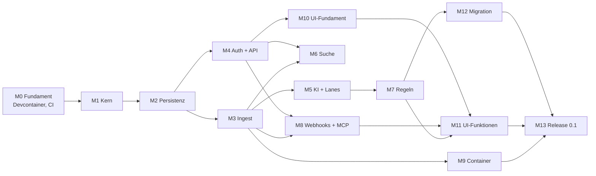

# Lekto – Umsetzungsplan

Stand: 06.10.2026 · Grundlage: [architektur.md](architektur.md)

Lekto wird API-first in 14 Meilensteinen (M0–M13) gebaut. Ab M3 lassen sich Dokumente per API einliefern; ab M11 ist Lekto über die Web-UI vollständig nutzbar; M13 schließt mit Release 0.1 und den ersten 100 Dokumenten ab.

## Abhängigkeiten

## Übersicht

| Kürzel | Meilenstein | Modell | Effort |
| --- | --- | --- | --- |
| M0 | Fundament: Devcontainer, CI, Konfiguration | Sonnet 5.5 | high |
| M1 | Domänenkern und Ports | Opus 5.5 | high |
| M2 | Persistenz (SQLite, Postgres), Jobs, Outbox | Opus 5.5 | high |
| M3 | Ingest-Pipeline: Speicher, OCR, Parsing, Worker, SSE | Opus 5.5 | high |
| M4 | Authentifizierung, Rechte, REST-API | Opus 5.5 | high (+ Review Fable 5.1 · high) |
| M5 | KI-Klassifizierung, Konfidenz, Lanes, Posteingang | Opus 5.5 | high |
| M6 | Suche mit Meilisearch | Sonnet 5.5 | high |
| M7 | Regel-Engine | Opus 5.5 | high |
| M8 | Webhooks und MCP-Server | Sonnet 5.5 | high |
| M9 | Lekto-Image mit s6-overlay | Sonnet 5.5 | high |
| M10 | Web-UI-Fundament und Design | Opus 5.5 | high |
| M11 | Web-UI-Funktionen | Sonnet 5.5 | medium (Regel-Baukasten: Opus 5.5 · high) |
| M12 | Migration aus Paperless-ngx | Sonnet 5.5 | high |
| M13 | Härtung und Release 0.1 | Fable 5.1 | high |
| M14 | Ingest-Graph: Knoten, Zustand je Knoten, Ereignisse, Sichtbarkeit in der UI (`ingest-v2.md`) | Opus 5.5 | high |
| M15 | Verstehen: Kennungen, Klassifikator, Nachbarn, Urteil, Titelmuster | Opus 5.5 | high |
| M16 | Lesen: Seitenbilder, VLM-Lesung, Bilder im Modellaufruf | Sonnet 5.5 | high |
| M17 | Grounding in der Prüfansicht (vorgezogen mit der neuen Dokumentansicht) | Sonnet 5.5 | medium |
| M18 | Eskalation und Kalibrierung | Opus 5.5 | high |
| 0.3.0 | Tags mit Arten, Gruppen, Themen, Spaces, Icons und Logos (fünf Pakete, siehe dort) | je Paket | high |

**Faustregel für die Modellwahl**

- **Opus 5.5** für alles, was Struktur festlegt oder schwer zu korrigieren ist: Kern, Datenmodell, Nebenläufigkeit, Sicherheit, Regel-Logik, Design-System.
- **Sonnet 5.5** für klar umrissene Integrationen nach festem Muster: Adapter, Container, Webhooks, Bildschirme nach Vorlage.
- **Fable 5.1** für unabhängige Prüfungen und lange, verifikationslastige Abschnitte (Sicherheits-Review, Release-Härtung).
- **Effort:** `medium` bei klarem Umfang, `high`, wenn Verifikation zählt (Default bei den meisten Modellen; Opus 5.5 startet bei `medium`). `xhigh`/`max` nur gezielt für einzelne harte Probleme, z. B. per `ultrathink` im Prompt. ([Quelle](https://code.claude.com/docs/en/model-config))
- Jeder Meilenstein beginnt mit einem Plan (Plan-Modus) und endet mit einem Review durch einen separaten Agenten, der die Umsetzung nicht geschrieben hat.

## Meilensteine

### M0 – Fundament: Devcontainer, CI, Konfiguration

**Ziel:** Entwickeln und Testen vollständig im Devcontainer; alle Abhängigkeiten starten mit.

- Devcontainer wie im Abschnitt [Devcontainer](#devcontainer) beschrieben.
- Mehrstufiges `Dockerfile` mit Ziel `dev` (Devcontainer) und `runtime` (M9), damit Entwicklung und Betrieb dieselben Systempakete nutzen.
- Konfiguration: `LEKTO_`-Variablen mit Pydantic Settings, `_FILE`-Variablen für Docker Secrets, Abbruch bei ungültiger Konfiguration.
- Composition Root als Gerüst; strukturiertes Logging.
- CI: Lint, Typen, Import-Verträge, Tests; Testmatrix SQLite/Postgres vorbereitet.

**Fertig, wenn:** „Reopen in Container" startet Postgres, Garage und Meilisearch; `uv run pytest` läuft im Container grün; CI ist grün.

**Modell:** Sonnet 5.5 · high – viel bekanntes Muster, aber die Garage-Initialisierung und Netzwerk-Details brauchen Verifikation.

### M1 – Domänenkern und Ports

**Ziel:** Fachlogik ohne jede Technik, vollständig testbar.

- Entitäten: Nutzer, Rolle, Dokument, Kontakt, Dokumenttyp, Tag, Felddefinition und -wert, Schublade, Freigabe, Lane, Verarbeitungsschritt.
- Rechteprüfung (Besitzer, Schublade, Freigabe lesen/schreiben).
- Zustandsautomat der Pipeline und Lane-Berechnung (schlechtestes Schrittergebnis).
- Ports mit echten async Signaturen; In-Memory-Adapter für jeden Port; Vertragstest-Suiten.

**Vorher klären:** Felddatentypen.

**Fertig, wenn:** Kern-Tests decken Rechte, Zustandsautomat und Lanes ab; Import-Verträge grün.

**Modell:** Opus 5.5 · high – legt die Struktur fest, auf der alles aufbaut.

### M2 – Persistenz, Jobs, Outbox

**Ziel:** Repository-, Job-Queue- und Event-Bus-Adapter auf SQLite und Postgres.

- SQLAlchemy 2 async (aiosqlite, asyncpg), Alembic-Migrationen für beide Datenbanken.
- Job-Tabelle mit Retries, Sperren und Idempotenz.
- Outbox-Tabelle, Verteilung im Prozess; Polling (SQLite) und optional `LISTEN/NOTIFY` (Postgres).

**Fertig, wenn:** Vertragstests aus M1 laufen gegen SQLite und Postgres grün.

**Modell:** Opus 5.5 · high – die Verträge aus M1 verlangen u. a. lückenlose Ereigniszustellung trotz abweichender Commit-Reihenfolge und sicheres paralleles Claimen; das auf zwei Datenbanken braucht Verifikation.

### M3 – Ingest-Pipeline

**Ziel:** Ein Dokument per API einliefern und bis „Parsen" verarbeiten.

- Objektspeicher-Adapter: Dateisystem und S3 (Garage); SHA-256 als Schlüssel, Dublettenprüfung.
- `POST /documents` mit `202 Accepted`; Worker-Dienst; Schritte Empfangen → OCR → Parsen mit Retries.
- OCRmyPDF- und Docling-Adapter, rechenlastig in eigenen Prozessen.
- Verarbeitungsprotokoll je Schritt; „Schritt wiederholen", „ab Schritt X neu verarbeiten".
- Server-Sent Events für Fortschritt.

**Übernommen aus M2** (bewusst offen gelassen, in M3 entscheiden bzw. umsetzen):

- Outbox-Verteilung: Der Worker ruft `EventBus.dispatch` per Polling auf. Postgres `LISTEN/NOTIFY` ist nicht umgesetzt; nur ergänzen, wenn die Latenz des Pollings stört.
- Aufräumen: Erledigte und aufgegebene Jobs sowie Outbox-Einträge, die alle Abonnenten erhalten haben, wachsen unbegrenzt. Aufräum-Job vorsehen.
- Lebenszyklus: Der Container schließt die Datenbank-Engine (`Database.dispose`) noch nicht; mit dem Start und Stopp von Worker und API regeln.
- Fehlgeschlagene Zustellungen werden unbegrenzt wiederholt (`event_retries` zählt die Versuche); Obergrenze oder wachsender Abstand bei Bedarf.
- Mehrere Dispatcher mit demselben Abonnentennamen stellen ggf. doppelt zu (mindestens einmal ist erlaubt).
- SQLite hat einen Schreiber: Ein Task darf keine zweite schreibende Unit of Work öffnen, solange seine erste offen ist (wartet sonst bis zum Busy-Timeout).

**Fertig, wenn:** Ein PDF und ein Foto laufen durch, Archiv-PDF und Docling-Ausgabe liegen im Speicher, ein abgebrochener Schritt lässt sich einzeln wiederholen.

**Modell:** Opus 5.5 · high – Idempotenz, Prozesse und Fehlerpfade.

### M4 – Authentifizierung, Rechte, REST-API

**Ziel:** Mehrbenutzerbetrieb und vollständige API für Stammdaten und Schubladen.

- Nativer Login (Argon2id), TOTP optional, Session-Cookie, persönliche API-Tokens mit Stufen.
- OIDC über Authlib, Verknüpfung mit lokalem Konto.
- Endpunkte: Nutzer (Admin), Stammdaten (Admin), Schubladen und Freigaben, Dokumente; OpenAPI-Spezifikation sauber gepflegt.

**Fertig, wenn:** Rechte-Tests zeigen, dass kein Nutzer fremde Dokumente ohne Freigabe sieht; OpenAPI ist vollständig.

**Modell:** Opus 5.5 · high; danach Sicherheits-Review mit Fable 5.1 · high – sicherheitskritisch, unabhängige Prüfung lohnt.

**Review und Behebung:** Das unabhängige Sicherheits-Review (`reviews/M4-security.md`) fand keine kritischen, einen hohen, vier mittlere und sieben geringe Befunde. Behoben vor dem Merge: Quellen-Drossel sperrt nur noch falsche Anmeldungen, `LEKTO_FORWARDED_ALLOW_IPS` ist mit `Secure`-Cookies Pflicht (M4-01); Fehlversuche werden atomar vor der Prüfung gezählt (M4-02); Admin-Endpunkte für Anmeldedaten nur per Session, kein Selbstbezug (M4-03); Request-Bodies begrenzt, `LEKTO_REQUEST_MAX_SIZE` (M4-04); dazu M4-06 bis M4-11. M4-05 (Token-Widerruf bei Passwortwechsel als Default) bewusst nicht geändert, M4-12 akzeptiert. Auftrag: `prompts/M4-fixes.md`.

### M5 – KI-Klassifizierung, Konfidenz, Lanes

**Ziel:** Dokumente werden klassifiziert und landen in Grün, Gelb oder Rot.

- LLM- und Embedding-Adapter (OpenAI-kompatibel), strukturierte Ausgabe mit festem Schema.
- Klassifizierung (Kontakt, Typ, Tags), Feldextraktion je Dokumenttyp.
- Konfidenz aus prüfbaren Fakten (Abgleich, Liste, Wert im Text); neue Gegebenheiten → Gelb.
- Posteingang (API): gelbe und rote Dokumente nur für den Besitzer.
- Kleiner Bewertungssatz aus Beispieldokumenten, um Modelle vergleichen zu können.

**Vorher klären:** LLM und Embedding-Modell, Konfidenz-Schwellen, Anzahl Retries.

**Fertig, wenn:** Der Bewertungssatz läuft reproduzierbar; Lanes stimmen mit den Erwartungen überein.

**Modell:** Opus 5.5 · high – Prompt- und Schema-Design, Bewertung.

**Review und Behebung:** Das Review durch einen separaten Agenten fand keine Blocker. Behoben vor dem Merge: Ein Kontakt wird nur grün, wenn er selbst im Text steht (ähnliche Schreibweise → Vorschlag); Belege nur als ganze Wörter, nur ISO-4217-Codes als Währung, Ja/Nein- und Auswahlwerte brauchen eine Belegstelle von mindestens 4 Zeichen; Tags aus der Klassifizierung werden ergänzt statt ersetzt; beim Bestätigen gelten Werte, die das Dokument schon hat, als entschieden (Vorschläge füllen nur leere Felder); die Bewertung zählt „grün mit falschem Wert" und bricht dann mit Status 1 ab. Als Restrisiko akzeptiert (Tobi, 07.10.2026): siehe „Übernommen aus M5" unter M6.

### M6 – Suche

**Ziel:** Hybride Suche, gefiltert nach Rechten.

- Meilisearch-Adapter, Index-Aktualisierung per Ereignis, vollständiger Neuaufbau per Job.
- Jede Suche gefiltert auf sichtbare Schubladen.

**Übernommen aus M5** (offen bzw. für spätere Meilensteine festgehalten):

- Embedding-Port und OpenAI-kompatibler Adapter existieren (`LEKTO_EMBEDDING_*`), werden aber noch nicht genutzt; die hybride Suche baut darauf auf.
- Echter Bewertungslauf (07.10.2026, Ergebnis in `architektur.md`): `qwen3:8b` mit 8192 Kontext, nur 5 der 28 Dokumente (Tobis Wahl). Offen: der volle Lauf (auf dem NUC etwa 1,5 bis 2,5 Stunden). Auf dem NUC liegt dafür die Modellvariante `qwen3:8b-ctx8k` (`num_ctx` 8192); für den Betrieb `OLLAMA_CONTEXT_LENGTH=8192` auf dem NUC setzen.
- Laufzeit 3 bis 10 Minuten pro Dokument auf der CPU des NUC: für die Migration (M12) mit vielen Dokumenten einplanen (Klassifizierung abschaltbar oder nachgelagert?).
- `bge-m3` ist auf dem NUC geladen, aber ungeprüft; die Wahl in M6 bestätigen.
- Restrisiko (akzeptiert): Eine Anweisung im Dokumenttext kann einen falschen, aber vorhandenen Kontakt grün machen, wenn der Text diesen Kontakt nennt. Tags aus der Klassifizierung werden ohne Textprüfung gesetzt. Für M7: Regeln dürfen Kontakt und Tags, die das Modell gesetzt hat, nicht allein vertrauen.
- Für M7: `inbox.field_checks(log)` liefert die Vorschläge und Prüfungen des letzten Modelllaufs je Feld; Bestätigungen stehen mit `model_version="person"` im Verarbeitungsprotokoll. Ohne Regeln setzt `confirm` nach dem Bestätigen bei `apply_rules` fort.
- Bestätigen ab `extract_fields` ersetzt die Felder, die der Besitzer eingetragen hat (dokumentiert, bewusst so).
- Feldprüfungen werden als bestanden protokolliert, auch wenn die Änderung danach an fehlenden Stammdaten scheitert (der Schritt wird dann unsicher).
- Fehlender Test: Klassifizierung auf Postgres im Integrationstest (bisher nur Speicher-Adapter und Rundlauf des Status `review`).

**Fertig, wenn:** Rechte-Tests für die Suche grün; Neuaufbau aus Datenbank und Speicher funktioniert.

**Modell:** Sonnet 5.5 · high – bekannte Integration, der Rechtefilter braucht Sorgfalt.

**Umsetzung und Review:** Index-Port `SearchIndex` mit Speicher- und Meilisearch-Adapter (httpx2, kein SDK), Vektoren über den Embedding-Port (`userProvided`), Abschnitte statt eines Vektors je Dokument, `GET /documents/search`, `POST /search/reindex`, Befehl `reindex`, `evaluate-search` mit 48 Anfragen. Das Review durch einen separaten Agenten fand keine Rechte-Lücke. Behoben vor dem Merge: Embedding-Ausfall hält ein Dokument nicht mehr aus dem Index; Umbenennungen während eines Neuaufbaus gehen nicht verloren; Abgleich bei jedem Start des Workers; Vektoren falscher Länge fallen auf Wörter zurück; Paging mit Bedeutung; ein Index ohne Einstellungen wird neu eingerichtet; `/health` meldet eine gestörte Suche als `degraded` (Tobi, 07.10.2026). Embedding-Modell: `snowflake-arctic-embed2` (Tobi, 07.10.2026, Bewertung in `architektur.md` unter „Suche“). Der Test der Klassifizierung auf SQL-Persistenz (Übergabe aus M5) liegt in `tests/integration/test_classification_evaluation.py`.

### M7 – Regel-Engine

**Ziel:** Globale und Nutzer-Regeln wie spezifiziert.

- Bedingungsbaum, Operatoren, Aktionen, Priorität, Konflikte → Gelb (auch Regel gegen LLM).
- Versionierung, Protokoll, Probelauf bei Dokumentänderungen.
- Rückwirkendes Anwenden: Ermittlung der betroffenen Dokumente und Ausführung als Job (Auswahl in der UI folgt in M11).

**Fertig, wenn:** Tests decken Konflikte, Schleifenschutz und Rechtegrenzen globaler Regeln ab.

**Übernommen aus M6** (offen bzw. für spätere Meilensteine festgehalten):

- Jede Dokumentänderung (auch durch Regeln oder rückwirkendes Anwenden) löst über das Ereignis `document.updated`/`lane_changed`/`filed` einen Index-Job aus; Regeln müssen nichts am Index tun. Ändert eine Regel viele Dokumente, entstehen viele Index-Jobs und Embeddings: auf dem NUC etwa 0,6 s je Abschnitt.
- Für M8 (MCP-Tool `search`): `SearchService.search(actor, text, filter, offset=, limit=, semantic_ratio=)` prüft Rechte selbst; der MCP-Server ruft ihn mit dem Besitzer des Tokens auf. Eine Seite kann weniger Treffer als `limit` enthalten.
- Die hybride Suche hat keine Schwelle: Meilisearch liefert auch bei Unsinn die nächsten Nachbarn. Eine Schwelle (`rankingScoreThreshold`) wäre eine eigene Entscheidung, am besten mit dem Bewertungssatz erweitert um Anfragen ohne Treffer.
- Der Neuaufbau belegt eine Worker-Schleife; seine Leihe (`LEKTO_SEARCH_REBUILD_TIMEOUT`) wird nicht verlängert. Der Befehl `reindex` und ein laufender Neuaufbau-Job dürfen nicht gleichzeitig laufen (nur in der Dokumentation, nicht erzwungen).
- Ein Modellwechsel oder eine andere Vektorlänge braucht einen Neuaufbau; der Adapter bricht ab, wenn ein Index mit anderem Embedder Dokumente enthält.
- `LEKTO_SEARCH_LOCALES` prüft nur das Format, nicht ob Meilisearch die Sprache kennt.
- Nicht in dieser Umgebung geprüft (läuft in der CI): der Rundlauf `test_search_end_to_end` mit Postgres und S3 und die Postgres-Variante von `test_classification_evaluation`.
- Für `evaluate-search` ist `LEKTO_EMBEDDING_DIMENSIONS` irgendein Wert, weil die Konfiguration zuerst geprüft wird; Präfixe gelten für alle Modelle eines Laufs.

**Modell:** Opus 5.5 · high – viele Randfälle, Wechselwirkung mit Rechten.

**Review und Behebung:** Das Review durch einen separaten Agenten fand keine Blocker. Behoben vor dem Merge: Rückwirkend gilt Ablegen in eine geteilte Schublade auf unbestätigte Modellwerte als Konflikt (nur mit Annahme); eine beim Upload oder durch Verschieben gewählte Schublade und früher von der Person gesetzte Tags und Felder ändert keine Regel mehr (Protokoll `person:drawer`); Bestätigen beantwortet nur die gesehenen erzwungenen Prüfungen; Bestätigen verlangt eine Schublade, wenn die Ablage sonst wieder scheitert; ein Bearbeiter, dem eine Änderung die Sicht nimmt, erhält nur `id` und `access: null`; Regex-Suchen teilen sich ein Zeitbudget (2 s je Lauf, 20 s je Vorschau-Seite); rückwirkende Anwendungen enden bei einem unerwarteten Fehler; SQL lädt nur die aktuelle Regelversion.

### M8 – Webhooks und MCP-Server

**Ziel:** Externe Systeme informieren und Claude anbinden.

- Webhook-Abonnements pro Nutzer, schlanke Ereignisse, HMAC-SHA256, Retries, Zustellprotokoll.
- MCP-Server über HTTP mit API-Token: `search`, `get_document`, `get_text`, `update_metadata`, `list_tags`.

**Fertig, wenn:** Ein Test-Empfänger erhält signierte Ereignisse; ein lokaler MCP-Client kann suchen und Metadaten ändern.

**Übernommen aus M6 und M7** (offen bzw. für spätere Meilensteine festgehalten):

- Aus M6: Für das MCP-Tool `search` prüft `SearchService.search(actor, text, filter, offset=, limit=, semantic_ratio=)` die Rechte selbst; der MCP-Server ruft ihn mit dem Besitzer des Tokens auf. Eine Seite kann weniger Treffer als `limit` enthalten. Die übrigen Punkte aus „Übernommen aus M6" unter M7 (Schwelle der hybriden Suche, Neuaufbau, Modellwechsel, Locales, Postgres-Läufe in der CI) gelten weiter.
- MCP-Tool `update_metadata`: über `DocumentService.change_metadata(actor, id, changes)` gehen, nicht über `update_metadata`; nur so laufen die Änderungs-Regeln (Flanke), und das Ergebnis enthält den Regelbericht (`rules`, nur für den Besitzer) und `access` (None, wenn die Regeln das Dokument aus der Sicht des Aufrufers abgelegt haben: dann nichts weiter zurückgeben, wie REST).
- Webhooks: `document.filed` kommt auch, wenn eine Regel in `apply_rules` oder `confirm(drawer_id)` das Dokument verschiebt, solange es noch keine Lane hat (früher als die endgültige Ablage). Für Abonnenten zählt erst `document.filed` bei grüner Lane; ggf. im Ereignis die Lane mitgeben oder `move_to` vor der Ablage kein `filed` melden lassen.
- Webhooks: Regeländerungen und rückwirkende Anwendungen erzeugen keine eigenen Ereignisse; Fortschritt nur per `GET /rule-applications/{id}`.
- Offen aus M7: Kein In-Memory-Adapter für `PatternMatcher` (der Speicher-Container nutzt den `regex`-Adapter, der ohne Dienst läuft). `RuleApplication` schreibt `documents`/`skipped` je Dokument neu (quadratisch, bei `LEKTO_RULES_APPLY_MAX_DOCUMENTS` nahe 100 000 relevant). Kleines Zeitfenster: Text und Muster werden vor der Transaktion für die dann gesehenen Regeln vorbereitet; eine dazwischen aktivierte Textregel wird ohne Text ausgewertet. Keine Obergrenze für Regeln je Nutzer (das Zeitbudget begrenzt die Kosten).
- Nicht in dieser Umgebung geprüft (läuft in der CI): Regel-Vertragstests und `test_rules_end_to_end` auf Postgres.

**Modell:** Sonnet 5.5 · high.

**Umsetzung und Review:** Webhooks (`/webhooks`, Zustellprotokoll, `POST /webhooks/{id}/test`): Abonnent `webhooks.fanout` und Job `webhooks.deliver` im Worker, Rechte beim Einreihen und vor jedem Versuch (sonst `dropped`), `document.deleted` an die Leser zum Zeitpunkt des Löschens (`DocumentDeleted.readers`, auch für SSE), Signatur nach Standard Webhooks (`webhook-id`, `-timestamp`, `-signature`, zwei Signaturen während der Übergangszeit nach dem Erneuern), Geheimnis AES-GCM-verschlüsselt, Wiederholung 10 Versuche ab 30 s verdoppelnd bis 1 h, Abschalten nach 20 aufgegebenen in Folge, Aufräumen des Protokolls über `LEKTO_RETENTION`. MCP unter `/api/v1/mcp` mit dem offiziellen SDK (`mcp==2.3.0`), fünf Tools, Namen statt IDs, Bearer-Token mit Stufen. Admins haben alle Rechte an allen Webhooks: lesen, ändern, löschen, testen, Geheimnis erneuern (Tobi, 08.10.2026); ein von ihnen erneuertes Geheimnis sehen sie einmal. Das Review durch einen separaten Agenten fand keine Rechte-Lücke bei Ereignissen und MCP. Behoben vor dem Merge: Der HTTP-Client protokollierte die volle Ziel-URL (kann ein Zugangsdatum enthalten) – die Logger `httpx`, `httpx2` und `httpcore` zeigen nur noch Warnungen; `dropped` nennt für gelöschte und nicht mehr sichtbare Dokumente denselben Grund; Geheimnisse stehen nicht mehr in `repr`.

### M9 – Lekto-Image mit s6-overlay

**Ziel:** Ein betriebsfertiges Image.

- `runtime`-Ziel im Dockerfile: Debian slim, OCRmyPDF-Abhängigkeiten, Docling mit PyTorch (CPU).
- s6-Dienste: `init-lekto`, `init-migrations`, `svc-api`, `svc-worker`; `LEKTO_ROLE`, `PUID`/`PGID`, Healthchecks.
- Beispiel-Compose für SQLite + Dateisystem und für Postgres + Garage.
- CI baut Images für amd64 und arm64.

**Vorher klären:** Backup-Strategie.

**Übernommen aus M8:**

- Der Worker braucht jetzt `LEKTO_SECRET_KEY` (Webhook-Geheimnisse); die Einstellungen verlangen ihn für jede Rolle, auch für `check` und `migrate`. Das Image muss ihn (oder `LEKTO_SECRET_KEY_FILE`) allen s6-Diensten geben.
- Neue Variablen: `LEKTO_WEBHOOKS_PER_USER`, `LEKTO_WEBHOOK_SECRET_GRACE`, `LEKTO_WEBHOOK_TIMEOUT`, `LEKTO_WEBHOOK_MAX_ATTEMPTS`, `LEKTO_WEBHOOK_RETRY_DELAY`, `LEKTO_WEBHOOK_DISABLE_AFTER`, `LEKTO_WEBHOOK_CONCURRENCY`, `LEKTO_MCP_ENABLED`, `LEKTO_MCP_TEXT_MAX`; in die Beispiel-Compose-Dateien und die Doku des Images aufnehmen.
- MCP liegt im API-Prozess unter `/api/v1/mcp` (Streamable HTTP, zustandslos). Ein Reverse Proxy darf es nicht puffern oder auf eine Antwortzeit begrenzen; Anfragen sind einfache `POST`s.
- Die Worker-Rolle stellt Webhooks zu und braucht Netzzugang zu den Zielen (auch im eigenen Netz, das ist entschieden). Weiterleitungen werden nie verfolgt, Proxy-Umgebungsvariablen nie ausgewertet.
- Ein toter Empfänger belegt eine Zustellschleife bis zum Zeitlimit je Versuch (`LEKTO_WEBHOOK_CONCURRENCY`); die Pipeline bleibt unberührt.
- Offen (M8): `POST /webhooks/{id}/test` ohne Ratenbegrenzung (ein Token mit Schreibstufe kann interne Adressen anstoßen, akzeptiert); `Webhook.previous_secret` bleibt nach Ablauf der Übergangszeit verschlüsselt in der Datenbank bis zum nächsten Erneuern; Admins sehen in Zustellprotokollen Dokument-IDs und die Ziel-URL fremder Webhooks (entschieden, so gewollt).
- Nicht in dieser Umgebung geprüft (läuft in der CI): die Vertragstests für Webhooks auf Postgres, die Migration `v0006` auf Postgres, ein echter MCP-Client (Claude Code, Inspector) gegen einen laufenden API-Prozess.

**Fertig, wenn:** Beide Beispiel-Stacks starten, migrieren und verarbeiten ein Dokument.

**Modell:** Sonnet 5.5 · high.

**Umsetzung und Review:** Stufen `deps` (gesperrte Abhängigkeiten ohne Dev-Gruppe), `app`, `s6` (s6-overlay 3.2.3.2, SHA-256 je Architektur) und `runtime`; `docling-models` baut auf `deps` (ein `uv sync` für `dev` und `runtime`). Dienste `init-lekto`, `init-migrations`, `svc-api`, `svc-worker` unter `deploy/image/rootfs`; die Rolle (`LEKTO_ROLE`) prüft jedes Dienstskript (`s6-svc -Od .`, s6-rc ist statisch); der Worker wartet in `svc-worker` mit dem neuen, schreibfreien Befehl `check-schema --wait 600` auf das Schema (nicht in `init-migrations`: ein Oneshot ließe sich mit `docker stop` nicht unterbrechen; Review-Befund). Lekto-Prozesse laufen über `lekto-run` als `PUID`:`PGID` (Default 1000, `0` abgelehnt, kein passwd-Eintrag); `/data` ist das Volume (Pfade per Image-`ENV`, `settings.py` unverändert); `init-lekto` lehnt relative Pfade, `/` und Systemordner ab. Herunterfahren: Worker 30 s, `S6_SERVICES_GRACETIME` 40 s, `S6_KILL_GRACETIME` 1 s (s6 wartet sie immer ganz ab), Compose `stop_grace_period` 60 s. Healthcheck: API über `/api/v1/health`, Worker über `s6-svstat` (mindestens 10 s oben) und eine Marke, dass das Warten auf das Schema vorbei ist. Hilfsbefehl `lekto` (`docker exec … lekto reindex`). Beispiel-Stacks `deploy/compose.sqlite.yml` und `compose.postgres.yml` mit Secrets als Dateien (`create-secrets.sh`), `deploy/test-image.sh` (31 Prüfungen, auch in der CI; seit M13 über 40), `deploy/README.md` mit Betrieb, Reverse Proxy, Webhooks, MCP, Backup und Wiederherstellung. Größe laut `docker image inspect` in der CI: 3,19 GB (amd64), 3,02 GB (arm64); OrbStack auf dem Mac zeigt 4,57 GB.

Echtläufe auf Tobis Mac (Ollama am NUC, `qwen3:8b-ctx8k` und `snowflake-arctic-embed2`): beide Stacks, je zwei PDFs (gerenderte Stromrechnung und Handwerkerrechnung aus dem Bewertungssatz) bis Lane Gelb in 66 bis 96 s (Kontakt und Typ unbekannt, Stammdaten leer), Suche semantisch; MCP gegen den laufenden Container mit dem MCP-SDK-Client (alle fünf Tools, `update_metadata` eingeschlossen) und mit Claude Code (`claude -p` mit `--mcp-config`); Backup und Wiederherstellung mit beiden Stacks durchgespielt (Dokument, Original, Archiv und Suche nach `reindex` wieder da). CI-Zeiten des Image-Jobs (Pull Request, je Architektur nativ): kalt 4:05 bis 4:17 (Bau 2:27 bis 2:28, Test 75 bis 83 s); mit GHA-Layer-Cache nicht schneller (Wiederherstellen rund 1 min, Schreiben aus `main` weitere 2 min), deshalb ohne Cache und nur im Pull Request. Pull Requests ohne Image-Pfad bleiben unberührt (Job `changes` 4 bis 5 s, `backend` 1:00, `integration` 2:47). Das Review durch einen separaten Agenten fand keine Lücke bei Geheimnissen (alle Beispielgeheimnisse in Logs und `docker inspect` gesucht) und Rechten (nur `s6-supervise` läuft als root). Behoben vor dem Merge: das Warten des Workers (siehe oben), Pfadprüfung in `init-lekto`, Angaben der Backup-Doku (Originale unveränderlich, Ableitungen nicht; Wiederherstellung ersetzt Objekte; `alpine` gepinnt), Hinweis, Geheimnisse nur als `_FILE` zu übergeben.

### M10 – Web-UI-Fundament

**Ziel:** Cleanes, modernes Grundgerüst, auf dem alle Bildschirme aufbauen.

- SvelteKit (statisch), Tailwind, shadcn-svelte; TypeScript-Client aus OpenAPI generiert.
- Gestaltungsrichtung, Farben, Typografie, Dark Mode; Login inkl. TOTP; Navigation.

**Fertig, wenn:** Login funktioniert, Design-System steht, Uvicorn liefert die gebaute UI aus.

**Modell:** Opus 5.5 · high – Gestaltungsentscheidungen prägen die ganze UI.

**Übernommen aus M9:**

- Die UI kommt ins Image: eine Node-Stufe im `Dockerfile` baut die statischen Dateien, die Stufe `runtime` kopiert sie; `.dockerignore` lässt `web/` durch (heute nur `backend/pyproject.toml`, `uv.lock`, `README.md`, `src/`, `deploy/image/`). Wie Uvicorn sie ausliefert (Pfad, Einstellung `LEKTO_…`, Vorrang der API-Pfade unter `/api/v1`), entscheidet M10; `deploy/README.md` und der Reverse-Proxy-Abschnitt (Cache-Header, Pfade) nachziehen.
- CI: Der Job `image` löst bei `web/` heute nicht aus (Pfade in `changes`: `Dockerfile`, `.dockerignore`, `deploy/` ohne Markdown, `backend/pyproject.toml`, `backend/uv.lock`, `ci.yml`). Sobald die UI im Image steckt, `web/` (ohne Tests und Markdown) und die Lock-Datei der UI aufnehmen und `deploy/test-image.sh` um einen Abruf der Startseite erweitern.
- Das Betriebsbild für die UI-Entwicklung bleibt der Devcontainer; das Image wird nur gebaut, nicht für Vite genutzt.
- Offen aus M8 (unverändert weitergetragen): `POST /webhooks/{id}/test` ohne Ratenbegrenzung, `Webhook.previous_secret` bleibt nach der Übergangszeit verschlüsselt liegen, Admins sehen Dokument-IDs und Ziel-URL fremder Webhooks (entschieden); dazu die Punkte aus „Übernommen aus M6 und M7" (Schwelle der hybriden Suche, Neuaufbau-Leihe, Modellwechsel, `LEKTO_SEARCH_LOCALES`, `PatternMatcher` ohne In-Memory-Adapter, quadratisches Schreiben in `RuleApplication`, Zeitfenster bei Textregeln, keine Obergrenze für Regeln je Nutzer).

**Umsetzung und Review:** SvelteKit 3.0.1 als Single-Page-App (`adapter-static`, Fallback `index.html`, kein SSR) unter `/ui`, Svelte 5, Vite 8, TypeScript 6, Tailwind 4, shadcn-svelte (bits-ui), Paraglide JS 2 (Englisch als Basis, Deutsch; Wahl im Browser gespeichert, Formate nach Browser-Region, sonst de-DE/en-US), Schriften Geist und Geist Mono lokal, alles exakt gepinnt (`pnpm-lock.yaml`, pnpm 12.9.1, Node 24.21.0). Gestaltung Richtung B „Papier" (Tobi, 08.10.2026; Artifact mit drei Richtungen): Petrol `#0d6b6b` als einziger Akzent, Papierweiß, runde Formen, Kopfnavigation mit Pillen, Lanes „Erledigt/Prüfen/Eingreifen/Läuft" immer mit Symbol und Wort. Client: `openapi-typescript` aus dem eingecheckten `web/openapi.json` (Befehl `python -m lekto.composition.openapi`, ein Backend-Test vergleicht) und `openapi-fetch` mit eigenem `fetch` (Cookie der Seite, `X-CSRF-Token` nur bei Änderungen, ein Wiederholversuch bei veraltetem Token, 401 außerhalb der Anmeldung → Login mit `next`). Anmeldung mit Passwort, TOTP, Wiederherstellungscode und OIDC-Knopf (nur wenn eingerichtet); `next` nur auf Seiten unter `/ui/`. Auslieferung: `LEKTO_UI_DIR` (im Image `/opt/lekto/ui`; gesetzt ohne `index.html` ist ein Konfigurationsfehler), `adapters/inbound/rest/ui.py` nach allen API-Routen, `/` → 302 `/ui/`, `/ui` → 308; Dateien des Builds, sonst `index.html` für Seitenpfade ohne Endung, 404-Problem für fehlende Dateien, alles unter `_app/`, versteckte Namen, Pfade außerhalb; nur GET/HEAD. `_app/immutable` ein Jahr `immutable`, alles andere `no-cache` mit ETag/304. CSP per Meta-Tag aus SvelteKit (Hash-Modus), als Header `frame-ancestors 'none'`, `nosniff`, `Referrer-Policy: same-origin`. Image: Stufe `web` auf der Bauplattform, `runtime` ohne Node. CI: Job `web` (ESLint, Prettier, svelte-check, Vitest, Client-Abgleich, Build), nur bei `web/`; `image` auch bei `web/` ohne Tests. Tests: 172 Vitest (u. a. kein fester Text im Markup, gleiche Schlüssel und Platzhalter in beiden Sprachen, `next`-Prüfung), 30 Backend-Tests der Auslieferung, Playwright-Rauchtest nur lokal (gelaufen: Anmeldung mit TOTP, Navigation, Neuladen, Abmelden, Rücksprung nach Sitzungsende). Das Review durch einen separaten Agenten fand keinen offenen Weg aus `next` heraus und keinen Pfadausbruch. Behoben vor dem Merge: die CSRF-Wiederholung lief nach einer Anmeldung in einem anderen Tab als die andere Person (jetzt nur bei gleicher Nutzer-ID, sonst neu laden); API-Änderungen ohne UI-Bezug lösten den Image-Job aus (`openapi.json`, `schema.ts` ausgenommen); Tastaturfokus zu blass (jetzt 2-px-Umriss in Petrol mit Abstand, 6:1); Fehler beim Laden einer Seite zeigten Englisch „Internal Error“ ohne das Detail der API (`hooks.client.ts`; dabei gefunden: `openapi-fetch` liest den Fehlerkörper selbst, `apiError` nimmt ihn jetzt entgegen); doppelte Schrägstriche umgingen die Regeln für `_app/`; 405 hatte den Titel „405“; Fokus und `aria-describedby` auf der Anmeldeseite; CSRF-Kopf nur an die eigene Seite.

### M11 – Web-UI-Funktionen

**Ziel:** Lekto vollständig über die Oberfläche nutzbar.

- Dokumentliste und -detail mit PDF.js, Upload, Fortschritt per SSE.
- Posteingang mit Lanes, Bestätigen und Korrigieren.
- Schubladen und Freigaben, Stammdaten (Admin), Webhooks, API-Tokens, Einstellungen.
- Regel-Baukasten mit Probelauf und Auswahldialog für rückwirkendes Anwenden.

**Übernommen aus M10:**

- Gerüst: `web/README.md`. Neue Seiten liegen unter `src/routes/(app)/…` (Layout prüft die Sitzung), Bereiche in `src/lib/sections.ts`; die Platzhalterseiten (`Placeholder.svelte`) werden ersetzt. Bausteine aus shadcn-svelte per CLI (`pnpm dlx shadcn-svelte@1.7.0 add …`, `components.json`), danach Texte über Paraglide; die Bausteinseite `/ui/dev/components` (nur `pnpm dev`) zeigt den Stand.
- Importe heißen `#lib/…` mit Dateiendung (SvelteKit 3 hat `$lib` entfernt; `imports` in `package.json`), `$app/env` statt `$app/environment`.
- Jeder sichtbare Text in `messages/{en,de}.json`; die Tests schlagen bei festem Text im Markup (auch `aria-label`, `title`, `placeholder`, `alt`) und bei fehlenden Schlüsseln an. Fehlertexte der API (Problem-Details) bleiben, wie die API sie schreibt.
- API-Aufrufe nur über `api` aus `#lib/api/client.ts`; Fehler mit `describeError`/`reportError` (`#lib/errors.ts`), 429 nennt die Wartezeit. Nach einer API-Änderung `web/openapi.json` neu schreiben und `pnpm gen:api`.
- Formate über `formatDate`, `formatNumber`, `formatMoney` (`#lib/i18n.ts`); Lanes über `LaneBadge`.
- CSP: `img-src` erlaubt `data:` und `blob:` (PDF-Vorschau), `connect-src 'self'` (SSE unter `/api/v1/events` passt). PDF.js braucht vermutlich einen Worker (`worker-src`) und darf kein CDN nutzen; die Direktiven stehen in `web/vite.config.ts`.
- Neue Abhängigkeiten nur nach Absprache und exakt gepinnt; pnpm 12 lehnt Pakete jünger als einen Tag ab (`minimumReleaseAge`).
- Nicht gebaut: Superforms, Zod, TanStack (E6); bei Formularen mit vielen Feldern neu entscheiden.
- Beobachtet: Bricht die OIDC-Anmeldung beim Anbieter ab, zeigt `/api/v1/auth/oidc/callback` ein Problem-JSON statt einer Seite der UI.
- Seitenpfade dürfen im letzten Abschnitt keinen Punkt enthalten (`/ui/users/john.doe`): die Auslieferung hält ihn für eine Datei und antwortet 404. IDs (UUID) sind unkritisch; Namen nicht als Pfadparameter.
- CSP: `style-src 'unsafe-inline'` ist weiter als nötig; laut Review erzeugt das Bündel keine `<style>`-Elemente, `style-src 'self'; style-src-attr 'unsafe-inline'` könnte reichen (im Browser prüfen, auch mit PDF.js).
- Playwright läuft nur lokal (`pnpm e2e`, `web/README.md`), die CI installiert keine Browser.

**Fertig, wenn:** Alle Abläufe aus dem Architektur-Dokument sind in der UI erreichbar.

**Modell:** Sonnet 5.5 · medium für Bildschirme nach Vorlage; Regel-Baukasten mit Opus 5.5 · high.

**Umsetzung und Review (M11a, ohne Regelbereich):** Tobis Entscheidungen (08.10.2026): Regeln komplett M11b (der Probelauf für Dokumente gehört zu M11a); Formulare ohne Superforms, Zod, TanStack; QR-Code für TOTP mit `uqr` 0.1.3 als SVG; OIDC-Fehler leitet auf `/ui/login?error=<code>` (Codes `denied`, `failed`, `conflict`, `provider`; bei verknüpfendem Aufruf mit Sitzung auf `/ui/settings?error=<code>`); Dokumentliste ohne Sortierung, „Mehr laden“; Suche ohne Gewichtungsregler; keine neue Design-Runde. Neue Abhängigkeiten: `pdfjs-dist` 6.4.299 (Legacy-Build, weil der normale `Map.getOrInsertComputed` braucht), `uqr` 0.1.3. Umgesetzt: Dokumentliste mit Filtern und Ereignisstrom (eine `EventSource`, Neuladen nach Wiederverbindung), Upload (3 parallel, nur Status „lädt hoch“, dann SSE), Detail mit schlankem PDF-Viewer, Bearbeiten mit Probelauf vor dem Speichern, Verarbeitungsprotokoll, Wiederholen, Neuverarbeiten, Verschieben, Löschen; Posteingang mit Zähler und Bestätigen/Korrigieren; Suche; Schubladen mit Freigaben; Stammdaten (Kontakte, Dokumenttypen, Schlagwörter, Felder); Benutzerverwaltung; Webhooks mit Zustellprotokoll; Einstellungen (Passwort, TOTP mit QR und Wiederherstellungscodes, OIDC verknüpfen, andere Sitzungen beenden, API-Tokens). Einzige API-Änderung: der OIDC-Callback (mit Test, `openapi.json` und Client neu erzeugt). CSP: `style-src 'self'` plus `style-src-attr 'unsafe-inline'` und `worker-src 'self'`, im Browser mit PDF.js ohne Verstöße; `wasm-unsafe-eval` war nicht nötig. Tests: 259 Vitest, 1973 Backend-Unit-Tests, Playwright lokal (`areas.spec.ts` öffnet alle Bereiche ohne Konsolenfehler und legt Kontakt, Schublade, Webhook und Token an und wieder weg). Das Review durch einen separaten Agenten fand und behoben vor dem Merge: `loading` blieb nach `refresh()` während `more()` für immer gesetzt (Test ergänzt); Webhook-Test und Geheimnis erneuern sowie das Verarbeitungsprotokoll wurden auch gezeigt, wo die API „nur Eigentümer“ sagt; das Formular wurde bei jedem Ereignis zurückgesetzt und löschte Eingaben (jetzt nur, wenn nichts geändert ist); Admins bekamen für Upload und Prüfen Schubladen angeboten, in die sie nicht schreiben dürfen; späte Antworten eines früheren Dokuments konnten das aktuelle überschreiben; Uploads blieben nach Abmelden stehen; Neustart des Ereignisstroms nach Abmeldung; zwei Layouts des PDF-Viewers konnten sich überholen; Namensabruf der Webhook-Seite ohne Fehlerbehandlung.

**Übergaben an M11b:**

- Die Seite `/ui/rules` ist weiter ein Platzhalter (`Placeholder.svelte`, Eintrag in `src/lib/sections.ts`). Wiederverwendbar: `PagedList` (`paging.svelte.ts`), `NativeSelect`, `ConfirmDialog`, `NameDialog`, `FieldValueInput`, `ReviewFieldInput`, `loadLookup` (Kontakte, Typen, Schlagwörter, Felder, Schubladen, Benutzer; `masterdata.svelte.ts`), `permissions.ts`, `events.svelte.ts` (`generation` nach Wiederverbindung), `fieldErrors` (422-Details je Feld) und der Probelauf-Dialog des `DocumentEditor` als Vorlage für die Vorschau von Regeln.
- Texte: `web/messages/{en,de}.json`, Hilfsskript ist nicht eingecheckt; Schlüssel in beiden Sprachen, sonst schlägt der Test an.
- Rechte zeigt die UI nur als Komfort, die API entscheidet. Laut Endpunktbeschreibung sind „Test senden“ und „Geheimnis erneuern“ eines Webhooks sowie das Verarbeitungsprotokoll eines Dokuments nur für den Eigentümer, auch für Admins; `GET /drawers` liefert Admins nur eigene und freigegebene Schubladen. Das passt nicht zu „Admins haben alle Rechte und sehen alles“: bei Bedarf in der API ändern und die UI nachziehen (`permissions.ts`, `webhooks/+page.svelte`).
- Nur mit abgefangenen API-Antworten geprüft (lokal gibt es weder Meilisearch noch ein Modell): die gelbe Prüfansicht mit Vorschlägen, Suchtreffer, die rote Spur. Beim ersten Lauf mit echten Diensten ansehen.
- Offen: `img-src` erlaubt weiter `blob:`; wahrscheinlich überflüssig, weil kein Code Blob-URLs erzeugt (mit einem PDF mit JBIG2/JPX prüfen, dann streichen). Kein Byte-Fortschritt beim Upload (nur Status). Für Währung gibt es keinen Feldtyp, die API speichert sie je Wert.
- Unverändert weitergetragen: die Punkte aus „Übernommen aus M10“ (offen aus M8, M6 und M7, M9).

**Umsetzung und Review (M11b):** Tobis Entscheidungen (08.10.2026): E1 Admins haben alle Rechte und sehen alles; E2 Probelauf vor dem Einschalten (Regel wird ausgeschaltet gespeichert); E3 Konflikte nie vorausgewählt, eigenes Häkchen (`accept_conflicts`); E4 Versionen nur ansehen; E5 kein JSON-Editor; F1a SSE für Admins zu allen Dokumenten, Webhooks nur Reichweite des Besitzers; F2a Schublade einer Nutzer-Regel gegen deren Besitzer; F3a Listen zeigen die Reichweite, Admins schalten mit `all_users` um; F4a Admins legen in jede Schublade ab, auch beim Bestätigen; F5a neue Regel per POST, dann PATCH `enabled=false`. Umgesetzt: Rechte in `permissions.py` (`can_control_document`, Reichweite für Listen und Webhooks), Ports `DocumentRepository.query` und `Visibility.everything` mit Vertragstests, `all_users` an Dokumentliste, Posteingang und Suche, Admins sehen und verwalten alle Schubladen, Regeln und Webhooks; `architektur.md` angepasst. Fehler beim Speichern einer Regel nennen den Ort. UI: Umschalter „Alle Nutzer“, Besitzer an fremden Dokumenten, fremde Schubladen; Regelliste, Baukasten (verschachtelte Gruppen bis Tiefe 5, alle Felder, Operatoren und Aktionen, Platzhalter, Prüfung vor dem Speichern, API-Fehler am Block), Ansicht, Versionen, Probelauf mit Auswahl, Fortschritt und Ergebnis. Keine neue Abhängigkeit, CSP unverändert. Tests: 300 Vitest (u. a. Hin- und Rückweg jeder Definition), 2049 Backend-Unit-Tests, Playwright lokal grün (`rules.spec.ts`: bauen, Probelauf, anwenden, ändern, Version 1 lesen, unverändert speichern ohne neue Version, abgelehnter Schalter, löschen; `areas.spec.ts`). Das Review durch einen separaten Agenten fand keine Lücke bei Rechten, Suche, SSE und Webhooks; behoben vor dem Merge: Bestätigen durch Admins prüfte gegen den Besitzer (gegen F4a; jetzt jede Schublade, die Ablage akzeptiert die Wahl des Admins); Regelseiten luden Regel und Probelauf doppelt und konnten Eingaben verwerfen; ein abgelehnter Schalter blieb umgelegt; die Prüfung im Browser lehnte Datums- und Zahlschreibweisen, lange Texte und doppelte Listenwerte ab, die die API annimmt; Fehlerzuordnung bei 404 für Dokumenttypen, bei Pydantic-Unions und bei „; “ im Text; `?all=1` galt auch für Nicht-Admins; späte Antworten der Regelliste; stilles Scheitern beim Wiedereinschalten.

### M12 – Migration aus Paperless-ngx

**Ziel:** Bestehendes Paperless-Archiv übernehmen, nur über die Lekto-API.

- CLI liest die Paperless-REST-API, schreibt über die Lekto-API.
- Abbildung von Korrespondenten, Typen, Tags, Custom Fields, Besitzern; Speicherpfade und Berechtigungen auf Schubladen.
- Probelauf mit Bericht, dann Übernahme; wiederaufnehmbar.

**Vorher klären:** Abbildung von Speicherpfaden und Berechtigungen.

**Fertig, wenn:** Eine Paperless-Testinstanz ist vollständig übernommen, der Bericht zeigt keine Verluste.

**Übernommen aus M11:**

- Admin-Rechte (M11b, `architektur.md`): Admins lesen und schreiben jedes Dokument, legen in jede Schublade ab und verwalten jede Schublade, jeden Webhook und jede Regel. Listen, Posteingang und Suche zeigen weiter nur die eigene Reichweite; `all_users=true` (nur Admins) zeigt alle. Für die Migration: ein Admin-Token kann in jede Schublade hochladen, aber `POST /documents` kennt keinen Besitzer, Besitzer wird der Hochladende. Besitzer aus Paperless brauchen also ein Token je Besitzer oder eine API-Erweiterung (in M12 klären).
- Regeln eines Nutzers prüfen die Schublade einer Aktion gegen den Besitzer der Regel, nicht gegen den Aufrufer (F2a).
- Bestätigt ein Admin in eine Schublade, in die der Besitzer nicht schreiben darf, steht seine Wahl im Protokoll (`drawer_id` im Eintrag `person`, ebenso in `person:drawer` bei Upload und Verschieben); die Ablage akzeptiert sie, solange der Admin aktiv ist. Ältere Protokolleinträge nennen keine Schublade.
- Fehler beim Speichern einer Regel nennen den Ort (`conditions.all[1].any[0]: …`, `actions[2]: …`); Fehler der Anfrageprüfung kommen weiter in Pydantics Form (`conditions.AllGroup.all.0.ConditionSchema.op: …`, je versuchter Art ein Fehler; die UI behält nur die passende).
- Offen: Gründe für Konflikte und Hinweise im Probelauf und bei Übersprungenen kommen von der API englisch und mit rohen IDs (etwa eines Kontakts); die UI zeigt sie, wie sie kommen. Die Regelliste ist nicht live (kein Ereignis für Regeln). Zwischen Anlegen und Ausschalten einer neuen Regel lag ein kurzes Fenster, in dem sie eingeschaltet war (F5a, entschieden); seit 24.10.2026 legt der Editor sie in einer Anfrage ausgeschaltet an (Issue #73). Die Suche über alle Nutzer (`Visibility.everything`) ist nur in der CI gegen Meilisearch geprüft. Der Baustein `checkbox` des Kits nutzt noch `data-checked`-Varianten (bits-ui setzt `data-state`), wird aber nirgends verwendet.
- Unverändert weitergetragen:
  - Aus M11a: `img-src blob:` wahrscheinlich überflüssig (mit JBIG2/JPX-PDF prüfen); kein Byte-Fortschritt beim Upload; gelbe Prüfansicht, Suchtreffer und rote Spur nur mit abgefangenen Antworten geprüft.
  - Aus M8: `POST /webhooks/{id}/test` ohne Ratenbegrenzung, `Webhook.previous_secret` bleibt nach der Übergangszeit verschlüsselt liegen.
  - Aus M6 und M7: Schwelle der hybriden Suche, Neuaufbau-Leihe, Modellwechsel, `LEKTO_SEARCH_LOCALES`, `PatternMatcher` ohne In-Memory-Adapter, quadratisches Schreiben in `RuleApplication`, Zeitfenster bei Textregeln, keine Obergrenze für Regeln je Nutzer.
  - Aus M9 für M13: siehe Abschnitt M13 im Umsetzungsplan.

**Umsetzung und Review (M12):** Tobis Entscheidungen (08.10.2026, Prompt `M12.md`) und die Antworten auf die Fragen im Plan: `owner_id` an `POST /drawers`, `POST /users` mit Admin-Token (nur Rolle „Nutzer“, ohne Passwort), `sha256` in den Dokumentdetails, Ablauftests gegen die echte API im Backend. Umgesetzt: `POST /documents` mit `owner` und `metadata` (nur Admins, `metadata` nur mit `channel=migration`; die Metadaten stehen im Protokolleintrag `receive`, eine Hülle um Klassifizieren und Felder (`core/services/imports.py`) wendet sie ohne LLM an, kein Schema und kein Port geändert); CLI `migration/` (`lekto_migration`, nur `httpx2`, SQLite-Zustand) mit `plan`, `run`, `verify`, Berichten als Markdown und JSON; CI-Job `migration`. Tests: 79 für die CLI gegen Attrappen beider APIs, 17 gegen die echte API im Backend (Abbruch und Wiederaufnahme, zweiter Lauf ohne Doppeltes, Rechte je Erweiterung), 2067 Backend-Unit-Tests, 300 Vitest. **Echtlauf gegen die Testinstanz** (Paperless 3.3.0, 1547 Dokumente, Lekto im Devcontainer mit Postgres, Dateisystem-Objektspeicher, OCR und Docling auf CPU, Worker 4, kein LLM): Probelauf 1,4 s; 50 Dokumente 626 s; Abbruch per Strg-C (Exit 130) und Wiederaufnahme bis 100 Dokumente ohne Doppeltes; Gesamtlauf 4 h 27 min für 1311 Uploads (etwa 12 s je Dokument, Pipeline je Dokument von Upload bis fertig: Median 36 s, 90. Perzentil 111 s); `verify` 1,4 s, mit `--rehash` 17 s. Ergebnis: 1525 Dokumente übernommen (1518 grün, 3 gelb wegen PDF/A, 4 rot), `verify` ohne Abweichung bei diesen; 1 Dokument ausgelassen (E-Mail `.eml`, Lekto nimmt nur PDF, JPEG, PNG, TIFF); **21 Dokumente nicht übernommen, weil die Testinstanz die Datei nicht liefert** (HTTP 404 für Original und Archiv, `original_size` null; die Titel enthalten Umlaute, vermutlich ein Dateinamenproblem der Testinstanz). Fehler, die der Echtlauf in Lekto fand: Upload mit Dateiname jenseits von Latin-1 (Gedankenstrich, Euro) antwortete 500 (behoben, Test); fünf Dokumente rot, weil Docling bei vier parallelen Workern auf 8 GB vom Betriebssystem beendet wurde (Exit -9; einzeln neu verarbeitet, grün). Das Review durch einen separaten Agenten fand keine Lücke bei Rechten und Schlüsseln, aber Randfälle, die vor dem Merge behoben wurden: inaktive Paperless-Nutzer werden erst nach den Dokumenten deaktiviert (sonst 404 für Besitzer und Freigaben); eine Freigabe an den ausführenden Admin (der Besitzer ist) brach den Lauf ab; ein Fehler bei Nutzern, Stammdaten oder Schubladen beendete den Lauf ohne Bericht; ein verlorenes Ergebnis nach dem Anlegen eines Nutzers gab 409; ein Upload nach Neustart wurde erneut gesendet statt seine Pipeline abzuwarten; Dubletten bekamen keine Lane; zu große Werte ließen das Dokument scheitern; Papierkorb, Mailkonten, weitere Dateiversionen, „hinzugefügt“ und Verlauf fehlten im Bericht; `verify` prüfte die Standardschublade nicht.

**Modell:** Sonnet 5.5 · high.

### M13 – Härtung und Release 0.1

**Ziel:** Lekto mit den ersten 100 Dokumenten produktiv nutzen.

- Ende-zu-Ende-Lauf mit 100 Dokumenten; Auswertung der Lanes.
- Sicherheits- und Architektur-Review des Gesamtsystems.
- Dokumentation: Installation, Konfiguration (alle `LEKTO_`-Variablen), Backup.

**Vorher klären:** Verfügbarkeit des Namens.

**Übernommen aus M9:**

- Veröffentlichen des Images (Entscheidung 3 in M9): Tag, Registry, Mehrarchitektur-Manifest (amd64 und arm64 werden in der CI auf getrennten Runnern gebaut), danach die Beispiel-Compose-Dateien auf das veröffentlichte Image umstellen (heute `build:` mit `lekto:local`). Der Image-Job nutzt keinen Layer-Cache (gemessen, siehe oben); für einen Release-Build ist das nur dann zu ändern, wenn die Bauzeit stört.
- Backup: M9 hat nur Doku (`deploy/README.md`). Ein `backup`-Befehl wäre Sache von M13; der Punkt „Backup-Strategie" in `architektur.md` (Offene Punkte) ist noch nicht abgehakt (Tobis Entscheidung).
- Vollständige Variablenliste und Installationsanleitung: `deploy/README.md` nennt nur die Betriebsvariablen, `backend/README.md` die Liste.
- Beobachtet: Uvicorn schreibt jeden Healthcheck-Aufruf (alle 30 s) als INFO in die Logs; den Pfad `/api/v1/health` aus dem Zugriffslog nehmen. Der Worker-Healthcheck erkennt keinen hängenden Worker, nur einen beendeten oder neu startenden (Herzschlag-Datei wäre ein Eingriff in den Worker).
- Nicht geprüft: ein Update von Image zu Image mit getrennten API- und Worker-Containern.

**Übernommen aus M12:**

- Migration von Tobis Archiv (M13): `migration/README.md` beschreibt Aufruf und Berichte. Ablauf wie in M12: erst `plan` (liest nur), dann `run`, dann `verify`; Lekto-Token eines Admins mit Stufe `read_write` (aus der UI unter Einstellungen, oder per Sitzung `POST /auth/tokens`), Paperless-Schlüssel nur aus Umgebung oder Datei. Der Admin muss in Lekto denselben Benutzernamen haben wie der Besitzer der Dokumente in Paperless (Zuordnung über den Benutzernamen), sonst legt die CLI einen zweiten Nutzer an und die Dokumente gehören diesem. Fehlende Nutzer entstehen ohne Passwort und Rolle „Nutzer“; Admin-Rechte und Anmeldung (OIDC oder Passwort) vergibt Tobi. Die CLI liegt nicht im Image; ob sie ins Release kommt, entscheidet M13.
- Dauer: etwa 12 s je Dokument (OCR und Docling auf der CPU, Worker 4, 8 GB RAM, kein LLM); 1500 Dokumente brauchen rund 4,5 Stunden. Mit 8 Workern auf 8 GB wurde es langsamer (Auslagerung), vier Docling-Prozesse wurden vom Betriebssystem beendet. Für 8 GB `LEKTO_WORKER_CONCURRENCY` höchstens 4, besser 3. Ein hängender oder abgestürzter Lauf lässt sich fortsetzen (`run` erneut), auch nach einem Neustart von API und Worker.
- Fehlerbilder aus dem Echtlauf, die Lekto betreffen: (1) OCR schlägt bei einzelnen PDFs fehl (`ocrmypdf` Exit 1: „color space“ bei einem Dokument; „invalidating the signature“ bei zwei signierten PDFs): rot, die Metadaten aus Paperless werden erst nach einem erfolgreichen Wiederholen angewendet. Zu klären: Rückfall im OCR-Schritt (z. B. ohne PDF/A, Signatur verwerfen) und ob übernommene Metadaten schon vor OCR/Parsen gelten sollen. (2) Drei Dokumente gelb („das Archiv konnte nicht als PDF/A erzeugt werden“). (3) Ein Dokument rot, weil Docling keinen Text findet (leere Seiten). (4) Docling wird bei zu viel Parallelität beendet (Exit -9; die Wiederholung einzeln gelingt): Speicherbedarf je Worker dokumentieren oder begrenzen. (5) Beträge liefert die API in E-Schreibweise (`5.335E+7` für 53350000); die UI formatiert sie, die API sollte feste Schreibweise ausgeben (`field_json` in `schemas.py`).
- Offen aus dem Echtlauf: 21 Dokumente der Testinstanz liefern ihre Datei nicht (404 für Original und Archiv bei `original_size` null); an Tobis Archiv prüfen, ob das auch dort vorkommt (Titel mit Umlauten). Die CLI meldet sie als „failed“ mit dem Grund und holt sie bei einem weiteren `run` nach, sobald Paperless die Datei liefert. Der Embedding-Dienst (Ollama) lief nicht: die Suche arbeitet mit Wörtern; Embeddings entstehen beim ersten Neuaufbau (`reindex`) oder bei der nächsten Dokumentänderung (Fenster höchstens 40 Minuten, ab 23 Uhr CET Ruhe, danach `keep_alive=0`).
- Verhalten der Migration: Dokumente ohne zusätzliche Rechte landen in der Standardschublade ihres Besitzers (Regeln können sie dort wieder ablegen, `verify` meldet das dann als Abweichung der Schublade). Eine Neuverarbeitung ab „Klassifizieren“ wendet Titel, Kontakt, Typ, Datum und Tags aus Paperless erneut an (nicht das Modell) und überschreibt spätere Änderungen von Hand in diesen Feldern. `verify` vergleicht den SHA-256 in Lekto mit der Prüfsumme, die Paperless 3.x je Version führt (`versions[].checksum`); `--rehash` lädt die Originale neu. Ein Lekto-Neuaufbau ohne den Zustand der CLI zu löschen führt zu fälschlich „fertigen“ Dokumenten (README).
- Weitergetragen (nicht Teil von M12, unverändert): die Punkte aus M11b, M11a, M8, M6 und M7 unter „Übernommen aus M11“ in M12.

**Fertig, wenn:** Review-Befunde sind behoben, Release 0.1 ist getaggt.

**Modell:** Fable 5.1 · high – lange, verifikationslastige Prüfung über das ganze System.

**Umsetzung und Review (M13):** Tobis Entscheidungen (09.10.2026, `prompts/M13.md` und Plan-Freigabe): Testinstanz als Quelle, Admin `test`, OCR-Rückfall auch bei Exit 2 mit Signaturhinweis, `OcrResult.note`, Variablen-Doku in `backend/README.md`, Devinstanz-Doku in `.devcontainer/README.md`, Stoppen per VS-Code-Befehl, Bucket-Kopie mit `rclone`, Übernahme ohne Embeddings mit anschließendem `reindex`, rotes Dokument ohne Text als eigener Thread nach 0.1 (siehe unten), Webhook-Test 10 je Nutzer und Minute, Versionstest, alte PRs rückwirkend gelabelt; signierte PDFs grün mit Hinweis, Docling-Textschicht als Rückfall gelb (09.10., 07:06); die vier Einzeiler des Reviews mitgenommen (07:54).

Vier Phasen, je ein Pull Request, jeder vor der nächsten Phase gemergt:

- **Phase A (PR #28):** OCRmyPDF läuft bei signierten PDFs ein zweites Mal mit `--invalidate-digital-signatures` (Archiv PDF/A, Original unverändert, grün mit Hinweis im Protokoll) und bei Exit 1 (Farbraum) ein zweites Mal als einfaches PDF (gelb mit Grund); bei Exit 10 steht Ghostscripts Grund im Protokoll (`-v1`): Overprint-Modus und CID-0-Schriften der Quelldateien, nicht behebbar. Findet Doclings Layout-Modell keinen Text, obwohl OCR welchen fand (die Gehaltsabrechnung aus M12), wird die Textschicht des Archivs als Markdown genommen und der Schritt gelb. Beträge und Zahlen in fester Schreibweise (`format(…, "f")`), Healthcheck aus dem Zugriffslog, Webhook-Test gedrosselt (429 mit `Retry-After`), `previous_secret` nach der Übergangszeit gelöscht, Test für rote Dokumente mit übernommenen Metadaten. Speicher gemessen: Docling 1,1 GB (eine Seite) bis 2,0 GB (zehn Seiten) je Prozess, OCRmyPDF 150 MB; Tabelle `LEKTO_WORKER_CONCURRENCY` je RAM in `backend/README.md` (8 GB: 3), Default bleibt 2.
- **Phase B (PR #29):** fünf Review-Agenten parallel (`.idea/reviews/M13-review.md`): 1 hoch, 5 mittel, 40 niedrig. Behoben: Admin-Token konnte Konten zum Admin machen und Admins deaktivieren (Rollenwechsel und Admin-Zustand nur mit Sitzung, `bootstrap_admin` prüft aktive Admins); `init-lekto` nahm `/data/../etc` an (`.`/`..`, `/tmp`, `/var` abgelehnt, Prüfung in `test-image.sh`); UI: Ereignisstrom und Uploads überlebten keine Navigation, `generation` nach vom Server geschlossenem Strom, späte Antworten in Prüfansicht, Protokoll und Such-Trefferzahl. Zwei Architektur-Befunde (MCP nutzt REST-Schemas; Regelmuster `re` gegen `regex`) nach Prüfung niedrig. Doku-Korrekturen in `architektur.md` (Kontakt/Typ optional, Worker indexiert, Ports-Tabelle vollständig, Name abgehakt), READMEs.
- **Phase C (PR #30):** `.vscode/tasks.json` (Starten, Stoppen über `workbench.action.tasks.terminate`, API, Worker, UI dev, Schema migrieren, UI bauen, Suche neu aufbauen, Migration plan/run/verify), `.devcontainer/live.env.example`, `live-setup.sh` (Schlüssel, Datenbank `lekto_live`), `garage-init` mit `LEKTO_S3_EXTRA_BUCKETS=lekto-live`, Index `lekto-live-documents`; Tests bleiben getrennt (`lekto_test_*`, Präfix `tests/`, `lekto-test-*`). `.devcontainer/README.md` (Einrichten, Tasks, Update nach `git pull`, Ollama-Regeln, Speicher, Migration, Backup mit `pg_dump` über `docker exec` und `rclone/rclone:1.75.1`). `backend/README.md`: eine Zeile je Variable mit Rolle (API, Worker, beide), Test gegen `Settings.model_fields`. Version 0.1.0 in Backend, CLI und UI mit Test. Release Drafter `v7.10.0` und `micnncim/action-label-syncer@v1.3.0` mit expliziten `permissions` (der Standard-Token des Repos darf nur lesen), Label-Satz aus pypaperless plus `dev-deps`, Abschnitt „Labels“ in `CLAUDE.md`, neues `README.md`. `img-src data: blob:` gestrichen (im Browser mit JPX-PDF und TOTP-QR geprüft). Die vier Einzeiler: `no-store`/`nosniff` auf allen API-Antworten außer Health und API-Beschreibung, OIDC-Flow-Cookie nach abgelehntem Login, Webhook-Test mit unlesbarem Geheimnis als `gave_up`, Token-Name 100 Zeichen. Die Tasks wurden in einem frisch gebauten Dev-Container neben dem laufenden durchgespielt (Einrichten, Migrieren, UI bauen, Start, Stopp, Neustart, Reindex, `check-schema`); ein Update mit neuer Alembic-Revision gab es in M13 nicht zu testen. `LEKTO_MIGRATION_*` lösen keine Warnung „unbekannte Variable“ mehr aus. CI je Pull Request: changes 0:06, backend 0:50, migration 0:15, web 1:07–1:44, integration 2:16–2:50, devcontainer 2:49–3:04, image 4:05–5:14 (nur bei Image-Pfaden).
- **Phase D (PR #31):** Devinstanz allein nach `.devcontainer/README.md` aufgesetzt (zwei Lücken dabei behoben: `garage-init` für den neuen Bucket in einem bestehenden Container, Host-Pfade beim Backup). **Dokumentlauf** (`.idea/reviews/M13-lanes.md`): zehn Originale, 1 grün, 9 gelb, 0 rot; Dokumenttyp 8 von 10, Datum 5 von 10, Kontakt 2 von 10 (Vorschläge meist richtig, aber voller Firmenname statt Kurzname; bei Gehalts- und Zeitnachweisen der Empfänger); Felder in der Testinstanz nicht messbar; Ollama über `ollama.tbsch.me` fiel dreimal mit 502 aus, der Lauf wurde auf Tobis Wunsch mit Groq (`openai/gpt-oss-120b`, `json_schema`, 8000 Token/min, `LEKTO_LLM_INPUT_BUDGET=6000`) beendet: 2 bis 4 s je Anfrage. **Übernahme** der Testinstanz (1547 Dokumente, Paperless 3.3.0) in die Devinstanz mit `plan`, `run` (vier Worker, ohne Embeddings, 13:32 bis 18:57 Uhr mit einer Unterbrechung, etwa 12 s je Dokument) und `verify` (2 s): 1525 übernommen, 1519 grün, 5 gelb (3× kein PDF/A, 1× Farbraum als einfaches PDF, 1× Text aus der OCR-Schicht), 1 rot (Docling Exit -9 bei vier parallelen Uploads und drei Workern; einzeln wiederholt grün); 1 übersprungen (.eml); 21 nicht übernommen, weil die Testinstanz die Datei nicht liefert (HTTP 404, dieselben wie in M12), `verify` nennt genau diese 21 als Abweichung „not migrated (failed)“. Ein Index, der mit Embeddings angelegt war und dann ohne Embeddings beschrieben wurde, lehnt jedes Dokument ab (`vector_embedding_error`, Embedder `userProvided`): für die Übernahme ohne Embeddings den Index vorher löschen oder gar nicht erst mit Embeddings anlegen; der `reindex` danach richtet ihn neu ein. **Backup und Wiederherstellung** nach der Doku durchgespielt (pg_dump, rclone, Bucket geleert und zurückgespielt, `reindex`): `pg_dump` 2,2 MB, Bucket 7630 Objekte / 2,1 GB per `rclone sync` (etwa eine Minute), Datenbank per `dropdb`/`createdb`/`pg_restore` ersetzt, Bucket geleert und aus der Kopie zurückgespielt (wieder 7630 Objekte, gleiche Größe); danach Start und Neuaufbau des Index. Der `reindex` mit Embeddings über `ollama.tbsch.me` lief mit rund 10 s je Dokument (250 Dokumente in 40 Minuten) statt der in M6 gemessenen 0,7 s und wurde nach Tobis 40-Minuten-Regel abgebrochen; die Devinstanz läuft bis zur Klärung ohne Embeddings (Wortsuche), der Index wird vom Abgleich beim Start neu gefüllt. Ein Wechsel zwischen „mit“ und „ohne“ Embeddings verlangt das Löschen des Index (Embedder `userProvided`), sonst `vector_embedding_error`. **UI mit echten Diensten** angesehen: gelbe Prüfansicht mit Vorschlag, Zitat, Konfidenz und Datumswarnung; Suchtreffer mit Hervorhebung und Trefferzahl; rote Spur mit Hinweis, Wiederholen und Protokoll (pdf.js meldet „Invalid PDF structure“ englisch, Befund 5.6). Beobachtung: alle 14 Felder sind nach der Übernahme global und erscheinen an jedem Dokument.

**Release-Entwurf:** Release Drafter 7 legt ohne eine veröffentlichte Vorgängerversion einen Entwurf ohne Änderungsliste an („No changes“, Warnhinweis im Entwurf) und löst die Version als `v0.0.1` auf; die Labels wirken erst ab der zweiten Version. Für 0.1.0 wird der Entwurf deshalb einmal von Hand gesetzt (Tag `v0.1.0`, Notizen aus den gelabelten Pull Requests #1–#31); danach arbeitet der Drafter normal. Die Konfiguration aus pypaperless nutzt die veralteten `version-resolver`-Schlüssel (Warnung im Lauf; funktioniert in 7.10.0).

**Nach 0.1 (Vorschläge; was kommt, entscheidet Tobi):**

- Aus dem Review (`M13-review.md`, alle niedrig): 1-02 OIDC-Verknüpfung nur mit Passwort; 1-03 `channel=migration` nur für Admins; 1-05 Sperrliste oder knappere Rückmeldung für den Webhook-Test; 1-06 Obergrenze für Ereignisströme je Nutzer; 1-08 Kommentar und README zur Konto-Drossel; 2-01 Warnung ohne Meilisearch-Schlüssel und toleranter Abgleich; 2-02 `https` für OIDC-Discovery-Endpunkte; 2-03 LLM-Zeitlimit je Anfrage; 3.4 Setuid-Programme aus dem Image; 3.5 `VOLUME /data`; 3.6 Lücken in `test-image.sh`; 3.7/3.8 Actions und Basis-Images per SHA/Digest, `curl | bash` in der Dev-Stufe; 3.10 `.lock` 0666; A-01 Vertrag für Inbound-Adapter untereinander; A-02 Musterprüfung über den `PatternMatcher`-Port; A-03 Vertrag Outbound→Outbound; A-04 In-Memory-`PatternMatcher`; A-05 Indizes für Listenfilter und Aufräumabfragen; A-06 Test der Fehlerzuordnung; A-09 Meta-Test der Vertragstests; 5.4 Upload-Abbruch, Größenprüfung, Duplikat-Link, `document.deleted`; 5.5 Pluralformen; 5.6 Textkleinigkeiten; 5.9 Zugänglichkeit; 5.10 Rechte-Komfort (Webhook-Knöpfe, Schublade für andere, deaktivierte Nutzer in Freigaben); 5.11 Posteingangs-Reiter und `all_users` in der URL; 5.12 PDF-Viewer bei nachgelieferter Archivdatei; 5.13 `minimumReleaseAge`, `pnpm audit`.
- Rotes Dokument ohne Text (Entscheidung 10): ein Dokument ohne Textschicht geht rot; der Besitzer kann es heute per Bestätigen von Hand ablegen (`Document.confirm` nimmt Rot). Vorschlag für einen eigenen Thread: Hinweis in der UI („kein Text erkannt, von Hand ablegen“), Bildvorschau statt leerem Viewer, ggf. Handschrift-OCR als späterer Adapter.
- Idee: Docling als eigener Dienst statt im Image (Tobi, 09.10.2026). Heute festgelegt in `architektur.md` („ein Lekto-Image“, „Docling ist im Image enthalten“); eine Begründung gegen einen eigenen Container ist nicht dokumentiert. Dafür: Image ohne PyTorch und Modelle deutlich kleiner, Worker leicht, Speicher von Docling getrennt begrenzbar (Exit -9 aus M12/M13 träfe nicht den Worker), Modelle einmal statt je Dokument geladen (Zeitgewinn nicht gemessen), Docling auf anderem Rechner möglich (z. B. NUC). Dagegen: zweiter Dienst, Abbruch bei Zeitlimit und Freigabe des Speichers nicht mehr durch den Prozess je Dokument (`docling/parser.py`), Netzwerk und Versionsabstimmung. Umsetzung ohne Kernänderung: neuer HTTP-Adapter hinter `DocumentParser` (z. B. gegen `docling-serve`), Eintrag in `PARSERS` (`composition/container.py`), Dienst in den Compose-Stacks; verlangt eine Änderung von `architektur.md`.
- Weitergetragen aus M6–M11b (unverändert, keins vom Review als Risiko eingestuft): Schwelle der hybriden Suche, Neuaufbau-Leihe, Modellwechsel braucht Neuaufbau, `LEKTO_SEARCH_LOCALES` nur formal geprüft, quadratisches Schreiben in `RuleApplication`, Zeitfenster bei Textregeln, keine Obergrenze für Regeln je Nutzer, englische Konfliktgründe mit rohen IDs, Regelliste nicht live, Fenster beim Anlegen einer Regel, Suche über alle Nutzer nur in der CI geprüft, Baustein `checkbox`, kein Byte-Fortschritt beim Upload, Worker-Healthcheck erkennt keinen hängenden Worker, Update von Image zu Image mit getrennten Containern nicht geprüft.
- Veröffentlichen des Images (Registry, Mehrarchitektur-Manifest, Beispiel-Compose auf das veröffentlichte Image), Migrations-CLI im Release (heute nur im Repo), Release-Drafter-Konfiguration auf die neuen `semver-increment`-Schlüssel umstellen, `backup`-Befehl (Entscheidung 7: nur Doku), ein Update-Test mit neuer Alembic-Revision über die Tasks.
- Idee: DocLang als Strukturformat (Tobi, 09.10.2026). DocLang ist kein Parser oder Dienst, sondern eine offene Spezifikation für ein KI-taugliches Dokumentformat (eingeschränktes XML mit Struktur und Seitenlayout, Beispiel `*.dclg.xml`), seit 06/2026 Arbeitsgruppe bei LF AI & Data (IBM, NVIDIA, Red Hat, ABBYY, HumanSignal), baut auf Docling auf; Docling soll es ausgeben können. Spezifikation noch in Arbeit. Bezug zu Lekto: `DocumentParser` legt neben dem Markdown das verlustfreie Docling-JSON ab (`docling/convert.py`, `export_to_dict()`); intern liest es niemand, Klassifizierung und Suche nutzen das Markdown. DocLang könnte dieses Strukturformat ersetzen oder ergänzen, damit Fremdwerkzeuge es lesen. Kein Ersatz für Docling und ohne Einfluss auf die Idee „Docling als eigener Dienst“. Erst sinnvoll, wenn die Spezifikation stabil ist. Quellen: https://doclang.ai/, https://lfaidata.foundation/press-release/2026/06/09/lf-ai-data-foundation-launches-doclang-specification-working-group-to-advance-an-open-standard-for-ai-native-documents/
- Idee: Live-Verarbeitungsstand beim Upload (Tobi, 10.10.2026): Fortschrittsbalken und Anzeige „wartet auf Verarbeitung“. Heute vorhanden: SSE `GET /events` (`document.received`, `document.node_completed`, `document.lane_changed`, `document.filed`), vom UI abonniert (`web/src/lib/events.svelte.ts`); `GET /documents/{id}` mit `processing.status`, `current_node`, `outcomes`; sieben feste Schritte. Das Upload-Fenster (`web/src/lib/upload.svelte.ts`) zeigt nur „wartet“ (Browser-Warteschlange), „lädt hoch“, „wird verarbeitet“ und dann die Lane; Schritt-Events nutzt es nicht. Teil 1, nur UI: Balken nach Schritten (n/7) aus `step_completed` und Dokumentzustand; Upload-Fortschritt in Bytes per `XMLHttpRequest` (`fetch` meldet keinen Upload-Fortschritt), keine neue Abhängigkeit. Teil 2, Backend: „wartet“ und „läuft“ sind heute beide `status=processing` mit `current_node`; ob der Job in der Warteschlange liegt oder ein Worker ihn hält, steht nur in der Job-Queue. Nötig wären ein Feld am Dokument (z. B. `waiting`/`running`, ggf. Position in der Warteschlange) und ein Event „Schritt gestartet“; das ändert den Port `JobQueue` (Abfrage nach Dokument) samt Vertragstests, also nur nach Absprache. Grenzen: kein Fortschritt innerhalb eines Schritts (z. B. OCR-Seiten), der Balken springt; SSE ohne Wiederholung und für eine API-Instanz (nach Reconnect lädt das UI den Stand neu, `recheck()`). WebSocket oder Polling sind nicht nötig.

**Unscharfe Zuordnung (nach 0.1, Tobi 10.10.2026):** Plan und Entscheidungen in `/mnt/project-files/plan/unscharfe-zuordnung-plan.md`. Aliase je Kontakt (Tabelle `contact_aliases`, Revision 0008), automatisch gelernt beim Bestätigen in der Prüfansicht (`learned_alias` im Protokoll), Beschreibung je Dokumenttyp, Vorauswahl von 20 Kontakten im Prompt (`classify-2`, `contacts_listed` im Protokoll). Offen: Aliase für Tags (vorerst nein), Paperless-Match-Regeln bei der Migration (vorerst nein), ähnliche bestätigte Dokumente über die Suche als zweites Signal, Wirkung im Echtlauf messen (M13: Kontakt 2 von 10 richtig). Aus dem Review offen (niedrig): `PATCH /contacts` hat keine Versionsprüfung; speichert ein Admin den Dialog, während ein Alias gelernt wird, geht der gelernte verloren.

### M14 – Ingest-Graph

Zielbild und Entscheidungen: `ingest-v2.md` (Tobi, 12.10.2026). Die sieben Schritte werden Knoten eines Graphen, ohne neue Logik; das Verhalten bleibt, der Bewertungssatz muss dieselben Lanes liefern.

- Kern: `Node` mit Kanten statt `Step` in fester Reihenfolge; `Processing` mit Zustand je Knoten (wartet, läuft, ok, unsicher, fehlgeschlagen, Dauer); „ab Knoten X neu“ setzt X und die Nachfolger zurück; Lanes unverändert; Protokoll je Knoten.
- Jobs: ein Job je Knoten, Knoten ohne gegenseitige Abhängigkeit parallel; `pages` und `archive` laufen nebeneinander, `read` wartet auf beide. Leihe, Wiederholung und Idempotenz wie heute.
- Ereignisse `document.node_started` und `document.node_completed`; `GET /documents/{id}` mit dem Zustand je Knoten; die Idee „Live-Verarbeitungsstand beim Upload“ geht hier auf.
- Web-UI: Graph mit Zustand je Knoten in der Dokumentansicht, Text sofort nach `read`, Hochladefenster nach Knoten. Jedes Zwischenergebnis sichtbar, sobald es vorliegt (Tobi, 12.10.2026).
- Migration des Zustands bestehender Dokumente (Schritt → Knoten) per Alembic-Revision.

**Fertig, wenn:** Bewertungssatz und Echtlauf liefern dieselben Lanes wie 0.1; die UI zeigt den Graphen live; Neuverarbeitung ab jedem Knoten funktioniert.

**Modell:** Opus 5.5 · high.

**Umsetzung (Branch `feature/smart-pipeline-0.2.0`, Tobis Entscheidungen vom 12.10.2026):** Die Schritte heißen in Code, API, Ereignissen, Datenbank und UI-Schlüsseln `Node`/`node` (Revision 0009 benennt Spalten, Job-Art, Nutzlast-Schlüssel und Ereignistyp um); die Texte für Nutzer sagen weiter „Schritt“. Graph `GRAPH` in `core/domain/pipeline.py`: `receive` → `ocr` und `pages` nebeneinander, `ocr` → `parse` → `classify` → `extract_fields` → `apply_rules` → `file`; `file` wartet auch auf `pages`. `Processing` hält je Knoten `status` (`waiting`, `running`, `done`, `skipped`), `outcome`, Start und Ende; `current_node` und `outcomes` entfallen (Revision 0010 übernimmt die Zeiten aus dem Protokoll, `pages` ist für Bestandsdokumente übersprungen; Spalten werden in place gelöscht, nie durch Neuanlegen der Tabelle, weil SQLite bei Fremdschlüsseln sonst Protokoll, Tags und Felder mitlöscht). Scheitert ein Knoten, enden laufende Zweige, nichts Neues startet; `retry` wiederholt alle gescheiterten Knoten, Neuverarbeitung ab X setzt X und seine Nachfolger zurück, Bestätigen übernimmt, was nicht erneut läuft, und lässt nie gelaufene, nicht benötigte Knoten (die Seiten nach gescheiterter OCR) nachlaufen. Der Worker markiert den Knoten beim Beanspruchen als laufend (eigene Transaktion, Ereignis `document.node_started`) und reiht nach einem Ergebnis alle neu fälligen Knoten ein; zwei Knoten eines Dokuments gleichzeitig fängt die optimistische Sperre mit drei Schreibversuchen. `pages`: alle Seiten als WebP 1200 px breit (Bilder behalten kleinere Größen, jede TIFF-Seite ist eine Seite) plus die 400-px-Vorschau, die vorher die OCR aus dem Archiv zog; Port `PageRenderer` statt `PreviewRenderer`, PDFium für PDF, Pillow für Bilder; `page_count` am Dokument (Revision 0011). Bestandsdokumente: Befehl `render-pages` reiht je Dokument einen Nachhol-Job ein (`pipeline.catch_up`), der den übersprungenen Knoten außerhalb der Verarbeitung ausführt und weder Status noch Lane ändert (kein erneutes `document.filed`, kein Rot für Seitenbilder). API: `processing` ist `{status, run, nodes[]}`, neu `GET /pipeline`, `GET /documents/{id}/pages/{n}`, `GET /documents/{id}/text` (wie das MCP-Tool `get_text`), Ereignis `document.node_started`. Web-UI: Graph als Zeilen je Ebene mit Zustand und Dauer (laufende Uhr), Text sobald `parse` fertig ist, Hochladefenster mit Fortschritt „Schritt n von N“ und laufendem Knoten, Protokoll nach Knoten gruppiert; die Neuverarbeitung folgt dem Graphen aus `GET /pipeline`. Der Migrationsclient liest `nodes`. Nicht geprüft in dieser Sitzung (keine Dienste im Container): Integrationstests auf Postgres, Garage und Docling; der Bewertungssatz lief nicht. Das Review durch einen separaten Agenten (12.10.2026) fand keine Rechte-Lücke an `/pipeline`, `/pages/{n}` und `/text` und keine Verletzung der Architekturregeln; behoben vor dem PR: `processing.nodes` kam auf Postgres in JSONB-Schlüsselordnung statt Graphordnung; späte Antworten der UI konnten einen neueren Zustand überschreiben; ein gescheiterter Nachhol-Lauf der Seiten blockierte jede Neuverarbeitung (der Knoten bleibt jetzt übersprungen); Bestätigen bei noch laufendem Knoten hätte dessen Ergebnis über die Entscheidung geschrieben (jetzt 409); ein Knoten, dessen Versuch eine Ausnahme warf, erschien in der Wartezeit als laufend (neues Ereignis `document.node_deferred`); `deploy/test-image.sh` las noch `outcomes`; die TOTP-Zeitschritte und der Anmelde-Assistent waren mit umbenannt; umbenannte Variablen `LEKTO_STEP_*` werden mit dem neuen Namen abgewiesen statt stillschweigend ignoriert; der Downgrade von 0010 verlor laufende Knoten. Offen gelassen: `catch_up()` lädt alle Dokumente in den Speicher (bei größerem Bestand eine streamende Abfrage).

### M15 – Verstehen

- Kennungen je Kontakt (IBAN, USt-IdNr, Kundennummer, E-Mail-Domain) als Stammdaten mit API und UI; Signal `facts` mit Namen, Aliasen und Kennungen.
- Port `Classifier` mit In-Memory-Adapter und Vertragstest; Adapter auf scikit-learn (neue Abhängigkeit, Entscheidung 2); Job `train` nach N Bestätigungen, Modell versioniert im Objektspeicher; Trainingsbeispiele sind von Personen gesetzte oder bestätigte Metadaten, die Übernahme eingeschlossen (Entscheidung 3).
- Signal `neighbours` über ähnliche Dokumente im Suchindex (`SearchIndex` um die Vektorsuche erweitert, Meilisearch `/similar`).
- Signal `llm`: ein Aufruf mit Kontakt samt Rolle, Typ, Tags, Datum, Titel, Sprache, Zitaten; Felder des Typs gleich mit, wenn der Typ sicher ist.
- `judge` mit der Grün-Regel aus `ingest-v2.md`; Kandidaten mit Quellen und Begründung in Protokoll und Prüfansicht.
- Felder nur, wenn der Typ sie führt (Entscheidung 5); Normalisierung deutscher Zahlen und Daten; Titelmuster je Dokumenttyp (Entscheidung 7); keine Schublade aus dem Klassifikator (Entscheidung 6).
- Bericht: Lanes je Feld, Trefferquote gegen Paperless, Rückkopplungsmaß (automatisch grün, später korrigiert).

**Fertig, wenn:** Der Echtlauf mit den zehn Originalen aus M13 kommt mit trainiertem Klassifikator über neun von zehn Gelb hinaus, ohne ein falsches Grün; der Bewertungssatz läuft mit und ohne Modell.

**Modell:** Opus 5.5 · high.

**Umsetzung (Branch `feature/understanding-0.2.0`, Tobis Entscheidungen vom 13.10.2026):** Lesarten 3, 4 und 7 bestätigt; Lesart 5 ersetzt: Felder sind je Zuordnung zu einem Typ Pflicht oder optional, globale mit eigenem Schalter, nach der Übernahme alle optional (Revision 0013); Pflicht muss gefunden und geprüft sein, ein optionales Feld darf leer bleiben, ein genannter Wert muss die Prüfung bestehen. Tags machen nie gelb. Kennungen von Hand und beim Training gewonnen (in mindestens zwei bestätigten Dokumenten, alle eines Kontakts); eine verworfene bleibt gesperrt, eine gelernte kann von Hand übernommen werden (Revision 0012). Ein Klassifikator für alle Nutzer. Die Knoten heißen `judge` und `fields`, davor `signal_llm`, `signal_classifier`, `signal_neighbours`, `signal_facts` (Revision 0016 benennt in Zustand, Protokoll, Jobs und Outbox um und gibt Bestandsdokumenten übersprungene, laufenden wartende Signale); die Dateien der Modellanfragen heißen `signal_llm.json` und `fields.json`, die alten `classify.json` und `extract_fields.json` gelten beim Lesen weiter. `confirmed_at` am Dokument (Revision 0014, nachgefüllt aus dem Protokoll) macht ein Dokument zum Trainingsbeispiel: Bestätigen, Änderung von Kontakt, Typ, Tags, Datum oder Feldern durch eine Person, die Übernahme; ändert die Verarbeitung Kontakt, Typ oder Tags, fällt es weg. Klassifikator: TF-IDF (Wörter und Wortpaare, `sublinear_tf`, `min_df` 2, `max_df` 0,5) und logistische Regression mit `class_weight=balanced`, Ablage als `npz` ohne Pickle, Vorhersage mit numpy (ein Paritätstest gegen `predict_proba`); Tabelle `classifier_models` (Revision 0015), Prüfjob alle zehn Minuten, `train`, `GET /classifier`, `POST /classifier/train`, Verwaltungsseite. Nachbarn: `SearchIndex.similar` (Meilisearch `/search` mit `vector` und `semanticRatio` 1, gefiltert auf `confirmed` und die Sichtbarkeit des Besitzers), jeder Treffer in der Datenbank nachgeprüft; nach dem Update nimmt der Abgleich beim Start des Workers die Dokumente neu auf (`v0014` erhöht die Version der bestätigten) und behält die Vektoren unveränderten Texts, ohne `reindex`. Ein Modellaufruf je Dokument (Prompt `propose-1`); der Felder-Knoten fragt nur nach Feldern außerhalb dessen, wonach das Modell gefragt hat (nach einer Typkorrektur, Prompt `extract-2`). Beim Bauen entschieden: Ein Signal, das einen anderen Wert nennt, widerspricht immer, auch einem Wert, den es nicht kennt (sonst bliebe der Lohnnachweis grün, dessen Angestellten das Modell für den Absender hält); „abdecken“ entscheidet nur, ob das Modell allein reicht, und die Nachbarn decken nur Werte ab, die ein bestätigtes Dokument trägt (`DocumentRepository.confirmed_labels`), nicht schon, sobald einer gefunden wurde. Ohne Vorschlag des Modells ist das Urteil unsicher statt rot. Titel: Muster des Typs, sonst der des Modells, solange der Titel der Dateiname oder der der Maschine ist; Bestätigen rendert das Muster mit den entschiedenen Werten neu; eine Regel ersetzt den Titel der Maschine ohne Gelb. Prüfansicht mit gereihten Kandidaten und Quellen-Chips (Klick übernimmt), Quellen grüner Werte hinter einem Info-Symbol, Zusammenfassung je Signal im Protokoll, Pflichtfelder markiert. Rückkopplungsmaß: `corrected` im Protokolleintrag jeder Korrektur, auch beim Bestätigen im Posteingang. Bewertungssatz: Trainingskorpus mit 55 Briefen von elf Kontakten im Stil ihrer Fälle, zwei Läufe (kalt und trainiert) mit einer simulierten Person, Bericht nebeneinander; neue Fälle 29–33 (Lohnnachweis mit Angestellter, Kontoauszug mit fremden Kontakten, Absender nur über Kennungen, `2.111,68`, Unsinn im optionalen Feld). Mit Fake-Antworten: kein falsches Grün in beiden Läufen; trainiert werden neue Kontakte und Typen, die der kleine Korpus nicht hat, gelb, weil Nachbarn oder Klassifikator einen anderen Wert nennen (die Nachbarn haben noch keine Mindestähnlichkeit; das gehört zur Kalibrierung in M18). Das Review durch einen separaten Agenten (13.10.2026) fand keine Rechte-Lücke an `/classifier`, an den Kennungen und an den Kandidaten in `/review` und keine Verletzung der Architekturregeln; behoben vor dem PR: Klassen eines Modells, das vor dem Löschen eines Kontakts oder Typs trainiert wurde (zwei zusammengeführt), ließen das Urteil scheitern (rot) oder widersprachen dem richtigen Wert; die Nachbarn deckten Werte aus den bestätigten Dokumenten aller Besitzer ab statt aus denen, die der Besitzer lesen darf; eine Neuverarbeitung ab `judge` las die alten Fakten, Vorhersagen und Nachbarn (jetzt laufen die Signale ohne Modellaufruf mit, `CURRENT_SIGNALS`), sodass ein neuer Alias oder eine neue Kennung nicht wirkte; ein Versionskonflikt beim Speichern des Trainings galt als verlorener Job und blockierte ihn für die Leihe, zwei Trainings zugleich konnten dieselbe Nummer nehmen (jetzt unter Sperre, mit Wiederholung); ohne Sprachmodell war der Felder-Knoten auch bei nur optionalen Feldern unsicher; die Signale übernommener Dokumente enthielten sich nicht; ein Absender, der zwei Kontakten gleich ähnlich ist, machte mit dem Klassifikator einen davon grün; der Titel des Modells kam mit Zeilenumbrüchen; das Zitat hinter einem Quellen-Chip war nur per Maus erreichbar; zwei API-Beschreibungen nannten noch `extract_fields`. Offen gelassen: Bestätigte Dokumente ohne Text zählen für die Schwellen des Trainings mit, bei sehr kleinem Bestand scheitert der Trainingsjob dann alle zehn Minuten mit „zu wenige“; Klassifikator und Nachbarn schreiben je Lauf ihre bekannten Klassen ins Protokoll (bei Hunderten Kontakten einige zehn KB je Dokument). Echtlauf (14.10.2026, `reviews/M15-lanes.md`, Kopie der Devinstanz mit 1516 bestätigten Dokumenten, Groq `qwen/qwen3.8-27b`): mit Klassifikator ohne Nachbarn 3 grün, 7 gelb; mit Klassifikator und Nachbarn 1 grün, 9 gelb (M13: 1 grün, 9 gelb); in keinem Durchgang ein falsches Grün (die vier grünen Datumsabweichungen sind Ausstellungsdaten gegen Paperless' Zeitraumsende oder Zuwendungstag). Der Kontakt ist zehnmal richtig (M13: zweimal). Die Nachbarn widersprechen dreimal dem Modell (einmal falsch: gleichförmige Formulare eines anderen Absenders, zweimal Paperless' uneinheitliche Typen), daher ist das Fertig-Kriterium nur ohne Nachbarn erfüllt; Tobi (14.10.2026): die Nachbarn bleiben, wie sie sind (Kalibrierung in M18); Beträge ohne jede Währung im Text gelten in `LEKTO_DEFAULT_CURRENCY` (EUR, umgesetzt, die Lohnabrechnung wird damit grün: mit Nachbarn 2 grün, 8 gelb); Felder „nur von Hand“ als Idee in Issue #52. Die Lernregel der Kennungen bleibt (eine Anteilsregel hätte bei den zehn nur richtige Belege gestrichen). Beim Lauf gefunden und behoben: die UI-Komponenten fragten Attribute ab, die bits-ui nicht setzt (Reiter der Stammdaten, Zustände), das Suchfeld verdeckte den dritten Admin-Eintrag, gelernte Kennungen und Protokollkarten auf schmalen Schirmen. Offen: der Worker bedient die Indexierung vor der Pipeline, nach einem großen Abgleich warten neue Uploads.

### Zwischenschritt: Layout-Text statt Docling

**Anlass:** Im Test des M15-Stands las das Modell auf einer Lohnabrechnung das Grundgehalt statt des Gesamtbruttos, und sein Zitat zum Netto stand nicht im Text. Ursache war Docling: Es nahm die Seite für eine zweispaltige Tabelle, legte mehrere Zeilen in eine Zelle und ließ die letzte Zeile als Fußzeile weg. Tobis Frage (14.10.2026), ob es Docling überhaupt braucht, führte zu einem Vergleich.

**Vergleich (`ocr_test`, lokal, nicht im Repository):** Sechs Varianten an vier echten Dokumenten (Lohnabrechnung, Versicherungsrechnung, Arztrechnung, Zeitnachweis) und fünf synthetischen mit bekanntem Text (Brief mit Seitenleiste, derselbe gescannt, Rechnung gescannt, schlechter Scan eines Kontoauszugs, Handyfoto eines Kassenbons).

| | Wörter (synthetisch, Mittel) | Werte (Beträge, Daten, IBAN, USt-IdNr) | Betrag bei seiner Beschriftung | Dauer je Dokument |
| --- | --- | --- | --- | --- |
| Textebene von OCRmyPDF | 62 % | 53 von 81 | 12 von 27 | 1 bis 6 s (OCR) |
| Docling (bisher) | 48 % | 45 von 81 | 8 von 27 | 6 bis 72 s |
| Docling mit eigener OCR | 46 % | 41 von 81 | 7 von 27 | 7 bis 71 s |
| MarkItDown | 62 % | 53 von 81 | 7 von 27 | 1 bis 2 s |
| Layout-Text (PDFium) | 62 % | 53 von 81 | 12 von 27 | unter 0,1 s |
| VLM (`anthropic.claude-sonnet-5-5` über Open WebUI) | 99 % | 81 von 81 | 26 von 27 | 4 bis 37 s, 2.400 Eingabe-Token je Seite |

Die Lücke der textbasierten Varianten kommt fast ganz aus dem schlechten Scan (Tesseract las 17 % der Wörter, `55,08 S` wurde `55,088`) und dem Foto (Tesseracts Seitenanalyse fand gar keinen Text); auf lesbaren Seiten las der Layout-Text alles. Docling ließ Kopf- und Fußzeilen weg: In einer Stichprobe von 250 Dokumenten der Devinstanz standen bei 89 Kennungen (USt-IdNr, IBAN, Mail-Domain) nur dort. Seine gepolsterten Tabellen füllten das Eingabebudget (die Lohnabrechnung: 11.445 Zeichen, ohne Leerzeichen 3.510; im Prompt fehlten 5.718). MarkItDown verklebte die Wörter eines Arztbriefs, dessen PDF keine Leerzeichen setzt. Das VLM las auch Text in Logos, schrieb aber auf der echten Lohnabrechnung einmal falsch, ließ eine Angabe aus und kommentierte in seiner Ausgabe.

**Entscheidungen (Tobi, 14.10.2026):** Docling ganz entfernen; der Text wird als Klartext gespeichert und in Festbreite gezeigt; `GET /documents/{id}/structure` liefert eine eigene Struktur (Seiten, Zeilen, Wörter mit Boxen); der Bestand wird von Hand neu ausgelesen (`reparse`). Das VLM als Leser schwer lesbarer Seiten ist Issue #53.

**Umsetzung (Branch `feature/layout-parser`, von `feature/understanding-0.2.0`):** Parser `adapters/outbound/pdfium/layout.py` auf den Zeichen und Zeilen von `chars.py` (aus dem Festbreiten-Modul gelöst): Wortgrenzen an den Lücken der Zeichenboxen, Spalten auf dem Raster der üblichen Zeichenbreite, Festbreiten-Blöcke mit ihrem eigenen Raster, eine Seite, deren Text überwiegend quer läuft, in dieser Richtung gelesen (`reading_turn`; hilft auch, wenn OCRmyPDF eine Seite wegen zu geringer Sicherheit nicht dreht), schräger Text am Rand in seiner Richtung. Docling, PyTorch, die Modelle, die Image-Stufe `docling-models`, die CI-Schritte und der Marker `docling` entfallen, ebenso `LEKTO_PARSE_TIMEOUT` und `LEKTO_DOCLING_MODELS_PATH`; das Image schrumpft von 4,6 auf 1,4 GB. Der Text heißt `content.txt` (`text/plain`); Leser nehmen `content.md` eines alten Dokuments, bis es neu ausgelesen ist. Ohne Docling fällt kein Parser mehr zurück: `ParseResult.note` und der unsichere Ausgang des Parse-Knotens entfallen (leere Seiten machen nichts gelb). Das Eingabebudget zählt einen Lauf von Leerzeichen einmal. `reparse` (Befehl und `POST /pipeline/reparse`) reiht je Dokument einen Job ein, der den Parse-Knoten neben der Verarbeitung ausführt und protokolliert (`input.reparse`). Der Inhalt-Tab zeigt den Text seitenweise in Festbreite; die Markdown-Ansicht und `marked` entfallen.

**Beobachtungen:** Ein seitlich liegender Scan wurde von OCRmyPDF nicht gedreht (Sicherheit der Ausrichtung 11,4 unter der Schwelle 14); bei 90° und 180° las Tesseract dann nichts Brauchbares, bei 270° liest der Layout-Text die Seite richtig. `test_api_end_to_end` (bisher nur mit dem Marker `docling`) scheiterte zweimal unter Volllast an seiner Frist von 10 s für die SSE-Ereignisse und lief danach dreimal grün. `deploy/test-image.sh` läuft im Devcontainer nicht (docker-outside-of-docker bindet die Temp-Dateien nicht ein); ein Rauchtest des Images über die API lief: OCR ok, Parsen ok mit `layout 1`.

**Uneinige Nachbarn (Tobi, 14.10.2026):** In der neuen, leeren Devinstanz wurde die erste Lohnabrechnung eines neuen Arbeitgebers gelb: Modell und Name im Text nannten ihn, die fünf ähnlichsten bestätigten Dokumente waren Abrechnungen früherer Arbeitgeber (drei des einen, zwei des anderen), und drei von fünf galten als Widerspruch. Neu: Bekommt unter den Nachbarn ein zweiter Kontakt ebenfalls zwei Stimmen, nennen sie keinen Kontakt. Ein Kontoauszug, auf dem das Modell einen Zahlungsempfänger als Absender nimmt, bleibt gelb (dort sind sich die Nachbarn einig). Die angezeigte Konfidenz von 89 % war die Obergrenze unsicherer Felder (`_UNSURE`), keine Messung.

**Offen:** Die Messung in der Kopie der Devinstanz (Bestand neu auslesen, die zehn Originale und eine Stichprobe ab den Signalen neu verarbeiten, Lanes, Felder und Zitatfehler gegen den Docling-Stand), danach die Entscheidung, den Branch zurück nach `feature/understanding-0.2.0` zu mergen.

### Zwischenschritt: Felder mit Beschreibung

**Anlass (Tobi, 14.10.2026):** Dokumente werden oft gelb, „weil die Namen der Felder im Text nicht gefunden werden“; die Feldnamen (`LA_Brutto`, `LA_Netto`) vergeben wir intern. Gemessen: Gelb machte fast immer das Zitat, nicht der Name. 70 von 74 Feldprüfungen an 37 Lohnabrechnungen scheiterten daran, dass das Modell Beschriftung und Wert aus verschiedenen Stellen zusammensetzte oder Beträge umschrieb. In 59 der 70 Fälle war der Wert trotzdem richtig. Eine gelockerte Prüfung hätte 10 der 11 falschen Werte grün gemacht.

**Entscheidungen (Tobi, 14.10.2026):**
- Beschreibung als Freitext am Feld (bis 300 Zeichen, in beiden Prompts, in Feldverwaltung und Formular).
- Prompt schärfen und messen, die Prüfung bleibt streng.
- Nach dem falschen Grün der Messung zusätzlich:
  - A: Das Zitat muss den Wert zeigen.
  - B: Ein Betrag zählt im Zitat nur als Betrag.
  - D: Werte auf schwach gelesenen Seiten sind nur Vorschläge; die Schwelle steht in `LEKTO_POOR_READING_THRESHOLD`.
  - C (die Beschriftung beim Wert) ist Issue #55.
- Eine fremde OCR-Schicht liest Lekto selbst neu (`--redo-ocr`).
- Das Modell der Devinstanz ist `anthropic.claude-sonnet-5-5`, mit Testläufen von höchstens 15 Dokumenten.

**Umsetzung (Branch `feature/field-hints-0.2.0`, von `release/0.2.0`):**
- **Feld und Schema:** `FieldDefinition.description` (Revision 0017), REST `description` an Feldern.
- **Prompts** `propose-2` und `extract-3`: Beschreibung hinter Name und Optionen, Zitat „wie es dasteht“, bei getrennter Beschriftung die Zeile des Werts.
- **Weboberfläche:** Textfeld in der Feldverwaltung, Hinweis unter dem Feld im Formular.
- **Bewertungssatz:** Felder mit Beschreibung, Fall 35 (Grundgehalt und Gesamtbrutto).
- **Prüfungen A und B:** in `_check_field` und `_check_date` (auch für das Dokumentdatum), dazu `amounts_in`.
- **D, Lesung je Seite:** Sie kommt aus dem hOCR, das OCRmyPDF mit `--keep-temporary-files` in einem eigenen Arbeitsordner behält (`OcrResult.readings`, Protokoll `readings`). Unsicher ist ein Wort unter 60 % Sicherheit; weniger als 10 Wörter sagen nichts.
- **D, Wirkung:** Felder-Knoten und Urteil machen einen grünen Wert auf einer schwach gelesenen Seite zum Vorschlag (die Seite des Zitats, ohne Fundstelle jede gelesene).
- **Fremde OCR:** Ein PDF mit unsichtbarem Text bekommt `--redo-ocr` statt `--skip-text` und `--deskew`; das Protokoll vermerkt `read_again`.
- **Sonnet 5.5:**
  - `LEKTO_LLM_TEMPERATURE=none` lässt die Temperatur weg.
  - Die Schemas schreiben „eins aus der Liste oder null“ als `anyOf` und haben keine Grenzen für Listen.
- **Protokoll-Ansicht:** Sie zeigt die Lesung je Seite.

**Messung (`reviews/field-hints.md`, 15 Dokumente):**
- alter Stand: 0 grün;
- neuer Prompt mit A und B: 10 grün;
- dazu eigene OCR und D: 10 grün, die fünf schwach gelesenen gelb;
- in keinem Lauf ein echtes falsches Grün. Grüne Abweichungen gab es nur bei den Bestätigungen, die Tobi prüft.

**Beobachtungen:**
- Die Originale der Lohnabrechnungen tragen die OCR von ecoDMS, die bisher ungeprüft blieb.
- Groqs Tageskontingent reichte für 45 Dokumente, und es teilt sich den Schlüssel mit der Devinstanz.
- `-k` druckt den Ort der Dateien mitten in die Ausgabe vor den Fehler; der Adapter entfernt die Zeilen.

**Offen:**
- Tobis eigene Beschreibungen für LA_Brutto und LA_Netto.
- Die Prüfung der fraglichen Bestätigungen.
- Der Bestand liest erst nach „ab OCR neu verarbeiten“ neu.
- Die Kalibrierung der Schwelle (M18).

### Zwischenschritt: Titelmuster als Regel, Liquid als Template-Sprache

**Anlass (Tobi, 14.10.2026):** Ein Titelmuster soll kein eigener Code sein, sondern die Abkürzung für eine vorgefertigte Regel: sichtbar unter Regeln, schreibgeschützt, mit dem Dokumenttyp als verlinktem Eigentümer. Regeln (und Muster) bekommen eine echte Template-Sprache mit allen Dokumentdaten und Feldern (`field.la_brutto`).

**Entscheidungen (Tobi, 14.10.2026):**
- Liquid (`python-liquid` 2.3, neue Abhängigkeit) statt Jinja2: Regeln schreiben auch Nutzer, Liquid ist dafür gebaut (nur übergebene Daten, Grenzen), die Sandbox von Jinja2 hatte 2024/2025 zwei Ausbrüche und kennt keine Schleifengrenze.
- Feldschlüssel aus dem Namen; Umbenennen schreibt Templates um.
- Eine Nutzerregel, die den Titel setzt, hat Vorrang vor der Typ-Regel.
- Templates in „Titel setzen“, „Feld setzen“ für Textfelder und im Grund von „Prüfung erzwingen“; Bedingungen bleiben ein Baukasten.
- Locale und Währung der Templates nur aus Einstellungen (`LEKTO_TEMPLATE_LOCALE`, `LEKTO_DEFAULT_CURRENCY`), keine Vorgabe im Adapter.

**Umsetzung (Branch `feature/templates-0.2.0`, von `release/0.2.0`):**
- **Port und Adapter:** Port `TemplateRenderer` (`check`: genutzte Pfade, `render`: Text oder `MissingValueError`), Adapter `adapters/outbound/liquid`.
  - Ohne `include`/`render`; Grenzen 1.000 Schleifendurchläufe und 10.000 Zeichen.
  - `FalsyStrictUndefined`: Ein fehlender Wert lässt sich prüfen, wirft aber bei der Ausgabe.
  - Zahlen als Gleitkommazahl, die ihren genauen Dezimaltext schreibt (Liquids Rechenfilter kennen kein `Decimal`); Beträge als Objekt mit `amount` und `currency`; Daten ohne Zeitzonenverschiebung; Babel-Filter.
  - Wie `regex` auch im Speicher-Container (Ausnahme in `architektur.md`).
- **Domäne:** `FieldDefinition.key` (`template_key`) mit Eindeutigkeit.
- **Engine:** Der Regel-Planer rendert mit dem Renderer, nachdem Typ, Kontakt, Ablage, Felder und Tags aufgelöst sind; die Namen von Tags, Schublade und Besitzer kommen über die Situation dazu. Fehlende Werte erzeugen eine Notiz `skipped`; eine erzwungene Prüfung hält mit dem rohen Grund.
- **Speichern:** Prüfung von Syntax und Werten, Ablehnung alter Platzhalter mit Hinweis.
- **Felder:** Umbenennen schreibt Regeln und Muster um; Löschen und Einengen sind gesperrt, solange ein Template das Feld nutzt.
- **Revisionen:**
  - 0018 übersetzt gespeicherte Regeln so, dass sie tun, was sie taten (`| default: ''`, ``).
  - 0019 übersetzt die Typmuster und legt je Muster eine Regel an. Die Zuordnung steht in einer eigenen Tabelle `title_pattern_rules`, weil SQLite eine Spalte mit Fremdschlüssel an `rules` nicht ohne Kopie der Tabelle wieder entfernen kann; die Regelversionen hängen an `rules`.
- **Typ-Regel:** global, Bedingung „Dokumenttyp ist X“, Aktion „Titel setzen“, Priorität 0, Eingang und Änderung; schreibgeschützt (409), weicht anderen Titeln (`yielded`).
- **Felder-Knoten und Bestätigen:** Der Felder-Knoten gibt nur den Titel des Modells; Bestätigen rendert kein Muster mehr (die Regeln laufen nach dem Bestätigen ohnehin).
- **Vorschau und Weboberfläche:**
  - `POST /templates/preview`.
  - Ein Template-Feld in Festbreite mit Werten und Feldschlüsseln zum Einfügen und der Vorschau am neuesten Dokument des Typs, im Typ-Dialog und im Regel-Editor.
  - Abzeichen „Titelmuster von …“ mit Link zum Typ (`?type=` öffnet den Dialog).
  - Der Feldschlüssel in der Feldverwaltung.

**Prüfung an echten Daten:**
- Eine Kopie von `lekto_live` (3 Typen mit `{document_date:YYYY/MM}`, keine Regeln) lief auf 0019: drei Muster in Liquid, drei Typ-Regeln.
- Im Browser (hell, dunkel, Handybreite):
  - Liste und Detail schreibgeschützt mit Link.
  - Der Typ-Dialog zeigt die Vorschau am neuesten Dokument, mit deutschem Monatsnamen und Betrag.
  - Die alte Schreibweise wird mit Hinweis abgelehnt.
- Die Kopie ist gelöscht.

**Beobachtungen:**
- Ein Muster in alter Schreibweise ist gültiges Liquid und erscheint wörtlich im Titel. Eine Ablehnung beim Speichern gab es kurz; Tobi (15.10.2026) will sie nicht: Dann steht eben `{document_date}` da.
- Fehlermeldungen des Servers bleiben englisch wie alle Meldungen der API.

**Offen:**
- Bestehende Dokumente tragen ihren alten Titel, bis die Regel angewendet wird („auf bestehende Dokumente anwenden“) oder sie neu verarbeitet werden.

### Zwischenschritt: Template-Editor, Stammdaten-Dialoge überall, Trainingsende als Ereignis

**Anlass (Tobi, 15.10.2026):** Der Test der Titelmuster ergab neun Punkte: die alte Schreibweise nicht mehr prüfen, kleinere Einfüge-Chips, den langen Hinweis entfernen; Stammdaten-Dialoge überall an Ort und Stelle, auch aus der Regel, mit einem Ausstieg zur Regel; die Klassifikator-Seite nach einem Training ohne Neuladen aktualisieren; ein Template-Editor von rechts mit Referenzdokument und Syntaxfarben für alle Template-Stellen. Punkt 6 (Autor „unbekannt“ bei Version 1) entfiel: Das Verhalten passt.

**Entscheidungen (Tobi, 15.10.2026):**
- Die alte Schreibweise wird nicht geprüft; rot ist nur ein ungültiges Template.
- Template-Editor mit CodeMirror 6 (neue Abhängigkeit) und eigener Liquid-Färbung.
- Das Ende eines Trainings ist ein Ereignis, kein Abfragen.
- CodeMirrors Styles im Shadow Root statt einer gelockerten CSP.

**Umsetzung (Branch `feature/template-editor-0.2.0`, von `release/0.2.0`):**
- **Alte Platzhalter:** `old_placeholder` und seine Prüfungen entfallen; `{document_date}` ist Text. Issue #58: eine Template-Dokumentation aus den Editoren verlinken.
- **Stammdaten-Dialoge:**
  - Ein Store (`masterdata-dialog.svelte.ts`) und ein Host im App-Layout öffnen Kontakte, Typen, Tags und Felder von jeder Seite.
  - Der Felder-Dialog ist aus der Feldverwaltung gelöst (`FieldDialog.svelte`).
  - Listen laden nach dem Speichern neu (`changed`).
  - Das Abzeichen „Titelmuster von …“ öffnet den Typ für Admins an Ort und Stelle. Der Typ-Dialog verlinkt die Regel, außer er kam aus ihr.
- **Trainingsende:** Domänenereignis `classifier.trained` (Nummer, Beispiele) in derselben Unit of Work wie das Modell. Der Ereignisstrom gibt es an aktive Admins (nicht an einen Strom für ein Dokument), Webhooks wählen weiter nur Dokumentereignisse. Die Klassifikator-Seite lädt bei dem Ereignis und nach einer Unterbrechung des Stroms neu.
- **Template-Editor:**
  - `lib/templates/liquid.ts` färbt, findet die Stelle für Vervollständigungen und fügt Werte und Filter passend ein (reine Funktionen, auch für die statische Ansicht).
  - `lib/templates/codemirror.ts` ist der Editor (Dekorationen statt Grammatik, Vervollständigung, Undo), nachgeladen; ein Chunk von etwa 97 KB gzip. Zwei junge transitive Pakete (`@codemirror/language` 6.13.1, `@lezer/lr` 1.4.11, acht Tage alt) sind per `pnpm-workspace.yaml` auf ältere Releases gesetzt; das Dockerfile kopiert die Datei mit.
  - `TemplateInput` (klein) und `TemplateEditor` (Sheet, `popover`- und `command`-Wrapper aus shadcn-svelte für das Referenzdokument) ersetzen das Template-Feld im Typ-Dialog, in „Titel setzen“, im Wert eines Textfelds und im Grund von „Prüfung erzwingen“.
  - `TemplatePreviewOut.values`: die Werte des Dokuments, wie ein Template sie schreibt, für die Liste im Editor.
  - Die Regelansicht färbt Templates statisch (`TemplateText`).
  - Tests ersetzen den Editor durch ein Textfeld (`tests/setup.ts`); die Grammatik, die Vervollständigung und der echte Editor in jsdom sind eigens getestet.

**Prüfung an echten Daten:**
- Eine Kopie von `lekto_live` lief mit der API auf Port 8001, ohne Worker; Browser hell, dunkel und in Handybreite, erst am Dev-Server, dann am Build. Geprüft:
  - Typ-Dialog aus den Stammdaten mit Link zur Regel, aus dem Abzeichen ohne.
  - Färbung, Vervollständigung, Fehler nur bei ungültigem Template.
  - Editor mit Referenzdokument, Werten, Suche, Einfügen, Filter-Chips, Übernehmen und Abbrechen.
  - Regelansicht eingefärbt.
- Das Trainingsende ohne echtes Training: Die Kopie teilt den S3-Bucket mit `lekto_live`, ein Training hätte dort ein Modell geschrieben und das älteste gelöscht. Stattdessen standen eine Modellzeile und das Ereignis in der Outbox der Kopie; die Seite zeigte das neue Modell ohne Neuladen, mit Toast.
- Die Kopie ist gelöscht.

**Beobachtungen:**
- Der Host der Stammdaten-Dialoge las in seinem Effekt den Eintrag, den er gerade gesetzt hatte, wenn eine Liste ihn ganz übergab: Endlosschleife, die Seite fiel auf die Fehlerseite. Die Tests hatten nur mit IDs geöffnet; jetzt lädt er in lokale Variablen, ein Test öffnet mit dem ganzen Eintrag.
- Im Build sperrte die CSP CodeMirrors `<style>`-Element; der Dev-Server sendet keine CSP. Im Shadow Root nahm die Fokusfalle von bits-ui den Fokus im Editor für entwichen (`Node.contains` sieht nicht in Shadow Roots) und holte ihn zurück; ein Listener am Fenster hält `focusin` aus dem Editor von ihr fern.
- Vorschläge im Typ-Dialog wurden am Rand des Dialogs abgeschnitten; sie öffnen jetzt innerhalb des Dialogs, nach oben, wo unten kein Platz ist.

**Offen:**
- Die Template-Dokumentation (#58).

### Zwischenschritt: Bezugszeitraum als Feld-Datentyp „Zeitraum“

**Anlass (Tobi, 15.10.2026):** Viele Dokumente beziehen sich auf einen Zeitraum, der nicht ihr Datum ist: Ein Zeitnachweis vom Oktober zeigt den September, eine Lohnabrechnung ihren Monat, eine Rechnung einen Leistungszeitraum. Solche Zeitfenster sollen standardmäßig erkannt werden.

**Entscheidungen (Tobi, 15.10.2026):**
- Bezeichnung „Bezugszeitraum“.
- Kein eingebautes Feld am Dokument, sondern ein Feld-Datentyp „Zeitraum“: pro Typ zuordenbar, Pflicht oder optional, die Beschreibung als Hinweis an das Modell. Die Bedeutung trägt der Typ, nicht der Name.
- Die Feldregeln gelten unverändert (ein durchgefallener Wert macht gelb).
- Ohne Jahr nur ein Vorschlag mit dem Jahr des Dokumentdatums.
- Regel-Operatoren: ist, überschneidet, beginnt nach, endet vor, vorhanden, fehlt.
- Filter in Liste und Suche später.

**Umsetzung (Branch `feature/period-0.2.0`, von `release/0.2.0`):**
- **Ein Codec für Feldwerte** (Tobis Hinweis): Die JSON-Form eines Feldwerts wurde zweimal geschrieben und zweimal gelesen (Domäne und API), die Kopien waren auseinandergelaufen (`5.335E+7` gegen `53350000`). `field_to_json` und `field_from_json` stehen jetzt bei den Feldtypen und dienen API, MCP, Regeln, Übernahme und Protokoll; `values.py` entfällt.
- **Domäne:** `Period(start, end)` in einem eigenen Modul (`core/domain/periods.py`), die Art aus den Enden (`PeriodKind`), JSON `{start, end}`.
- **SQL:** Revision 0020, `document_fields.value_date_end`. Der Downgrade macht Zeiträume zu Daten (ihrem Anfang). Wo Unbekanntes bisher als Datum durchrutschte (`case _`), steht das Datum jetzt ausdrücklich.
- **Lesen:** `evidence.py` liest Zeiträume mit ihrer Stelle im Text. Von einem Wert gilt die Lesung, die in keiner anderen liegt (die Tage einer Spanne, das Jahr eines Monats zählen nicht); zwei sind keine. Ein Text zeigt einen Zeitraum, wie er dasteht, oder mit erstem und letztem Tag.
- **Prompts:** `extract-4` fragt nach `{start, end}`, `propose-2` nimmt den Zeitraum wie geschrieben; das Antwortschema ist Claude-verträglich.
- **Prüfung:** wie ein Datum; ohne Jahr oder als Tag gleich dem Dokumentdatum ein Vorschlag; schwach gelesene Seiten wie bei allen wörtlichen Werten.
- **Regeln:** Operator `overlaps`; `gt` und `lt` vergleichen den Anfang bzw. das Ende mit einem Datum (`condition_value`). Templates: `.start`, `.end`; ausgegeben als „September 2026“, „KW 38 2026“, „Q3 2026“. Suchindex: der Zeitraum in beiden Schreibweisen und als Wort.
- **Web:** Typ im Felddialog; Eingabe Von/Bis und ein Monatswähler (`PeriodInput`), auch in Regeln; Anzeige `formatPeriod` (in UTC). Die Stellen, die „Objekt = Betrag“ annahmen, prüfen ausdrücklich `isMoney`/`isPeriod`; `sameValue` vergleicht unabhängig von der Reihenfolge der Schlüssel.

**Prüfung:**
- Evaluation: Feld „Bezugszeitraum“ für Lohnabrechnung und Zeitnachweis (neuer Typ), die vier Lohnabrechnungen mit ihrem Monat, zwei neue Fälle (Zeitnachweis „Abrechnungsmonat: September 2026“, Wochenbericht „KW 38/2026“). Feste Antworten: kein falsches Grün, keine Verstöße.
- Sonnet 5.5, kalt, zehn Dokumente: Bezugszeitraum 5 von 5 richtig und ohne Person übernommen. Dabei zeigte sich eine Lücke im Set: Zwei Lohnabrechnungen zeigen ein Gesamtbrutto, das ihre Erwartung nicht kannte (das Feld kam später); nachgetragen, danach richtig.
- Trainiert kommen die Zeitnachweise gelb: Die Lohnabrechnungen desselben Arbeitgebers im Korpus nennen einen anderen Typ, ein Widerspruch (`lanes`).

**Offen:**
- Filter nach Bezugszeitraum (und Dokumentdatum) in Liste und Suche.
- In der Telefonrechnung des Sets liest Sonnet „Fällig am“ anders als erwartet; der Text nennt nur eine Abbuchung „frühestens am 12.04.2026“.

### Zwischenschritt: VLM als Texterkennung auf Wunsch (Issue #53)

**Anlass:** Schlechte Scans und Fotos liest Tesseract kaum oder gar nicht (synthetischer Kontoauszug: 17 % der Wörter, das Foto eines Kassenbons: nichts); dort las im Vergleich in `ocr_test` nur ein VLM. Auf der Devinstanz (80 Dokumente, 15.10.2026) hat Tesseract 12 Seiten selbst gelesen, 5 davon schwach (ab 8 % unsicherer Wörter), keine ohne Text.

**Entscheidungen (Tobi, 15.10.2026):**
- Ein Dokument an ein VLM zu senden, ist immer eine Entscheidung eines Menschen: ein Knopf „Mit VLM lesen“, der immer da ist, wenn ein VLM eingerichtet ist; keine Automatik.
- Eine neue Schwelle gibt es nicht: Empfohlen ist der Knopf, wo die Texterkennung das Dokument schon rot (kein Text) oder gelb (eine schwach gelesene Seite) macht.
- Immer das ganze Dokument, keine Seitenauswahl.
- Liest das VLM, zählt sein Text als OCR und gehört in die Textebene des Archiv-PDFs.
- Eigene Einstellungen `LEKTO_VLM_*`, nicht die des Sprachmodells: Seitenbilder gehen nur dorthin, wo es ausdrücklich eingetragen ist.
- Das Archiv ist der Speicher der Lesung: „Neu verarbeiten ab Parse“ und `reparse` behalten sie. „Neu verarbeiten ab OCR“ fragt bei einem Dokument, das zuletzt das VLM las, ob wieder das VLM liest, vorausgewählt (jede Sendung bleibt eine Entscheidung; Tobi, 15.10.2026, nach dem ersten Stand, der dann wortlos mit Tesseract las). Woran man es erkennt: das Protokoll der OCR und die Metadaten des Archivs (`/Creator`, `xmp:CreatorTool`: „Lekto, vision language model … (read-1)“).
- Kein Werkzeug im MCP-Server.

**Versuch vorab (Sonnet 5.5 über Open WebUI, die fünf synthetischen Seiten aus `ocr_test`, zehn Aufrufe):** Die Zeilen mit ihrer Box in Tausendsteln des Bildes liefen auf dem dichten Kontoauszug ab der Mitte nach unten weg und lagen auf dem Foto bis zu 17 Zeilen daneben. In Pixeln des gesendeten Bildes (höchstens 1,15 Megapixel, damit der Dienst nicht noch einmal skaliert) saß jede Zeile: Überdeckung mit der wahren Lage im Median 0,79 bis 0,91, auf dem Foto 35 von 35 und auf dem Kontoauszug 80 von 80 Zeilen mit mindestens 0,5; Wörter 99 bis 100 %. Je Seite etwa 2.100 Eingabe- und 1.100 bis 2.400 Ausgabe-Tokens, 10 bis 15 s.

**Umsetzung (Branch `feature/vlm-reader-0.2.0`, von `release/0.2.0`):**
- **OCR-Plugin:** OCRmyPDF 17 nimmt eigene Texterkennungen als Plugin. Mit `vision` läuft es mit `--force-ocr --deskew` und `ocrmypdf/plugin.py`: Drehung und Schräglage bestimmt weiter Tesseract, jedes vorbereitete Seitenbild geht ans VLM (Prompt `read-1`, JSON-Schema, nach einer unpassenden Antwort einmal neu), die Wörter einer Zeile teilen sich ihre Box nach Länge, OCRmyPDF schreibt daraus die Textebene. Die Einstellungen gehen in der Umgebung in OCRmyPDFs Prozess, je Seite bleibt ein Protokoll in einem eigenen Ordner. `[unreadable]` zählt als unsicheres Wort.
- **Port:** `Ocr.vision` nennt das Modell, `make_archive(vision=True)` liest mit ihm, `OcrResult.vision` hält die Aufrufe. Fake und Vertragstest; der echte Adapter gegen einen Ersatz-Endpunkt.
- **Einstellungen:** `LEKTO_VLM_BASE_URL`, `_MODEL`, `_API_KEY(_FILE)`, `_TIMEOUT` (das ganze Dokument, Vorgabe 30 Minuten; eine Seite höchstens 5 Minuten). Die Leasedauer der Jobs wächst damit; beim Start warnt Lekto vor einem VLM außerhalb des lokalen Netzes.
- **Pipeline:** `POST /documents/{id}/vision` (Besitzer und Admins) verarbeitet ab OCR neu; der Lauf merkt sich die Bitte (`processing.vision`, Revision 0021), ein Wiederholen fragt erneut. Der OCR-Knoten protokolliert Modell, Endpunkt, Prompt und je Aufruf die Tokens (im Token-Tooltip „N Aufrufe“ statt Versuche) und legt die Aufrufe wie die des Sprachmodells ab (`exchanges/ocr.json`, das Bild als Platzhalter); ohne eingerichtetes VLM scheitert er. Ein VLM, das nicht lesen kann, ist ein vorübergehender Fehler (Wiederholung, dann rot).
- **Empfehlung:** `GET /documents/{id}/reading` mit den Seiten und `advice` (`no_text`, `poor_page`); keine mehr, sobald das VLM gelesen hat. `GET /pipeline` nennt Modell und Endpunkt.
- **Web:** „Mit VLM lesen“ im Aktionsmenü, bei Empfehlung markiert und als Hinweis unter dem Kopf; ein Dialog nennt Endpunkt und Modell, bevor etwas gesendet wird. Während des Lesens sagt der Kopf es, der Inhalt trägt „vom VLM gelesen“, das Protokoll öffnet den Prompt der OCR. Neu verarbeiten ab OCR fragt nach einer VLM-Lesung „Wieder mit dem VLM lesen, wie beim letzten Mal“ (vorausgewählt, mit Endpunkt und Modell; der Knopf heißt dann „Mit VLM neu verarbeiten“ und ruft `POST /documents/{id}/vision`); abgewählt oder ohne VLM warnt er, dass die Lesung verloren geht.

**Prüfung:**
- Neue Beispiele, nur mit Pillow erzeugt: ein Scan mit 100 dpi, Schatten, Rauschen und starkem JPEG sowie ein Kassenbon, schräg auf einem Tisch fotografiert. Beide gut lesbar, Tesseract findet auf beiden keinen Text.
- Integrationstest mit echtem OCRmyPDF, Ersatz-VLM und Ersatz-Sprachmodell: ohne Bitte rot mit `no_text`, nichts gesendet; mit „Mit VLM lesen“ grün mit Kontakt, Typ, Datum und Pflichtfeld.
- Im Browser gegen den Build auf einer leeren Instanz mit Ersatz-VLM: Hinweis, Menü, Dialog, Lesung, Inhalt, Prompt, Warnung; hell, dunkel, Handybreite, ohne Konsolenfehler und CSP-Verstöße.

**Offen:**
- Ein echter Lauf an Scans und Fotos der Devinstanz (Seiten gehen dabei hinaus, nur mit Tobis Zustimmung).
- Ein lokales Vision-Modell auf dem NUC statt eines entfernten; der Adapter passt für jeden OpenAI-kompatiblen Endpunkt, der Bilder nimmt und Pixel-Boxen liefert.
- Fotos vorher entzerren (Perspektive), damit Tesseract sie liest; bräuchte OpenCV.

### Zwischenschritt: Fakten und Codes am Dokument

**Anlass (Tobi, 15.10.2026):** Lekto liest „Fakten“ auf dem Dokument (Namen und Kennungen von Kontakten) und ordnet sie Kontakten zu; zu sehen waren sie nur am Kontakt. Tobi wollte sie am Dokument sehen, mit der Fundstelle, dazu eine Erkennung von Bar- und QR-Codes, und Kennungen per Klick an den Kontakt heften.

**Entscheidungen (Tobi, 15.10.2026):**
- Ort: Inhalt › Text (Variante B des Entwurfs). Die Textbox wird schmaler, rechts „Fakten“, darunter „Codes“. Unter Details nur ein Chip am Kontaktfeld, der zum Inhalt führt; die Spalte unter Details ist schon voll. Variante A (ein Umschalter „Angaben“ / „Fakten und Codes“ in dieser Spalte) verworfen.
- Erkennung mit `zxing-cpp` (neue Abhängigkeit). Eine Python-Lösung ohne Systempakete und mit Data Matrix gibt es nicht: `pyzbar` braucht `libzbar0` und liest kein Data Matrix, `pylibdmtx` nur Data Matrix, OpenCV ist groß, `pyzxing` braucht Java.
- Die Codes liest das Fakten-Signal; kein neuer Knoten, keine Änderung am Graphen.
- Anheften vorerst nur Admins.
- Mit dabei: die Warnung beim eigenen Konto und „wie ‹Betragsfeld›“ am GiroCode.
- Nachtrag: Die Personalnummer ist eine eigene Kennung (`personnel_number`): hinter ihrer Beschriftung, 3 bis 30 Zeichen, führende Nullen fallen weg. Der Name des Kontakts unter „Belegen“ öffnet für Admins seinen Dialog an Ort und Stelle. Codes mit gleichem Format und Inhalt (derselbe Link auf jeder Seite eines Briefs) stehen einmal, mit einem Chip je Seite wie die Fundstellen der Felder; `codes.json` hält weiter jeden Abdruck.
- Mit dem Plan freigegeben („Okay, baue das.“): Links in QR-Codes nur als Text mit Kopierknopf, nicht anklickbar (der Inhalt ist fremd); eine Kennung aus einem Code zählt im Urteil wie eine im Text; nach dem Anheften keine neue Bewertung des Dokuments.

**Umsetzung (Branch `feature/facts-codes-0.2.0`, von `release/0.2.0`):**
- **Codes lesen:** Port `CodeReader` (`read_codes(pdf) → CodeReading`), Adapter `adapters/outbound/zxing`: PDFium rendert jede Seite des Archivs in Graustufen mit 300 dpi (Kante höchstens 5000 px, höchstens 50 Seiten, unter der Sperre von PDFium), zxing-cpp liest alle Formate. Ungültige und leere Funde fallen weg, gleiche je Seite zählen einmal; die Box steht in Bruchteilen der Seite. Fake und Vertragstest. Domäne `codes.py`: der GiroCode (EPC069-12) mit Empfänger, IBAN, BIC, Betrag und Zweck; Kennungen im Inhalt findet dieselbe Erkennung wie im Text, dazu die IBAN des GiroCodes. Das Beispiel `codes.pdf` (GiroCode, Code 128, Data Matrix) erzeugt `make_samples.py` mit zxing-cpp.
- **Fakten:** `signal_facts` liest die Codes einmal und legt sie als `codes.json` ab (mit der Version des Lesers); die OCR löscht die Datei mit einem neuen Archiv, eine neue Bewertung nimmt sie. Scheitert das Lesen, warnt das Signal und läuft ohne Codes. Revision 0022: `document_identifiers` (Dokument, Art, Wert), gefüllt vom Signal; daraus zählt `contacts_of` die Kontakte bestätigter Dokumente. Die Fakten stehen einmal in `domain/facts.py`, für Signal und Ansicht, mit Spannen im Text: Namen über Satzzeichen und Umlaut-Schreibweisen hinweg, Kennungen über Trennzeichen.
- **Bestand:** `read-codes` (Befehl, VS-Code-Task „Lekto: Read codes“) reiht für jedes Dokument mit gelesenem Text, das nicht in Verarbeitung ist, einen Job `pipeline.facts` ein: Codes lesen und `document_identifiers` füllen, ohne Protokoll und ohne neue Bewertung. Übernommene Dokumente bekommen ihre Codes nur so, weil sich das Signal bei ihnen enthält.
- **API:** `GET /documents/{id}/facts` (Leserecht, 409 ohne Text): Namen und Kennungen mit dem Kontakt, dem sie heute gehören, und ihren Spannen im Text (Zeichen wie bei `/text`); die Codes einmal je Format und Inhalt, mit ihren Seiten und Boxen (eine je Abdruck), GiroCode, Kennungen und den Betragsfeldern gleichen Werts; `other_contacts` nur für Admins. `POST /contacts/{id}/identifiers` (Admins) heftet genau eine Kennung von Hand an; `PATCH` ersetzt die ganze Liste ohne Versionsprüfung.
- **Web:** `FactsPanel` neben dem Text, auf schmalen Schirmen darunter: „Belegen ‹Kontakt›“, „Andere Kontakte“, „Keinem Kontakt zugeordnet“. Überfahren markiert die Fundstelle im Text, ein Klick hält die Markierung und scrollt dorthin; ein Code markiert, was von seinem Inhalt auch im Text steht. Je Code ein Ausschnitt des Seitenbilds (`CodeThumb`, per CSS), der GiroCode als Überweisung mit „wie ‹Feld›“, anderer Inhalt roh mit Kopierknopf; je Seite ein Chip wie an den Feldern, der Details auf dieser Seite öffnet, alle Fundstellen des Codes markiert. Anheften an den Kontakt des Dokuments (vorausgewählt) oder einen anderen, die Warnung schon an der Zeile. Der Chip unter dem Kontaktfeld zählt Belege, Kennungen ohne Kontakt und Codes.

**Prüfung:**
- Unit- und Vertragstests; der zxing-Adapter am Beispiel `codes.pdf` (alle drei Codes, etwa 0,1 s je Seite). Die übrigen Beispiele (Scans, schlechter Scan, Foto) ergeben keine falschen Funde.
- Evaluation mit festen Antworten: gleich wie auf `release/0.2.0` (73 Fälle, keine falschen Grünen, keine Verstöße), auch mit der Personalnummer.
- Im Browser gegen den Build auf einer leeren Instanz mit einer synthetischen Rechnung (GiroCode, Code 128, Data Matrix): Chip, Markieren, Anheften, Code auf der Seite; hell, dunkel, Handybreite, ohne Konsolenfehler.

**Offen:**
- Tesseract liest in IBANs gern „O“ statt „0“ (die synthetische Rechnung: „DEO2 …“), die Kennung fehlt dann. Die Erkennung könnte in IBANs „O“ als „0“ lesen, wenn die Prüfziffer dann stimmt.
- Fundstellen von Namen und Kennungen auch auf der Seite (Box im Archiv), nicht nur im Text.
- Anheften auch für Besitzer.
- Nach dem Merge auf der Devinstanz: Revision 0022 und `read-codes`.

### Zwischenschritt: Dokumentansicht – ganze Höhe, Seiten nebeneinander, Metadaten

**Anlass (Tobi, 16.10.2026):** Die Dokumentansicht scrollte als Ganzes, Inhalt und Details sahen verschieden aus, die Ansicht der Seiten zeigte eine Seite je Reihe und zoomte nur mit Knöpfen; der Text hatte noch die JSON-Ansicht aus der Docling-Zeit, und anders als in Paperless-ngx fehlten die Metadaten der Dateien.

**Entscheidungen (Tobi, 16.10.2026):**
- Ab Desktop-Breite passt die Ansicht ins Fenster, gescrollt wird nur in ihren Karten; am Handy scrollt die Seite.
- Inhalt in den Karten und Spalten von Details, der Text ohne inneren Rahmen.
- Die JSON-Ansicht fällt weg; `/structure` und `content.json` bleiben im Backend.
- Seiten nebeneinander, die Aufteilung folgt dem Zoom; „1 Seite“, „2 Seiten“ (Vorgabe), „Übersicht“ (vier je Reihe). Herauszoomen hält bei der Übersicht; eine Aufteilung, die der Zoom erreicht, ist markiert (nach einem klickbaren Muster). Zoom mit Strg/⌘ und Mausrad, Pinch und zwei Fingern.
- Ein Tab „Metadaten“ wie in Paperless-ngx; `pikepdf` wird direkte Abhängigkeit.

**Umsetzung (Branch `feature/document-view-0.2.0`, von `release/0.2.0`):**
- **Layout:** Die App-Hülle füllt ab `lg` mit einer `data-wide`-Seite das Fenster; die Tabs Details, Inhalt, Metadaten und Protokoll füllen den Rest, ihre Karten scrollen in sich (im Protokoll Knoten und Laufkasten getrennt). Unsichtbare Texte für Screenreader sind absolut positioniert; die Scrollbereiche sind ihr Bezugsrahmen, sonst ragten sie hinaus und das Fenster scrollte.
- **Inhalt:** links eine Karte mit Leiste (Zeichen, „vom VLM gelesen“, Kopieren, Herunterladen) und dem Text, rechts die Fakten und Codes auf der Innenfläche; der JSON-Baum und sein Abruf sind entfernt.
- **Seiten:** `PageViewer` für PDF und Seitenbilder: die Seiten in umbrechenden Reihen, 100 % ist die gedruckte Größe. Reine Funktionen in `lib/viewer/zoom.ts` (Aufteilungen, Grenzen, Anker unter dem Zeiger, Reihe der Seitenanzeige „Seite 1–2 von 3“) und `lib/viewer/gestures.ts` (Mausrad mit Strg/⌘, Safaris Gesten, zwei Finger). Während der Zoom läuft, werden die Seiten nur skaliert; ruht er, zeichnet PDF.js die sichtbaren neu, daneben und dann auf einmal kopiert, damit keine Seite leer steht. Doppelklick vergrößert eine Seite und zurück.
- **Metadaten:** Port `MetadataReader`, Adapter `adapters/outbound/pikepdf` (PDF-Infos, XMP, PDF/A; Bilder mit Pillow, EXIF ohne die Angaben zur Speicherung der Pixel), Fake und Vertragstest; `GET /documents/{id}/files` (Leserecht) mit Größe und SHA-256 von Original und Archiv. Der Pfad heißt `files`, nicht `metadata`, weil „Metadaten“ in Lekto sonst Titel, Kontakt, Typ und Felder sind.

**Prüfung:**
- Vitest für Zoom und Gesten, Komponententests für Inhalt und Metadaten; Backend: Adapter an einem erzeugten PDF/A mit XMP, verschlüsselt, an einem JPEG mit EXIF und am TIFF; Endpunkt mit Leserecht.
- Browser gegen den Build mit synthetischen Dokumenten: am Desktop scrollt das Fenster in keinem Tab (1400×900 und 1100×760), am Handy die Seite ohne seitlichen Überstand; Strg + Mausrad hält bei der Übersicht, beim Hineinzoomen wird „2 Seiten“ markiert; Doppelklick, Zwei-Finger-Pinch, Sprung zu Codes; hell, dunkel, ohne Konsolenfehler.

**Offen:**
- Die Daten der PDF-Infos stehen roh da (`D:2026…`), wie die Datei sie hält.

### Zwischenschritt: UI-Verbesserungen – eine Ansicht für Dokumente und Suche, Zahlen an den Stammdaten, Zeiträume in ISO

**Anlass (Tobi, 16.10.2026):** Zehn Punkte aus dem Test der Oberfläche: Die Stammdaten zeigten nicht, wie viele Dokumente sie haben; Felder ließen sich nur vom Feld aus Typen zuordnen, mit einer langen Liste von Schaltern; das Titelmuster hatte keinen Hinweis; der Fortschritt war eine Textzeile; der Zeitraum hatte nur ein Monatsfeld; ein Zitat mit vielen Fundstellen brach Buchstabe für Buchstabe um („S. 9 S. 9“); die Hinweisbox für das VLM war kaum zu sehen; Dokumente und Suche waren zwei Seiten mit denselben Filtern, ohne Sortierung; Dokumente gab es nur als Liste.

**Entscheidungen (Tobi, 16.10.2026):**
- **Bereich „Alle Nutzer“:** eine Sitzungseinstellung im Benutzermenü, nur für Admins, im Browser gemerkt. Sie gilt für Dokumente, Suche, Posteingang mit seiner Zahl, Regeln und die Zahlen an den Stammdaten. `all=1` verschwindet aus den URLs; die API behält `all_users` und prüft wie bisher.
- **Zahlen an den Stammdaten:** auf Wunsch über `?document_counts=true` an den vier Listen. Es zählen die Dokumente im Bereich, bei Feldern nur die mit Wert. Die Zahl ist ein Link zur gefilterten Ansicht.
- **Zuordnung Feld ↔ Typ:** eine Liste mit Suche zum Hinzufügen, in beiden Dialogen. Der Typ-Dialog speichert über einen eigenen Endpunkt; globale Felder stehen dort nur zur Info.
- **Titelmuster:** ein kurzer Hinweis.
- **Fortschritt:** Abschnitte je Knoten, im Kopf und klein in Raster, Liste und Posteingang.
- **Zeitraum nach ISO 8601, erweitert um `JJJJ-Qn`:** im Eingabefeld, in den Anzeigen von Zeiträumen und in Templates. Die deutsche Schreibweise ist nicht genormt („KW 38“ zählt nur die ISO-Woche). „Die ISO reicht erstmal nur für das Zeitraum Feld und die Templates“: Einfache Datumsangaben bleiben.
- **Fundstellen:** ein Chip je Seite, das Zitat in eigener Zeile, ab sieben Seiten „+N“.
- **Hinweisboxen:** Varianten der vorhandenen Alert-Komponente mit den gebräuchlichen Namen und Farben: `note` (blau), `tip` (grün, Glühbirne), `warning` (gelb), `caution` (rot). Die VLM-Empfehlung wird `tip`.
- **Dokumente und Suche:** eine Ansicht unter `/documents`, `/search` entfällt ganz, ohne Umleitung (0.2.0 ist noch nicht veröffentlicht). Sortierung über `?sort=`, je für Liste und Suche im Browser gemerkt: Suche nach Relevanz, Liste nach Dokumentdatum absteigend, Dokumente ohne Datum am Ende.
- **Darstellung:** Raster oder Liste, Raster als Vorgabe, gemerkt.

**Umsetzung (Branch `feature/ui-improvements-0.2.0`, von `release/0.2.0`):**
- **Bereich:** `lib/scope.svelte.ts` hält die Wahl (`localStorage`, abgesichert) und gilt nur, solange der Nutzer Admin ist; der Schalter steht im Benutzermenü, ein Abzeichen am Avatar zeigt ihn an. `AllUsersToggle` und `all` in den Filtern sind entfernt.
- **Sortierung:** `DocumentOrder` (Schlüssel und Richtung) im Port; die Liste blättert weiter mit der ID des letzten Dokuments, der Service liest dessen Wert des Schlüssels nach (fehlt das Dokument, 422). Revision 0023: `title_key` (NFKD ohne Akzente, casefold) mit den Indizes für Datum und Titel; SQLite verträgt dafür kein Batch-Umschreiben der Tabelle, es löschte abhängige Zeilen. In Meilisearch steht `sort` vor den übrigen Ranking-Regeln; sortierbar sind Dokumentdatum, Eingang und Titelschlüssel.
- **Feldfilter:** `field_id` an Liste und Suche (Dokumente mit Wert für das Feld); der Index hält die IDs der Felder mit Wert. Einträge des älteren Aufbaus (Layout 1) schreibt der Abgleich neu, mit ihren Vektoren.
- **Eine Ansicht:** `routes/(app)/documents` mit eigenem Suchfeld (× beendet die Suche), Filtern, Sortierung und dem Umschalter Raster/Liste (`lib/listing.ts`); `DocumentCard` zeigt die erste Seite. Route und Menüpunkt der Suche sind entfernt, das Suchfeld im Kopf führt nach `/documents?q=`.
- **Zahlen:** `DocumentRepository.count_by(CountBy, user)` zählt in einer gruppierten Abfrage; `document_count` an Kontakten, Typen, Tags und Feldern, wenn `document_counts=true`. `DocumentCount` verlinkt auf `/documents?contact=…` (ebenso `type`, `tag`, `field`).
- **Zuordnung:** `MasterDataService.assign_fields` und `PUT /document-types/{id}/fields` (Felder mit Pflicht, in einer Transaktion; ein globales Feld oder eines mit Werten außerhalb, das ein Muster nutzt, wird abgelehnt). `AssignmentList` in Feld- und Typ-Dialog.
- **Hinweisboxen:** Tokens `--note` hell und dunkel; die Alert-Varianten setzen ihr Icon selbst.
- **Fortschritt:** `ProcessingProgress` mit `role="progressbar"`, Tooltip je Abschnitt; im Kopf ein Link ins Protokoll.
- **Fundstellen:** `byPage` fasst die Boxen je Seite zusammen; `FieldShell` zeigt höchstens sechs Chips und „+N“.
- **Zeitraum:** `Period.notation` im Kern schreibt ISO, der Liquid-Renderer und der Suchindex nutzen sie (der Index zusätzlich zu den deutschen Formen). Im Web liest und schreibt `lib/periods.ts`; `PeriodInput` hat statt des Monatsfelds das Feld „Zeitraum“, das Getipptes bis zum Verlassen stehen lässt und meldet, was es nicht lesen kann.

**Prüfung:**
- Vertragstests für Sortierung, Blättern, Zählen und Feldfilter auf Speicher, SQLite und Postgres; Suchindex-Verträge für Feldfilter und Sortierung (Meilisearch, auch hybrid); REST für Sortierung, Zahlen und Typ-Zuordnung; Renderer und Index für Zeiträume.
- Vitest für Bereich, Sortierung und Darstellung, Zuordnungsliste, Fortschritt, Chips und das Lesen und Schreiben von Zeiträumen.
- Im Browser gegen den Build auf einer leeren Instanz mit synthetischen Dokumenten: Bereichsschalter, Suche in der Ansicht, Sortierung mit Zurück-Knopf, Raster und Liste, Zahlen-Links, beide Dialoge, Fortschritt, Hinweisbox, Zeitraum-Eingabe; hell, dunkel, Handybreite, ohne Konsolenfehler.
- Der lokale Smoke-Test `areas.spec.ts` öffnet die Suche jetzt unter `/documents?q=` und wartet nach der Anmeldung auf den Posteingang, die Startseite; grün gegen die Prüfinstanz.

**Offen:**
- Nach dem Merge auf der Devinstanz: Revision 0023, Neustart; der Abgleich schreibt die Index-Einträge neu (Layout 2), ohne Embeddings.
- Neue Titel aus Titelmustern mit Zeitraum sehen anders aus als ältere (`2026-W38` statt „KW 38 2026“).
- Filter nach Zeitraum in Liste und Suche.
- Der lokale Playwright-Test `rules.spec.ts` passt schon vor diesem Schritt nicht mehr zum Regel-Baukasten (Beschriftungen der Bedingungen, Start im Posteingang).

### Release 0.3.0 – Tags mit Arten, Gruppen, Themen, Spaces

**Anlass (Tobi, 16.10.2026):** Tags waren nur Namen, flach, und jeder Tag war ein Ziel der Klassifizierung. Es fehlten eine Struktur um die Kontakte (Gruppen darüber, Themen darunter), eine Hierarchie, die Trennung zwischen Merkmalen, die Lekto ermittelt, und solchen, die nur ein Mensch festlegt, und ein Aussehen (Icons, Farben, Logos). Beispiel: Eine Versicherungsgruppe ist zugleich Arbeitgeberin und Versicherer für Haftpflicht, Krankenversicherung und Lebensversicherung; ihre Dokumente gehören je in eines dieser Themen, und Fakten wie Personal- oder Versicherungsscheinnummer zeigen, in welches.

**Entscheidungen (Tobi, 16.10.2026, in sechs Runden; Ergebnis in `architektur.md`: Datenmodell, „Tags, Gruppen und Themen“, Urteil, Felder, Kontakte, Suche, Regel-Engine, Schnittstellen):**
- **Klassifizierungsmerkmal oder Menschenmerkmal:** ein Schalter `auto`/`manual` an Tags und Feldern; Regeln dürfen manuelle Merkmale setzen. Issue #52 kommt mit: Ein Pflichtfeld „nur von Hand“ hält das Dokument gelb, bis eine Person es setzt.
- **Ein Tag-Modell mit Arten** `document`, `contact` (Kontaktgruppe), `document_type` (Typgruppe), `topic` (Thema). Kontakte und Typen in beliebig vielen Gruppen; Gruppen sind statisch (immer `manual`) und werden vom Dokument über Kontakt und Typ geerbt. Personen-Tags nein (Personen sollen Nutzer werden); Status-Tags sind manuelle Dokument-Tags.
- **Hierarchie:** gespeichert wird nur der gesetzte Tag, Vorfahren sind abgeleitet; Filter und Regelbedingungen treffen Nachfahren mit; keine Zyklen, höchstens fünf Ebenen; Namen eindeutig je Art; Elterntags dürfen gesetzt werden, Kind und Elternteil zugleich wird zum Kind.
- **Thema** (englisch `topic`, verworfen: „Schublade“, das mit dem Ablage-Möbel kollidiert, und „Sachgebiet“): globaler Katalog, am Kontakt freigeschaltet (Variante B; verworfen A: ein Thema je Kontakt, ohne Sicht über Kontakte hinweg). Höchstens ein Thema je Dokument, eines, das sein Kontakt führt. Eine Kennung gehört einem Kontakt und zeigt optional auf eines seiner Themen; das Training gibt einer gelernten Kennung ein Thema nur, wenn alle ihre Dokumente es tragen. Freischalten im Kontaktdialog oder, als Admin, durch die Wahl am Dokument. Urteil: gesetzt nur bei grünem Kontakt und Kennung plus Signal oder zwei Signalen; sonst Vorschlag, nie gelb, ein Widerspruch lässt es leer.
- **Anzeige:** je Tag „am Dokument zeigen“, Vorgabe nach Art; am Dokument das Blatt, der Pfad im Tooltip (Variante a).
- **Aussehen:** Icons aus Lucide (bleibt; eine Auswahl von 170, die übrigen nachgeladen aus dem eigenen Build; Vorschau „Lekto Icon-Auswahl“, Artifact, privat), zwölf Hauptfarben plus eigene Farbe für Tags, Logos für Kontakte per Upload und, auf Wunsch (`LEKTO_LOGO_FETCH`), von der eigenen Website des Kontakts. Logo-Dienste Dritter nein.
- **Space statt Schublade** in Code, API, Datenbank, Templates und Oberfläche, auf Deutsch und Englisch „Space“ (verworfen: Aktenschrank/Cabinet, Vault). Der Bruch der API ist gewollt; die Version bleibt 0.3.0, der PR trägt `refactor` und nennt den Bruch im Titel. Der Umbau der Rechte kommt später (Tobi steuert ihn ein).
- **Migrationsclient:** nur, was die API erzwingt; ASN, Tag-Hierarchie und Farben aus Paperless in einem späteren Release.
- **Schnitt:** fünf Pakete, je eine Branch von `release/0.3.0` und ein PR mit eigenem Label, in dieser Reihenfolge (3 vor 4, weil Themen das Tag-Modell brauchen). Jede Branch beginnt mit einem Plan im Plan-Modus und endet mit einem Review durch einen separaten Agenten.

| # | Branch | Inhalt | Label | Revision | Modell |
| --- | --- | --- | --- | --- | --- |
| 1 | `refactor/spaces-0.3.0` | Schublade wird Space | `refactor` | 0024 | Sonnet 5.5 · high (Revision im Review) |
| 2 | `feature/manual-fields-0.3.0` | Felder „nur von Hand“ (#52) | `enhancement` | 0025 | Sonnet 5.5 · medium |
| 3 | `feature/nested-tags-0.3.0` | Tag-Modell mit Arten, Hierarchie, Gruppen, auto/manuell, Anzeige | `new-feature` | 0026 | Opus 5.5 · high |
| 4 | `feature/topics-0.3.0` | Themen an Kontakt, Dokument und Kennung, im Urteil | `new-feature` | 0027 | Opus 5.5 · high |
| 5 | `feature/master-data-looks-0.3.0` | Icons, Farben, Logos | `new-feature` | 0028 | Sonnet 5.5 · high (Schutz vor SSRF im Review mit Fable 5.1 · high) |
| 6 | `feature/tags-menu-0.3.0` | Ein Tags-Reiter, Anlegen aus den Auswahlen, Stammdaten am Handy (nachgereicht, Tobi 17.10.2026) | `enhancement` | – | Opus 5.5 |
| 7 | `feature/refinements-0.3.0` | Nachbesserungen aus Tobis Antworten auf die offenen Punkte (nachgereicht, Tobi 17.10.2026) | `enhancement` | – | Opus 5.5 |

#### Paket 1 – Space statt Schublade (`refactor/spaces-0.3.0`)

PR mit Label `refactor`, der Bruch im Titel, etwa „Rename drawers to spaces (breaking: /api/v1/spaces, space_id, {{ space }})“. Kein Verhalten ändert sich; der Name `space` ersetzt `drawer` überall, auch in gespeicherten Daten. Bestand vor dem Umbau: 197 Dateien nennen „drawer“ oder „Schublade“ (Backend, Web, Migrationsclient, Doku).

**Umsetzung:**
- **Kern:** `domain/drawers.py` wird `domain/spaces.py` (`Space`, `SpaceId`, `ShareLevel` bleibt, `DEFAULT_SPACE_NAME` behält den Wert „Default“); `Document.space_id` und `move_to`; `DocumentFiled.space_id` (der Ereignistyp `document.filed` bleibt); `permissions.py` (`space_access`, `reach_space_access`, `can_file_into`, `can_manage_space`); Regeln `SetSpace` mit `type: "set_space"`, `References.spaces`, im Regelwerk `SPACE = "space"`, `SpaceTarget`, `RulePlan.space`; Pipeline `PERSON_SPACE = "person:space"`, `CHOSEN_SPACE = "space_id"`; Template-Variable `space` statt `drawer`; Suche `IndexDocument.space_id`, `Visibility.spaces`; Port `SpaceRepository`, `DocumentFilter.space`, `exists(space=)`; `SpaceService`; alle Meldungen („no write access to space“ …).
- **Revision 0024 (`v0024_spaces`):** Tabellen `drawers` → `spaces`, `drawer_shares` → `space_shares`, Spalten `documents.drawer_id` und `space_shares.drawer_id` → `space_id`; Schlüssel und Indizes nach der Namenskonvention (`pk_spaces`, `uq_spaces_default_owner_id`, `ix_documents_space_id` …). Postgres benennt in place um (`ALTER TABLE … RENAME`, `RENAME CONSTRAINT`, `ALTER INDEX … RENAME`). Unter SQLite fiele das durch den Abgleich-Test (er vergleicht den Wortlaut von `CREATE TABLE` samt Schlüsselnamen, ein Umbenennen setzt den Namen in Anführungszeichen und behält die alten Schlüssel): Dort werden `spaces` und `space_shares` neu angelegt und befüllt und `documents` über eine temporäre Kopie neu aufgebaut, ohne Umbenennen, mit ausgeschalteten Fremdschlüsseln (`migrate`), sodass abhängige Zeilen bleiben (geändert beim Plan der Branch, Tobi: „Baue es um wie Du brauchst“). Dieselbe Revision schreibt die gespeicherten Daten um:
  - `rule_versions.actions`: `{"type": "set_drawer", "drawer_id"}` → `{"type": "set_space", "space_id"}`;
  - Templates in Regeln (Titel, Textfelder, Gründe) und `document_types.title_pattern`: die Variable `drawer` → `space`, nur in Ausdrücken (`{{ … }}`, ``) und als ganzes Wort, über den Lexer von python-liquid, nie im übrigen Text;
  - `outbox.payload` von `document.filed`: `drawer_id` → `space_id`;
  - `processing_log`: `model_version` `person:drawer` → `person:space`, der Schlüssel `drawer_id` in Ein- und Ausgabe, das Feld `drawer` in geänderten Feldern, Prüfungen und offenen Feldern → `space`; der Plan der Branch prüft, ob es auch in `documents.processing_nodes` steht.
  - Die Rückrichtung stellt alles wieder her.
- **API:** `/api/v1/spaces` (Tag `spaces`) mit denselben Routen; `SpaceCreate`, `SpaceOut`; `space_id` in `DocumentDetails`, `MoveRequest`, `VisibilityOut` (`space_owner_id`), `ConfirmRequest`, im Upload-Feld und als Filter von Liste und Suche; Regelaktion `set_space`; MCP `DocumentOut.space_id`. Die Web-UI erkennt den Fehler „kein Schreibrecht“ heute am Text (`web/src/lib/rules/errors.ts:74`, `/drawer/`): Das Problem-Detail bekommt einen festen Code, die UI prüft ihn statt des Texts.
- **Suche:** Feld `space_id` im Index, `LAYOUT = 3`; der Abgleich schreibt die Einträge neu und behält die Vektoren.
- **Web:** Route `/spaces`, Menüpunkt, `SpaceShares.svelte`, `lib/permissions.ts`, `lib/masterdata.svelte.ts`, `lib/filters.ts` (`?space=`), Upload, Regel-Baukasten (`set_space`), Prüf- und Template-Werte; 22 Schlüssel je Sprache umbenannt (`nav_spaces`, `space_new` …), drei weitere Texte angepasst; deutsch „Space“, „Spaces“, „Standard-Space“, „Mit mir geteilt“.
- **Migrationsclient:** `/spaces`, `space_id`, Berichtsart `space`; Tests und Fake.
- **Doku:** `README.md` (Glossar), `backend/README.md` (Knoten, Endpunkte, `set_space`, Template-Variablen, `person:space`), `web/README.md`, `migration/README.md`, Bewertungsfälle 27 und 28.
- **Tests:** umbenannt mit (`test_users_and_spaces.py`, Builder `space()`, `default_space()`, `in_space`); Unit-of-Work-, Suchindex-, Regel- und Ereignis-Verträge.

**Prüfung:**
- Alle Prüfungen in `backend/`, `web/` und `migration/`; `openapi.json` und `schema.ts` neu erzeugt.
- Revision 0024 hin und zurück auf SQLite und Postgres mit Daten: Regel mit `set_drawer` und `{{ drawer }}` im Titel und Grund, Titelmuster mit `{{ drawer }}`, ein Wort „drawer“ im Text des Templates (bleibt), ein offenes Ereignis `document.filed`, Protokoll mit `person:drawer`.
- Nach dem Umbau nennt nur noch Geschichte „drawer“: frühere Revisionen, diese Revision, `.idea/` (Suche als Test im Review).
- Browser gegen den Build: Spaces anlegen, teilen, umbenennen, löschen; Hochladen in einen Space; Verschieben; Regel mit „Space setzen“ und Fehler „kein Schreibrecht“; hell, dunkel, Handybreite, ohne Konsolenfehler.

**Nach dem Merge:** Devinstanz: Revision 0024, Neustart (der Abgleich schreibt den Index neu, ohne Embeddings).

**Umsetzung (Branch `refactor/spaces-0.3.0`, 16.10.2026, autonom über Nacht auf Tobis Wunsch):**
- Commits: gemeinsame `downgrade()` für Tests (Fremdschlüssel aus wie bei `migrate`, sonst nähme die Rückrichtung eines Neuaufbaus abhängige Zeilen mit); der Umbau selbst in einem Commit (Backend, Revision 0024, API, Web, Migrationsclient), weil Feldnamen wie `space` auch Werte der API sind (offene Felder, Prüfungen) und ein grüner Zwischenstand Übersetzungscode zum Wegwerfen gebraucht hätte; `SpaceWriteDeniedError` mit `space_id` im Problem-Detail statt eines Fehlercodes (wie `existing_document_id`; die Web-UI liest das Feld statt des Texts); README; Layout 3 des Suchindex (im Review gefunden: ohne die Erhöhung hätte der Abgleich die alten Einträge mit `drawer_id` behalten und geteilte Dokumente wären aus der Suche anderer gefallen).
- Templates: Die Variable wird über die Analyse von python-liquid umbenannt (Fundstellen), Text, Zeichenketten, `` und `field.drawer` bleiben; ein Template, das `space` schon anders nutzt, hält die Revision an. Die Bewertungsfälle 27 und 28 schleusen nun `space` ein.
- Migrationsclient: alte Zustandsdateien werden beim Öffnen umgeschrieben (`kind`, Schlüssel `drawer` in den Details).
- Prüfung: alle Prüfungen grün (3007 Backend-Tests mit Postgres, 532 Vitest, Build, Migrationsclient 80); Revision 0024 hin und zurück mit Daten auf SQLite und Postgres, Schema nach der Rückrichtung gleich dem von 0023; Browser gegen den Build auf einer leeren Prüfinstanz (Port 8001): Spaces anlegen, löschen, Filter `?space=`, Dokument im Space, hell, dunkel, Handybreite, Englisch, keine Konsolenfehler außer der erwarteten 401 vor der Anmeldung. Review durch einen separaten Agenten: Layout behoben, „des Spaces“.
- Offen für Tobi: Alte Clients, die `drawer_id` beim Upload senden, landen still im Standard-Space (`?drawer_id=` filtert nicht mehr); ein 422 für eine Version wäre möglich. Der Review schlug `breaking-change` als Label vor; nach Tobis Entscheidung bleibt `refactor` mit dem Bruch im Titel.

#### Paket 2 – Felder „nur von Hand“ (`feature/manual-fields-0.3.0`, Issue #52)

PR mit Label `enhancement`, schließt #52.

**Umsetzung:**
- **Kern:** `Assignment` (`auto`, `manual`) als gemeinsamer Begriff für Felder und später Tags (`domain/master_data.py`); `FieldDefinition.assignment`, Vorgabe `auto`.
- **Revision 0025:** `field_definitions.assignment` (Text, nicht leer, Vorgabe `auto`).
- **`signal_llm`:** fragt nur Felder mit `auto` an (`nodes.py`, bevor die Felder je Typ gruppiert werden); der Prompt bleibt `propose-2`, nur die Liste ändert sich.
- **`fields`:** fragt manuelle Felder nie an (auch nicht mit `extract-4` nach einer Korrektur des Typs) und lässt ihren Wert, wie er ist. Ein optionales manuelles Feld ist immer in Ordnung. Ein Pflichtfeld ohne Wert ist eine unsichere Prüfung mit dem Grund „is set by hand“, ohne Vorschlag: Das Dokument wird gelb; die Person setzt den Wert in der Prüfansicht (`decide` nimmt ihn wie jeden anderen). Hat das Dokument schon einen Wert (von einer Person, einer Regel oder der Übernahme), ist die Prüfung in Ordnung.
- **Regeln:** setzen manuelle Felder wie bisher.
- **API:** `assignment` in `FieldCreate`, `FieldPatch`, `FieldOut`.
- **Web:** Schalter „Nur von Hand“ im Feld-Dialog mit Hinweis („Lekto fragt das Modell nie nach diesem Feld“), ein Abzeichen in der Feldliste; in der Prüfansicht der Grund statt eines Zitats.
- **Doku:** `backend/README.md` (Felder), Bewertungsfall mit einem manuellen Pflichtfeld.

**Prüfung:**
- Unit: Signal und Felder-Knoten ohne manuelle Felder im Prompt (die abgelegte Anfrage enthält sie nicht), Pflicht ohne Wert gelb, mit Wert grün, optional immer grün; Vertragstest der Feldspalte auf Speicher, SQLite und Postgres; Revision hin und zurück.
- Evaluation mit festen Antworten: wie auf `release/0.3.0`, dazu der neue Fall (gelb mit Grund, das Modell nie gefragt).
- Browser: Feld anlegen und umschalten, Dokument mit manuellem Pflichtfeld in der Prüfansicht setzen und bestätigen.

**Nach dem Merge:** Devinstanz: Revision 0025.

**Umsetzung (Branch `feature/manual-fields-0.3.0`, 16.10.2026, autonom):**
- `Assignment` (`auto`, `manual`) in `domain/master_data.py`, `FieldDefinition.assignment` und `is_read`, Revision 0025, `assignment` an `FieldCreate`/`FieldPatch`/`FieldOut`; Schalter „Nur von Hand“ im Feld-Dialog, Hinweis in der Feldliste.
- `signal_llm` und `fields` fragen manuelle Felder nie an (auch nicht mit `extract-4` nach einer Typkorrektur) und lassen ihren Wert, wie er ist.
- Abweichung vom Plan (im Review gefunden): Ob ein Pflichtfeld „nur von Hand“ einen Wert hat, prüft `apply_rules` nach den Regeln, nicht der Felder-Knoten; sonst blieb ein Dokument gelb, dessen Wert eine Regel im selben Lauf setzte. Bestätigen ohne Wert ist für ein solches Feld keine Entscheidung (422 `open_fields`). Bei einer Typkorrektur behalten Formular und Bewertung den von Hand eingetragenen Wert (er wird nie neu gelesen). Die Prüfkarte sagt „Diesen Wert trägst Du von Hand ein“ statt „Keine Fundstelle im Text“.
- Bewertung: Typ „Quittung“ mit dem Pflichtfeld „Ablagenummer“ (nur von Hand), Fall 38; der Bericht wertet solche Felder nicht als Leistung des Modells. Die Bewertung führt den Regelknoten nicht aus, Fall 38 ist kalt daher grün (das Gelb prüfen Pipeline-Tests), trainiert gelb wegen des Typs.
- Prüfung: 3014 Backend-Tests mit Postgres, 534 Vitest, Build; Bewertung mit festen Antworten ohne falsches Grün und ohne Verstöße; Browser gegen den Build (Feld anlegen, Dialog, Prüfkarte mit Eingabe, hell und dunkel). Review durch einen separaten Agenten, die Funde oben behoben.
- Offen: Die ASN aus Paperless als Feld „nur von Hand“ kommt mit dem Migrationsclient in einem späteren Release.

#### Paket 3 – Tags mit Arten, Hierarchie und Gruppen (`feature/nested-tags-0.3.0`)

PR mit Label `new-feature`. Die Art `topic` kommt erst mit Paket 4.

**Umsetzung:**
- **Kern:**
  - `TagScope` (`document`, `contact`, `document_type`); `Tag.scope`, `Tag.parent_id`, `Tag.assignment` (Gruppen immer `manual`), `Tag.shown` (Vorgabe: Gruppen aus, Dokument-Tags an).
  - `domain/tag_tree.py`, rein: `TagTree` mit `ancestors`, `descendants`, `path`, `check_parent` (gleiche Art, kein Zyklus, mit dem Teilbaum höchstens fünf Ebenen) und `normalise` (streicht Vorfahren anderer gesetzter Tags).
  - `Contact.group_ids` (Art `contact`), `DocumentType.group_ids` (Art `document_type`); am Dokument nur Tags der Art `document`, beim Setzen normalisiert.
  - `MasterDataService`: Anlegen und Ändern mit Art, Elterntag, Ermittlung und Anzeige; die Art eines Tags ist fest. Löschen nur ohne Kinder und ohne Gebrauch (Dokumente, Kontakte, Typen, Regeln). Neuer Elterntag, geänderte Gruppen an Kontakt oder Typ und Umbenennung reihen `search.refresh` für die betroffenen Dokumente ein.
  - Filter: Der Kern erweitert jeden gewünschten Tag um seine Nachfahren und gibt dem Port Mengen („eines davon“, je Menge UND); ebenso für Kontakt- und Typgruppen über Kontakt und Typ des Dokuments. So braucht weder SQLite noch Postgres eine rekursive Abfrage; die Bäume sind klein. Zahlen an Elterntags zählen jedes Dokument einmal, das den Tag oder einen Nachfahren trägt.
- **Revision 0026:** `tags.scope` (Vorgabe `document`), `tags.parent_id` (Fremdschlüssel auf `tags`, Index), `tags.assignment` (Vorgabe `auto`), `tags.shown` (Vorgabe wahr); eindeutig `(scope, name_key)` statt `name_key`; Tabellen `contact_groups` (Kontakt mit CASCADE, Tag) und `document_type_groups` (Typ mit CASCADE, Tag). Risiko: `uq_tags_name_key` steht unter SQLite im `CREATE TABLE`; sie zu ändern verlangt ein Neuanlegen der Tabelle, das mit eingeschalteten Fremdschlüsseln abhängige Zeilen verlieren kann. Der Plan der Branch wählt zwischen dem Verfahren von SQLite (Fremdschlüssel aus, neu anlegen, `foreign_key_check`) und einem Schlüssel, der die Art enthält; ein Test belegt, dass `document_tags` vollständig bleibt.
- **Klassifizierung:** Ziele sind nur Tags der Art `document` mit `auto`: `signal_llm` listet nur sie (der Prompt bleibt `propose-2`), der Klassifikator trainiert nur sie, die Nachbarn stimmen nur über sie ab, das Urteil schlägt keine manuellen vor und normalisiert, was es hinzufügt. Behoben nebenbei: Vorschläge des Urteils für Tags sind Namen, `inbox._suggested` liest sie als IDs (`judge_tags` liefert künftig IDs).
- **Bestätigung (Vorschlag, nicht besprochen):** Eine Änderung nur an manuellen Tags bestätigt das Dokument nicht; ein Status-Tag sagt nichts über Kontakt und Typ. Bleibt es bei der heutigen Regel, bestätigt jede Änderung an Tags.
- **Regeln:** Bedingungen auf Tags treffen Nachfahren mit; neue Felder `contact_group` und `document_type_group` (enthält, eines von, vorhanden, fehlt) über die Gruppen von Kontakt und Typ samt Vorfahren, unter Misstrauen „unbekannt“, wenn Kontakt oder Typ vom Modell und unbestätigt sind. „Tags hinzufügen/entfernen“ nur mit Tags der Art `document`, manuelle eingeschlossen.
- **Templates:** `contact_groups`, `document_type_groups` (die zugeordneten Namen, sortiert); `tags` bleiben die gesetzten.
- **Suche:** Der Eintrag hält Tags mit Vorfahren (IDs und Namen) und die Gruppen von Kontakt und Typ mit Vorfahren; der Filter in Meilisearch braucht daher keine Erweiterung. `LAYOUT = 4`.
- **API:** `TagOut` (Art, Elterntag, Pfad, Ermittlung, Anzeige, Zahl), `TagCreate` (Art mit Vorgabe `document`), `TagPatch`; `GET /tags?scope=`; `group_ids` an Kontakten und Typen; Filter `contact_group_id` und `document_type_group_id` an Liste und Suche (wiederholbar wie `tag_id`). MCP: `list_tags` mit Art und Pfad, `search` und `update_metadata` mit Dokument-Tags.
- **Web:**
  - Stammdaten: der Reiter Tags wird drei Reiter (Dokument-Tags, Kontaktgruppen, Typgruppen) mit Baum (ein- und ausklappen, Zahl je Zeile); Dialog mit Elterntag (gleiche Art, ohne eigene Nachfahren), „Ermittlung: automatisch / nur von Hand“ (nicht bei Gruppen) und „am Dokument zeigen“.
  - Kontakt- und Typ-Dialog: Gruppen auswählen.
  - `TagsInput`: Auswahl mit Pfaden, die Suche trifft auch Elternnamen; Chips zeigen das Blatt, den Pfad im Tooltip und beim Tippen.
  - Chips auch in Liste, Raster und Kopf des Dokuments (heute zeigt nur das Formular Tags); eingeblendete Gruppen bei Kontakt und Typ.
  - Filter für Gruppen; Regel-Baukasten mit den neuen Feldern; Template-Werte.
- **Migrationsclient:** gleicht Namen nur mit `GET /tags?scope=document` ab (sonst träfe er eine gleichnamige Gruppe).
- **Doku:** `backend/README.md` (Tags, Filter, Regeln, Templates).

**Prüfung:**
- Unit: `TagTree` (Zyklus, Tiefe mit Teilbaum, fremde Art, Normalisieren), Löschen und Neuindizieren im Service, Urteil ohne manuelle Tags, Regelwerk mit Nachfahren, Gruppen und Misstrauen.
- Verträge auf Speicher, SQLite und Postgres: Filter mit Mengen, Gruppen, Zahlen an Elterntags, Eindeutigkeit je Art; Suchindex mit Vorfahren. Revision hin und zurück mit Daten.
- Evaluation mit festen Antworten: unverändert gegenüber Paket 2.
- Vitest: Baum, Auswahl mit Pfaden, Chips. Browser gegen den Build: Bäume anlegen und umhängen, Gruppen an Kontakt und Typ, Filter über einen Elterntag und eine Gruppe, Chips in Liste, Raster und Kopf; hell, dunkel, Handybreite.

**Nach dem Merge:** Devinstanz: Revision 0026, Neustart (Index Layout 4).

**Umsetzung (Branch `feature/nested-tags-0.3.0`, 16./17.10.2026, autonom über Nacht):**
- **Kern:** `TagScope` (`document`, `contact`, `document_type`; `is_group` und die Vorgaben je Art, sodass `topic` als weiterer Wert hinzukommt), `Tag.scope`, `parent_id`, `assignment`, `shown`, `Tag.is_target`; `domain/tag_tree.py` mit `TagTree` (Vorfahren, Nachfahren, Pfad, `check_parent`, `normalise`, gegen Zyklen in gespeicherten Daten gesichert); `Contact.group_ids`, `DocumentType.group_ids` (höchstens 100). Dokument-Tags prüft und normalisiert eine Stelle (`_access.checked_changes`: Änderung durch eine Person, Urteil, Prüfansicht, Übernahme); die Regeln normalisieren ihr Ergebnis selbst. Auch die Gruppen eines Kontakts oder Typs werden normalisiert (wie am Dokument; Auslegung von „Kind und Elternteil zugleich wird zum Kind“).
- **Revision 0026:** unter SQLite `tags` über eine temporäre Kopie neu aufgebaut wie `documents` in 0024 (Fremdschlüssel aus, Zahl der Zeilen geprüft), unter Postgres in place; eindeutig `uq_tags_scope_name_key`; `contact_groups` und `document_type_groups` mit Index auf `tag_id`. Test mit Daten auf SQLite und Postgres: `document_tags` vollständig, gleichnamige Kontaktgruppe erlaubt, doppelter Name je Art abgewiesen, nach der Rückrichtung das Schema von 0025. Die Rückrichtung löscht Gruppen und Verschachtelung; Regeln mit Gruppenbedingungen bleiben, wie sie sind (wie 0020 mit Zeiträumen).
- **Service:** Anlegen und Ändern mit Art, Elterntag, Ermittlung und Anzeige; Löschen nur ohne Kinder und ohne Gebrauch durch Dokumente, Kontakte, Typen und Regeln (409 mit den Namen der Regeln). Für Tags heißt das: Regeln werden nicht mehr abgeschaltet, das Löschen wird abgelehnt (wie entschieden; Kontakte, Typen, Felder und Spaces schalten Regeln weiter ab, Doku in `rules/references.py`). `search.refresh` nur, wenn sich Name, Elterntag oder Gruppen wirklich ändern; der Job nimmt die Dokumente mit Nachfahren und die der Kontakte und Typen in der Gruppe oder darunter.
- **Filter und Zahlen:** `DocumentFilter.tags`, `contact_groups`, `document_type_groups` als Mengen („eines davon“, je Menge UND); der Kern erweitert um die Nachfahren (`services/_tags.py`); SQL mit `IN`-Unterabfragen, Gruppen über `contact_groups`/`document_type_groups`; Meilisearch `tag_ids IN [...]`; die Suche prüft Gruppen gegen die Datenbank nach. Zahlen an Elterntags über den neuen Port `count_tagged` (eine Abfrage mit `count(DISTINCT CASE …)`, je 200 Tags), an Gruppen aus den Zahlen je Kontakt und Typ.
- **Suche:** Layout 4 mit Tags samt Vorfahren und `contact_group_ids`/`contact_groups`, `document_type_group_ids`/`document_type_groups` (filterbar, durchsuchbar). Der Kopf des ersten Abschnitts nennt weiter nur die gesetzten Tags: Ein Umhängen kostet so keine Embeddings, und der Abgleich auf Layout 4 bettet nichts neu ein (Entscheidung beim Bau, die zurückhaltendere).
- **Klassifizierung:** nur automatische Dokument-Tags in der Liste des Modells (Prompt bleibt `propose-2`), im Training, in den Stimmen der Nachbarn (auch im Protokoll) und im Urteil; das Urteil normalisiert, was es setzt, und schlägt IDs vor (behoben, die Prüfansicht las sie schon als IDs); die neuen Namen des Modells stehen nur noch in `proposed`. Die Bestätigung bleibt, wie sie ist.
- **Regeln:** Tag-Bedingungen treffen Nachfahren; `contact_group` und `document_type_group` (enthält, eines von, vorhanden, fehlt) über die Gruppen mit Vorfahren, unter Misstrauen unbekannt, solange Kontakt oder Typ vom Modell und unbestätigt sind (`Taxonomy` in den Fakten). Beim Speichern wird die Art jedes genannten Tags geprüft (422); „Tags hinzufügen/entfernen“ nur mit Dokument-Tags, ein Elterntag eines bleibenden oder hinzukommenden Tags wird nicht gesetzt (Notiz `skipped`). Templates: `contact_groups`, `document_type_groups`.
- **API und MCP:** `TagOut` (mit Pfad), `TagCreate`, `TagPatch`, `GET /tags?scope=` in der Reihenfolge der Bäume, `group_ids` an Kontakten und Typen, Filter `contact_group_id` und `document_type_group_id`; MCP `list_tags` mit Art und Pfad (optional eine Art), `search` und `update_metadata` nennen nur Dokument-Tags.
- **Web:** drei Reiter mit Baum (`TagTreeList`: ein- und ausklappen, Zahl je Zeile als Link, am Handy unter dem Namen); Tag-Dialog mit Elterntag (gleiche Art, ohne sich und seine Nachfahren), Ermittlung (nicht bei Gruppen) und Anzeige; Gruppen im Kontakt- und Typ-Dialog; Filter `?contact_group=`, `?type_group=`; `TagsInput` als Suche über den Pfad (Elterntags eines gesetzten Tags bietet sie nicht an); Chips (`TagChip`, `TagChips`, `GroupChips`) in Liste, Raster, Kopf und unter Kontakt und Typ, der Pfad als Tooltip und im Kopf und Formular beim Tippen. Gezeigt wird je Tag der nächste eingeblendete auf dem Weg nach oben: Ein ausgeblendeter Tag zeigt seinen eingeblendeten Elterntag (Auslegung von „nur Tags mit `shown`“). Regel-Baukasten mit den neuen Feldern und Tags mit Pfad, Template-Werte.
- **Migrationsclient:** `GET /tags?scope=document`; der Fake kennt Arten, ein Test mit gleichnamiger Kontaktgruppe.
- **Doku:** `backend/README.md` (Abschnitt Tags, Signale und Urteil, Regeln, Templates, Suche, Endpunkte, MCP), `migration/README.md`.
- **Prüfung:** alle Prüfungen grün: 3060 Backend-Tests mit Postgres, Garage und Meilisearch, 552 Vitest, Build, Migrationsclient 81; Bewertung mit festen Antworten unverändert (75 Fälle, kein falsches Grün, keine Verstöße, Bericht bis auf die Uhrzeit gleich). Browser gegen den Build auf einer leeren Prüfinstanz (8001): Bäume in den drei Reitern, Tag anlegen und umhängen, ein- und ausklappen, Gruppen an Kontakt und Typ, Filter über einen Elterntag und eine Gruppe (auch über die Filterleiste), Chips in Liste, Raster und Kopf mit dem Pfad als Tooltip und beim Tippen, Tag-Eingabe mit Suche über den Elternnamen, Regel mit Gruppenbedingung; Deutsch und Englisch, hell und dunkel, Handybreite; keine Konsolenfehler außer der 401 vor der Anmeldung, keine CSP-Verstöße. Dabei gefunden und behoben: Zahl und Einzug der Baumzeilen am Handy, Breite der Gruppenfilter, Name des Knopfs „Tag hinzufügen“, Gruppenbedingungen im Plural („Kontaktgruppen enthalten …“).
- **Nach dem Review (separater Agent):** (1) Zwei gleichzeitige Umhängungen (A unter B, B unter A) bestanden je die Prüfung und speicherten einen Zyklus; Anlegen und Ändern eines Tags nehmen nun die Sperre der Unit of Work (`lock("tags")`: unter SQLite die Schreibsperre, unter Postgres ein Advisory Lock), bevor sie den Baum lesen; Test auf Speicher, SQLite und Postgres (ohne die Sperre schlägt er unter Postgres fehl). Tags, zu denen kein oberster Tag führt (so beschädigte Daten), zeigen `TagTree.of_scope` und der Baum der Web-UI am Ende wie oberste, damit man sie reparieren kann. (2) `verify` des Migrationsclients vergleicht Tags samt Vorfahren (Lekto behält von Kind und Elternteil das Kind). (3) Eigene Texte für Gruppen („Keine (oberste Ebene)“, Löschhinweise), der englische Hinweis zur Ermittlung umformuliert, 404 für eine unbekannte Gruppe beim Anlegen von Kontakt und Typ dokumentiert, das Tag-Feld behält seine `id`, auch ohne Knopf. (4) Gruppen stehen in Raster und Liste als umrandete Chips neben ihrem Kontakt und Typ, die Tags in eigener Zeile; der Kopf des Dokuments zeigt nur die Tags (die Gruppen stehen im Formular unter Kontakt und Typ). Prüfung danach: 3063 Backend-Tests, 556 Vitest, Build, Migrationsclient 82; Browser wie oben erneut (Deutsch, Englisch, hell, dunkel, Handybreite), ohne Konsolenfehler und CSP-Verstöße.
- **Offen für Tobi:** (1) Bestätigung: Soll eine Änderung nur an manuellen Tags das Dokument nicht bestätigen? Heute bestätigt jede Änderung an Tags (unverändert gelassen). (2) Klassifikator und Nachbarn lernen und stimmen über die gesetzten Tags, nicht über deren Vorfahren. (3) Ein Umhängen normalisiert vorhandene Dokumente nicht nach (eines kann danach Kind und Elternteil tragen, bis jemand es ändert). (4) Die Kopfleiste der App läuft am Handy um 8 px über, schon auf `release/0.3.0` (AppShell nicht angefasst). (5) Die Rückrichtung von 0026 lässt Regeln mit Gruppenbedingungen stehen.

#### Paket 4 – Themen (`feature/topics-0.3.0`)

PR mit Label `new-feature`.

**Umsetzung:**
- **Kern:**
  - `TagScope.TOPIC`.
  - `Contact.topic_ids` (die freigeschalteten Themen); `Identifier.topic_id`, die Regel „Thema der Kennung ∈ Themen des Kontakts“ im Kontakt.
  - Freischaltung entfernen: abgelehnt, solange Dokumente des Kontakts das Thema tragen (Service); Kennungen verlieren das Thema.
  - `Document.topic_id`: nur ein Thema, das der Kontakt führt (Service). Wechselt der Kontakt, bleibt es, wenn der neue es führt, sonst fällt es weg. Wählt ein Admin ein Thema, das der Kontakt nicht führt, wird es in derselben Transaktion freigeschaltet; andere bekommen 422.
  - `topic_id` gehört zu `CONFIRMING` und `CLASSIFIER_LABELS`.
- **Kennungen:** `mine_identifiers` bekommt je bestätigtem Dokument Kontakt, Thema und Kennungen; eine gelernte Kennung bekommt das Thema, wenn alle ihre Dokumente es tragen, sonst keines. `facts_in` liefert zur Kennung das Thema, `FactsView` die Paare aus Kontakt und Thema.
- **Revision 0027:** `contact_topics` (Kontakt mit CASCADE, Tag), `contact_identifiers.topic_id` (leer erlaubt), `documents.topic_id` (Fremdschlüssel, Index).
- **Signale und Urteil:**
  - `signal_llm` mit Prompt `propose-3`: zu den vorausgewählten Kontakten ihre Themen, die Antwort nennt ein Thema aus dieser Liste.
  - Klassifikator: ein Modell über Themen wie beim Typ (mindestens zwei Dokumente je Klasse); das Urteil wertet nur die Themen des entschiedenen Kontakts.
  - Nachbarn: Stimmen für das Thema; `KnownLabels` mit Themen.
  - Fakten: eine Kennung mit Thema ist harter Beweis für das Paar.
  - `judge_topic` nach `judge_contact`: gesetzt, wenn der Kontakt grün ist und (Kennung des Paares und ein Signal) oder zwei Signale das Thema nennen; sonst Vorschlag; verschiedene Themen genannt → leer mit allen Kandidaten und Quellen; nie unsicher. `MetadataResult` setzt es und räumt ein Thema ab, das der neue Kontakt nicht führt.
- **Regeln:** Feld `topic` (ist, eines von, vorhanden, fehlt; mit Nachfahren), Aktion „Thema setzen“ in Nutzer-Regeln wie Kontakt und Typ (führt der Kontakt das Thema nicht, wird es nicht gesetzt und vermerkt); zwei Regeln mit verschiedenen Themen sind ein Konflikt wie bei jedem Einzelfeld; unter Misstrauen „unbekannt“, wenn das Modell das Thema gesetzt hat.
- **Templates:** `topic`.
- **Suche:** Thema mit Vorfahren (ID und Name) im Eintrag und im Kopf des ersten Abschnitts; Filter `topic_id`; `LAYOUT = 5`.
- **API:** `GET /tags?scope=topic`; `topic_ids` an Kontakten; `topic_id` an `IdentifierIn`/`IdentifierOut` und an `POST /contacts/{id}/identifiers`; `topic_id` in `DocumentPatch`, `DocumentDetails`, als Filter von Liste und Suche, in der Prüfansicht (Kandidaten) und in `decide`; MCP `get_document` und `update_metadata` mit Thema (beim Namen).
- **Web:**
  - Stammdaten: Reiter „Themen“ mit Baum.
  - Kontaktdialog: Themen freischalten; im Kennungs-Editor je Zeile das Thema.
  - Fakten: Anheften mit Thema, vorbelegt mit dem Thema des Dokuments.
  - Dokument: Feld „Thema“ mit den Themen des Kontakts (Admins: alle, mit Hinweis „wird am Kontakt freigeschaltet“), Karte in der Prüfansicht mit Kandidaten, eckiger Chip in Liste, Raster und Kopf.
  - Filter, Regel-Baukasten, Template-Werte.
- **Evaluation:** Trainingskorpus mit Themen an zwei Kontakten; neue Fälle: Lohnabrechnung mit Personalnummer → „Arbeit“ grün; Brief desselben Kontakts mit Versicherungsscheinnummer → „Krankenversicherung“; zwei Kennungen verschiedener Themen → leer mit Vorschlägen; gelber Kontakt → Thema nur Vorschlag.
- **Doku:** `backend/README.md` (Themen, Kennungen, Urteil, Prompt `propose-3`).

**Prüfung:**
- Unit: Regeln am Kontakt (Kennung mit fremdem Thema, Freischaltung entfernen), Themenwechsel beim Kontaktwechsel, Freischalten durch Admins, Lernregel, `judge_topic` in allen Fällen oben, Regelwerk.
- Verträge auf Speicher, SQLite und Postgres; Revision hin und zurück mit Daten.
- Evaluation mit festen Antworten: keine falschen Grünen, die neuen Fälle wie erwartet, die übrigen unverändert.
- Browser: Thema freischalten, Kennung mit Thema, Anheften, Dokument mit Themenwahl und Kontaktwechsel, Prüfkarte, Filter.

**Nach dem Merge:** Devinstanz: Revision 0027, Neustart (Index Layout 5). Themen und Kennungen pflegt Tobi; das Training lernt Themen der Kennungen mit dem nächsten Lauf.

**Umsetzung (Branch `feature/topics-0.3.0`, 17.10.2026, autonom):**
- **Kern:** `TagScope.TOPIC` (Vorgaben: automatisch, angezeigt); `Contact.topic_ids` (höchstens 100; ein Thema und eines darunter dürfen beide freigeschaltet sein), `set_topics` nimmt den Kennungen ein entferntes Thema; `Identifier.topic_id` mit der Regel „Thema der Kennung ∈ Themen des Kontakts“ im Kontakt (`_check_topics`); `Document.topic_id` in `CONFIRMING` und `CLASSIFIER_LABELS`. „Nur ein Thema, das der Kontakt führt“ prüft eine Stelle, `_access.checked_changes` (Änderung durch eine Person, Urteil, Prüfansicht): Ein Kontaktwechsel ohne Thema räumt ein nicht geführtes ab, ein Admin schaltet ein gewähltes in derselben Unit of Work frei, andere bekommen 422, ein Thema ohne Kontakt ist 422. Abschalten am Kontakt 409, solange Dokumente des Kontakts es tragen; Löschen nur ohne Kinder und ungenutzt (Dokumente, Freischaltungen, Kennungen, Regeln; 409).
- **Kennungen:** `mine_identifiers` bekommt je bestätigtem Dokument Kontakt, Thema und Kennungen; eine gelernte Kennung bekommt das Thema nur, wenn alle ihre Dokumente es tragen. Eine gelernte Kennung behält ihr Thema nur, solange der Kontakt es führt.
- **Revision 0027:** `contact_topics` (Kontakt mit CASCADE, Index auf `tag_id`), `contact_identifiers.topic_id` und `documents.topic_id` mit Fremdschlüssel auf `tags`, `documents` mit Index. Unter Postgres in place; unter SQLite `documents` und `contact_identifiers` ohne Umbenennen neu gebaut wie in 0024 und 0026 (temporäre Kopie, Fremdschlüssel aus mit Schutzabfrage, Zahl der Zeilen geprüft). Die Rückrichtung entfernt Spalten, `contact_topics` und die Themen; Regeln mit Themen bleiben (wie 0026). Test mit Daten auf SQLite und Postgres, hin und zurück.
- **Signale und Urteil:** Prompt `propose-3`: an jedem der höchstens 20 vorausgewählten Kontakte seine automatischen Themen, im Schema das Pflichtfeld `topic` (eines davon oder `null`). Klassifikator mit dem Ziel Thema (mindestens zwei Dokumente je Klasse); Modelle ohne Themen laden weiter. Nachbarn stimmen über das Thema ab, `KnownLabels.topics`; die Fakten liefern das Thema einer Kennung (`FactsView.topics` je Kontakt). `judge_topic` wie entschieden, immer OK; unter einem nur vorgeschlagenen Kontakt nur Vorschläge. Ein Thema „nur von Hand“ schlägt die Klassifizierung nie vor (wie bei Dokument-Tags).
- **Regeln und Templates:** Bedingung `topic` (ist, eines von, vorhanden, fehlt; mit Nachfahren; unter Misstrauen unbekannt), Aktion `set_topic` nur in Nutzer-Regeln (in globalen 422), mit Notiz übersprungen, wenn der Kontakt nach den Regeln es nicht führt; verschiedene Themen zweier Regeln sind ein Konflikt. Setzt eine Regel einen Kontakt, der das Thema nicht führt, räumt sie es ab (als Wirkung dieser Regel im Bericht). Templates: `topic`.
- **Suche:** Layout 5 mit `topic_ids` (filterbar) und `topics` (durchsuchbar) samt Vorfahren, im Kopf des ersten Abschnitts der Pfad des Themas. Der Abgleich auf Layout 5 bettet nichts neu ein (noch hat kein Dokument ein Thema); Umbenennen und Umhängen eines Themas aktualisieren seine Dokumente und betten deren ersten Abschnitt neu ein.
- **API und MCP:** wie geplant (Prüfansicht und Bestätigen eingeschlossen); dazu `topic_id` an den Kennungen in `GET /documents/{id}/facts` (zum Vorbelegen beim Anheften). MCP `get_document` und `update_metadata` mit dem Thema beim Namen, `list_tags` nennt die Themen.
- **Web:** Reiter „Themen“ mit Baum; Kontaktdialog mit Themenauswahl (Pfad als Name) und je Kennung dem Thema in eigener Zeile (nur Themen des Kontakts); Anheften in den Fakten mit Thema, vorbelegt; Formularfeld „Thema“ (Nutzer: Themen des Kontakts; Admins: alle, mit Hinweis auf die Freischaltung); die Karte in der Prüfansicht ist eine ruhige Hinweiskarte mit Kandidaten (das Thema ist nie unsicher); eckiger Chip (`rounded-md`) vor den Tags in Liste, Raster und Kopf; Filter, Regel-Baukasten, Template-Werte; Texte auf Deutsch und Englisch.
- **Evaluation:** `master_data.json` mit Themen (Arbeit; Versicherung › Hausrat-, Haftpflicht-, Krankenversicherung), `contact_topics` und Kennungen mit Thema (Hanse: Personalnummer → Arbeit; Gesundkasse: Versicherungsschein → Krankenversicherung); der Trainingskorpus trägt Themen (Hanse, Gesundkasse) und zwei neue Lohnabrechnungen der Hanse (57 Dokumente); Fälle 39–42 neu, 13 und 14 erwarten ihr Thema. Im Bericht zählt ein Thema als angenommen nur, wenn es gesetzt wurde.
- **Doku:** `backend/README.md` (Abschnitt Themen, Signale und Urteil, Regeln, Templates, Suche, Endpunkte, MCP).
- **Abweichungen:** (1) Widersprechen sich Signale oder Kennungen, bleibt das Thema leer mit allen Kandidaten, aber ohne einzelnen Vorschlag (`suggestion`), damit keiner bevorzugt wird. (2) Das Formular schickt bei jedem Kontaktwechsel das gewählte Thema mit; sonst ginge die Wahl eines Admins verloren, wenn sie dem gespeicherten Thema gleicht, das der neue Kontakt nicht führt (im Browser gefunden). (3) Der Filter `topic_id` ist einzeln wie `contact_id`, nicht wiederholbar wie `tag_id`; MCP `search` hat keinen Themenfilter (Themennamen sind durchsuchbar). (4) Für die Evaluation setzt der Korpus das Thema über eine Änderung durch eine Person, damit die Freischaltregel gilt.
- **Prüfung:** alle grün: 3113 Backend-Tests mit Postgres, Garage und Meilisearch, ruff, mypy, lint-imports; 565 Vitest, Lint, Format, Check, Build; Migrationsclient 82 (unverändert). Bewertung mit festen Antworten: 83 Fälle (kalt 41, trainiert 42), kein falsches Grün, kein Grün mit falschem Wert, keine Änderung ohne bestandene Prüfung, alle Spuren wie erwartet; Thema richtig 40 von 41 (kalt) und 41 von 42 (trainiert); die übrigen Fälle in ihren Spuren unverändert. Browser gegen den Build auf einer leeren Prüfinstanz (8001), 18 Prüfungen: Thema im Dialog anlegen, Baum im Reiter, Themen am Kontakt freischalten, Kennung mit Thema, kein Thema ohne Kontakt, Thema bleibt bzw. fällt beim Kontaktwechsel, Freischalten durch die Wahl eines Admins, Anheften mit vorbelegtem Thema, Prüfkarte bei einer Nutzerin (nur die Themen des Kontakts, Kandidat übernehmen, Bestätigen), Filter (auch über ein Elternthema), Chips in Liste, Raster und Kopf, Regel-Baukasten mit Bedingung und Aktion zum Thema; Deutsch und Englisch, hell und dunkel, Handybreite; keine Konsolenfehler außer der 401 vor der Anmeldung, keine CSP-Verstöße. Dabei gefunden und behoben: Abweichung (2), die Kennungszeile im Kontaktdialog war zu eng (Thema jetzt in eigener Zeile), „ohne Fundstelle“ am Thema entfällt (ein Thema hat nie ein Zitat).
- **Nach dem Review (separater Agent):** (1) Ein Thema, das ein Kontaktwechsel abräumte, galt als Entscheidung der Person: Änderungsregeln und die Regeln nach dem Bestätigen wurden „overruled“, und es zählte als Korrektur. Der Eintrag der Person kommt nun aus der Änderung, wie sie gegeben wurde (`changed`; ein so abgeräumtes Thema steht auch nicht in `corrected`). Das Formular schickt das Thema bei einem Kontaktwechsel nur als Wahl der Person: ein anderes Thema, das gespeicherte geleert, wo der neue Kontakt es führt, oder das gespeicherte erneut gewählt, wo er es nicht führt (die Wahl eines Admins schaltet es frei); ein vom Kontakt abgeräumtes nie. (2) Setzte eine Regel einen Kontakt, der das von der Person gewählte Thema nicht führt, fiel das Thema weg; jetzt wird der Kontakt der Regel überstimmt (Notiz `overruled`). (3) Zwei Regeln mit verschiedenen Themen ließen das Thema offen, die Web-UI konnte es aber nicht bestätigen; jetzt eine gelbe Prüfkarte (ohne „Keine Fundstelle“), Startwert das Thema des Dokuments oder der Vorschlag, Teil der Bestätigung. (4) Abschalten eines Themas am Kontakt und Setzen am Dokument liefen ohne Sperre und konnten beide gelingen; beide nehmen jetzt eine Sperre je Kontakt (`contact_topics_lock`), Test auf Speicher, SQLite und Postgres (ohne die Sperre schlägt er auf Speicher und Postgres fehl). (5) Nach einer Freischaltung durch die Wahl eines Admins lädt die Dokumentseite die Stammdaten neu, der Hinweis verschwindet. Prüfung danach: 3119 Backend-Tests, 569 Vitest, Lint, Format, Check, Build, Migrationsclient unverändert; Bewertung mit festen Antworten unverändert (Bericht bis auf die Uhrzeit gleich); Browser erneut mit 23 Prüfungen, neu: ein abgeräumtes Thema wird nicht geschickt, der Hinweis verschwindet nach dem Freischalten, ein von zwei Regeln offen gelassenes Thema wird in der Prüfansicht entschieden; keine Konsolenfehler außer der 401, keine CSP-Verstöße. Ein voller Lauf scheiterte einmal an `test_documents_go_through_the_api[postgres+s3]`; allein und im nächsten vollen Lauf grün (nicht weiter verfolgt).
- **Offen für Tobi:** (1) Klassifikator und Nachbarn lernen das gesetzte Thema, nicht seine Vorfahren (wie bei Tags). (2) Soll der Filter `topic_id` wiederholbar sein und MCP `search` einen Themenfilter bekommen? (3) Die Rückrichtung von 0027 lässt Regeln mit Themen stehen. (4) Umbenennen oder Umhängen eines Themas kostet Embeddings für den ersten Abschnitt seiner Dokumente, weil der Pfad im Kopf steht (so geplant; Tags nennen dort nur sich selbst). (5) Die Begründungen der Prüfkarte kommen wie bei den anderen Feldern englisch aus dem Backend; ein Regelkonflikt nennt die Werte als IDs. (6) Regeln, die ein Thema oder einen Kontakt setzen, nehmen die Sperre je Kontakt nicht (sie lesen die Themen des Kontakts in derselben Transaktion; seltener Wettlauf, offen).

#### Paket 5 – Icons, Farben und Logos (`feature/master-data-looks-0.3.0`)

PR mit Label `new-feature`.

**Umsetzung:**
- **Kern:** `Tag.icon` und `DocumentType.icon` (Name eines Lucide-Icons, Kleinbuchstaben, Ziffern und Bindestriche, höchstens 64 Zeichen, optional); `Tag.color`: einer der zwölf Namen (`gray`, `red`, `orange`, `amber`, `lime`, `green`, `teal`, `sky`, `blue`, `violet`, `fuchsia`, `pink`) oder `#rrggbb`. `Contact.logo`: Herkunft (hochgeladen, abgerufen), Domain, Zeitpunkt; die Datei liegt unter `contacts/{id}/logo.webp` (Schlüssel in `services/objects.py`).
- **Revision 0028:** `tags.icon`, `tags.color`, `document_types.icon`, die Angaben zum Logo an `contacts`.
- **Bilder:** Port `ImageNormaliser` (PNG, JPEG, WebP, ICO lesen; Grenze gegen Bilder, die beim Entpacken riesig werden; auf 128 px als WebP mit Transparenz), Adapter mit Pillow, Fake und Vertragstest. SVG wird abgelehnt.
- **Abruf:** Port `LogoFetcher` (`fetch(domain)`), Adapter mit `httpx2`, Fake und Vertragstest:
  - Schutz vor SSRF, den es in Lekto noch nicht gibt: Der Name wird aufgelöst, jede Adresse muss öffentlich sein (`is_global`; abgewiesen werden auch 100.64.0.0/10, ULA und auf IPv6 abgebildete private IPv4), verbunden wird mit der geprüften Adresse und dem Namen für SNI und Host (gegen DNS-Rebinding).
  - Nur HTTPS, höchstens drei Weiterleitungen, jede neu geprüft; höchstens 1 MB, 10 s; Inhaltstyp geprüft; ohne Cookies, `trust_env=False`.
  - Gelesen werden `apple-touch-icon`, `<link rel="icon">` mit Größen, das Web-App-Manifest und `/favicon.ico`, mit `html.parser` der Standardbibliothek; gewählt wird das größte Rasterbild ab 64 px.
- **Ablauf:** Einstellung `LEKTO_LOGO_FETCH` (Vorgabe aus). Job `contacts.logo`, eingereiht, wenn ein Kontakt ohne hochgeladenes Logo eine Domain als Kennung bekommt (von Hand, gelernt, angeheftet); dazu der Knopf (`POST /contacts/{id}/logo/fetch`, 202) und der Befehl `fetch-logos` mit VS-Code-Task. Ein gescheiterter Abruf wird mit der Domain vermerkt und erst nach neuer Domain oder auf Knopfdruck wiederholt. Ein hochgeladenes Logo wird nie überschrieben.
- **API:** `PUT /contacts/{id}/logo` (Upload, Admins, 1 MB, 415 bei anderem Typ), `DELETE /contacts/{id}/logo`, `GET /contacts/{id}/logo` (angemeldete Nutzer; die Stammdaten sind global) mit `Cache-Control: private, max-age=86400` und der Version in der URL, als Ausnahme vom `no-store` der API, damit Listen die Logos nicht neu laden; `ContactOut.logo`; die API meldet, ob der Abruf eingeschaltet ist. `icon` und `color` an Tags und Typen.
- **Web:**
  - `IconPicker`: die 170 Icons der Auswahl nach Bereichen, die Suche über alle; die Liste der Namen kommt aus `import.meta.glob`, geladen wird ein Icon erst, wenn es zu sehen ist (eigene Dateien mit Hash im Build). Bereiche und Suchwörter in beiden Sprachen.
  - `ColorPicker`: zwölf Felder, „Mehr Farben“ mit Farbwähler und Hex-Feld.
  - `TagChip` (Icon, Farbe; eine eigene Farbe mit Hintergrund und Schrift gemischt, wie in der Vorschau), `TypeIcon`, `ContactAvatar` (Logo oder Initialen) in Liste, Raster, Kopf, Formular, Prüfansicht und Stammdaten.
  - Kontaktdialog: Logo hochladen, entfernen, abrufen (nur wenn eingeschaltet), mit Herkunft.
  - Die zwölf Farben als Tokens in `app.css`, hell und dunkel, Text mit WCAG AA.
- **Doku:** `backend/README.md` (Logos, `LEKTO_LOGO_FETCH`, Endpunkte), `deploy/README.md` (ausgehende Anfragen), `.devcontainer/live.env.example`.

**Prüfung:**
- Unit: Schutz vor SSRF mit festem Resolver (privat, Loopback, Link-Local, CGNAT, ULA, abgebildete IPv4, Weiterleitung auf eine private Adresse, zu groß, zu langsam), Wahl des Icons aus HTML und Manifest, Normalisieren (riesiges Bild, ICO, Transparenz), Auslöser des Jobs, Vorrang des Uploads.
- REST: Größe, Typen, SVG abgelehnt, Header des Logos; Vertrag der Spalten.
- Vitest: Auswahl, Farben, Kontrast eigener Farben, Avatar.
- Browser gegen den Build: Icons und Farben an Tags und Typen, eigene Farbe hell und dunkel, Logo hochladen und entfernen, Initialen; Größe des Builds vorher und nachher im PR. Kein echter Abruf in Tests; den ersten auf der Devinstanz nur auf Tobis Zuruf.

**Nach dem Merge:** Devinstanz: Revision 0028, `LEKTO_LOGO_FETCH=true` in `live.env`, `fetch-logos` auf Zuruf.

**Umsetzung (Branch `feature/master-data-looks-0.3.0`, 17.10.2026, autonom):**
- **Kern:** `domain/appearance.py`: `checked_icon` (Kleinbuchstaben und Ziffern in Wörtern mit Bindestrich, höchstens 64 Zeichen; nur die Form), `PaletteColor` (zwölf Namen) und `checked_color` (ein Name oder `#rrggbb`, kleingeschrieben gespeichert), `ContactLogo` (Herkunft `uploaded`/`fetched`, Domain eines geholten, Zeitpunkt = Version) und `FailedLogoFetch` (Domain, Zeitpunkt). `Tag.icon`, `Tag.color`, `DocumentType.icon`, `Contact.logo`, `Contact.logo_failure`, `Contact.domains` (die zählenden Domains, von Hand eingetragene zuerst). Schlüssel `objects.logo_key` → `contacts/{id}/logo.webp`.
- **Revision 0028:** `tags.icon`, `tags.color`, `document_types.icon`, an `contacts` `logo_source`, `logo_domain`, `logo_stored_at`, `logo_failed_domain`, `logo_failed_at`; alle leer erlaubt, ohne Schlüssel, daher auf beiden Datenbanken in place (kein Neubau unter SQLite). Test mit Daten auf SQLite und Postgres hin und zurück, danach das Schema von 0027.
- **Bilder:** Port `ImageNormaliser`, Adapter `adapters/outbound/pillow` (nur die Decoder PNG, JPEG, WebP, ICO; Art am Inhalt erkannt, SVG erreicht keinen Decoder; höchstens 4096 × 4096 Pixel vor dem Dekodieren geprüft, bei ICO jedes Bild nach seinem eigenen Kopf; JPEG verkleinert dekodiert und nach EXIF aufgerichtet; WebP bis 128 px mit Transparenz), Fake und Vertragstest.
- **Abruf:** Port `LogoFetcher` (`fetch(domain)`), Adapter `adapters/outbound/logos` mit httpx2, Fake und Vertragstest. Schutz vor SSRF (`addresses.is_public`): jede Adresse des Namens muss öffentlich sein (`is_global` und nicht privat, Loopback, Link-Local, Multicast, reserviert, 100.64.0.0/10, fc00::/7, Site-Local, mit Zone, IPv4-kompatibel, 6to4, Teredo; auf IPv6 abgebildete und NAT64-Adressen zählen als ihre IPv4-Adresse); verbunden wird mit der geprüften Adresse, Name als `Host` und für TLS (`sni_hostname`, Zertifikat), jede Weiterleitung neu geprüft (höchstens drei); nur HTTPS auf Port 443, ohne Zugangsdaten in der Adresse; je Anfrage höchstens 1 MB und 10 s, je Abruf 30 s; nur die erfragten Inhaltstypen; `Accept-Encoding: identity`, gzip wird innerhalb der Grenze entpackt, andere Kodierungen abgelehnt; je Anfrage ein eigener Client (keine Cookies), `trust_env=False`. Gelesen werden die Seite der Domain (sonst `www.`), `apple-touch-icon` (ohne Größe 180 px), `<link rel="icon">` mit `sizes`, das Manifest und `/favicon.ico` (`html.parser`); versucht werden höchstens vier Icons, nach angegebener Größe, ab 128 px ist Schluss, sonst das größte ab 64 px (Größe aus dem Bildkopf). Tests gegen eine Attrappe des Webs (`MockTransport`) mit festem Resolver; keine Anfrage verlässt den Prozess.
- **Ablauf:** `LogoService`: Hochladen (Admins; PNG, JPEG oder WebP bis 1 MiB, ICO nur von Websites), Entfernen, Lesen; Datei und Kontakt ändern sich unter einer Sperre je Kontakt (`logo_lock`), auch beim Löschen des Kontakts (das Logo geht mit). Job `contacts.logo` (mit `LEKTO_LOGO_FETCH`): eingereiht, wenn ein Kontakt ohne Logo eine neue Domain bekommt (von Hand, angeheftet, gelernt: `replace_learned_identifiers`), nur für diese Domain; auf Knopfdruck (`POST /contacts/{id}/logo/fetch`) alle Domains nacheinander (höchstens drei), auch eine gescheiterte, ersetzt ein geholtes Logo; `fetch-logos` (VS-Code-Task „Lekto: Fetch logos“) für alle Kontakte ohne Logo, ohne gescheiterte Domains. Gescheitert: vermerkt mit der ersten versuchten Domain. Das Netz wird außerhalb jeder Transaktion gefragt; ein hochgeladenes Logo wird nie ersetzt, auch wenn es während eines Abrufs kommt.
- **API:** `icon`/`color` an `TagCreate`/`TagPatch`/`TagOut` und an den Typen (`null` entfernt); `ContactOut.logo` (Herkunft, Domain, Zeitpunkt, `url` mit `?v=`) und `logo_failure`; `PUT`/`DELETE`/`GET /contacts/{id}/logo` (413, 415, 422); `GET` mit `Cache-Control: private, max-age=86400` als Ausnahme von `NoStore` (nur erfolgreiche Antworten dieses Pfads), das Hochladen ausgenommen von `LEKTO_REQUEST_MAX_SIZE` (eigene Grenze); `POST /contacts/{id}/logo/fetch` (202; 503 ohne Abruf, 409 mit hochgeladenem Logo, 422 ohne Domain); `GET /pipeline` meldet `logo_fetch` (die Stelle, an der die Web-UI schon das VLM erfährt).
- **Web:** Palette als Tokens `--tag-<name>`/`--tag-<name>-foreground` in `app.css` (Werte der freigegebenen Vorschau, jedes Paar ≥ 6,2:1 hell, ≥ 8,5:1 dunkel); eigene Farbe mit `color-mix` wie in der Vorschau (`.chip-own`). `LucideIcon` (Icon aus dem eigenen Build per `import.meta.glob`, je Icon eine Datei, geladen, wenn es sichtbar wird; Ersatz für unbekannte Namen), `IconPicker` (170 Icons in elf Bereichen, Suche über alle 1866 nach Namen und für die Auswahl nach deutschen und englischen Wörtern), `ColorPicker` (zwölf Felder, „Mehr Farben“ mit Farbwähler und Hex-Feld), `TagChip` mit Icon und Farbe (Thema eckig, Gruppen umrandet), `TypeIcon`, `ContactAvatar` (Logo auf weißem Grund, sonst Initialen ohne Rechtsformen) in Liste, Raster, Kopf und Formular des Dokuments, bei den Kandidaten der Prüfansicht und in den Stammdaten (Bäume als Chips); Kontaktdialog mit Logo (hochladen, entfernen, holen nur mit Abruf, Domain und ohne hochgeladenes Logo) und Herkunft.
- **Doku:** `backend/README.md` (Abschnitt Icons, Farben und Logos, Endpunkte, Ausnahme vom `no-store`, Job), `deploy/README.md` (ausgehende Anfragen nur mit `LEKTO_LOGO_FETCH`), `.devcontainer/live.env.example`.
- **Abweichungen und Auslegungen:** (1) Eine eigene Farbe mischt den Grund wie in der Vorschau (22 % mit der Karte), die Schrift aber nicht fest zu 70 %: Für Weiß im hellen und Schwarz im dunklen Schema ergäbe das 2,1:1 bzw. 1,3:1. `lib/colors.ts` rechnet je Schema den größten Anteil von 70 % abwärts (in 5-%-Schritten, Oklab wie `color-mix`), der 4,6:1 hält, und gibt ihn als `--chip-light`/`--chip-dark` mit; ein Test prüft die Palette aus `app.css` und 216 eigene Farben, der Browser maß an den Chips mindestens 4,85:1. Eigene Farben tragen einen feinen Ring, damit Weiß auf Weiß als Chip erkennbar bleibt. (2) Die Suchwörter der 170 Icons stehen in zwei Datendateien je Sprache (`lib/icons/words.de.ts`, `words.en.ts`), die elf Bereiche als Meldungen; 340 Meldungen wären unhandlich gewesen. (3) Ob der Abruf eingeschaltet ist, meldet `GET /pipeline` (`logo_fetch`), wo die Web-UI das VLM erfährt. (4) Der Kopf des Dokuments zeigt jetzt Kontakt (Logo oder Initialen) und Typ (Icon) über den Tags, ohne Gruppen; die Bäume der Stammdaten zeigen Tags als Chips. (5) Ein Logo steht auf weißem Grund, auch dunkel (Logos sind für hellen Grund gezeichnet). (6) Beim Bau festgelegt: nur Port 443, je Abruf 30 s und höchstens vier Icons, `www.` als zweiter Versuch, ab 128 px kein weiteres Icon; ein ICO wird nur von Websites genommen, hochgeladen 415; ein gescheiterter Abruf wird mit der ersten versuchten Domain vermerkt; der Knopf ohne Abruf antwortet 503 wie der Klassifikator. (7) Vitest liest `app.css` roh (`test.css.include` in `vite.config.ts`), sonst lieferte `?raw` dort nichts.
- **Größe des Builds:** vorher 6 918 400 Bytes in 365 Dateien (JavaScript zusammen gzip 722 978 Bytes), nachher 8 054 956 Bytes in 2 214 Dateien (gzip 919 820 Bytes): 1 866 Icons zu je etwa 0,5 KB als eigene Dateien, geladen nur beim Zeigen; die Liste aller Icons (232 KB, gzip 50 KB) lädt mit jeder Seite, die Chips zeigt.
- **Prüfung:** alle grün: 3321 Backend-Tests mit Postgres, Garage und Meilisearch, ruff, mypy, lint-imports; 611 Vitest, Lint, Format, Check, Build; Migrationsclient 82 (unverändert). Bewertung mit festen Antworten wie nach Paket 4 (Bericht bis auf eine Zeitspalte gleich, kein falsches Grün). Schutz vor SSRF: 112 Tests gegen eine Attrappe des Webs mit festem Resolver (privat, Loopback, Link-Local, CGNAT, ULA, abgebildete IPv4, NAT64, eine von zwei Adressen privat, DNS-Rebinding, Weiterleitung auf private Adressen und fremde Ports, mehr als drei Weiterleitungen, zu groß angekündigt und unangekündigt, gzip-Bombe, zu langsam, falsche Inhaltstypen, Cookies, Proxy aus der Umgebung), keine Anfrage nach außen. Browser gegen den Build auf einer leeren Prüfinstanz (8001), 26 Prüfungen: Icons und Farben an Tags und Typen über die Dialoge (Suche „Auto“, Palette, „Mehr Farben“ mit Hex), eigene Farben hell und dunkel mit dem gemessenen Kontrast der Chips, Logo hochladen und entfernen im Kontaktdialog, Initialen, Logo mit eigenem Cache-Header, Logo und Typ-Icon in Liste, Raster, Kopf und Formular; Deutsch und Englisch, hell und dunkel, Handybreite ohne Überlauf; keine Konsolenfehler außer der 401 vor der Anmeldung, keine CSP-Verstöße. Dabei gefunden und behoben: „Kein Icon“ in Monospace, Weiß auf Weiß ohne Kontur.
- **Review des Schutzes vor SSRF (separater Agent, nur lesend, ohne Netz):** keine Umgehung gefunden (Prüfung bis in httpx2/httpcore2: `Host` bleibt, `sni_hostname` wird `server_hostname` mit Zertifikatsprüfung, keine Proxys, kein erneutes Auflösen, keine Wiederholungen, kein HTTP/2). Behoben: Seiten und Manifeste werden als UTF-8 gelesen, gleich welchen Zeichensatz der Server nennt (punycode brauchte für 1 MB 66 s auf der Ereignisschleife, idna warf); ein ICO wird beim Abruf nur über sein Verzeichnis gemessen und im Thread (Pillow dekodiert beim Öffnen das größte Bild); der Normalisierer prüft jedes Bild eines ICO so, wie Pillow es liest (ein vorangestellter IHDR von 1 × 1 verbarg 9000 × 9000), höchstens 64 Bilder, ohne globale Warnungsfilter; gzip endet mit seinem Strom, auch die gesendeten Bytes zählen gegen die Grenze; Größen nur aus ASCII-Ziffern, ein tief verschachteltes Manifest gilt als leer, alles Übrige wird zum gescheiterten Abruf (wird vermerkt); 192.88.99.0/24 gilt nicht als öffentlich. Hinweise der Review ohne Änderung: je Anfrage ein neuer TLS-Kontext, nur die erste geprüfte Adresse wird versucht, ein abgebrochenes `getaddrinfo` belegt seinen Thread weiter, ein progressives JPEG mit sehr vielen Scans kann den Thread des Normalisierers eine Weile binden.
- **Nach dem Review (unabhängig, keine Umgehung des Schutzes vor SSRF):** (1) Ein progressives JPEG unter 1 MB mit Zehntausenden Scans band den Normalisierer minutenlang, länger als die Lease von drei Minuten; mehr als 64 Scan-Marken werden vor dem Dekodieren abgewiesen (64 dauern bei 4096 × 4096 eine halbe Sekunde), die Lease von `contacts.logo` ist zehn Minuten. (2) EXIF mit der Auflösung als Text ließ `exif_transpose` einen `TypeError` werfen (Hochladen 500, Abruf brach ab, der Fehlschlag wurde nicht vermerkt); nicht anwendbares EXIF lässt das Bild, wie es ist, jeder andere Fehler von Pillow ist ein `ImageError`, ein unerwarteter Fehler eines Adapters ein gescheiterter Abruf dieser Domain. (3) Ein Platz für den Fehlschlag ließ `fetch-logos` zwei scheiternde Domains abwechselnd versuchen; der Kontakt hält nun alle gescheiterten Domains (`logo_failed_domains` in 0028), jeder Abruf fügt die versuchten hinzu, wiederholt wird nur auf Knopfdruck. (4) Die Datei wurde vor der Zeile des Kontakts geschrieben; nun die Zeile zuerst (eine Änderung des Kontakts in der Zwischenzeit scheitert unter SQL an der Version, bevor die Datei ersetzt ist), dann die Datei, bei einem Konflikt bis zu dreimal neu. Prüfung danach: 3328 Backend-Tests mit Postgres, Garage und Meilisearch, ruff, mypy, lint-imports; 612 Vitest, Lint, Format, Check, Build; Browser erneut mit 26 Prüfungen, ohne Konsolenfehler und CSP-Verstöße.
- **Offen für Tobi:** (1) Die angepasste Mischung eigener Farben (Abweichung 1) statt fester 70 %. (2) Kontakt und Typ im Kopf des Dokuments (Abweichung 4). (3) Ein Kontakt mit geholtem Logo holt bei einer neuen Domain nicht neu (nur auf Knopfdruck); `fetch-logos` versucht gescheiterte Domains nicht erneut (eine Option dafür wäre möglich). (4) Wird `LEKTO_LOGO_FETCH` wieder ausgeschaltet, bleiben eingereihte Jobs `contacts.logo` liegen, bis er wieder an ist. (5) Die Liste aller Icons kostet 50 KB gzip auf Seiten mit Chips; mit `build.modulePreload.resolveDependencies` ließe sie sich verkleinern. (6) Die Pfeiltasten wechseln die Farbe, nicht aber das Icon (170 Tab-Stopps in der Auswahl).

#### Paket 6 – Ein Tags-Menü, Anlegen ohne Umweg, Stammdaten am Handy (`feature/tags-menu-0.3.0`)

**Anlass (Tobi, 17.10.2026):** Nach den Paketen 3 bis 5 hatten die Stammdaten sieben Reiter, die am Handy in zwei Reihen umbrachen; je Zeile ließen „0 Dokumente“ und zwei Knöpfe etwa sechs Zeichen für den Namen, Felder zeigten Schlüssel, Typ und Beschreibung dreifach abgeschnitten, die Dialoge listeten alle Gruppen und Themen als Häkchenlisten, „Speichern“ stand weit unten; die Kopfleiste lief um 8 px über. Wer beim Kontakt eine neue Gruppe brauchte, musste den Dialog verlassen.

**Entscheidungen (Tobi, 17.10.2026, nach Entwürfen; Ergebnis in `architektur.md` › Schnittstellen › Web-UI):** vier Reiter (Kontakte · Dokumenttypen · Tags · Felder); der Reiter Tags als der eine Ort für alle Arten (Variante A: Suche, Filter nach Art in der URL, je Art ein Abschnitt mit einzeiligem Kopf ohne Zahlen, eingeklappt gemerkt, Gebrauch als Link); die Zahlen an Gruppen und Themen aus der API; „Neuer Tag“ fragt zuerst nach der Art; Anlegen aus jeder Auswahl für Admins („„…“ anlegen“, „Mit Details anlegen …“); am Handy ganze Zeilen als Knopf, Editoren über den ganzen Bildschirm mit fester Leiste, die Auswahl als Blatt von unten; Löschen im Editor.

**Umsetzung (Branch `feature/tags-menu-0.3.0`, 17.10.2026, autonom):**
- **API:** `TagOut.contact_count` (Kontaktgruppen und Themen) und `document_type_count` (Typgruppen) mit `document_counts=true`, für jeden, der fragt (Stammdaten sind global). Jedes Mitglied zählt einmal an seinem Tag und an allen darüber, wie ein Filter auf den Tag es findet: `TagTree.holders` (rein), `MasterDataService.tag_members` liest Tags, Kontakte und Typen in einer Unit of Work. Keine Revision. Tests: Baum (Einheit), Service auf Speicher, SQL-Suite auf SQLite und Postgres, REST.
- **Kopfleiste:** schmalere Abstände unter `sm`; bei 390 px kein Überlauf mehr (im Browser gemessen, auch das Rechteck jedes Elements der Kopfleiste).
- **Stammdaten:** vier Reiter in `?tab=` (ein unbekannter ist der erste; die alten Werte ohne Umleitung), je Reiter eine Suche im Browser (`lib/master-search.ts`: Kontakte auch nach Aliasen und Kennungen, eine IBAN mit oder ohne Leerzeichen; Felder auch nach Schlüssel) und ein Knopf zum Anlegen, am Handy das runde „+“ neben dem Titel und die Reiter gleich breit („Typen“). Zeilen über `MasterRow`: am Desktop Gebrauch als Link und Stift, am Handy die ganze Zeile als Knopf mit der Zahl und einem Pfeil, ohne weitere Knöpfe; Namen bis zwei Zeilen. Kontakte: Gruppen als Chips, Kennungen, Themen, ein Alias (am Handy nur ohne Gruppen); Typen: Beschreibung auf zwei Zeilen („Noch keine Beschreibung“), Gruppen, „Titelmuster“ (das Muster als Tooltip), „n Felder · n Pflicht“; Felder: Datentyp, „von Hand“, „Rechnung · Pflicht“ bzw. „Alle Typen · optional“, Beschreibung einzeilig, der Schlüssel nur am Desktop und im Feld-Editor. `DocumentCount` heißt `UsageCount` und zählt auch Kontakte und Typen.
- **Reiter Tags (`TagsPanel`, `lib/tag-kinds.ts`):** Filter-Chips „Alle · Dokument-Tags · Kontaktgruppen · Typgruppen · Themen“ in `?kind=`, je Art ein Abschnitt (Einklappen, Icon, Name, am Desktop die Beschreibung, rundes „+“ mit der Art vorbelegt), eingeklappte Abschnitte in `localStorage` (abgesichert). Eine Suche trifft auch Elternnamen, zeigt die Treffer mit den Tags darüber, nur Abschnitte mit Treffern und öffnet sie (ohne das Gemerkte zu ändern). Baumzeilen: Pfeil nur bei Kindern, je Ebene eine Stufe weiter (`--depth`), Chips ohne Pfeil fluchten mit denen mit Pfeil; am Desktop „n darunter“ und bei Typgruppen die Namen ihrer Typen (aus dem Entwurf). Gebrauch als Link: Dokumente; Kontaktgruppe → `?tab=contacts&group=`, Typgruppe → `?tab=document-types&group=`, Thema → Kontakte (`&topic=`) · Dokumente; die Kontakt- und Typliste filtern danach samt der Tags darunter und zeigen den Filter als Chip zum Entfernen.
- **Editoren (`EditorShell`):** am Desktop Dialoge mit stehendem Kopf und Fuß (Löschen links, Abbrechen und Speichern rechts), dazwischen scrollt der Inhalt; ein Fehler der API steht unter dem Kopf. Am Handy über den ganzen Bildschirm mit fester Leiste („Abbrechen“ · Art des Eintrags, etwa „Kontakt“ · „Sichern“), Löschen am Ende. Löschen fragt nach (`ConfirmDialog`), ein 409 bleibt als Meldung, der Editor offen; die Listen haben keine Löschknöpfe mehr (alle vier Arten, auch Felder). Der Feld-Editor zeigt `field.<key>`.
- **Neuer Tag:** ohne Art (Knopf des Reiters bei „Alle“) zuerst vier Karten mit Satz und Beispiel, dann Name, Elterntag (nur dieser Art), Icon, Farbe, Ermittlung (nicht bei Gruppen), „Am Dokument zeigen“ (Vorgabe je Art) und eine Vorschau mit ihrer Form („eckig: ein Thema“). Mit Art (Abschnitt, Filter, Auswahl) ohne Karten.
- **Auswahl (`TagPicker`, `TagPickerDialog`):** Gruppen eines Kontakts oder Typs und Themen eines Kontakts als Chips mit „+ Gruppe“/„+ Thema“; die Auswahl ist ein Dialog über dem Editor, am Handy ein Blatt von unten (Suche über die Pfade, alle Tags der Art mit Häkchen und Einrückung, bei keinem Treffer „Kein Treffer.“ und alle, „Fertig“). Kennungen am Handy als Zeilen (Art, Wert in Mono, Themen-Chip, „gelernt“/„verworfen“), die sich an Ort und Stelle öffnen; Aliase danach, kompakt.
- **Anlegen ohne Umweg (`lib/tag-create.ts`):** nur Admins; heißt kein Tag der Art wie die Suche (Groß- und Kleinschreibung und Leerzeichen am Rand egal), bieten Auswahl, Tag-Eingabe am Dokument und Themenfeld „„…“ anlegen“ (`POST /tags` mit Art, oberste Ebene, sofort gewählt) und „Mit Details anlegen …“: `masterDataDialogs.createTag` öffnet einen zweiten Tag-Dialog über dem aktuellen (Art gesetzt, Name vorbelegt), der neue Tag wird gewählt; danach laden Listen und Lookup neu (`saved`). Die Felder des Stammdaten-Dialogs haben eigene IDs (`$props.id()`), weil zwei übereinander stehen können. Das Themenfeld am Dokument ist dafür eine Suche im Popover statt eines Auswahlfelds (Chip, „Kein Thema“, Pfade); ein dort angelegtes Thema schaltet das Speichern am Kontakt frei wie jede Wahl eines Admins. Ein Admin kann so auch das erste Thema eines Kontakts anlegen (das Feld ist für ihn mit Kontakt nie gesperrt).
- **Handy:** Breite unter `sm` über `lib/phone.svelte.ts` (`MediaQuery`, in Tests überschreibbar), wo sich die Struktur unterscheidet; Ziele mindestens 44 px (Filter-Chips, Pfeile und „+“ der Abschnitte und Bäume, „+ Gruppe“, Filter-Chip), der kleine Entfernen-Knopf der Chips nimmt Tipps über seinen Rand hinaus.
- **Doku:** `architektur.md` (ein Tags-Reiter, Anlegen ohne Umweg, Stammdaten am Handy), `web/README.md` (Abschnitt Master data), `backend/README.md` (Zahlen an Gruppen und Themen). Der Smoke-Test `areas.spec.ts` löscht seinen Kontakt nun im Editor (grün gegen die Prüfinstanz).
- **Abweichungen und Auslegungen:** (1) Die Filter-Chips tragen keine Zahlen (der Entwurf für den Desktop zeigte die Zahl der Tags je Art; „keine Zahlen im Kopf“ auch hier, wie im Handy-Entwurf). (2) Hinweise nur, wo ein Tag vom Üblichen seiner Art abweicht: „nur von Hand“, „am Dokument ausgeblendet“, bei Gruppen (Vorgabe: ausgeblendet) „am Dokument gezeigt“; sonst trug im Browser jede Gruppe den Hinweis. (3) Der Gebrauch von Kontaktgruppen, Typgruppen und Themen verlinkt die gefilterte Kontakt- bzw. Typliste (neuer Filter dort). (4) Die Suche gibt es auch am Desktop. (5) „… unter „Versicherung““ aus dem Entwurf fehlt: Welcher Elterntag gemeint ist, fiel nicht sauber heraus. (6) Am Handy zeigt der Abschnittskopf kein Icon und die Zeile als Zahl den letzten Gebrauch (bei Themen die Dokumente), wie im Entwurf. (7) Der Logo-Block im Kontakt-Editor bleibt wie in Paket 5 (der Entwurf setzte das Logo neben den Namen). (8) Sprach- und Farbknopf bleiben in der Kopfleiste (der Entwurf ließ sie weg); gegen den Überlauf genügten die Abstände. (9) Am Desktop ist die Auswahl ein Dialog über dem Editor, kein Popover.
- **Prüfung:** Backend 3333 Tests mit Postgres, Garage und Meilisearch, ruff, ruff format, mypy, lint-imports grün; Web 655 Vitest in 70 Dateien, Lint, Format, Check, Build (in ein eigenes Verzeichnis, `web/build` der laufenden Devinstanz blieb unberührt); Migrationsclient 82 (unverändert). Browser gegen den Build auf einer leeren Prüfinstanz (8001) mit synthetischen Stammdaten und drei Dokumenten, 116 Prüfungen ohne Fehlschlag: alle vier Reiter bei 1400 × 900 und 390 × 844, Deutsch und Englisch, hell und dunkel, ohne Überlauf (auch die Kopfleiste); Filter in der URL und nach dem Neuladen, Einklappen nach dem Neuladen gemerkt, Suche über den Elternnamen; Kontaktgruppe im Kontakt-Editor über „„…“ anlegen“ und „Mit Details anlegen …“ (Desktop und Handy, gespeichert); Thema im Themenfeld des Dokuments als Admin angelegt, gespeichert und am Kontakt freigeschaltet (beide Breiten); Editor am Handy über den ganzen Bildschirm, geändert und mit „Sichern“ gespeichert; Löschen aus dem Editor (Tag, Feld, Kontakt am Handy, Thema am Desktop), ein benutzter Tag abgelehnt; „Neuer Tag“ mit Karten und die Auswahl als Blatt in Englisch und dunkel. Konsole: außer der 401 vor der Anmeldung nur die 409 der absichtlich abgelehnten Löschung; keine CSP-Verstöße. Dabei gefunden und behoben: Hinweis „ausgeblendet“ an jeder Gruppe (Abweichung 2), graue Kreise hinter aufgeklappten Pfeilen, zu lange Zeile unter Kontakten am Handy, doppelte IDs zweier Dialoge übereinander.
- **Nach dem Review (unabhängig, nichts Schweres):** (1) „Fertig“ ließ die Suche der Auswahl gefüllt (bits-ui meldet nur eigene Schließvorgänge); sie wird dort und bei jedem Öffnen geleert. (2) Ein Filter auf eine Art, deren Abschnitt der Browser eingeklappt hält, zeigte einen leeren Abschnitt; mit Filter (wie mit Suche) ist er offen, ohne Pfeil, das Gemerkte bleibt. (3) Ein unbekanntes `?group=`/`?topic=` (gelöscht, vertippt, andere Art) leerte die Kontakt- oder Typliste ohne Chip; es wird ignoriert und aus der URL genommen. (4) Ein Doppelklick auf „„…“ anlegen“ in der Tag-Eingabe und im Themenfeld schickte zwei `POST /tags` (das zweite 409); beide warten nun auf das erste. (5) Die Kopfleiste lief bei 360 px noch um 1 px über; unter 380 px sind Rand, Abstände und der Sprachknopf etwas schmaler (im Browser bei 360, 375 und 390 gemessen). (6) Die vergrößerte Trefferfläche des ✕ an Chips lag über dem Ende des Namens; sie reicht nur noch nach rechts, oben und unten. (7) Barrierefreiheit: `aria-controls` nur bei offenem Abschnitt (ebenso am Icon-Knopf), `aria-expanded` an „+ Gruppe“/„+ Thema“, die Chips heißen nach dem sichtbaren Label (`aria-labelledby`); am Handy 44 px für den Namen eines Chips mit Pfad, die Farbfelder (36 px und 4 jenseits des Rahmens, Abstand 8, ohne Überlappung) und die Knöpfe für Icon und „Mehr Farben“ (im Browser mit `elementFromPoint` gemessen). Neue Vitest: Suche nach „Fertig“ leer, ein offener gefilterter Abschnitt, unbekannter Filter, ein Anlegen bei Doppelklick (Tag-Eingabe, Themenfeld), kein Anlegen für Nutzer im Themenfeld, Escape schließt nur den oberen Dialog. Zwei Zwischenstände (5a7e8d8, 94d3fc5) fielen durch Lint, je der nächste Commit behebt es. Prüfung danach: 663 Vitest in 71 Dateien, Lint, Format, Check, Build (eigenes Verzeichnis); Browser auf frischer Prüfinstanz erneut 116 Prüfungen ohne Fehlschlag, Konsole wie zuvor (401, die absichtliche 409), keine CSP-Verstöße; Backend unverändert.
- **Offen für Tobi:** (1) Zahlen in den Filter-Chips? (2) „am Dokument gezeigt“ als Hinweis bei Gruppen statt „ausgeblendet“ bei allen? (3) „… unter …“ beim Anlegen, und unter welchem Elterntag? (4) Logo neben dem Namen im Kontakt-Editor am Handy, Sprach- und Farbknopf in der Kopfleiste am Handy? (5) Meldungen der API (etwa „'Gesundheit' is in use“) kommen weiter englisch.

#### Paket 7 – Nachbesserungen aus Tobis Antworten (`feature/refinements-0.3.0`)

**Anlass (Tobi, 17.10.2026):** Antworten auf die offenen Punkte der Pakete 3 bis 6.

**Entscheidungen (Tobi, 17.10.2026; Ergebnis in `architektur.md`: „Tags, Gruppen und Themen“, Kontakte › Logo, Training und Rückkopplung, Suche, Regel-Engine, Schnittstellen):** (1) Eine Änderung nur an manuellen Dokument-Tags bestätigt nicht. (2) Bekommt ein Tag oder eine Gruppe einen anderen Elterntag, behalten Dokumente bzw. Kontakte und Typen nur den Nachfahren, in einem Job über die betroffenen Zeilen, ohne Bestätigung und Lane zu ändern, mit neuen Sucheinträgen. (3) `topic_id` wiederholbar („eines davon“), im Web als Chips, MCP `search` mit Themen beim Namen. (4) Gründe von Regelkonflikten nennen Namen statt IDs. (5) Ein abgerufenes Logo wird für eine neue Domain neu geholt, ein hochgeladenes nie ersetzt. (6) Ein Job `contacts.logo` bei ausgeschaltetem Abruf endet sofort mit Vermerk. (7) Die Liste aller Icons lädt nur, wo sie gebraucht wird. (8) Pfeiltasten in der Icon-Auswahl. (9) Am Handy das Logo neben dem Namen im Kontakt-Editor, Sprache und Darstellung im Kontomenü.

**Umsetzung (Branch `feature/refinements-0.3.0`, 17.10.2026, autonom):**
- **Bestätigung (1):** `documents.confirms` (rein): bestätigend ist eine Änderung an `CONFIRMING`, außer sie fügt nur manuelle Tags hinzu oder entfernt sie; `change_metadata` liest dafür die Ermittlung der hinzugekommenen und entfernten Tags (REST `PATCH`, MCP `update_metadata`, Probelauf). Bestätigen im Posteingang und die Übernahme bleiben, wie sie sind.
- **Normalisieren nach dem Umhängen (2):** Ein neuer Elterntag (nicht die oberste Ebene) eines Dokument-Tags oder einer Gruppe reiht `tags.normalise` mit dem Tag ein, in derselben Unit of Work wie das Umhängen; Themen brauchen keinen (ein Dokument trägt eines, ein Kontakt darf ein Thema und eines darunter führen). Der Job läuft im Worker nach den Regelanwendungen in Schritten (`master_data.normalise_tagged`): Jeder Schritt hält die Sperre des Tag-Baums, liest den Baum, wie er dann ist, nimmt den Tag mit seinen Nachfahren und normalisiert bei Dokument-Tags die nächsten 200 Dokumente, die einen davon tragen (über `DocumentFilter`, nach ID geblättert), jedes eine eigene Änderung (`document.updated`, die den Sucheintrag erneuert); bei Gruppen die Kontakte bzw. Typen (deren Gruppen samt Vorfahren, die der Index hält, bleiben gleich). Der Schritt schließt seinen Job und reiht den nächsten (`after`) im selben Commit ein. Lane und `confirmed_at` bleiben; eine Zeile, die sich inzwischen änderte, scheitert an der Version, und der Schritt läuft erneut (fünf Versuche ab einer Minute, verdoppelt). Ohne Schlüssel gegen Doppel: jedes Umhängen hat seinen Job, ein zweiter Lauf ändert nichts.
- **Themenfilter (3):** `topic_id` in `GET /documents` und `/documents/search` wiederholbar (höchstens 50), mehrere „eines davon“, jedes mit den Themen darunter (der Kern konnte Mengen schon). MCP `search` mit `topics` (Namen, eines davon) und dem Thema je Treffer. Web: `Filters.topics` (`?topic=` wiederholt), statt des Auswahlfelds „Alle Themen“ ein „Thema hinzufügen“ wie bei Tags, gewählte Themen als eckige Chips zum Entfernen.
- **Gründe mit Namen (4):** Das Regelwerk nennt in Gründen und Notizen Kontakte, Typen, Themen, Spaces und Tags beim Namen und Feldwerte, wie sie geschrieben werden (`_Planner._shown`, `_value_text`: Text und Auswahl in Anführungszeichen, `12.50 EUR`, `2026-Q3`, Datum ISO, yes/no); die Gründe des Knotens `apply_rules` nennen ein Feld beim Namen statt `field:<id>` (`RulePlan.labels`). Die IDs bleiben in Werten, Vorschlägen und Wirkungen. Geprüft wurden alle Gründe von Regelwerk und Regelknoten; nur etwas, das es nicht mehr gibt („… no longer exists“), steht weiter mit seiner ID.
- **Logo für eine neue Domain (5):** `queue_logo_fetch` reiht auch für einen Kontakt mit abgerufenem Logo ein, für die erste neue Domain, die nicht scheiterte und von der das Logo nicht stammt (von Hand, angeheftet, gelernt); der Job ersetzt ein abgerufenes Logo durch ein gefundenes, findet er keines, bleibt das alte und die Domain wird vermerkt. `fetch-logos` fragt weiter nur für Kontakte ohne Logo; ein hochgeladenes wird nie ersetzt.
- **Logo-Jobs bei ausgeschaltetem Abruf (6):** `LogoService.run_next_job` nimmt den Job auch ohne Abruf und gibt ihn sofort auf (`failed`, Vermerk „not fetched: fetching logos is off (LEKTO_LOGO_FETCH)“), ohne Warten und Wiederholung; der Knopf antwortet weiter 503.
- **Icon-Liste nur, wo nötig (7):** Chips und Typ-Icons laden die 170 Icons der Auswahl über eine kleine eigene Liste (`lib/icons/curated-modules.ts`, ein `import.meta.glob` über die wörtliche Liste, weil Vite sie so verlangt; ein Test hält sie gleich `curated.ts`), `lib/icons/load.ts` lädt für ein anderes Icon die Liste aller nach. Der offene Teil der Icon-Auswahl (`IconPickerPanel`: Bereiche, Suche, Suchwörter, Liste aller) lädt erst beim Öffnen. Größen des Builds (eigenes Verzeichnis, vorab geladenes JavaScript je Seite aus dem Manifest von Vite): vorher lud jede Seite der App die Liste aller (232 748 Bytes, gzip 46 916), `/documents` vorab 899 430 Bytes (gzip 280 989), Dokumentansicht 1 544 018 (477 800), Posteingang 875 295 (272 895), Stammdaten 896 639 (277 519); nachher keine Seite: `/documents` 680 097 (gzip 235 015), Dokumentansicht 1 324 834 (431 922), Posteingang 656 090 (226 894), Stammdaten 677 430 (231 528). Die kleine Liste 27 640 Bytes (gzip 7 613, mit den Vorlade-Listen), der offene Teil der Auswahl 20 847 (9 184), die Liste aller 225 248 (42 801). Build insgesamt 8 106 860 Bytes in 2 215 Dateien → 8 133 917 in 2 218.
- **Pfeiltasten in der Icon-Auswahl (8):** Die Kacheln sind ein Tab-Stopp (Roving Tabindex: das gewählte Icon, sonst das erste, danach das zuletzt fokussierte); die Pfeile bewegen den Fokus, links und rechts in Lesereihenfolge, hoch und runter in die Reihe darüber bzw. darunter zur nächstgelegenen Kachel, auch von einem Bereich in den nächsten (`lib/grid-keys.ts`, rein, die Reihen aus den Boxen der Kacheln, weil das Raster umbricht), Pos1 und Ende an Anfang und Ende der Reihe, mit Strg/⌘ aller Kacheln; Enter und Leertaste wählen (Knöpfe).
- **Handy (9):** Im Kontakt-Editor unter `sm` das Logo (56 px) neben dem Namensfeld, darunter kleine Pillen ohne Icons („Logo hochladen“, „Von der Website“, „Logo entfernen“; je 44 px Trefferfläche über ein Pseudo-Element) und die Herkunft, wie im Entwurf; ein neuer Kontakt zeigt die Initialen des getippten Namens. Am Handy stehen Sprache und Erscheinungsbild als Gruppen im Kontomenü (`LanguageChoices`, `ThemeChoices`, die auch die Menüs der Kopfleiste nutzen); am Desktop und auf der Anmeldeseite bleibt alles, wie es war.
- **Doku:** `architektur.md` (Training und Rückkopplung, Hierarchie, Kontakte › Logo, Suche › Filter, Regel-Engine › Konflikte, MCP, Stammdaten am Handy), `backend/README.md` (Klassifikator, Tags, Themen, Regeln, Logos, Worker, MCP, Endpunkte), `web/README.md` (Filter, Icons, Kopfleiste, Kontakt-Editor), `deploy/README.md` (ausgeschalteter Abruf).
- **Abweichungen und Auslegungen:** (1) Räumt das Normalisieren beim Setzen eines manuellen Tags einen automatischen Elterntag ab, berührt die Änderung einen automatischen Tag und bestätigt. (2) Das Normalisieren meldet je Dokument `document.updated` (auch an Webhooks und SSE), weil sich das Dokument ändert; das Protokoll nennt es nicht. (3) MCP-Treffer nennen jetzt auch ihr Thema. (4) Ein Thema heißt in Gründen bei seinem Namen, nicht beim Pfad. (5) Vermerkt wird bei (6) als gescheiterter Job: die Warteschlange kennt Vermerke nur dort. (6) Am Handy fehlt der Hinweis zu Dateitypen unter dem Logo (wie im Entwurf); die Reihenfolge der Knöpfe ist jetzt überall Hochladen · Holen · Entfernen (am Desktop vorher Hochladen · Entfernen · Holen). (7) Pos1/Ende wirken in der Reihe wie im Raster-Muster der APG, aller Kacheln mit Strg/⌘; an den Enden geht es nicht weiter.
- **Prüfung:** alle grün: Backend 3345 Tests (vorher 3333) mit Postgres, Garage und Meilisearch, ruff, ruff format, mypy, lint-imports, jeder Backend-Commit für sich; Web 676 Vitest in 73 Dateien (vorher 663 in 71), Lint, Format, Check, Build (in ein eigenes Verzeichnis, `web/build` der Devinstanz blieb unberührt); Migrationsclient 82 (unverändert). Bewertung mit festen Antworten: 83 Fälle, kein falsches Grün, keine Verstöße, Bericht bis auf die Zeitspalte gleich dem nach Paket 5. Neue Tests: `confirms` und der Service (manuelle Tags allein bestätigen nicht), Normalisieren auf Speicher und in der SQL-Suite auf SQLite und Postgres (Schritte zu 2 Dokumenten, Lane und Bestätigung bleiben, Gruppen von Kontakt und Typ, ein zwischen zwei Schritten zurückgehängter Tag bleibt unberührt) und im Worker, Themenfilter in Service, REST und MCP, Gründe mit Namen im Regelwerk, Logo neu für neue Domain (von Hand, angeheftet, gelernt; Upload bleibt) und sofortiges Ende ohne Abruf, Vitest für Filter-Chips, kleine Liste und Laden, `grid-keys`, Tastatur in der Auswahl, Kontakt-Editor und Kontomenü am Handy. Browser gegen den Build auf einer frischen Prüfinstanz (8001; API mit `LEKTO_LOGO_FETCH=true`, Worker ohne, so fragt nichts das Netz): über die API 7 Prüfungen (Konfliktgrund mit Namen, manueller Tag bestätigt nicht, automatischer schon, Umhängen im Worker normalisiert, zwei Themen, Elternthema, Abruf angenommen und vom Worker sofort mit Vermerk beendet), im Browser 77 Prüfungen ohne Fehlschlag: zwei Themen über die Filterleiste (Desktop Deutsch hell, Handy Englisch dunkel; URL, Chips, Treffer, kein Überlauf), ein Icon außerhalb der Auswahl am Chip gezeichnet, Konfliktgrund mit Namen in der Dokumentansicht (Deutsch hell, Englisch dunkel), keine Liste aller Icons auf einer Dokumentseite mit Icons der Auswahl, Icon-Auswahl per Tastatur (ein Tab-Stopp, Tab auf das gewählte, Pfeil runter gleiche Spalte, Pos1/Ende, Enter wählt, der Fokus kehrt zum Knopf zurück; nach 1,5 s keine sichtbare Kachel ohne Icon, Desktop Englisch dunkel und Handy Deutsch hell), bei 360, 375 und 390 px in Deutsch hell und Englisch dunkel Kopfleiste ohne Überlauf und ohne Sprach- und Farbknopf, Sprache und Erscheinungsbild im Kontomenü innerhalb des Bildschirms, Logo neben dem Namen und Pillen darunter in einer Reihe mit 44 px Trefferfläche, Logo hochladen und entfernen am Handy, kein Überlauf; Desktop mit Sprach- und Farbknopf in der Kopfleiste. Keine Konsolenfehler außer der 401 vor der Anmeldung, keine CSP-Verstöße. Dabei gefunden und behoben: die beiden Knöpfe unter dem Logo brachen am Handy in zwei Zeilen um (jetzt kleine Pillen ohne Icons, kurzer Text), der lange Hinweis machte den Block hoch.
- **Nach dem Review (separater Agent, nur lesend; nichts Schweres):** (1) Der Job las den Baum einmal und nutzte ihn für alle Seiten ohne Sperre: Wurde der Tag währenddessen zurückgehängt, strichen die übrigen Seiten den früheren Elterntag trotzdem. Jetzt ist jeder Schritt (200 Dokumente) ein eigener Job, der die Sperre des Baums hält und ihn neu liest, und den nächsten im selben Commit einreiht; so deckt eine Lease auch nur einen Schritt (Test auf Speicher: zurückgehängt zwischen zwei Schritten). (2) Ein Test prüfte die Bestätigung nur scheinbar (das Dokument war nie bestätigt); jetzt mit einer bestätigenden Änderung vorab. (3) Docstrings, die nur Kontakte ohne Logo nannten, nennen auch solche mit abgerufenem. (4) Der kurze Knopf „Von der Website“ heißt für Screenreader „Von der Website holen“; nach der Wahl eines Icons kehrt der Fokus zum Knopf der Auswahl zurück (vorher fiel er auf die Seite); lädt der offene Teil der Auswahl nicht, sagt sie das (`icon_load_failed`) statt leer zu bleiben; der Test prüft, dass Tab die Kacheln verlässt. Ohne Änderung: die Bestätigung beim Abräumen eines automatischen Elterntags (Auslegung 1), die Reihenfolge der Knöpfe am Desktop (Auslegung 6). Prüfung danach: Backend 3345 Tests, Web 676 Vitest, Lint, Format, Check, Build; Browser auf frischer Prüfinstanz erneut (7 + 77 Prüfungen, keine Konsolenfehler außer der 401, keine CSP-Verstöße).
- **Entschieden (Tobi, 17.10.2026), alles bleibt, wie gebaut:** (1) Webhooks und SSE hören das Normalisieren als `document.updated`. (2) Ein Thema heißt in Gründen bei seinem Namen. (3) Am Handy kein Hinweis zu Dateitypen unter dem Logo. (4) Pos1/Ende in der Reihe, mit Strg/⌘ über alle Kacheln.

**Umsetzung (18.10.2026, Branch `feature/inbox-ui-0.4.0`, von `feature/inbox-backend-0.4.0` 79358e6):** Nur Web-UI, kein Backend-Commit. Posteingang (`routes/(app)/inbox`): Knopf „Hochladen“ mit dem `UploadDialog` (Space, für Admins der Besitzer mit den Spaces, in die er schreiben darf; nach der Auswahl schließt der Dialog), Ziehen auf die Seite mit Overlay „Loslassen zum Hochladen“ (nicht am Handy, nicht bei offenem Dialog; der Browser öffnet nie eine gezogene Datei), sofort in den Standard-Space. `lib/intake.ts` liest Ordner über `webkitGetAsEntry` vollständig und rekursiv (`readEntries` in Teilen), ohne Struktur; übersprungen werden andere Typen (nur PDF, JPEG, PNG, TIFF, nach Typ oder ohne Typ nach Endung), Versteckte (`.DS_Store`, ein versteckter Ordner als einer) und Unlesbares. `lib/upload.svelte.ts`: drei Anfragen gleichzeitig; das Ergebnis (`UploadSummary`: hochgeladen, Dubletten mit Link aus `existing_document_id`, übersprungen mit Grund, 413 als zu groß, 415 als Typ, Fehler) bleibt bis zum Wegklicken, nur im Browser, mit Fortschritt beim Hochladen; der Screenreader hört das Ergebnis einmal am Ende. Reiter in `?tab=` (`lib/inbox-view.ts`) mit den Zahlen der Zusammenfassung; Zeilen (`InboxRow`): in Verarbeitung mit Fortschrittsleiste, Gelb und Rot mit Lane und Grund, Neu ruhig mit Marke und „Gesehen“, Erledigt mit wie, wann und von wem („von dir“) und „Wieder als neu“; „Alle als gesehen markieren“ fragt zuerst. Ereignisse laden die Liste neu (auch Knoten-Ereignisse, damit der Fortschritt läuft); nach Gesehen, Alle als gesehen und Wieder als neu beginnt die Liste von vorn, ebenso, wenn die nächste Seite 422 antwortet (Erledigt nach dem Verlassen sortiert, Paket 1). Badge (`lib/inbox.svelte.ts`): `open` aus `/inbox/summary`, Hintergrund und Zahl aus den Lane-Tokens (Kontrast-Test für alle Paare hell und dunkel), grau nur mit Dokumenten in Verarbeitung, `aria-label` wie „5 im Posteingang, 1 rot, 4 gelb“; die Zusammenfassung kommt auch beim Fokussieren des Fensters neu und bei `document.received` (zählt nicht mehr als Knoten-Ereignis). Dokumentansicht: meldet gesehen beim Öffnen und erneut, wenn das offene Dokument grün wird, danach das Badge; aus dem Posteingang erst, wenn der Posteingang geladen ist, der bei jedem Dokument neu lädt; ein Dokument, das ihn während des Öffnens verlässt, behält seinen Platz (`keepPlace`). Nach dem Bestätigen das nächste Dokument, das auf eine Entscheidung wartet (Gelb oder Rot, sonst das erste davor), nie ein neues oder eines in Verarbeitung; ohne eines zurück zum Posteingang (`nextDecision`). Archiv: kein Hochladen, kein Lane-Filter (ein alter Link mit `lane` filtert nichts), keine Lane-Abzeichen und kein Fortschritt; „Im Posteingang“ (`InboxMark`, neben dem Link der Zeile oder Karte) führt zum Reiter, unter dem das Dokument steht. Vorschauen nur mit `page_count`; die Dokumentansicht fragt das Archiv erst, wenn es da ist (vorher das Original eines PDFs, `viewerSources`), Fakten und Text erst, wenn der Text da ist (`hasText`). Am Handy: Reiter scrollen in ihrer Zeile, der aktuelle steht im Blick; Aktionen der Zeilen als Icons mit 44 px; alle Knöpfe des Posteingangs 44 px. Doku: `web/README.md` (Posteingang, Archiv, Dokumentansicht). Test-Helfer: `lib/testing/documents.ts` (Dokumente, Einträge, Zusammenfassung, Fake der API), `lib/testing/page-state.svelte.ts` (reaktives `page`).

Abweichungen: Der Besitzer im Dialog ist neu (der bisherige Dialog hatte nur den Space). Über den Brief hinaus, um Konsolenfehler bei Dokumenten in Verarbeitung zu vermeiden, die jetzt im Posteingang stehen: keine Anfrage nach dem Archiv vor dem Archiv, nach den Fakten und (Tobi 7.3) nach dem Text vor dem Text. Unlesbare Einträge eines Ordners werden übersprungen („Nicht lesbar“) statt den ganzen Abwurf scheitern zu lassen.

Prüfung: Web `lint`, `format:check`, `check` (0 Fehler), 749 Vitest in 82 Dateien, `build` grün, je Commit (ein Lauf hatte eine Zeitüberschreitung im unveränderten `MasterDataDialogHost.test.ts`, beim Wiederholen grün). Neu: Badge-Farben je schlechtester Lane, grau, `aria-label`; Reiter und URL; Ziehen von Dateien und einem Ordner (verschachtelt, `readEntries` in Teilen), übersprungene Typen, Versteckte und Unlesbares, Dublette mit Link, Grenze von drei Anfragen, Zusammenfassung bis zum Wegklicken; Dialog mit Besitzer und Space; gesehen beim Öffnen und wieder bei Grün, „Gesehen“, „Alle als gesehen“ mit Rückfrage, „Wieder als neu“ und Neubeginn der Liste; Archiv ohne Lanes und Hochladen, mit „Im Posteingang“; nächstes Dokument nach dem Bestätigen, auch nach zwei Bestätigungen hintereinander. Browser (`i2-ui.mjs`, frische Prüfinstanz, Worker zeitweise angehalten): 94/94 – Abwurf echter `DataTransfer` und eines Ordners, Dublette, übersprungene `.txt`, `.docx`, `.DS_Store` und versteckter Ordner, Dialog, alle Reiter, ein gelbes Dokument bestätigt und weiter zum nächsten roten, Erledigt „Bestätigt von dir“, ein neues geöffnet → gesehen → Erledigt → wieder als neu, Badge grau, rot, gelb, grün und weg, Archiv, Deutsch und Englisch, hell und dunkel, 1400 und 390 px ohne Überlauf, Reiter scrollen und aktueller im Blick, 44-px-Ziele, kein Overlay am Handy; keine Konsolenfehler und CSP-Verstöße außer dem 401 vor der Anmeldung und dem 409 der Dublette, keine 404 der Vorschau.

Nach dem Review (separater, nur lesender Agent, 6 Befunde, keiner hoch): behoben: nach dem Bestätigen von A und B konnte „weiter“ auf das schon bestätigte A zurückspringen (der Posteingang lud nur einmal; jetzt je Dokument, das bestätigte fällt vorher heraus; Test mit zwei Bestätigungen); ein unlesbarer Eintrag ließ den ganzen Abwurf scheitern (jetzt übersprungen); die Zusammenfassung sagte jeden Fortschritt an (jetzt einmal das Ergebnis); „Versteckte Datei“ auch für Ordner (jetzt „Versteckt“); „Erneut versuchen“ und „Mehr laden“ unter 44 px am Handy; README (Umbruch, `viewerSources`, `hasText`). Dazu beim Ansehen der Bilder: am Handy stand der aktuelle Reiter (Erledigt) außerhalb seiner Zeile; jetzt scrollt die Zeile zu ihm.

Tobis Antworten (18.10.2026): 7.1 Der 409 der Dublette in der Konsole ist in Ordnung. 7.2 „Weiter“ springt zum ersten wartenden davor, wenn danach keines mehr kommt. 7.3 Auch der Text im Reiter Inhalt wird erst gefragt, wenn das Dokument ihn hat (eigener Commit mit Test).

Offene Punkte: Das graue Badge hebt sich auf dem aktiven Menüpunkt (gleicher Grund) nur durch seinen Rand ab. Andere Tabs und Geräte erfahren ein Gesehen beim Fokussieren oder beim nächsten Ereignis (kein SSE-Ereignis, Paket 1).

#### Abschluss des Release

- PRs je Paket gegen `release/0.3.0` (Tobi, 17.10.2026: „für jedes Paket einen PR, dann repariere die Notes nachträglich“): #84 (Spaces, `refactor`), #85 (Felder von Hand, `enhancement`), #86 (Tags, `new-feature`), #87 (Themen, `new-feature`), #88 (Icons, Farben, Logos, `new-feature`), #89 (Tags-Menü, Handy, `enhancement`), #90 (Nachbesserungen, `enhancement`); CI grün, per Fast-Forward der Reihe nach gemergt. Dazu „After the update to 0.3“ in `backend/README.md` und ein Satz in `deploy/README.md` (Tobi: ja).
- `release/0.3.0` → `main` als PR mit `skip-changelog` (die Pakete tragen die Release Notes), Merge-Commit; Tobi veröffentlicht 0.3.0.
- Offen für spätere Releases: Umbau der Rechte; Migrationsclient mit ASN, Tag-Hierarchie und Farben aus Paperless; Personen als Nutzer, die ein Dokument betrifft.

### Release 0.4.0 – Posteingang als Eingang

**Anlass (Tobi, 17.10.2026):** Der Posteingang soll die Ansicht sein, über die ein Nutzer neue Dokumente einstellt (Knopf oder Ziehen auf die Seite), und dort soll alles Neue stehen, bis ein Mensch es gesehen hat – auch Dokumente, die ganz von selbst grün durchliefen. Das Archiv braucht die Lanes dann nicht mehr.

**Entscheidungen (Tobi, 17./18.10.2026, in vier Runden; Ergebnis in `architektur.md` › Verarbeitung › „Posteingang“):**
- Hochladen nur im Posteingang: Knopf mit Dialog (Space, für Admins Besitzer), Ziehen lädt sofort in den Standard-Space; mehrere Dateien und Ordner (rekursiv, ohne Struktur), andere Dateitypen und versteckte Dateien übersprungen; das Ergebnis nur im Browser. Am Handy der Knopf (Kamera und Fotos des Systems), kein eigener Scan.
- Im Posteingang: in Verarbeitung (sofort), Gelb und Rot bis zur Bestätigung, von selbst Grünes als „neu“ wie eine ungelesene Mail. Gesehen je Nutzer, durch Öffnen der Dokumentansicht oder „Gesehen“/„Alle als gesehen“; kein Bestätigen, keine Wirkung aufs Training (verworfen: „Passt“ als Bestätigung, weil Grün dann wie Gelb wäre; ein Verfallen nach N Tagen). Neu ist nur, was ohne menschliche Entscheidung grün wurde; nach erneuter Verarbeitung wieder, wenn sich Kontakt, Typ, Thema, Tags, Datum oder Felder änderten. Beim Update ist nichts neu.
- „Erledigt“: 14 Tage, alles, was meinen Posteingang verließ, mit wie, wann und von wem; gesehene „wieder als neu“.
- Reiter Alle · Neu · Prüfen · Eingreifen · In Verarbeitung · Erledigt; das Badge zählt alle Fälle und nimmt als Hintergrund die Farbe der schlechtesten Lane an (grau nur mit Dokumenten in Verarbeitung).
- Archiv: alles in Reichweite, ohne Lane-Filter, -Abzeichen und Fortschritt; „Im Posteingang“ an Dokumenten, die dort stehen. Die API behält `lane`.
- **Schnitt:** zwei Pakete von `release/0.4.0` (von `main` c6ab2f1, nach dem Backend-Review #94), je ein PR mit Label; danach `release/0.4.0` → `main` als Draft-PR. Die Briefs verweisen auf `.idea/reviews/0.3.0-code-review.md`: nichts, was #94 vereinheitlicht hat, entsteht neu doppelt (Job-Gerüst `services/_jobs.py`, ein Cursor-Format, Reichweite und Dokumentfilter einmal in Python, „Besitzer oder Admin“ an einer Stelle, Ereignistypen und Grenzen aus dem Kern, `UploadFields`, gemeinsame Test-Helfer).

| # | Branch | Inhalt | Label | Revision | Modell |
| --- | --- | --- | --- | --- | --- |
| 1 | `feature/inbox-backend-0.4.0` | Neu, gesehen, erledigt, Abfrage und Zusammenfassung des Posteingangs, „im Posteingang“ an Dokumenten | `new-feature` | 0030 | Opus 5.5 |
| 2 | `feature/inbox-ui-0.4.0` | Posteingang mit Hochladen, Ziehen, Reitern, Badge; Archiv ohne Lanes | `new-feature` | – | Opus 5.5 |

#### Paket 1 – Posteingang im Backend (`feature/inbox-backend-0.4.0`)

PR mit Label `new-feature`.

- **Revision 0030:** am Dokument der Zeitpunkt, zu dem es zuletzt ohne menschliche Entscheidung grün wurde (leer: für niemanden neu; der Bestand bleibt leer); eine Tabelle „gesehen“ je Nutzer und Dokument (Zeitpunkt; beide mit CASCADE); was „Erledigt“ braucht (wer bestätigte und wann, wer sah und wann). Der Plan der Branch wählt zwischen einer eigenen Tabelle des Verlaufs und der Ableitung aus „gesehen“ und dem Protokoll (`confirmed_by`); der Aufräum-Job nimmt, was älter als 14 Tage ist, sofern es nur dafür da ist. Indizes für die Abfrage des Posteingangs. Test mit Daten auf SQLite und Postgres, hin und zurück.
- **Kern:**
  - Endet die Verarbeitung grün ohne Entscheidung einer Person in diesem Lauf, wird das Dokument neu: beim ersten Mal immer, nach einer erneuten Verarbeitung nur, wenn sich Kontakt, Typ, Thema, Tags, Datum oder Felder gegenüber vorher änderten. Ein Bestätigen aus Gelb oder Rot macht es nicht neu und hält fest, wer bestätigte.
  - „Gesehen“ je Nutzer setzen und entfernen („wieder als neu“), „alle als gesehen“ für das, was im Posteingang des Aufrufers neu ist (mit `all_users` für Admins); kein Einfluss auf `confirmed_at`, Training oder Regeln.
  - Abfrage des Posteingangs nach Reiter (neu, prüfen, eingreifen, in Verarbeitung, erledigt; ohne Angabe alles Offene), neueste zuerst, mit dem einen Cursor-Format; Reichweite wie heute (der Besitzer, Admins mit `all_users`). Zusammenfassung: Zahl je Reiter und die schlechteste Lane der offenen Fälle.
  - Je Dokument in Listen und Suche, ob es im Posteingang des Aufrufers steht.
- **API:** `GET /inbox` mit dem Reiter als Filter (die Einträge mit ihren offenen Knoten, bei „erledigt“ mit wie, wann und von wem); `GET /inbox/summary`; `PUT`/`DELETE /documents/{id}/seen`; `POST /inbox/seen`; `in_inbox` an den Dokumenten von Liste und Suche. Abrufe über API und MCP setzen nichts. `openapi.json` und `schema.ts` neu erzeugt (die Web-UI nutzt sie erst in Paket 2).
- **Doku:** `backend/README.md` (Posteingang, Endpunkte, „After the update to 0.4“: Revision 0030, nichts ist neu).
- **Prüfung:** Unit für die Regel „neu“ (erster Lauf, erneute Verarbeitung mit und ohne Änderung, Bestätigen, Admin bestätigt das Dokument eines Nutzers), gesehen je Nutzer, Reiter, Zusammenfassung, erledigt nach 14 Tagen; Verträge auf Speicher, SQLite und Postgres; REST.

**Nach dem Merge:** Devinstanz: Revision 0030, Neustart.

**Umsetzung (18.10.2026, Branch `feature/inbox-backend-0.4.0`):** Kern: `domain/inbox.py` mit der Regel (`inbox_state`, `open_tab`, `departure`, `worst_lane`, `DONE_PERIOD` = 14 Tage), einmal in Python für Kern und Speicher-Adapter, im SQL-Adapter als Bedingungen. „Neu“ entscheidet `Document.record_result`, wenn ein Lauf grün endet (`_becomes_new`): nie, wenn eine Person darin entschied (`Processing.decided`: Bestätigen aus Gelb oder Rot, eine Änderung von Kontakt, Typ, Thema, Tags, Datum oder Feldern während des Laufs, auch nur von Hand gesetzter Tags, die übernommenen Metadaten einer Migration); im ersten Lauf immer; sonst, wenn der Digest von Kontakt, Typ, Thema, Tags, Datum und Feldern (`metadata_digest`) vom Stand beim Start des Laufs abweicht (`Processing.baseline`, gesetzt in `_reset` für Wiederholen, neu Verarbeiten und VLM). Bestätigen leert `new_at` (für niemanden neu). Revision 0030: `documents.new_at`, `processing_baseline`, `processing_decided`; Tabellen `inbox_seen` (Nutzer und Dokument, Zeitpunkt; CASCADE mit beiden, Index auf dem Dokument) und `inbox_confirmations` (je Dokument die letzte Bestätigung: wer, wann; CASCADE mit dem Dokument, `confirmed_by` ohne Fremdschlüssel wie `rule_versions.created_by`, Index auf der Zeit). Der Bestand bleibt leer: nach dem Update ist nichts neu; ein vor dem Update begonnener Lauf macht nichts neu, außer einem ersten. Neuer Port `InboxRepository` (`uow.inbox`: Abfrage nach Reiter, Zählung, gesehen setzen, entfernen, alle als gesehen, Bestätigung festhalten, Aufräumen, Marken eines gelöschten Nutzers) mit Speicher-Adapter, SQL-Adapter und Vertrag auf Speicher, SQLite und Postgres. `InboxService` übernimmt den Posteingang von `DocumentService` (Reiter, Zusammenfassung, gesehen je Nutzer); die Bestätigung schreibt `inbox_confirmations` in derselben Unit of Work, der Aufräum-Job entfernt nach 14 Tagen die Bestätigungen und die gesehen-Marken, die nichts mehr sagen. `load_lister` in `_access` prüft `all_users` einmal (Dokumente, Posteingang, Suche, Regeln). API: `GET /inbox?tab=new|review|intervene|processing|done` (ohne Reiter alles Offene, neueste zuerst im einen Cursor-Format; die Einträge mit `tab`, offenen Knoten und unter `done` mit `how`, `at`, `by`), `GET /inbox/summary` (je Reiter, `open`, `worst_lane`), `POST /inbox/seen` (`marked`), `PUT`/`DELETE /documents/{id}/seen`, `in_inbox` an `ListedDocument` in `GET /documents` und der Suche; `openapi.json` und `schema.ts` neu erzeugt. Doku: `backend/README.md` (Abschnitt Inbox, Endpunkte, Aufräumen, „After the update to 0.4“).

Entscheidungen aus dem Spielraum des Briefs:
- **Erledigt abgeleitet statt Verlaufstabelle:** Die gesehen-Marken braucht „neu“ ohnehin. Erledigt ist, was grün ist und der Betrachter seit dem Neuwerden sah (in den 14 Tagen), oder, wenn es für niemanden neu ist, was eine Person in den 14 Tagen bestätigte. Weil Bestätigen `new_at` leert, liegt ein zählendes Gesehen immer nach jeder Bestätigung: eine Regel, keine Schreibvorgänge je Nutzer beim Bestätigen, nichts doppelt zu halten. Was nur für Erledigt da ist (Bestätigungen, Marken, die nichts mehr sagen), nimmt der bestehende Aufräum-Job.
- **Gesehen** zählt nur für ein Dokument, das neu und vom Aufrufer ungesehen ist und in seinem Posteingang stehen kann (eigenes; für Admins jedes); sonst antwortet `PUT` 204 und ändert nichts (die Web-UI meldet jedes Öffnen). Ein schon gesehenes behält seinen Zeitpunkt. Kein Einfluss auf `confirmed_at`, Training, Regeln, Lane, Version.
- **Kein SSE-Ereignis für gesehen:** Gesehen gehört dem Aufrufer allein; ein Ereignis je Öffnen füllte den Outbox mit Zeilen, die Webhooks und Suchindex nichts angehen, und bräuchte ein eigenes Routing je Nutzer. Die Web-UI aktualisiert nach eigenen Aktionen; andere Tabs und Geräte beim nächsten Dokument-Ereignis oder Neuladen (Vorschlag für Paket 2: die Zusammenfassung auch beim Fokussieren des Tabs holen). Alles andere am Offenen kommt mit `document.lane_changed` oder `document.deleted`.
- **Indizes:** Die Abfragen gehen über Besitzer (Präfix des Index `owner_id, sha256`) und Lane (0029), den Primärschlüssel von `inbox_seen` für den Join und von `inbox_confirmations`; `inbox_confirmations.confirmed_at` für Erledigt und Aufräumen, `inbox_seen.document_id` für die Kaskade. Kein Index auf `new_at`: gemessen auf Postgres mit 55 000 Dokumenten (45 000 gesehen) braucht die Zusammenfassung mit und ohne ihn etwa 20 ms, die erste Seite von Offen und Neu 4 bis 5 ms, die von Erledigt 41 ms (bei leerem Erledigt ein voller Durchlauf).
- **`in_inbox`** mit einer Abfrage der gesehen-Marken des Aufrufers für die neuen Dokumente einer Seite (`inbox.in_inbox`), in Liste und Suche; mit `all_users` der Posteingang aller. Nicht an `DocumentDetails`, nur an `ListedDocument` (Liste, Suche).
- **Reihenfolge:** Alle Reiter nach Eingang, neueste zuerst (der Cursor ist die Dokument-ID wie überall), auch Erledigt.

Abweichungen: Die übernommenen Metadaten einer Migration und eine Änderung einer Person während des Laufs zählen als Entscheidung im Lauf (das Dokument wird nicht neu); der Brief nennt nur das Bestätigen. Grund: Übernommene Metadaten gelten auch sonst als bestätigt (Training), und eine Migration aus Paperless-ngx füllte sonst den Posteingang mit Tausenden „neuer“ Dokumente; das ist das konservative Verhalten von heute (sie stehen nicht im Posteingang). `DocumentService.inbox` ist in `InboxService.items` aufgegangen. Test-Helfer: `builders.run_pipeline` mit Zeit und Haken, `Returns` auch mit einem beim Speichern vervollständigten Ergebnis.

Prüfung: Backend `ruff check`, `ruff format --check`, `mypy` (537 Dateien), `lint-imports` (7 Verträge) grün; `pytest -n auto` 3556 bestanden (3251 Unit, 305 Integration auf SQLite, Postgres, Garage, Meilisearch). Neu: Domänentests der Regel (erster Lauf, neu Verarbeiten mit und ohne Änderung, Wiederholen aus Rot, Bestätigen, Entscheidung im Lauf, Lauf von vor 0.4, Digest, Reiter, Erledigt, schlechteste Lane), Vertrag `InboxRepositoryContract` (16 Fälle je Adapter), Service-Tests (`test_inbox_tabs.py`: alle Reiter, Zusammenfassung mit jeder Lane, gesehen je Nutzer und für zwei Nutzer, Admin bestätigt, Teilen, 14 Tage, alle als gesehen, `in_inbox`, gelöschter Nutzer), REST (Endpunkte, 403 für `all_users` und Lese-Token, 404, 422, Rechtematrix), Migration 0030 hin und zurück mit Daten. Web: `lint`, `format:check`, `check`, 677 Vitest, `build` grün (nur `schema.ts` geändert). Prüfinstanz (Port 8001, SQLite, ohne Modell): API-Skript `i1-api.mjs` 31/31 (Hochladen erscheint sofort unter In Verarbeitung, drei gelb mit schlechtester Lane Gelb, bestätigt vom Besitzer und vom Admin mit wer, durch eine Regel beim neu Verarbeiten geändert und wieder neu, Admin mit `all_users` mit eigenem gesehen, gesehen, wieder gesehen behält die Zeit, wieder als neu, alle als gesehen, Lesen setzt nichts, `in_inbox`, 403, 404, 422, schlechteste Lane Grün und null); Browser-Skript `i1-ui.mjs` 31/31: Hochladen in der Web-UI, Posteingang mit gelbem und rotem Dokument (schlechteste Lane Rot), Bestätigen in der Dokumentansicht, danach Erledigt; Posteingang, Dokumente und Dokumentansicht auf Deutsch und Englisch, hell und dunkel, 1400 und 390 px ohne Überlauf, keine Konsolenfehler und CSP-Verstöße (außer dem 401 vor der Anmeldung, siehe offene Punkte zum 404 der Vorschau).

Offene Punkte und Fragen an Tobi:
- Ein rotes oder gelbes Dokument, dessen Wiederholen oder neu Verarbeiten grün mit unveränderten Metadaten endet, verlässt den Posteingang ohne Eintrag unter Erledigt (wörtlich nach Brief: nach Wiederholen nur bei Änderung neu). Alternative: Wiederholen setzt den Lauf fort, ein erster Lauf bleibt der erste (dann neu).
- Migrierte Dokumente mit übernommenen Metadaten werden nicht neu (siehe Abweichungen); bitte bestätigen.
- Erledigt nach Eingang statt nach dem Zeitpunkt des Verlassens sortiert (einfacher Cursor); auf Wunsch nach `wann`.
- Für Paket 2: Ein Gesehen während der ersten Verarbeitung zählt nicht (es war noch nicht neu); die Dokumentansicht muss gesehen erneut melden, wenn ein offenes Dokument grün wird. Die Web-UI lädt die Vorschau auch für Dokumente ohne Seitenbilder (in Verarbeitung, kaputt) und bekommt 404 als Konsolenfehler; das gab es im Archiv schon, jetzt auch im Posteingang, der Dokumente in Verarbeitung zeigt (Vorschlag: Vorschau erst, wenn der Knoten `pages` fertig ist). Bis Paket 2 zeigt die heutige Web-UI unter „Alle“ auch Dokumente in Verarbeitung und neue (mit „0 offene Felder“), das Badge zählt sie, und „danach das nächste Dokument“ kann zu einem solchen springen.
- Fällt ein Eintrag im Service heraus (der Fall, dass Abfrage und Regel sich widersprächen, wird als Fehler geloggt), wird die Seite kürzer und die Seitenfolge endet früher, wie bei `GET /documents`.

Nach dem Review (separater, nur lesender Agent, 11 Befunde): behoben: erneutes Gesehen verschob den Zeitpunkt und hielt das Dokument weitere 14 Tage unter Erledigt (jetzt nur für ungesehen Neues, Tests in Service und API); nur von Hand gesetzte Tags während eines Laufs machten das Dokument neu (jetzt eine Entscheidung im Lauf, `Document.record_decision`); der Speicher-Adapter nahm Marken unbekannter Dokumente und Nutzer an (jetzt `ConflictError` wie die Fremdschlüssel, mit Vertragstest); fehlende Tests (Änderung und Übernahme im Lauf, gelöschter Nutzer, wieder gesehen) ergänzt und Test-Helfer statt Kopien genutzt (`run_pipeline`, `Classifies`); `load_lister` auch in Suche und Regeln; der Index auf `new_at` half nicht (gemessen) und fiel weg; README korrigiert („nichts fällt heraus“, Leserecht bei `POST /inbox/seen`). Als offene Fragen stehen gelassen: Wiederholen ohne Änderung, Sortierung von Erledigt, kürzere Seite bei Widerspruch, Übergangsverhalten der heutigen Web-UI.

Nachtrag (Tobi, 18.10.2026, zwei der offenen Fragen entschieden): (1) „Neu nur bei geänderten Metadaten“ gilt nur, wenn das Dokument vor dem Lauf grün war. War es gelb, rot oder in Verarbeitung, wird es neu, sobald der Lauf ohne Entscheidung einer Person grün endet, auch mit unveränderten Metadaten (Wiederholen aus Rot, neu Verarbeiten aus Gelb); umgesetzt mit `Processing.baseline = NOT_GREEN` beim Start eines solchen Laufs (auch beim ersten), eine Entscheidung im Lauf sperrt weiter, migrierte Dokumente bleiben nicht neu (bestätigt). (2) Erledigt ist nach dem Zeitpunkt des Verlassens sortiert, neueste zuerst, gleich alte nach ID (`domain.inbox.left_at`: das eigene Gesehen seit dem Neuwerden, sonst die Bestätigung); die übrigen Reiter bleiben nach Eingang. Der Cursor bleibt die ID des letzten Dokuments, der Service schlägt den Zeitpunkt nach (`InboxRepository.entry`, `InboxPosition`), ein Cursor auf ein nicht mehr erledigtes Dokument gibt 422 wie bei `GET /documents`. Felder der API unverändert, nur die Beschreibung von `GET /inbox`; README und `architektur.md` angepasst. Tests: Domäne (Wiederholen aus Rot, Gelb neu verarbeitet, einmal grün und wieder gelb), Service, Vertrag (Reihenfolge und stabile Seiten unter Erledigt, `entry`) und REST (Reihenfolge, Seiten, 422); Backend 3565 bestanden, Web 677 Vitest und Build grün.

#### Paket 2 – Posteingang in der Web-UI (`feature/inbox-ui-0.4.0`)

PR mit Label `new-feature`.

- **Posteingang:** Reiter in der URL; Knopf „Hochladen“ mit dem bisherigen Dialog; Ziehen auf die Seite mit Overlay („Loslassen zum Hochladen“), Ordner rekursiv über die Einträge des Browsers, mehrere Dateien parallel mit begrenzter Zahl gleichzeitiger Anfragen; die Zusammenfassung (hochgeladen, Dubletten mit Link, übersprungen mit Grund) bis zum Wegklicken, nur im Browser. Neue Dokumente ruhig dargestellt, „Gesehen“ je Zeile, „Alle als gesehen markieren“ mit Rückfrage; „Erledigt“ mit wie, wann, von wem und „wieder als neu“.
- **Badge:** Hintergrund in der Farbe der schlechtesten Lane, die Zahl lesbar auf jeder Farbe, grau nur mit Dokumenten in Verarbeitung; `aria-label` nennt, was darin steht.
- **Dokumentansicht:** meldet „gesehen“ beim Öffnen.
- **Archiv:** Hochladen, Lane-Filter, Lane-Abzeichen und Fortschritt fallen weg; „Im Posteingang“ mit Link.
- **Handy:** nur der Knopf; Reiter und Zeilen bei 360–390 px ohne Überlauf.
- **Doku:** `web/README.md`.
- **Prüfung:** Vitest (Reiter, Ziehen mit Dateien und Ordnern, übersprungene Typen, Dublette, Badge-Farben, gesehen beim Öffnen, Archiv ohne Lanes); Browser gegen den Build auf der Prüfinstanz: Ziehen von Dateien und eines Ordners, Dublette, alle Reiter, das Badge in jeder Farbe, Deutsch und Englisch, hell und dunkel, 1400 und 390 px, ohne Konsolenfehler und CSP-Verstöße.

#### Abschluss des Release

- `release/0.4.0` → `main` als Draft-PR mit `skip-changelog`; gemergt auf Tobis Wort, danach die Notes prüfen (beim Ändern eines Entwurfs `tag_name` mitschicken).

#### Nachtrag: Lesesicherheit (19.10.2026)

Branch `feature/reading-content` von `main`, PR mit Label `enhancement`. Anlass: Das richtig gelesene Datum einer Lohnabrechnung (Tesseract 96 %) blieb gelb, weil 10 % der Wörter der Seite unsicher waren, fast alle Rauschen. Regel in `architektur.md` › „Lesesicherheit“. Gebaut:
- OCR-Adapter: `ocrmypdf/hocr.py` liest das hOCR mit `HTMLParser` (je Wort Text, Sicherheit, Box als Anteil der Seite wie `Box`, Zeilenhöhe aus `x_size`); `OcrResult.words`. Der OCR-Knoten legt die Wörter als `documents/{id}/reading.json` ab (Version 1, nur Wörter mit Box; neu mit jedem Archiv, gelöscht, wenn Tesseract keine Seite las, auch beim VLM; in `derivative_keys`). Gewählt statt der Ausgabe des Knotens, weil die Wörter eines langen Scans mehrere Hundert KB bis MB sind und das Protokoll in der Datenbank klein bleiben soll. Im Protokoll je Seite weiter Wörter und unsichere, dazu `content` und `content_unsure`.
- Kern: `PageReading.of` zählt Inhalt (`is_noise`, `content_words`), `poor` entscheidet nach Inhalt, wo gezählt, sonst nach allen Wörtern (Einträge von vorher, VLM). `_readable` prüft die Seite, dann den Wert: `words_at` (Wörter, deren Mitte in den Boxen der Fundstelle liegt, mit einer halben Zeilenhöhe Luft), `value_words` (kürzeste Folgen, die den Wert zeigen, wie `has_date`, `has_amount`, `has_number`, `has_period`, `contains`), alle mit mindestens 60 %. Die Wörter werden nur geladen, wenn ein bestandener Wert eine Fundstelle hat, und im Thread gelesen.
- API und Web-UI: `content`, `content_unsure` an `GET /documents/{id}/reading` (null ohne Inhaltszählung); die Zeile der Lesung im Protokoll nennt beide Anteile (`log_reading_page_content`). Doku: `backend/README.md` (Feldprüfungen, OCR-Zeile, `LEKTO_POOR_READING_THRESHOLD`).

Abweichung: zusätzlich zu den Rauschregeln des Briefs die flache Box (unter 35 % der Zeilenhöhe). Grund: Auf einer synthetischen verrauschten Lohnabrechnung durch das echte OCRmyPDF las Tesseract die Führungspunkte als Buchstaben (`onen.`, `cee`, `cence`, `teens`, `2222222`, unsicher), und die Seite blieb nach Inhalt schwach gelesen (9,8 %); ihre Boxen sind 0,1 bis 0,2 der Zeile hoch, echte Wörter aus kleinen Buchstaben mindestens 0,55. Danach 5,2 %. Die Schwelle 60 % für Kleindruck: Briefkopf 6 pt neben 11 pt (0,55), Fußnoten 8 pt bleiben (0,73), Zeilen einer Schrift schwanken bis 20 %.

Prüfung: Backend `ruff`, `ruff format`, `mypy` (540 Dateien), `lint-imports` (7 Verträge) grün, `pytest -n auto` 3626 bestanden (mit Integration auf SQLite, Postgres, Garage, Meilisearch, OCR; ein Lauf zwischendurch hatte einen Ausreißer in `test_api_end_to_end[postgres+s3]`, der sich nicht wiederholte). Neu: synthetische hOCR-Lohnabrechnung (`tests/scans.py`, 237 Wörter, 9,7 % unsicher, nach Inhalt 1,5 %), Rauschregeln, Zählung, Speicherung hin und zurück, hOCR-Parser, Datum unter Rauschen angewandt, Betrag mit 31 % auf gut gelesener Seite nur Vorschlag, Zeitraum, Rückfälle (keine Wörter, keine Fundstelle, Wörter einer anderen Seite, kaputtes `reading.json`), Einträge von vorher, Integration: Boxen der Wörter und des Locators passen auf `scan.pdf`. Web: `lint`, `format:check`, `check`, 750 Vitest, `build` grün. `evaluate --fake` vorher und nachher gleich: 83 Fälle, 0 falsch grün, 0 grün mit falschem Wert, Lanes kalt 30/10/1 wie erwartet (die Fälle haben keine Lesung). Prüfinstanz (SQLite, Port 8001, Stellvertreter-Sprachmodell `r1-llm.py`): synthetischer Scan durch Tesseract, Seite 12,6 % aller Wörter unsicher, 4,3 % des Inhalts, Datum 24.06.2022 angewandt, `'Lohnsteuer': the value was read unsure (0%)` in der Prüfkarte; Deutsch und Englisch, hell und dunkel, 1400 und 390 px ohne Überlauf, keine Konsolenfehler oder CSP-Verstöße, 21/21.

Nach dem Review (separater, nur lesender Agent, keine schweren Befunde): Die Wörter werden nur geladen, wenn ein bestandener Wert eine Fundstelle hat, und im Thread gelesen und geschrieben; ein `reading.json` anderer Version wird unabhängig von seiner Form neu gelesen; ein verirrtes End-Tag im hOCR schließt nichts mehr; Docstring von `value_words` (kürzeste Folgen gleicher Länge), README zur Währung als Wort des Betrags, Kommentar zur Reihenfolge im OCR-Knoten, `unsure_share` entfernt; Tests für unlesbare Wörter und für neu Verarbeiten ab Parse.

Offen: Eine Währung, die ein Betrag braucht, um als Betrag zu zählen (`620 €`), gehört zu seinen Wörtern; ein unsicheres `€` macht ihn zum Vorschlag. Die Schwellen (35 %, 60 %) sind an synthetischen Scans gewählt, Kalibrierung mit echten Scans in M18.

**Ergänzung: Umgebung statt Seite (Entscheidung 10.2, 19.10.2026).** Branch `feature/reading-surroundings` von `feature/reading-content`. Anlass: Auf der echten Abrechnung blieb das Datum (95 %) auch nach Inhalt gezählt gelb: im Kopf 0 von 17 Inhaltswörtern unsicher, auf der Seite 11 von 126 (9 %), weil die Tabelle der Beträge wirklich schlecht gelesen war. Kein Layout, keine Blöcke von Tesseract. Gebaut:
- Kern (`domain/reading.py`): `surroundings` nimmt die `SURROUNDING` = 20 Inhaltswörter, die den Wörtern des Werts am nächsten stehen, ohne diese; `Surroundings.poor` ab `LEKTO_POOR_READING_THRESHOLD` (8 %, also zwei von 20), `describe` gibt `the text around the value was poorly read (3 of 20 content words unsure)`. Abstand (`gap`): euklidisch zwischen den nächsten Kanten der Boxen, senkrecht in Zeilenhöhen (Median von `x_size` über den Inhalt, ohne Größen der Boxhöhe), waagerecht in Zeichen (Median der Zeichenbreite in den Boxen des Inhalts) zu je `CHARACTER` = 0,5 Zeilenhöhen; Gleichstand nach Lesereihenfolge. Gewählt, weil die Boxen Anteile einer Seite sind, deren Form `reading.json` nicht kennt: Zeile und Zeichen auf der Seite selbst gemessen machen den Abstand physikalisch, gleich ob Brief, Querformat oder Kassenbon; ein Zeichen ist in Proportionalschrift etwa eine halbe Schriftgröße breit. Damit liegt das nächste Wort der Zeile meist näher als die Zeile darunter (Lücke etwa 0,3 gegen 0,4 Zeilenhöhen), ein Wort zwei Zeilen tiefer etwa so weit wie eines mit drei Zeichen Lücke.
- Dienst (`_readable`): je Fundstelle die Wörter des Werts (`value_words`, einmal berechnet für beide Bedingungen); mit ihnen und mindestens 20 anderen Inhaltswörtern entscheidet die Umgebung, sonst die Seite der Fundstelle nach Inhalt (mit `MIN_WORDS`), ohne Fundstelle irgendeine gelesene Seite. Alte Dokumente ohne `reading.json` und VLM-Lesungen haben keine Wörter und behalten die Seitenregel. Die Begründung der Stelle geht der des Werts vor. Neu verarbeiten ab einem Knoten nach der OCR liest `reading.json` wieder (Judge und Felder laden es bei jedem Lauf); ein Test über die ganze Pipeline belegt es, ohne zweiten OCR-Lauf.
- Doku: `architektur.md` › „Lesesicherheit“, `backend/README.md` (Feldprüfungen, `LEKTO_POOR_READING_THRESHOLD`), Kommentar in `settings.py`.

Prüfung: Backend `ruff`, `ruff format`, `mypy` (540 Dateien), `lint-imports` (7 Verträge) grün, `pytest -n auto` 3648 bestanden, keiner übersprungen (mit Integration). Neu: `BAD_TABLE` in `tests/scans.py` (Lohnabrechnung mit schlecht gelesener Tabelle, Seite 9 % des Inhalts unsicher, Kopf 0); Datum im Kopf gut, Betrag `317,22` (93 %) in der Tabelle schwach, Schwelle (1 von 20 nicht, 2 von 20 schon), Abstand (gleiche Zeile vor den Zeilen darunter, Gleichstand nach Lesereihenfolge auch rückwärts), Wörter des Werts und Rauschen nicht gezählt, zu wenige Wörter, ohne Wörter; Dienst: Datum unter schlechter Tabelle angewandt, Betrag in der Tabelle mit Umgebungsbegründung, Rückfälle auf die Seite (keine Wörter, keine Fundstelle, andere Seite, Wörter zeigen den Wert nicht), zweite Fundstelle auf derselben Seite, Kassenbon mit 19 Inhaltswörtern nach Seite, Stelle vor Wert, Neuverarbeiten ab Judge. `evaluate --fake` vorher und nachher gleich: 83 Fälle, 0 falsch grün, 0 grün mit falschem Wert. Prüfinstanz (SQLite, Port 8001, `r1-llm.py`) mit zwei synthetischen Scans durch Tesseract: `r1-payslip.pdf` Datum angewandt, `'Lohnsteuer': the value was read unsure (0%)` (Umgebung 1 von 20); `r2-payslip.pdf` (Tabelle um ein sicheres `412,33` gesprenkelt, `r2-scan.py 11 0.12`) `'Lohnsteuer': the text around the value was poorly read (2 of 20 content words unsure)` in der Prüfkarte; Deutsch und Englisch, hell und dunkel, 1400 und 390 px ohne Überlauf, keine Konsolenfehler oder CSP-Verstöße, 18/18. Keine Änderung an der Web-UI.

Nach dem Review (separater, nur lesender Agent, keine Fehler in der Regel): Eine zweite Fundstelle auf derselben Seite, an der die Wörter des Werts nicht gefunden werden (Boxen von Textschicht und Tesseract am Zeilenrand), fiel auf die ganze Seite zurück und hob die Umgebung wieder auf; jetzt gilt die beurteilte Umgebung für ihre Seite. Abstände werden auf ein Millionstel einer Zeile gerundet, damit gleiche Lücken wirklich nach Lesereihenfolge entscheiden und nicht nach Rundungsresten der Gleitkommazahlen; `count` unter eins ohne Inhalt gibt None statt eines Fehlers. Tests ergänzt (zweite Fundstelle, Wörter, die den Wert nicht zeigen, Gleichstand mit nicht binären Zahlen, übliche Zeilenhöhe von 1,2, Boxen ohne Höhe), Docstring von `surroundings`, README und `architektur.md` (Boxhöhe ohne Zeilengröße, mehrere Fundstellen, Satz zum Kopf der Abrechnung). `evaluate --fake` danach unverändert.

Beobachtet: Auf `r2-payslip.pdf` wurde auch das Datum (96 %) gelb, weil zwei seiner 20 Nachbarn unsicher waren (`Krankenkasse` 0 %, mit seiner Punktführung zu einem Wort verschmolzen, und ein gesprenkeltes Tabellenwort). Zwei von 20 ist streng. Auf einem anderen gesprenkelten Scan las Tesseract eine Punktführung als Ziffern (`02.00.0000.`, 0 %); sie zählt als Inhalt.

Offen: Ob zwei unsichere von 20 reichen sollen (die Schwelle gilt für Seite und Umgebung gleich); Punktführungen als Ziffern oder mit dem Label verschmolzen im Rauschfilter; der Rat zum VLM (`poor_page`) folgt weiter der Seite. In einer Tabelle zählen die Spalte darüber und darunter, nicht die weit links stehende Beschriftung der Zeile.

**Ergänzung: Fundstelle über Zeilen, Wert ohne Fundstelle (Entscheidung 12.1/12.2, 19.10.2026).** Direkt auf `feature/reading-content` (Tobi: ohne Subagent). Anlass: Auf der echten Abrechnung hatte das Datum keine Fundstelle, also entschied wieder die Seite. Ursache: Das Zitat „Entgeltbescheinigung 24.06.2022“ ist eine Zeile des geparsten Texts, in der Textschicht des OCR-Archivs stehen aber Tesseracts Blöcke nacheinander (linke Spalte, dann rechte), sodass die Suche des Locators über die Zeichenfolge es nicht fand. Gebaut:
- Locator (`pdfium/locator.py`): ein dritter Durchgang für ein Zitat, das weder streng noch locker gefunden wurde, über die Zeilen der Seite (`page_lines`, wie der Parser, Wortlücke `WORD_GAP`), streng und locker; die Boxen der getroffenen Zeichen, je Zeile verbunden (`_lines`). Am echten Archiv (nur lesend, Kopie danach gelöscht) gefunden: Seite 1, zwei Boxen.
- Dienst (`_readable`): ein Zitat ohne Fundstelle lässt den Wert unter Tesseracts Wörtern suchen (`reading.value_on_pages`, kürzeste Folge bis `VALUE_RUN` = 4 Wörter); steht er genau einmal, entscheiden Umgebung und eigene Lesung wie an einer Fundstelle, sonst die Seite. Die Wörter werden dafür geladen, sobald ein Wert die Prüfung bestand, nicht erst mit Fundstelle.
- Tests: Locator (Zeile über zwei Blöcke, ein Zitat in einer Folge bleibt beim alten Weg), Domäne (einmal, zweimal, nirgends, über drei Wörter), Dienst (ohne Fundstelle gefunden und nach Umgebung grün, unsicher gelesen nur Vorschlag, zweimal ohne Fundstelle nach Seite); zwei Fälle „Zitat ohne Fundstelle → Seite“ der alten Tests entfallen, weil der Wert jetzt gesucht wird.

**Ergänzung: Schwelle der Umgebung, Wörter neben Führungen (Entscheidung 11.1/11.2a, 19.10.2026).** Branch `feature/reading-thresholds` von `main`, direkt gebaut. Die Umgebung gilt ab drei von 20 unsicheren Inhaltswörtern als schwach gelesen (`SURROUNDING_POOR`; die Seite bleibt bei `LEKTO_POOR_READING_THRESHOLD`). Ein Wort direkt vor oder nach einer Führung in seiner Zeile (höchstens `LEADER_GAP` = eine Zeilenhöhe Lücke; Führung: Punktreihe im Text oder flache Box) ist weder Inhalt noch unsicher (`beside_leaders`, in `content_words`): Auf dem synthetischen Scan las Tesseract „Krankenkasse“ mit 38 % neben „................“, der Text des Labels sauber. Für den Wert selbst gilt Regel B unverändert. Entschieden ohne Änderung: als Ziffern gelesene Führungen (11.2b) später, der Rat zum VLM folgt der Seite (11.3), in Tabellen zählt die Spalte (11.4).

#### Nachtrag: Beschriftung beim Wert, Schritt 1 (Issue #55)

Branch `feature/label-check` von `main` (1d578f7), PR gegen `main` mit Label `enhancement`, verweist auf #55, schließt es nicht (Schritt 2 folgt). Entscheidungen Tobis vom 19.10.2026; Regel in `architektur.md` › „Beschriftung beim Wert“. Gebaut:
- Prompts `propose-4` und `extract-5`: Jeder Feldeintrag hat `label` (die Beschriftung des Werts, wörtlich wie das Zitat, null ohne), Schemas verlangen es; sonst unverändert. Eine Antwort ohne `label` (wie zu `propose-3`/`extract-4`) und eine Beschriftung, die kein Text ist, gelten als ohne; jeder andere zusätzliche Schlüssel bleibt unpassend. `Proposal.label`, im Protokoll nur, wo eine gegeben ist.
- Kern (`domain/labels.py`): `layout_words` liest die Wörter aus `content.json`; `label_places` sucht die Beschriftung wie der Locator (ausgeglichen, dann nur Buchstaben und Ziffern), aber als ganze Wörter; `value_places` findet die Wörter des Werts in der Fundstelle (`words_at`, `value_words`) oder einmal auf den Seiten (`value_on_pages`, dafür über ein Protokoll `Placed` für beide Wortarten geöffnet); `stands_by` misst Zeile (Median der Zeilenabstände) und Zeichen auf der Seite: rechts auf der Zeile oder darunter in der Spalte (Überlappung oder `LABEL_COLUMN` = 4 Zeichen) innerhalb `LABEL_LINES` = 3 Zeilen; `check_label` gibt `beside`, `apart`, `label_missing`, `no_label`, `unknown`. `FieldCheck.label`.
- Dienst (`FieldsNode`, `_labelled`): je Feld mit Wert (geprüft oder Vorschlag) das Ergebnis in die Prüfung; nur Betrag, Zahl, Datum, Zeitraum, die übrigen `unknown`; `content.json` nur geladen, wenn ein solches Feld eine Beschriftung hat, im Thread geprüft; ändert nichts sonst.
- REST `FieldCheckOut.label` (Review, Posteingang); Web-UI: Zeile je Feld im Eintrag des Feldknotens im Protokoll, ohne Farbe („Beschriftung: „Gesamtbrutto“ – steht beim Wert“, `log_label_*`); die Prüfkarte unverändert.
- Evaluation: der Text jedes Falls bekommt eine Struktur auf festem Raster (`grid_layout`), die festen Antworten Beschriftungen, der Bericht zählt die Ergebnisse je Fall und gesamt. Neue Fälle 43 (Lohnabrechnung, Grundgehalt statt Gesamtbrutto: `apart`), 44 (Rechnung mit Werten in Spalten unter den Beschriftungen: `beside`), 45 (Gesamtbeitrag weit unter „Monatsbeitrag“: `apart`).
- Doku: `backend/README.md`, `evaluation/README.md`, `architektur.md`.

Abweichungen: (1) Die Fälle 43 und 45 nehmen den falschen Wert, der jede andere Prüfung besteht; damit `evaluate --fake` kein „grün mit falschem Wert“ zeigt, lässt ihre feste Antwort zusätzlich ein Pflichtfeld weg (gelb aus diesem Grund), und der Bericht führt den falschen Wert unter „Accepted but wrong“, bis Schritt 2 greift. (2) Ganze Wörter statt der reinen Teilzeichenfolge des Locators (nach dem Review, s. u.). (3) Ein Fehler der Prüfung lässt den Knoten nicht scheitern.

Prüfung: Backend `ruff`, `ruff format`, `mypy` (544 Dateien), `lint-imports` (7 Verträge) grün, `pytest -n auto` 3685 bestanden, keiner übersprungen (mit Integration); jeder Commit einzeln mit `ruff`, `mypy`, `lint-imports` und den Unit-Tests grün. Neu: Geometrie (gleiche Zeile rechts, darunter in der Spalte bis 3 Zeilen und nicht bei 4, Zeile auf der Seite gemessen, andere Spalte, Beschriftung an zwei Stellen, ohne Wörter `unknown`, locker gefunden, ganze Wörter, über zwei Zeilen, Wert zweimal mit Fundstelle), echtes PDF durch Layout-Parser und Locator, Antworten mit und ohne `label`, Dienst (je Typ, kein Ergebnis geändert, Vorschlag, ohne oder kaputtes `content.json`, Speicherfehler und Fehler der Prüfung, Übernahme aus dem Vorschlag), REST, Vitest (Web: `lint`, `format:check`, `check`, 753 Vitest, `build` grün). `evaluate --fake`: 89 Fälle, 0 falsch grün, 0 grün mit falschem Wert, Lanes wie erwartet (44/44, 45/45). Beschriftungen kalt: 24 beside, 2 apart, 0 label_missing, 18 no_label, 39 unknown; trainiert 20/2/0/13/32. Die vielen `unknown` sind Texte und Auswahlen (nicht geprüft) und Beträge, die zweimal im Text stehen: Die Evaluation hat keinen Locator, also keine Fundstelle. Prüfinstanz (SQLite, Port 8001, `r4-llm.py`, digitale Lohnabrechnung `r4-payslip.pdf`): Bruttolohn aus der Grundgehaltszeile `apart` und trotzdem angewandt, Nettolohn rechts und Monatsbeitrag darunter `beside`, „Schichtzulage“ `label_missing`, ohne Beschriftung `no_label`, Text `unknown`, Feldknoten ok, Review zeigt `label`; Deutsch und Englisch, hell und dunkel, 1400 und 390 px ohne Überlauf, keine Konsolenfehler oder CSP-Verstöße, 51/51.

Nach dem Review (separater, nur lesender Agent): Eine Beschriftung passte in längere Wörter („Brutto“ in „Steuerbrutto“) und stand so bei der falschen Zeile: jetzt nur ganze Wörter (Rand eines Worts, oder Buchstabe neben Nicht-Buchstabe: „Brutto:“ in „Brutto:3.650,00“). Eine Beschriftung über zwei Zeilen oder zwei Stellen zählt mit der Zeile, auf der sie endet, statt mit einer Box über beide. HTML-Entitäten wie beim Locator, die Seite einmal je Wert gemessen. Weil nur gemessen wird: eine Beschriftung, die kein Text ist, gilt als keine (statt die Antwort unpassend zu machen), ein Speicherfehler oder ein Fehler in der Prüfung lässt sie `unknown` oder weg (statt den Knoten scheitern zu lassen). „nicht prüfbar“ statt „nicht geprüft“, `LABEL_LINES` statt einer festen Drei in REST und Bericht, README umbrochen.

Offen für Tobi: Auf der Zeile der Beschriftung zählt jeder Wert rechts davon, egal wie weit („Rechnungsdatum 01.03.2026 Lieferdatum 28.02.2026“ gibt für das Lieferdatum `beside`); so entschieden, für Schritt 2 vielleicht ein Wort dazwischen ausschließen. `LABEL_COLUMN` = 4 ist gewählt, nicht gemessen. Ein Wert, der ohne Fundstelle mehrmals dasteht, bleibt `unknown`. `grid_layout` liegt im Kern, weil es das Format des Parsers schreibt, das auch `layout_words` liest; die lockere Suche teilt der Kern nicht mit dem Locator-Adapter.

**Ergänzung in `propose-4`: jedes Feld einmal (Entscheidung 16.1, 19.10.2026).** Direkt auf `feature/label-check` (in #100, damit es bei einer neuen Prompt-Version bleibt). Ein Feld, das zu mehreren Typen gehört, stand mit seiner Beschreibung bei jedem Typ (der Leistungszeitraum viermal). Jetzt beschreibt ein Abschnitt „Fields“ jedes Feld einmal (die der gelisteten Typen und die für jedes Dokument), die Typen nennen nur ihre Schlüssel (`— fields: a1, a2, a3`), „Fields for every document“ nur Schlüssel. `extract-5` bleibt (nur die Felder eines Typs). Die festen Antworten der Bewertung lesen die Schlüssel aus dem neuen Wortlaut (`_proposal_keys`, `FIELDS_OF_TYPE`). Prüfung: 3686 Backend-Tests mit Integration; `evaluate --fake` 89 Fälle, kein falsches Grün, Zählung der Beschriftungen unverändert (kalt 24/2/0/18/39, trainiert 20/2/0/13/32).

#### Nachtrag: Umbenennung in Lekto (Issue #60)

Entscheidungen (Tobi, 19.10.2026): Name Lekto, Anzeigename Lekto DMS, technisch `lekto`; Repository `tb1337/lekto-dms` (benennt Tobi nach dem Merge um). Neue Minor-Version, kein `breaking-change`, und ohne Übergang: kein altes Präfix, keine alten Namen auf Datenebene (siehe `architektur.md` › Name). Der Devcontainer behält das Compose-Projekt `papiq-dev` und `/workspaces/papiq`, damit die Volumes der Devinstanz bleiben.

Ein Branch `maintenance/rename-lekto`, ein Pull Request (`maintenance`, `minor`, `Closes #60`), Commits je Thema: Python-Paket `lekto`; Präfix `LEKTO_`; Namen im Backend (OpenAPI-Titel „Lekto DMS API“, MCP-Server, User-Agent, Cookies, Tokens `lekto_`, TOTP-Issuer, HMAC-Kontexte, Format `lekto-tfidf-logreg/1`, CreatorTool, Advisory-Locks „lekto:ob“ und „lekt“, Vorgaben `lekto-documents` und `data/lekto.db`, neu erzeugte Beispieldateien); Image und Deploy (`init-lekto`, `/opt/lekto`, `lekto`-Befehle, Compose-Projekte `lekto-sqlite` und `lekto-postgres`); Web-UI (Schriftzug „lekto“, Seitentitel über die Message `app_name`, localStorage `lekto.*`); Migrationsclient `lekto_migration`; Devcontainer (Datenbank, Rolle und Bucket `lekto`, Devinstanz `lekto_live`, `lekto-live`, `lekto-live-documents`); Doku mit „Upgrading from Papiq“; diese Dokumente.

Die Devinstanz liest nach dem Merge `LEKTO_`: in `live.env` das Präfix umstellen; ihre Daten liegen weiter in `papiq_live`, `papiq-live` und `papiq-live-documents` (Werte behalten oder umziehen).

### Zwischenschritt: Dokumentliste – Karte, Filter mit Zahlen, Lenses

**Anlass (Tobi, 19.10.2026):** Die Dokumentliste sah noch nach Paperless-ngx aus: schmal, drei hohe Karten je Reihe, Filter als lange Listen. Entwürfe auf dem Canvas „Lekto Dokumentliste“ (Seiten Entwürfe, Karte „Mischung“, Filter, Lenses).

**Entscheidungen (Tobi, 19. und 20.10.2026):** siehe `architektur.md` › Schnittstellen › Web-UI (Dokumentliste, Filter, Lenses) und Datenmodell (Lens). Nicht gebaut: Massenaktionen und „Bezahlt“ (offen, ob gewollt), ein Upload-Knopf im Kopf (Upload nur im Posteingang).

**Umsetzung (Branch `enhancement/ui-optimization`, je Anforderung ein Commit):**
- **Breite, Karte, Monate:** `data-roomy` an der AppShell (bis 1600 px); `DocumentCard` „Kontakt oben“, `InboxMark` kompakt; `listing.ts` gruppiert nach Monat.
- **Filter:** mehrere Kontakte, Typen und Spaces je „eins davon“; Zeitraum des Dokumentdatums (`document_date_from`/`_to`, beide Tage eingeschlossen; Meilisearch filtert das Datum als Bereich); mehrere Kontakt- und Typgruppen ebenfalls „eins davon“ (vorher alle zugleich). `GET /documents/facets` zählt aus `DocumentRepository.facet_rows`: wer „eins davon“ ist, zählt ohne die eigene Wahl; Tags, Themen und Gruppen zählen mit ihren Nachfahren. Leere Werte in der URL gelten nicht.
- **Filterleiste:** `FilterSection`, `PeriodFacet`, `FacetChips` (Chips wie `TagChip`), `FacetList` mit `FacetPicker`; am Handy ein Blatt mit festem Kopf und Fuß.
- **Lenses**, in dieser Reihenfolge:
  1. Nach einem Feld sortieren: `sort=field`/`-field` mit `sort_field_id` an `GET /documents` (Felder vom Typ Datum, Zeitraum nach Beginn, Zahl, Betrag nach Wert); `DocumentOrder` trägt das Feld, die Position den Wert; Dokumente ohne Wert zuletzt. Nicht in der Suche: der Index kennt keine Feldwerte.
  2. Lens im Backend: `core/domain/lenses.py` (`Lens`, `LensFilter`, `Grouping`, `Layout`, `RelativePeriod`), `LensRepository` (`uow.lenses`) mit Speicher-Adapter und Vertragstests, Tabelle `lenses` (Revision 0031, mit dem Nutzer gelöscht), `LensService`, REST `/lenses` mit `PUT /lenses/order`.
  3. Web: `View` (Raster oder Liste) heißt `Layout`, der Browser-Schlüssel `lekto.documents.layout`.
  4. Web: Lenses in der Leiste und als Chips öffnen (`lenses.ts`: Lens in die URL und zurück, ein Zeitraum der Schnellwahl bleibt relativ; die Liste sortiert mit `sort=field` und `sort_field` nach einem Feld, nicht gemerkt).
  5. Web: Kartenfelder, Frist und Gruppierung (`card-fields.ts`, `grouping.ts`, `CardFields`); in schmalen Karten umbrechen statt kürzen.
  6. Web: der Editor mit Vorschau (`LensEditor` auf `EditorShell`; „+“ legt aus der Seite an, wie sie steht).
  7. Web: die Leiste „weicht ab“ (`LensChanges`, ein Punkt an der Lens).

- **Kennzeichen auf dem Vorschaubild** (Tobi, 20.10.2026, Variante I des Canvas „Kennzeichen“; verworfen: Umfärben nach dem Untergrund, Schleier, Medien-Stil): `.mark-glass` in `app.css` (Unschärfe, Rand aus `--mark-edge` und `--mark-light`), `TagChip`/`TagChips`/`GroupChips` mit `onImage`, `InboxMark` mit `badge` an der Ecke der Karte (statt `compact` auf dem Bild).
- **Kopf und Bedienelemente** (Tobi, 20.10.2026): Kopf der Liste in einer Zeile (Variante A); Buttons in einer Form, `Select` statt nativem Select (am Handy nativ), `SearchSelect` für Kontakt, Typ und Thema, `TagPicker` als ein Tag-Feld auch für Dokument-Tags (`TagPickerList` in Popover oder Blatt); Test-Helfer `testing/select.ts` für beide Formen der Auswahl.
- **API-Dokumentation im Benutzermenü** (Tobi, 21.10.2026): Ein Eintrag „API-Dokumentation“ zwischen „Einstellungen“ und „Abmelden“ öffnet die Swagger-Oberfläche der API (`/api/v1/docs`, `API_DOCS` in `base.ts`) in einem neuen Tab, für alle Nutzer (die Seite ist ohne Anmeldung erreichbar).
- **Prüfung im Lebenslauf** (Tobi, 21.10.2026): „Archiviert“ heißt nur, dass die PDF/A-Kopie entstand; der Lebenslauf endet jetzt mit der Prüfung (`lifeOf` mit `lane`, `confirmed_at`, `processing`, `channel`): „Geprüft“ (`confirmed_at`, „von Hand“, bei einer Migration in ihrem Lauf „übernommen“), „Ohne Prüfung“ (grün ohne Bestätigung, zur Zeit des letzten Knotens) oder, solange Gelb oder Rot und nichts läuft, offen am Ende mit gestrichelter Linie in der Farbe der Lane, „steht aus, seit“ dem Eingang; ein einzeln geändertes Feld beendet die Prüfung nicht. Auf jeder Linie steht die Dauer zwischen zwei Schritten (`gapOf`: Minuten bis Jahre, unter einer Minute nichts), am Handy als Zeile „… danach“.
- **Eingang setzbar** (Tobi, 21.10.2026): Ein Datum, `created_at` ist der Eingang und die Ankunft in Lekto zugleich; wird es gesetzt, überschreibt es den Upload-Zeitpunkt (der bleibt in der UUIDv7-ID, im Ereignis `document.received` und im Protokoll). Setzen: beim Upload nur in den importierten Metadaten (Admin, Kanal `migration`; der Migrations-Client gibt Paperless' `added` mit), danach per `PATCH` (`created_at`, mit Zeitzone, nicht in der Zukunft) und MCP `update_metadata`, in der UI am Meilenstein „Eingegangen“. Allein geändert bestätigt es nichts und die Regeln laufen nicht (`DocumentChanges.only_receipt`). Sortierung: `sort=created_at` nach dem Wert, Gleichstand nach ID (Index `(created_at, id)`, Revision 0032); das interne Blättern und die Vorgabe bleiben nach ID (`SortKey.ARRIVAL`). Die Liste sortiert weiter vorgegeben nach Dokumentdatum.

**Prüfung:** Vertragstests für Filter, Zählen, Sortieren nach Feld und Lenses auf Speicher, SQLite und Postgres; Suchindex-Verträge für die Filter; REST mit Rechten (nur der Besitzer, andere 404, auch Admins); Vitest für Filterleiste, Lenses, Editor, Kartenfelder und Gruppen; im Browser gegen den Build einer Prüfinstanz mit erfundenen Daten (62 Dokumente, Felder mit Fristen, zwei Lenses), Desktop und Handy.

**Offen:** Gruppen ohne Dokumente blendet die Leiste aus wie Tags (die Devinstanz hat eine Kontaktgruppe ohne Kontakte). Ob die Chips über der Liste die Farben der Tags tragen sollen. Zahlen je Lens in der Leiste (im Entwurf) fehlen noch.

### Zwischenschritt: Dokumentansicht – ein Reiter „Dokument“, Dateipass, Markierungen über Kreuz

**Anlass (Tobi, 20.10.2026):** Die Metadaten sahen aus wie in Paperless-ngx („genauso billig“), und „Details“ und „Inhalt“ sollten eine Ansicht werden, in der man links Seiten oder Text und rechts Angaben oder Fakten frei mischt. Mock: Artefakt „Lekto Dokumentansicht“.

**Entscheidungen (Tobi, 20.10.2026):** siehe `architektur.md` › Schnittstellen › Web-UI (Dokument und Dateipass). Reitername „Dokument“, die PDF-Werkzeuge bleiben oben links, die Schnellwahl zum Ausprobieren (danach wieder entfernt: die zwei Umschalter reichen), die Leiste mit vier Teilen am Handy, der Dateipass mit festen Spaltenbreiten in „Alle Einträge“. Die Stellen der Fakten auf der Seite berechnet das Backend (Variante 1, nicht die Oberfläche aus `/structure` und nicht der Quote-Locator auf dem Archiv-PDF).

**Umsetzung (Branch `enhancement/ui-optimization`, je Schritt ein Commit):**
1. Dateipass: `file-passport.ts` liest Info, XMP, PDF/A und EXIF aus `/files`, `DocumentFiles` zeigt Lebenslauf, Pässe und Einträge.
2. Reiter „Dokument“: `document-view.ts` (`View`, `viewOf`, `viewHref`; die Wahl wurde zuerst unter `lekto.document.view` gemerkt, seit 21.10. nicht mehr), `PaneHead`, `DocumentContent` geteilt in `DocumentText` und `DocumentFacts`, der Umschalter als Snippet am Ende der Köpfe (`Segmented` mit `names="@xl"`, Container-Queries).
3. Schnellwahl (`PRESETS`, `presetOf`); wieder entfernt.
4. Markierungen über Kreuz: `line_boxes` und `load_layout` in den Kern gezogen; `core/domain/text_places.py` (`TextPlaces`) legt die Wörter von `content.json` der Reihe nach über den Text (Läufe zwischen Leerraum, ein fehlendes Wort bringt den Rest nicht aus dem Tritt), `facts.on_pages` gibt jeder Fundstelle ihre `locations`; im Web `spanMarks` (Fakten auf der Seite) und `quoteStretches` (Zitate im Text).
5. Handy: eine Leiste mit vier Teilen, ein Bereich zur Zeit; Tipp statt Überfahren.

**Prüfung:** Domänentests für `TextPlaces` und `on_pages`, ein Test gegen echte Ausgabe des Layout-Parsers (Spalten, fester Zeichenabstand, Text am Rand, mehrere Seiten: jedes Wort findet seinen Kasten), REST mit `locations`; Vitest für Bereiche, Markierungen in beide Richtungen und das Handy; im Browser gegen den Build einer Prüfinstanz mit erfundenen Daten, Desktop und Handy.

**Offen:** Wie viele Wörter der echten Dokumente ihren Kasten finden, ist nicht gemessen (nur mit Tobis Okay an der Devinstanz, nur Zahlen).

### Release 0.5.0 – Rechte über Spaces

**Anlass (Tobi, 21.10.2026):** Das Berechtigungssystem aus Nutzern und Spaces ging nicht gut auf, es war schwer zu handhaben und unverständlich. Drei Dinge entschieden nebeneinander, wer was darf: der Besitzer des Dokuments (sieht es in jeder Lane, löscht, verarbeitet neu, bestätigt, verschiebt), der Besitzer des Space (verwaltet ihn, sieht das Grüne darin) und Freigaben je Nutzer („lesen“, „lesen/schreiben“, das weder Verschieben noch Löschen erlaubte). Daraus entstanden Fälle, die niemand verstand: ein fremdes Dokument im eigenen Space, das man weder löschen noch verschieben durfte; eine entzogene Freigabe, nach der der andere sein Dokument im eigenen Space weiter sah; Gelbes in einem geteilten Space, bei dem niemand helfen konnte; je Kombination aus Lesern und Schreibern ein Space nach der Migration.

**Entscheidungen (Tobi, 21.10.2026, in einer Diskussion über zehn Runden; Ergebnis in `architektur.md`: Datenhaltung, Datenmodell, Berechtigungen, Posteingang, Signale, Urteil, Training, Kontakte, Suche, Regel-Engine, Migration; `ingest-v2.md` Entscheidung 6 aufgehoben):**
- **Verworfen:** Spaces als gespeicherte Filter über die eigenen Dokumente, geteilt mit anderen (Tobis erste These: der Besitzer bleibt, der Space filtert einen Ausschnitt per Tags und Merkmalen) – zu undurchsichtig, und jede Umklassifizierung hätte Nebenwirkungen auf die Sichtbarkeit; dazu je Besitzer doppelte Spaces („Haushalt“ von beiden) und eine Schwelle „gesehen“, bevor ein Dokument geteilt wird. Gruppen und Rechte je Nutzer: nicht nötig, ein geteilter Space deckt beides ab. Ein Merkmal „privat/gemeinsam“ ohne Spaces: reicht nur für einen Haushalt. Phasen (erst Spaces, dann Personen): nein, gebaut wird alles in einem Zug, sobald der Plan steht.
- **Tresor-Modell** (Vorbild die Tresore in 1Password und die Spaces bei N26, nach denen der Name gewählt ist): Ein Dokument liegt in genau einem Space, nur der Space trägt Rechte. Kein Besitzer des Dokuments mehr, „eingestellt von“ nur als Auskunft. Zwei Rollen, Lesen und Bearbeiten (eine dritte zum Verwalten entfiel, als Bearbeiter auch Regeln und Mitglieder pflegen); Leser sehen nur Grünes, Bearbeiter jede Lane.
- **Persönlicher Space:** jeder Nutzer einen, dort landen Uploads; nicht löschbar, aber teilbar („Aufweichung“: der private Space muss auch teilbar sein); seine Mitglieder bestimmt nur sein Nutzer.
- **Upload ohne Wahl:** Der Nutzer soll nicht wählen müssen, das System soll smart sein und Arbeit abnehmen (Grundregel). Die API behält `space_id` (und `uploaded_by` für Admins).
- **Lekto schlägt den Space vor:** Der Space wird Ziel der Klassifizierung (Klassifikator und Nachbarn lernen ihn, „Dokumente vom Vermieter liegen immer in Haushalt“), mit einer Beschreibung für das Modell wie Typen und Felder. Bedingungen am Space verworfen, weil Regeln dasselbe tun (zwei Wege wären wieder undurchsichtig).
- **Mehr Sichtbarkeit nur mit Klick:** Die Werte müssen bestätigt sein, damit Regeln korrekt arbeiten; der Klick ist in Ordnung (verworfen: Claudes Vorschlag, harte Belege wie IBAN oder Kennung wie bestätigt zählen zu lassen). Einengen geht ohne Rückfrage, unsichere Vorschläge lassen den Space, ohne Gelb (im freigegebenen Plan).
- **Übergeben:** in den persönlichen Space eines anderen ohne Mitgliedschaft, von Hand und per Regel; ersetzt den Besitzerwechsel. Erkennt Lekto, dass ein Dokument für Anna ist, legt es das Übergeben nahe.
- **Personen:** Nutzer bekommen Namen, Aliasse, Geburtsdatum, E-Mail und Kennungen; kein Klassifizierungsmerkmal und keine Grunddaten wie Titel und Kontakt, sondern Beleg („wessen“ neben „worum“); nicht jedes Dokument nennt einen Empfänger. Tobi meinte mit „Usertags“ etwas anderes, fand den Gedanken aber gut (hatte ihn selbst).
- **Regeln:** gehören zu einem Space (Nutzer ← Space → Regeln) oder sind global; „Space setzen“ bleibt („für Dokumente in meinem Space per Regel sagen: schieb es nach Haushalt“); Space-Regeln pflegen alle Bearbeiter („geteilter Space ist geteilter Space“); sie laufen beim Einzug, ohne Endlosschleifen. Globale Regeln dürfen alles, keine Einschränkung für Admins.
- **Posteingang:** Dokumente der Spaces, in denen ich bearbeite; neu beim Einzug für Bearbeiter, die es vorher nicht sahen.
- **Bestand:** Standard-Space → persönlich, Besitzer eines Space → Bearbeiter, „lesen“ → Lesen, „lesen/schreiben“ → Bearbeiten; Dokumente bleiben, wo sie liegen; Nutzer-Regeln → Regeln des persönlichen Space. Paperless: ein Space je Kombination, mit Lesen und Bearbeiten.
- **Release:** in 0.5.0 (Entwurf mit Umbenennung, Dokumentliste, Migration in Phasen, CLI), Labels `refactor` und `new-feature`, der Bruch im Titel des PR (kein `breaking-change`, das höbe auf 1.0.0); wie 0.3.0 und 0.4.0: `release/0.5.0` von `main` (e1a7ed4), je Paket eine Branch und ein PR dorthin.
- **Dubletten ohne Besitzer:** Claude wählte über Nacht (a) „je Space eindeutig, geprüft gegen alle Spaces, die der Einstellende sieht“; Tobi entschied am 22.10.2026 für (b) „global eindeutig“: eine Installation ist ein eigenes Ökosystem, ein Dokument ist nur einmal vorhanden. Dass eine Meldung verrät, dass es die Datei gibt, nimmt er hin (siehe Paket 1, Nachtrag).
- **Bauen:** autonom über Nacht auf Tobis Wunsch (21.10.2026); alle Branches bleiben lokal, bis Tobi „pushen“ sagt; Fragen klärt er am nächsten Tag.

**Antworten von Tobi (22.10.2026)** auf die offenen Punkte nach dem Bau, in einer Frage-Antwort-Runde:
- **Bestätigt, wie gebaut:** Verschiebt eine Person ein Dokument, laufen die Regeln des Ziel-Space im Änderungsmodus (kein Neustart der Verarbeitung; „Prüfung erzwingen“ greift dabei nicht, wie bei Änderungen von Hand). Ein Umlegen durch das Urteil, das den Einstellenden ausschließt oder in den persönlichen Space eines anderen führt, braucht immer den Klick. Aliasse sind nicht eindeutig, Anzeigenamen eindeutig, auch gegen die Benutzernamen anderer. Das eigene Profil nur mit Sitzung, ein Admin-Token liest und setzt nur Anzeigename und E-Mail. Ein Vorschlag „Übergeben an Anna“ verrät dem Einstellenden, dass etwas darin Anna gehört (hingenommen). Ein Ziel `to: space` im Migrationsplan lässt die Einstellenden einander sehen, so gewollt; eine feste Verbindung von Speicherpfad und Space gibt es nicht (Speicherpfade werden standardmäßig verworfen).
- **Die kleineren Punkte:** alle so, wie gebaut, außer diesen, die nachgebaut werden: (4) die Vorschau des rückwirkenden Anwendens zeigt die Kette, die das Verschieben auslöst („nichts von später nachrüsten“; Paket 2); (5) der Space einer Regel lässt sich ändern, mit Rechten am alten und neuen Space, als neue Version; (6) die Marken, die ein Verschieben schreibt, sind still: „Erledigt“ zeigt sie nicht; (7) Nutzer löschen mit Dialog: leere, allein bearbeitete Spaces gehen mit, je Space mit Dokumenten „Dokumente verschieben nach …“ oder „Neuer Bearbeiter …“, ein Klick, ganz oder gar nicht; (14) kein festes Pivot-Jahr: ein zweistelliges Jahr ergibt beide Lesarten zum Vergleich, muss gewählt werden, gilt die dem Eingang des Dokuments nächste; Geburtsdaten werden mit dem bekannten Datum verglichen (Tag, Monat, Jahr ohne Jahrhundert; Paket 3); (18) überall „Übergeben an Anna“ (Paket 3); (20) Lenses behalten nur Spaces, die ihr Besitzer sieht.

Grundlage des Plans: drei Kartierungen durch Agenten (Backend, Web-UI und Migrationsclient, Klassifizierung). Was sie fanden und der Plan berücksichtigt: Dubletten sind je Besitzer eindeutig (Index `owner_id, sha256`), Namen von Spaces je Besitzer; die Template-Variable `owner` steht in gespeicherten Regeln; das Nachbarn-Signal sucht aus Sicht des Besitzers; `DocumentDeleted.readers` wird in der Outbox gespeichert; die Bewertung prüft, dass Space und Besitzer bleiben; ein Verschieben bestätigt nichts (eine reine Korrektur des Space trainiert nicht); der Posteingang hält den Space für „immer gesetzt“ (`ALWAYS_SET`) und kann keinen Vorschlag übernehmen; der Klassifikator ist ein Modell für alle (der eigene persönliche Space braucht eine Pseudoklasse, ein neues Ziel geht als optionales Array ohne Wechsel des Formats); ein eigener Knoten für Personen hieße, jedes Dokument zu migrieren (darum in `signal_facts`); die eigene IBAN ist heute das „unbekannte IBAN“; Paperless liefert Vor- und Nachname und E-Mail jedes Nutzers.

| # | Branch | Inhalt | Label | Revision | Modell |
| --- | --- | --- | --- | --- | --- |
| 1 | `refactor/space-members-0.5.0` | Spaces mit Mitgliedern, kein Besitzer, Regeln am Space | `refactor` | 0033 | Opus 5.5 |
| 2 | `feature/space-suggestion-0.5.0` | Lekto schlägt den Space vor, Regeln beim Einzug | `new-feature` | 0034 | Opus 5.5 |
| 3 | `feature/persons-0.5.0` | Nutzerprofile, Personen als Beleg | `new-feature` | 0035 | Opus 5.5 |

Jedes Paket umfasst Backend, Web und Migrationsclient (sonst wären `pnpm check` und der OpenAPI-Test rot), beginnt mit einem Plan der Branch und endet mit einem Review durch einen separaten Agenten. Die Branches bauen aufeinander auf (2 auf 1, 3 auf 2). Keine neuen Abhängigkeiten.

#### Paket 1 – Spaces mit Mitgliedern (`refactor/space-members-0.5.0`)

PR mit Label `refactor`, der Bruch im Titel, etwa „Carry rights by space members (breaking: no document owner, members instead of shares)“.

**Umsetzung:**
- **Kern:** `Space` mit `members` (Rolle `read` oder `edit`) und `personal_of` statt `owner_id`, `is_default` und `shares`; ein geteilter Space behält mindestens einen Bearbeiter; Namen geteilter Spaces global eindeutig (ohne Groß- und Kleinschreibung), der persönliche heißt für seinen Nutzer „Persönlich“, für andere wie sein Nutzer. `Document.uploaded_by` statt `owner_id` (leer, wenn der Nutzer gelöscht ist). `permissions.py` neu: Zugriff aus der Rolle, Admins überall Bearbeiten; Leser nur Grünes; Verschieben (Bearbeiter in Quelle und Ziel) und Übergeben (Ziel ein fremder persönlicher Space); `may_file` mit dem Sonderweg für Admins entfällt. Upload landet im persönlichen Space des Einstellenden; API `space_id` (Bearbeiter des Ziels) und `uploaded_by` (nur Admins). Dubletten je Space, geprüft gegen alle Spaces, die der Einstellende sieht (Vorgabe (a)); Verschieben in einen Space mit derselben Datei: 409.
- **Regeln:** Geltungsbereich `global` oder `space` (`space_id` statt `owner_id`); eine Space-Regel wirkt auf die Dokumente ihres Space, beim Eingang die Regeln des persönlichen Space des Einstellenden; „Space setzen“ zielt auf einen Space, in dem der zuletzt Speichernde (`rule_versions.created_by` der aktiven Version) bearbeitet, oder auf einen fremden persönlichen Space. Die Sperre (M7) greift, wenn das Ziel Mitglieder hat, die die Quelle nicht hat; globale Regeln dürfen den Space setzen. Regeln pflegen und rückwirkend anwenden die Bearbeiter des Space; Leser sehen sie nicht.
- **Reichweite:** Posteingang (Bearbeiter), Webhooks (Reichweite ihres Besitzers nach Rollen), SSE und `DocumentDeleted.readers` aus den Mitgliedern; neu beim Einzug für Bearbeiter, die es vorher nicht sahen. Nutzer löschen: persönlicher Space leer, nicht letzter Bearbeiter eines geteilten Space. Das Nachbarn-Signal sucht aus Sicht des Einstellenden.
- **Revision 0033:** `space_members` aus Besitzer (Bearbeiten) und Freigaben („lesen“ → Lesen, „lesen/schreiben“ → Bearbeiten); `spaces.personal_of` aus `is_default`; `owner_id`, `is_default`, `space_shares` entfallen; kollidieren Namen verschiedener Besitzer, bekommt einer „(Benutzername)“ angehängt. `documents.owner_id` → `uploaded_by`, der Index für Dubletten je Space (verletzt der Bestand ihn, hält die Revision mit den IDs an). `rules.owner_id` → `space_id` (persönlicher Space des Besitzers), `scope` `user` → `space`. Templates in Regeln und Titelmustern: `owner` → `uploaded_by` über python-liquid wie in 0024, Abbruch, wenn ein Template `uploaded_by` schon anders nutzt. Rückrichtung, so weit möglich (der erste Bearbeiter wird Besitzer). Test mit Daten auf SQLite und Postgres, hin und zurück.
- **Suche:** Layout 6, `owner_id` fällt aus dem Index; Filter „Space, in dem ich bearbeite, oder Space, den ich lese, und Grün“.
- **API:** `SpaceOut` mit `members`, `role` (des Aufrufers) und `personal_of`; `POST /spaces` (Admins mit Mitgliedern, ohne selbst Mitglied zu werden); `PUT`/`DELETE /spaces/{id}/members/{user_id}` statt der Freigaben; `DocumentDetails` mit `uploaded_by` und `access` (`read`, `edit`); `move` übergibt auch; `RuleOut` mit `scope` und `space_id`; MCP entsprechend; `openapi.json` und `schema.ts` neu.
- **Web:** Spaces-Seite (persönlicher zuerst, dann die übrigen mit meiner Rolle, für Admins „Spaces anderer Nutzer“), Mitglieder-Dialog statt `SpaceShares`; Upload ohne Wahl von Space und Besitzer; Dokumentkopf mit Space und „sichtbar für …“, Verschieben mit „Übergeben an“; Regeln „Gilt für: Global / Space X“; Probelauf mit den Mitgliedern; `permissions.ts` neu; Texte in beiden Sprachen.
- **Migrationsclient:** `prepare` legt Spaces mit Mitgliedern an (Besitzer und Schreiber bearbeiten, Leser lesen); Upload mit `uploaded_by` = Paperless-Besitzer; Dokumente ohne weitere Rechte in den persönlichen Space des Besitzers; Fake der API angepasst.
- **Bewertung:** Statt „Besitzer und Space bleiben“ „eingestellt von und Space bleiben“.
- **Doku:** `README.md` (Glossar), `backend/README.md` (Rechte, „After the update to 0.5“), `web/README.md`, `migration/README.md`, `docs/templates.md`.

**Prüfung:** alle Prüfungen in `backend/`, `web/` und `migration/`; Verträge auf Speicher, SQLite und Postgres; eine Rechtematrix in REST (Leser, Bearbeiter, Admin, Fremder; Grün, Gelb, in Verarbeitung); Revision 0033 hin und zurück mit Daten (Space mit Freigaben beider Stufen, kollidierende Namen, Nutzer-Regel mit „Space setzen“ und `{{ owner }}`, Titelmuster mit `{{ owner }}`, Dubletten verschiedener Besitzer in verschiedenen Spaces); Browser gegen den Build auf einer Prüfinstanz (Port 8001): Space anlegen, Mitglieder, persönlichen teilen, Hochladen, Verschieben, Übergeben, Regel mit Geltungsbereich, hell, dunkel, Handybreite.

**Nach dem Merge:** Devinstanz: Revision 0033, Neustart (der Abgleich schreibt den Index in Layout 6 neu und behält die Vektoren).

**Umsetzung (Branch `refactor/space-members-0.5.0`, 21./22.10.2026, autonom über Nacht auf Tobis Wunsch):**
- **Commits:** der Umbau in einem Commit (Backend mit Revision 0033, `openapi.json`, Web, Migrationsclient, READMEs, `docs/templates.md`), weil der Bruch der API jeden kleineren grünen Zwischenstand nur mit Übersetzungscode zum Wegwerfen erlaubt hätte (wie Paket 1 von 0.3.0); dazu dieser Nachtrag. Gebaut in Schritten durch getrennte Agenten (Backend; Web und Migrationsclient parallel; zwei Nachbesserungen und Abschluss). Nichts gepusht.
- **Kern:** `SpaceRole` `read`/`edit` ersetzt `ShareLevel` überall, auch als Zugriff am Dokument. Der persönliche Space hat den festen gespeicherten Namen „Personal“ (die Web-UI zeigt ihn seinem Nutzer als „Persönlich“, anderen mit dem Namen des Nutzers), lässt sich weder umbenennen noch löschen, sein Nutzer bleibt Bearbeiter. `Space.widens` ist die Sperre (M7): Das Ziel hat ein Mitglied, das die Quelle nicht hat. `permissions.py` mit `Reach` (bearbeitet, liest). Verschieben ist kein Sehen: Die Mitglieder der Quelle behalten ihren Stand im Posteingang; neu wird ein grünes Dokument für die Bearbeiter des Ziels, die es vorher nicht lesen konnten (`Document.mark_new`, gesehen-Marken für die übrigen). `FileNode` legt immer ab; `may_file` mit dem Sonderweg für Admins ist weg. Admins legen Spaces mit Mitgliedern an, ohne selbst Mitglied zu werden (für die Migration).
- **Regeln:** Autor einer Regel ist, wer ihre aktive Version speicherte. Eine Space-Regel greift nur auf Dokumente ihres Space („the rule belongs to another space“); „Space setzen“ zielt auf Spaces, in denen der Autor bearbeitet, oder auf persönliche Spaces (Übergeben). Regeln eines deaktivierten Autors laufen weiter, ihr „Space setzen“ erreicht dann nur persönliche Spaces. Rückwirkend gilt ein Space als leer, solange das Dokument in einem persönlichen Space liegt. Legt eine Regel in einen Space ab, der dieselbe Datei hält, bleibt das Dokument, wo es ist (der Grund nennt das andere nicht).
- **Dubletten (a), beim Abschluss verschärft:** Es zählt nur, was der Einstellende lesen kann (in Spaces, die er bearbeitet, alles; in Spaces, die er liest, nur Grünes), dazu der Ziel-Space. Die 409 nennt das Dokument nur, wenn der Aufrufer es lesen darf (`DuplicateDocumentError.existing` kann leer sein; Port `list_by_sha256` statt `find_by_sha256`); ebenso beim Verschieben und beim Bestätigen in einen Space.
- **Übergeben:** `GET /spaces` zeigt nur die eigenen Mitgliedschaften; damit jeder übergeben kann, nennt `UserOut` jetzt `personal_space_id` (`GET /users`, `GET /users/{id}`, für alle Angemeldeten; Port `SpaceRepository.personal_ids`). Die Web-UI bietet „Übergeben an …“ für jeden anderen aktiven Nutzer an (`handOverTargets` aus den Nutzern), auch im Regel-Baukasten und in der Beschreibung einer Regel.
- **Revision 0033** (`v0033_space_members.py`): Postgres in place, SQLite neu aufgebaut wie 0024. Ein Nutzer ohne Standard-Space bekommt einen persönlichen. Kollidierende Namen: Der älteste Space behält den Namen, die übrigen bekommen „ (Benutzername)“, wenn nötig mit Nummer. Abweichung vom Plan: Liegt dieselbe Datei zweimal in einem Space (zwei Besitzer), wandert das neuere Dokument in den persönlichen Space seines Besitzers; nur wenn auch dort dieselbe Datei liegt, hält die Revision an und nennt beide. Regelberichte im Protokoll: `scope` `user` → `space`. Rückrichtung: persönlicher Space → Standard-Space („Default“), Besitzer eines geteilten Space wird sein ältester Bearbeiter, ein Dokument ohne Einstellenden gehört dem Besitzer seines Space; sie hält an, wenn ein Besitzer dieselbe Datei zweimal bekäme.
- **Suche:** Layout 6, Filter `space_id IN [bearbeitet] OR (lane = "green" AND space_id IN [liest])`.
- **Web:** wie geplant; dazu „eingestellt von …“ im Dokumentkopf, wenn jemand anderes einstellte; das Abzeichen des Besitzers an Karten und Zeilen wird für Admins der Name des Space, in dem sie nicht Mitglied sind; nach dem Übergeben (oder dem Verschieben in einen Space, den man nur liest) geht die Ansicht zurück zum Posteingang oder zu den Dokumenten („An anna übergeben.“).
- **Migrationsclient:** Der Schlüssel `fallback_owner` bleibt (wer Dokumente ohne Paperless-Besitzer einstellt). Platzhalter `{members}` statt `{shares}` (alle Mitglieder mit Rolle, Vorgabe „Geteilt: {members}“; `{shares}` ist ein Fehler im Plan). Ein Space-Ziel des Plans nennt einen geteilten Space (ein bestehender bleibt, wie er ist; ein neuer bekommt die Einstellenden seiner Dokumente als Bearbeiter); persönliche Spaces nennt der Plan nicht. Die Dubletten in `check --download` folgen der API (lesbar für den Einstellenden; ein Dokument desselben Laufs, das noch nicht in Lekto ist, gilt als grün).
- **Prüfung:** Backend `ruff check`, `ruff format --check`, `mypy` (563 Dateien), `lint-imports` (7 Verträge) grün, `pytest -n auto` 3731 bestanden; Revision 0033 mit Daten hin und zurück auf SQLite und Postgres. In einem Lauf fiel `test_documents_go_through_the_api[postgres+s3]` beim Wiederholen nach der absichtlich gebrochenen OCR mit 409 aus, dreimal einzeln und im nächsten vollen Lauf grün (ein Wettlauf, Ursache nicht untersucht). Web `lint`, `format:check`, `check` (3146 Dateien), 876 Vitest, `build` grün. Migrationsclient 217 Tests grün, `test_migration_flow.py` gegen die echte API 4 grün. Browser gegen den Build auf einer Prüfinstanz (Port 8001, SQLite, tobi, anna, Admin) 28/28: Space anlegen, anna als Leserin, Hochladen ohne Wahl landet in „Persönlich“, Verschieben, Übergeben an anna, Geltungsbereich einer Regel, „Spaces anderer Nutzer“ für den Admin; Deutsch und Englisch, hell und dunkel, 1400 und 390 px, ohne Überlauf und ohne Konsolenfehler außer der 401 vor der Anmeldung. Der Browserlauf war vor den beiden Nachbesserungen (Dubletten, `personal_space_id`); diese decken Unit-Tests ab.

Offen für Tobi:
- Dubletten (a) als Vorgabe gewählt und auf Lesbares verschärft; bitte bestätigen. – Entschieden: (b), global eindeutig (Nachtrag unten).
- Das Nachbarn-Signal enthält sich, wenn der Einstellende gelöscht oder deaktiviert ist.
- `widens` zählt nur neue Mitglieder: Wer vom Leser zum Bearbeiter wird und damit Gelbes sähe, zählt nicht.
- Revision 0033: kollidierende Namen werden „Name (Benutzername)“; Dubletten in einem Space wandern in den persönlichen Space ihres Besitzers, nur unauflösbare halten an (mit dem Nachtrag entfallen); Nutzer ohne Standard-Space bekommen einen persönlichen.
- Regeln eines deaktivierten Autors laufen weiter („Space setzen“ nur noch in persönliche Spaces).
- Migration: Ein im Plan genannter, noch nicht vorhandener Space bekommt alle Einstellenden seiner Dokumente als Bearbeiter (ein Speicherpfad „Steuer“ für Tobis und Annas Dokumente ergibt einen gemeinsamen „Steuer“, vor 0.5 einen je Besitzer; Ausweg: den Space vorher in Lekto mit den gewünschten Mitgliedern anlegen). In Paperless inaktive Nutzer bleiben Mitglieder ihrer Spaces, auch deaktiviert.
- Der Space einer Regel lässt sich nach dem Speichern nicht ändern (neu anlegen). – Entschieden: änderbar (Nachtrag 2 unten).
- Lenses beschneiden ihre `space_ids` gegen alle Spaces, nicht gegen die sichtbaren (älter als Paket 1). – Behoben (Nachtrag 2 unten).
- Eine 409 ohne Dokument beim Hochladen zeigt die Web-UI als Fehler statt als Dublette; aus der Web-UI kommt sie praktisch nicht vor (das Ziel ist der eigene persönliche Space). – Mit dem Nachtrag behoben.
- Der Wettlauf im End-to-End-Test oben (nach dem Review behoben, siehe unten).

Nach dem Review (separater, nur lesender Agent mit drei Teilprüfern, 14 Befunde; behoben in 7906cea, ad98097, 83f863e, a445452, e0fc820):
- **Behoben, hoch:** Bestätigen mit Übergeben oder in einen nur lesbaren Space gab 500 (jetzt `{id, access: null}` wie beim Ändern, beim Empfänger neu); Revision 0033 brach auf Postgres ab, weil die alten Indizes erst nach dem Umbenennen fielen (eigener Space „Personal“, „Taxes“/„taxes“/„Taxes (bob)“); der Migrationsclient machte Einstellende in einem schon vorhandenen Space aus dem Plan nicht zu Mitgliedern (jetzt immer Bearbeiter, `check` und `prepare` nennen je Space, wer Zugriff bekommt und wer sich gegenseitig sieht).
- **Behoben, mittel:** Rückrichtung von 0033 (`scope` wieder `user`, hält mit Namen an bei geteilten persönlichen Spaces und globalen Regeln mit Aktionen, die 0.4 nicht kennt; Besitzer wird der Einstellende nur, solange er Mitglied ist); das Protokoll verriet Bearbeitern und Empfängern über das Nachbarn-Signal Kontakte und Tags aus Dokumenten des Einstellenden (Nicht-Admins sehen nur lesbare Nachbarn, `known` nur Admins); Übergeben im Dokumentkopf endete in „nicht gefunden“; Regeln übergaben an deaktivierte Nutzer; rückwirkendes Anwenden legte ab, wo die anwendende Person selbst nicht ablegen darf; der Migrationsclient glich eine Dublette eines anderen Nutzers an (verschob und benannte dessen Dokument um).
- **Behoben, klein:** lange Namen beim Zusatz gekürzt, der älteste Space behält einen kollidierenden Namen, frühere `read_write`-Freigaben sehen nichts Altes als neu; Mitglieder mit Namen, Deaktivierte ohne Rollenwahl; „sichtbar für“ nennt Leser erst bei Grün; Texte zu Verschieben und Space-Regeln; Anwenden-Seite prüft das Recht; jedes Mitglied kann einen Space verlassen (nicht der Nutzer seines persönlichen, nicht der letzte Bearbeiter); `prepare` weckt selbst angelegte, deaktivierte Nutzer; ein Ziel „Personal“/„Persönlich“ ist ein Fehler im Plan; der Wettlauf im End-to-End-Test (Wiederholen, während `pages` noch lief) wartet jetzt im Test auf ruhende Knoten.
- **Offen gelassen:** Rückschlüsse auf Fremdes (eine 409 ohne Dokument beim Übergeben, global eindeutige Namen, Regelhinweise nennen fremde Spaces); Verschieben schreibt Gesehen-Marken, das Dokument steht dann für Bearbeiter beider Spaces unter „Erledigt“ (Tobi, 22.10.2026: still, Nachtrag 2); Löschen eines Nutzers, den nur ein leerer, allein bearbeiteter Space hält, gibt 409 ohne Angebot (Tobi: Dialog, Nachtrag 2); ein Space aus dem Plan mit mehreren Einstellenden lässt sie gegenseitig sehen (der Bericht sagt es).
- **Prüfung:** Backend 3746 Tests, Web 883 Vitest und Build, Migrationsclient 224 Tests grün; der Browserlauf wurde nach den Korrekturen nicht wiederholt.

Nachtrag (Tobi, 22.10.2026): Dubletten global statt je Space. „Eine Lekto-Installation ist wie ein eigenes Ökosystem, in dem Leute gemeinsam Dokumente archivieren: ein Dokument ist nur einmal vorhanden, global gültig.“ Umgesetzt auf `refactor/space-members-0.5.0`, Paket 2 und 3 darauf neu aufgesetzt:
- **Datenbank:** eindeutiger Index auf `documents.sha256` statt auf Space und SHA-256; `documents.space_id` bekommt seinen eigenen Index zurück. Revision 0033 legt den Index einfach an; für Dubletten im Bestand gibt es keinen eigenen Code mehr (Tobi: nur er nutzt Lekto, auf der Devinstanz): Halten zwei Besitzer dieselbe Datei, scheitert die Revision am Index. Die Auflösung von 0033 (die neuere von zwei gleichen Dateien in einem Space wanderte in den persönlichen Space ihres Besitzers) und die Sperre der Rückrichtung („bekäme ein Besitzer die Datei zweimal“) entfallen.
- **Hochladen:** Liegt die Datei schon in Lekto, gibt es 409: mit `existing_document_id`, wenn der Aufrufer das Dokument lesen darf, sonst ohne und mit „the file lies in Lekto already, in a space you cannot see“; die Web-UI zeigt dann „Diese Datei liegt schon in Lekto, in einem Space, den du nicht siehst.“ statt des Links. Port `find_by_sha256(sha256)` statt `list_by_sha256(sha256, spaces)`, Helfer `_access.duplicate_of`.
- **Entfällt:** die Prüfung auf Dubletten beim Verschieben, Übergeben, Bestätigen in einen Space und bei Regeln (sie können nicht mehr kollidieren), mit ihren Meldungen; damit auch die 409 ohne Dokument beim Übergeben, die verriet, dass der Empfänger die Datei hat.
- **Migrationsclient:** `check --download` nennt jede Datei, die schon in Lekto liegt, gleich wo; die Hilfen für die Reichweite des Einstellenden fallen weg; die Fake-API prüft global.

Nachtrag 2 (Tobi, 22.10.2026, aus den Antworten oben):
- **Regel umhängen:** `PUT /rules/{id}` nimmt mit dem Inhalt `scope` und `space_id` (ohne `scope` bleibt die Regel, wo sie ist; `space_id` ohne `scope` ist 422). Wer umhängt, ändert die Regel, wo sie ist, und bearbeitet, wohin sie geht (global: Admins); die Regel eines Titelmusters bleibt global. Jede Version nennt ihren Space (`rule_versions.space_id`, ohne Fremdschlüssel, damit der Verlauf einen gelöschten Space behält; Revision 0033 füllt die vorhandenen mit dem Space ihrer Regel), `GET /rules/{id}/versions` mit `scope` und `space_id`. Web: „Gilt für“ auch beim Bearbeiten, mit dem Hinweis, wer umhängen darf (`lib/rules/places.ts`, auch für neue Regeln); die Versionsliste sagt „Verschoben von … nach …“.
- **Stille Marken:** `inbox_seen.silent` (Revision 0033). Ein Verschieben (`inbox.arrived`) markiert für alle, die das Dokument kannten, still; beim Bestätigen in einen Space mit neuen Lesern still für die übrigen Bearbeiter des Quell-Space, wer bestätigt, sieht es wirklich. „Erledigt“ (Domäne `departure`, SQL, Speicher) lässt stille Marken weg; eine echte Marke ersetzt die stille. Die Marken, mit denen 0033 frühere `read_write`-Freigaben vor „neu“ bewahrt, sind ebenfalls still.
- **Nutzer löschen:** `GET /users/{id}/removal` nennt die Spaces, die das Löschen aufhalten (`BlockingSpace`: der persönliche Space mit Dokumenten, Wahl `move_to`; ein geteilter, den der Nutzer allein bearbeitet: mit Dokumenten `move_to` oder `editor`, leer `remove` oder `editor`); `DELETE /users/{id}` nimmt je Space eine Entscheidung (`spaces: [{space_id, remove | move_to | editor}]`), sonst 409 mit `blocking_spaces`. Alles in einer Unit of Work: Dokumente wandern wie ein Verschieben von Hand durch den Admin (gemeinsamer Helfer `services/_moves.py` mit `DocumentService.move`, Protokoll „Space gewählt“, neu für die Bearbeiter im Ziel), dann Bearbeiter, Mitgliedschaften, Spaces (Regeln, die in sie ablegen, abgeschaltet), Nutzer. Ein Ziel darf kein Space sein, der mitgeht, und nicht der persönliche Space eines deaktivierten Nutzers. Web: `UserDeleteDialog` (Space- oder Nutzerwahl je Space, ein Klick).
- **Lenses** behalten nur die Spaces, die ihr Besitzer sieht (Admins alle).
- **Übergeben:** Verschieben-Dialog und Ziele heißen schon „Übergeben an …“; die Vorschläge folgen in Paket 3.
- **Prüfung:** Backend `ruff`, `format`, `mypy` (565 Dateien), `lint-imports` (7 Verträge), `pytest -n auto` 3754 bestanden (mit Integration; neu: Umhängen in Domäne, Service und REST, stille Marken im Vertrag auf Speicher, SQLite und Postgres, Löschen mit Entscheidungen in Service und REST, Lenses, Revision 0033 mit `rule_versions.space_id` und stillen Marken hin und zurück); Web `lint`, `format:check`, `check` (3171 Dateien), 888 Vitest, `build`; Migrationsclient 223 Tests, `test_migration_flow.py` 4. Kein Browserlauf.

#### Paket 2 – Lekto schlägt den Space vor (`feature/space-suggestion-0.5.0`)

PR mit Label `new-feature`.

**Umsetzung:**
- **Beschreibung am Space** (bis 300 Zeichen, wie bei Typen), im Dialog des Space.
- **Bestätigter Space:** Verschieben durch eine Person und Bestätigen bestätigen den Space; nur bestätigte Spaces sind Trainingsbeispiele und zählen fürs Nachtrainieren (der Plan der Branch wählt zwischen eigenem Zeitpunkt und `confirmed_at`).
- **Klassifikator:** Ziel `space` als optionales Array (kein Wechsel von `FORMAT`); der eigene persönliche Space des Einstellenden als Pseudoklasse; Vorhersage auf die infrage kommenden Spaces beschränkt und neu normiert.
- **Nachbarn:** der Space der ähnlichen bestätigten Dokumente, nur infrage kommende.
- **LLM:** Prompt `propose-5` mit den infrage kommenden Spaces und ihren Beschreibungen, als Schlüssel statt Namen; der Parser der Bewertung angepasst.
- **Urteil:** Prüfung des Space: nur ein sicherer Vorschlag zählt; weitet er die Sichtbarkeit, gelb mit „Vorschlag: Haushalt (sichtbar für Anna)“; engt er ein, verschieben; unsicher, bleiben ohne Gelb; widerspricht eine Regel, gelb. Der Space kommt in die Werte der Herkunft (`Provenance`), damit Widersprüche zwischen Regel und Modell greifen.
- **Posteingang:** Bestätigen übernimmt den vorgeschlagenen Space (bisher `ALWAYS_SET`); das Formular startet beim Vorschlag.
- **Regeln beim Einzug:** Kommt ein Dokument in einen Space (Ablage, Verschieben, Bestätigen), laufen dessen Regeln; Sperre gegen Schleifen („Regeln schieben hin und her: A → B → A“).
- **Bewertung:** der erwartete Space je Fall statt „Space bleibt“.
- **Revision 0034:** Beschreibung des Space, ggf. die Bestätigung des Space.

**Prüfung:** Unit für Klassifikator (Pseudoklasse, Beschränkung, Normierung), Nachbarn, Prompt, Urteil (sicher, unsicher, weitet, engt ein, Regel widerspricht), Posteingang (Vorschlag übernehmen), Einzug und Schleife; Revision hin und zurück; Browser: Vorschlag im Posteingang bestätigen.

**Nach dem Merge:** Devinstanz: Revision 0034, Neustart, der Klassifikator trainiert neu (`train`), sobald Tobi es will.

**Umsetzung (Branch `feature/space-suggestion-0.5.0`, 22.10.2026, autonom über Nacht auf Tobis Wunsch):** ein Commit fee2598 (Backend mit Revision 0034, `openapi.json` und Web zusammen: die neue API bricht sonst `pnpm check`). Der Plan der Branch (zehn Entscheidungen mit Vorgaben) galt, mit Tobis Änderung an Entscheidung 4: Verschiebt eine Person ein fertiges Dokument (Verschieben, Übergeben) oder eine rückwirkend angewandte Regel, laufen die Regeln des Ziel-Space im Änderungsmodus (kein Neustart, keine zurückgesetzte Lane, keine erzwungenen Prüfungen), mit der Sperre gegen Schleifen; nach dem Verschieben durch eine Person lassen sie deren Space stehen. Bestätigen in einen anderen Space setzt weiter bei `apply_rules` fort (dort laufen die Regeln des Ziels beim Eingang), weil Bestätigen die Verarbeitung ohnehin fortsetzt. Entscheidung 10 (Bestätigen in einen weiteren Space macht neu) kam schon mit den Korrekturen von Paket 1, jetzt mit Test.
- **Beschreibung:** `Space.description` (bis 300 Zeichen), Bearbeiter schreiben sie, im persönlichen Space auch; `PATCH /spaces/{id}` nimmt `SpacePatch {name?, description?}` statt `NameIn` (der persönliche Space behält seinen Namen, 422). Das Modell liest die Beschreibungen geteilter Spaces und die des eigenen persönlichen Space (beim Bau der Web-UI ergänzt: vorher stand der eigene persönliche Space ohne seine Beschreibung im Prompt, eine Beschreibung dort wäre wirkungslos gewesen); persönliche Spaces anderer stehen nur mit dem Namen ihres Nutzers darin.
- **Entschiedener Space:** eigener Zeitpunkt `Document.space_confirmed_at`, gesetzt beim Bestätigen, beim Verschieben und Übergeben durch eine Person, beim Hochladen mit gewähltem Space und bei der Migration; ein Verschieben durch Urteil oder Regel leert ihn. Er sperrt den Space gegen das Urteil, auch nach neuer Verarbeitung. Revision 0034 füllt ihn aus `confirmed_at` und den Einträgen `person:space`.
- **Klassifikator:** Ziel `space` als optionale Arrays, ohne Wechsel von `FORMAT`; Beschriftung `"own"` für den persönlichen Space des Einstellenden, sonst die ID. Beispiele sind Dokumente mit bestätigten Metadaten oder entschiedenem Space (`DocumentFilter(labelled=True)`); Kontakt, Typ, Thema und Tags lernen nur aus bestätigten (ein unbestätigtes Dokument ist kein falsches Negativ für Tags mehr). Die infrage kommenden Spaces (`core/services/_spaces.py`): der persönliche des Einstellenden, die er bearbeitet, die persönlichen der anderen aktiven Nutzer; neu normiert nur, wenn sie mindestens die Hälfte der Wahrscheinlichkeit halten. `ClassesOut` bekam `topic` (fehlte) und `space`.
- **Nachbarn:** Ein Nachbar stimmt nur mit entschiedenem Space; einer im persönlichen Space seines Einstellenden stimmt für den persönlichen Space des jetzigen („persönlich bleibt persönlich“).
- **`propose-5`:** Abschnitt „Spaces“ nur mit mindestens zwei Kandidaten, als Schlüssel `s1…`; die gespeicherte Antwort hält die ID.
- **Urteil (`judge_space`):** „sicher“ nach der Regel des Typs, je Wert (zwei Signale, oder das Modell allein, wo kein anderes Signal diesen Space kennt; der Plan sagte „irgendein Kandidat“). Einengen verschiebt über `MetadataResult.space` (beim Anwenden erneut gegen Weiten und Dubletten geprüft; die Prüfung auf Dubletten entfiel mit dem Nachtrag zu Paket 1, 22.10.2026: jede Datei gibt es nur einmal), Weiten macht gelb mit Vorschlag und den neuen Lesern, unsicher bleibt ohne Gelb, ein entschiedener Space bleibt. Ein sicherer Space des Urteils ist ein Wert des Modells: Eine Regel, die woandershin schiebt, macht gelb.
- **Regeln beim Einzug:** Der Regelknoten lässt in jedem Space, in den das Dokument kommt, dessen Regeln laufen; die Muster aller erreichbaren Regeln werden außerhalb der Transaktion vorbereitet; „rules move it back and forth: A → B → A“ macht den Knoten unsicher.
- **Posteingang:** Eine offene Prüfung des Space mit Vorschlag wird mit `accept_suggestions` übernommen (`Decision.space`), sonst behalten; beides zählt als Entscheidung über den Space.
- **Web:** Beschreibung im Dialog des Space (`SpaceDialog` ersetzt `NameDialog`; beim persönlichen ohne Namen), unter dem Namen in der Liste; der Vorschlag in der Zeile des Posteingangs, wenn nur er offen ist („Vorschlag: Haushalt (sichtbar für anna)“, `lib/space-suggestion.ts`), und im Formular: Die Auswahl startet beim Vorschlag („Vorschlag: Haushalt“), darunter, wer es dort neu sieht; Bestätigen damit schickt `accept_suggestions: true`, eine andere Wahl ihren `space_id`, der jetzige Space behält. Im Protokoll die Spaces von Modell, Klassifikator und Nachbarn, die Spaces nacheinander (`spaces` im Regelknoten) und die Regeln beim Einzug mit ihrem Problem; persönliche Spaces anderer heißen nach ihrem Nutzer. Klassifikator-Seite mit Themen und Spaces; Text zum Geltungsbereich nennt den Einzug.
- **Abweichungen:** Die Bewertung behält „Space bleibt“, Fälle mit geteilten Spaces fehlen noch (ihre Fixtures kennen nur Admin und einen Nutzer); die festen Antworten nennen `space` nach Beschriftung, wenn der Prompt Spaces listet. `space_confirmed_at` steht nicht in `DocumentDetails`.
- **Prüfung:** Backend `ruff`, `format`, `mypy` (569 Dateien), `lint-imports` (7 Verträge) grün, `pytest -n auto` 3783 bestanden (mit Integration); Revision 0034 mit Daten hin und zurück auf SQLite und Postgres. Web `lint`, `format:check`, `check` (3164 Dateien), 895 Vitest, `build` grün. Browser gegen den Build auf einer Prüfinstanz (Port 8001, SQLite, tobi, anna, ein geskripteter OpenAI-kompatibler Endpunkt als Modell, der „Stadtwerke Check“ und „Haushalt“ antwortet) 29/29: Hochgeladenes wartet gelb nur auf den Space, die Zeile des Posteingangs nennt „Vorschlag: Haushalt (sichtbar für anna)“, die Beschreibung steht in der Liste, der persönliche Space hat im Dialog keinen Namen, das Formular startet beim Vorschlag, Bestätigen verschiebt nach Haushalt, anna liest das Dokument, sobald es grün ist; Deutsch und Englisch, hell und dunkel, 1400 und 390 px, ohne Überlauf und Konsolenfehler.

Offen für Tobi:
- Nachbarn kommen nur aus Dokumenten mit bestätigten Metadaten (der Index filtert `confirmed`); ein Dokument, dessen Space eine Person entschied, dessen Metadaten aber niemand bestätigte, stimmt nirgends (es trainiert den Klassifikator trotzdem).
- Das Urteil engt auch bei neuer Verarbeitung ein: Hat eine Regel ein Dokument nach Haushalt gelegt und ist das Urteil dann sicher, dass es persönlich ist, wandert es zurück, und die Regel widerspricht dem Modell (gelb). Folgt aus „Einengen ohne Rückfrage“ und „Regel widerspricht → gelb“, kann aber überraschen.
- Wie oft ein weitender Vorschlag gelb macht, hängt vom Klassifikator ab (je Space mindestens zwei Beispiele) und vom Modell allein, wenn sonst kein Signal einen Space kennt.
- Die Benutzernamen aller aktiven Nutzer gehen an das Modell (persönliche Spaces mit dem Namen ihres Nutzers), ihre Beschreibungen nie.
- `widens` zählt weiter nur neue Mitglieder, keinen Leser, der Bearbeiter wird (seit Paket 1).
- Auf dem Handy wird der Vorschlag in der Zeile des Posteingangs wie jeder Grund abgeschnitten; vollständig steht er im Dokument.

Nach dem Review (separater, nur lesender Agent in einem eigenen Worktree, 15 Befunde; behoben in f1a663e, 73b3bd2, 3b398f3):
- **Behoben, hoch:** Regelketten wuschen unbestätigte Werte rein (Tobis Regel setzt auf den unbestätigten Kontakt hin den Typ und legt ins eigene Archiv, die Regel des Archivs legt auf den Typ hin nach Haushalt: Anna sah es ohne Klick); jetzt bleibt, was eine Regel nur auf unbestätigte Werte hin setzt, für die Regeln des nächsten Space unbestätigt (`running.Chain`, beim Eingang, nach dem Verschieben und nach Änderungsregeln), und eine spätere Regel, die dort einen anderen Wert setzt, ist ein Konflikt. Ein Urteil „bleibt, wo es liegt“ galt als Wert des Modells und machte jede ablegende Regel gelb (fast jedes Dokument ohne Klassifikator); jetzt ist es keiner. Das Urteil übergab beim „Einengen“ selbst an den persönlichen Space eines anderen und nahm dem Einstellenden sein Dokument; jetzt sind ein fremder persönlicher Space und ein Space ohne den Einstellenden nur ein Vorschlag mit Klick (Vorgabe von Claude, `architektur.md` › Urteil, Tobi bestätigt noch).
- **Behoben, mittel:** Kennungen und Genauigkeit lernten aus Dokumenten, deren Metadaten niemand bestätigte (nur der Space war entschieden); Gründe, Kandidaten und die Meldung einer Dublette nannten fremde Spaces und ihre Mitglieder (jetzt nur Art und Id; die Web-UI nennt, was ihr Betrachter sieht, sonst „ein Space, den du nicht siehst“); „eigener persönlicher Space“ und seine Id zählten im Klassifikator getrennt statt zusammen; ein Vorschlag blieb gelb, obwohl eine Regel das Dokument schon dorthin gelegt hatte (jetzt erledigt); der Schutz vor Schleifen vergaß die Kette vor einem Klick (jetzt zählen die Spaces der Läufe, die auf den Klick warteten; im Protokoll `chain`).
- **Behoben, klein:** Änderungsregeln, die ein Dokument ablegen, lassen jetzt die Regeln des Ziels laufen; die Rückfüllung von 0034 nimmt nur Entscheidungen einer Person über den Space (Bestätigen im Posteingang, Verschieben, Wahl beim Hochladen, Migration), nicht jedes `confirmed_at`, und keine, nach der Regeln das Dokument woanders ablegten; bekannte Spaces der Nachbarn nur aus bestätigten Dokumenten; Beschreibungen von Bestätigen und `accept_suggestions` in der API; die Beschreibung des persönlichen Space schreibt nur sein Nutzer (und Admins), im Backend erzwungen; ein Vorschlag, den die bestätigende Person nicht übernehmen kann, bleibt beim Bestätigen stehen statt das Ganze mit 404 abzulehnen (das Formular sagt es); ein gescheiterter Knoten verschwindet im Posteingang nicht mehr hinter einem Vorschlag; `rules:change` im README, toter Code im Prompt, Fall 27.
- **Offen gelassen:** Regeln einer Kette wirken mit den Rechten ihres Autors, nicht mit denen der anwendenden Person (so gewollt: die Regeln eines Space laufen, wenn ein Dokument hineinkommt); die Vorschau des rückwirkenden Anwendens zeigt die Verschiebungen der Kette nicht (Tobi, 22.10.2026: jetzt bauen; Nachtrag 2 unten); überschreibt die Regel eines späteren Space einen Wert, den eine frühere Regel auf bestätigte Werte hin setzte, gewinnt sie still (der Space bestimmt über das, was in ihm liegt); legt das Urteil ein Dokument selbst um (nur noch, wenn es niemandem Neues zeigt und beim Einstellenden bleibt), laufen die Regeln des Herkunfts-Space nicht; Verschieben einer Person in den Space, in dem das Dokument schon liegt, entscheidet ihn nicht (dafür „Behalten“ beim Bestätigen).
- **Prüfung:** Backend `ruff`, `format`, `mypy` (569 Dateien), `lint-imports` (7 Verträge) grün, `pytest -n auto` 3792 bestanden (mit Integration; im Worktree mit eigener virtueller Umgebung); Revision 0034 mit Daten hin und zurück auf SQLite und Postgres. Web `lint`, `format:check`, `check` (3166 Dateien), 896 Vitest, `build` grün. Der Browserlauf wurde nach den Korrekturen nicht wiederholt.

Nachtrag (22.10.2026, mit den Antworten von Tobi, Paket 1 Nachtrag 2): Löschen eines Nutzers verschiebt dessen Dokumente, wie ein Admin sie von Hand verschiebt; mit Paket 2 heißt das auch: Der Space gilt als entschieden, und die Regeln des Ziel-Space laufen als Änderungsregeln. Was sie brauchen, bereitet `UserService` außerhalb der Transaktion vor (`ChangeRules.arrival_rules`, `prepare`), wie `DocumentService.move`; der gemeinsame Helfer `services/_moves.py` führt beides aus. Test: `test_deleting_a_user_runs_the_rules_of_the_space_their_documents_move_into`.

Nachtrag 2 (Tobi, 22.10.2026, Antwort 4): Die Vorschau des rückwirkenden Anwendens zeigt die Kette. `RuleApplicationService._play` wendet die Regel an, schreibt ihren Eintrag und lässt die Regeln der Spaces laufen, in die sie das Dokument legt (`ChangeRules.after_arrival`, mit Sperre gegen Schleifen, Misstrauen über die Kette und dem Recht der anwendenden Person); das Anwenden committet, die Vorschau spielt dasselbe in einer Unit of Work, die sie nie committet (Speicher- und SQL-Adapter verwerfen, was nicht committet wird), also ohne eigene Logik. `after_arrival` gibt seine Schritte zurück (`ArrivalStep`: Space, die Berichte seiner Regeln, `moved_to`, `looped_to`, `problem`). Die Vorschau bereitet die Muster der folgenden Regeln mit vor wie das Anwenden (`_following`). API: je Dokument `outcome` (`space_id`, `chain`) und bei Konflikten `accepted` (dasselbe mit übernommenem Konflikt). Web: die Seite „Anwenden“ zeigt die Schritte je Dokument („→ Haushalt (Regel „Versorger“)“, „dann Tags Haushaltskosten (Regel „Rechnungen“ von Haushalt)“, „Die Kette hält an: …“, „Liegt danach in …“), Spaces, die der Betrachter nicht sieht, ohne Namen; bei einem Konflikt darunter „Mit übernommenem Konflikt:“. Tests: Service (Kette und nichts gespeichert, Halt beim Zurückschieben, Kette eines übernommenen Konflikts), REST, Vitest (`chainLines`).

#### Paket 3 – Personen (`feature/persons-0.5.0`)

PR mit Label `new-feature`.

**Umsetzung:**
- **Profil:** Anzeigename, Aliasse, Geburtsdatum, E-Mail, Kennungen; gepflegt vom Nutzer selbst (Einstellungen) und von Admins; andere sehen nur den Anzeigenamen, der überall den Benutzernamen ersetzt.
- **Kennungen:** neue Arten Steuer-ID (mit Prüfziffer), Sozialversicherungsnummer, ganze E-Mail-Adresse; eindeutig über Kontakte und Nutzer; Kennungen von Nutzern lernt kein Kontakt (`taken`); die eigene IBAN ist nicht mehr „unbekannt“; eine Vertragskennung am Kontakt kann einen Nutzer nennen.
- **`signal_facts` findet Personen:** Name oder Alias schwach, Geburtsdatum mittel, Kennung hart; dazu der Empfänger des Modells, im Urteil mit den Namen der Nutzer abgeglichen. Ergebnis im Protokoll, nicht am Dokument; persönliche Daten nie an das Modell.
- **Urteil:** Fehlt eine gefundene Person im vorgeschlagenen Space, warnt der Vorschlag; ist genau eine andere Person hart belegt und passt kein Space, schlägt er „Übergeben an …“ vor.
- **Migrationsclient:** Anzeigename aus Vor- und Nachname, E-Mail aus Paperless.
- **Web:** Profil in den Einstellungen und unter Admin › Nutzer, der Editor für Kennungen der Kontakte wiederverwendet, die Fakten-Ansicht mit Personen, Anzeigenamen überall.
- **Revision 0035:** Profil, Aliasse und Kennungen der Nutzer.

**Prüfung:** Unit für die neuen Kennungen (Prüfziffer der Steuer-ID, E-Mail), Eindeutigkeit über Kontakte und Nutzer, Personen in den Fakten (schwach, mittel, hart; mehrere Personen), Urteil (Warnung, Übergeben vorschlagen), Sichtbarkeit des Profils in REST; Revision hin und zurück; Browser: Profil pflegen, Fakten mit Personen.

**Nach dem Merge:** Devinstanz: Revision 0035, Neustart; Profile pflegt Tobi.

**Umsetzung (Branch `feature/persons-0.5.0`, 22.10.2026, autonom über Nacht auf Tobis Wunsch):** in zwei Schritten; Phase A (alles außer dem Urteil) parallel zum Review von Paket 2, danach auf das korrigierte Paket 2 (5209ad5) neu aufgesetzt, Phase B (das Urteil) darauf.
- **Commits:** 746d09f „Give users a profile and find them in documents“ (Backend, Revision 0035, Web, Doku), 29904ba „Fill user profiles from Paperless“ (Migrationsclient), 679c382 „Weigh the persons a document names when suggesting its space“ (Urteil, Prompt, Web, Bewertung).
- **Profil:** Der Anzeigename ist öffentlich und steht am Nutzer (`User.label`, ohne ihn der Benutzername), Aliasse, Geburtsdatum, E-Mail und Kennungen stehen in einem privaten Profil (`uow.profiles`); `GET`/`PATCH /auth/me/profile` für den Nutzer selbst, `GET`/`PATCH /users/{id}/profile` für Admins und ihn (auch mit Token, für die Migration); `UserOut.display_name` sehen alle, die Mitglieder eines Space tragen ihn. Abweichung vom Plan der Branch: statt einer Tabelle `user_names` wie bei Kontakten `users.display_name` mit eindeutigem Schlüssel und `user_aliases`; dass kein Alias dem Anzeigenamen eines anderen gleicht, prüft der Service. Name und E-Mail aus OIDC füllen das Profil nur beim Anlegen. `uploaded_by` in Templates schreibt den Anzeigenamen.
- **Kennungen:** neue Arten `tax_id`, `social_security_number`, `health_insurance_number` (je mit Prüfziffer) und `email_address`; ein Wert gehört nie zugleich einem Kontakt und einem Nutzer (mehreren Nutzern darf er gehören: das gemeinsame Konto); eine gleiche gelernte Kennung eines Kontakts fällt weg, eine von Hand eingetragene ergibt 409. Eine Kunden- oder Personalnummer am Kontakt kann von Hand einen Nutzer nennen (`user_id`). Die Steuer-ID steht hinter ihrer Beschriftung oder in ihren Gruppen, die Sozialversicherungsnummer überall (mit Prüfziffer), die Krankenversichertennummer hinter ihrer Beschriftung; eine Kundennummer, die eine dieser Nummern ist, ist keine (behoben: „Sozialversicherungsnummer“ ergab eine Kundennummer). Kennungen von Nutzern lernt kein Kontakt, die eigene IBAN ist kein „unbekanntes“ IBAN mehr.
- **Personen in `signal_facts`:** Kennung hart, Geburtsdatum mittel, Name oder Alias schwach; das Protokoll hält Nutzer-IDs, Stärken und Arten, nie Werte; der Fakten-Endpunkt nennt Personen den Bearbeitern des Space und Admins (Lesern `null`).
- **Urteil (Phase B):** Den Empfänger des Modells gleicht das Urteil mit Anzeigenamen und Aliassen ab (mittel; nie der Benutzername) und nimmt die stärkste Stärke aus Fakten und Empfänger. Harte Belege stützen den einen Space, dessen Mitglieder genau die belegten Personen sind (eine andere Person allein: ihr persönlicher Space; neu gegenüber dem Plan der Branch: sonst der eine kleinste Space, der es allen zeigt), mit einem Signal ist er sicher; gegen einen sicheren Space oder – unsicher – den, in dem es liegt, wird es gelb mit dem gestützten Space als Vorschlag. Mittlere Belege warnen nur (`unseen_by` an der Prüfung, nur IDs), schwache entscheiden nur zwischen gleich genannten Spaces. Abweichung: Ein harter Beleg anderer ohne passenden Space bei unsicherem Urteil bleibt eine Warnung (der Plan sah gelb vor; da nichts sicher war, ist Bleiben das Vorsichtige). `propose-5` nennt persönliche Spaces anderer mit dem Anzeigenamen. API `FieldCheckOut.unseen_by`.
- **Web:** Profil in den Einstellungen und unter Admin › Nutzer (`ProfileForm`, der Editor für Kennungen mit den Arten der Personen), Anzeigenamen statt Benutzernamen an allen Stellen, Personen in der Fakten-Ansicht; Phase B: „Vorschlag: an Anna Busch übergeben“ in Zeile und Formular, „Genannt, sieht es dort aber nicht: …“ unter dem Space, im Protokoll die Personen der Fakten und des Urteils.
- **Migrationsclient:** Anzeigename aus Vor- und Nachname, E-Mail über das Profil, nie überschreibend; ein vergebener Anzeigename bleibt leer, mit Hinweis.
- **Bewertung:** `users` in `master_data.json` (der Einstellende Max Mustermann, Erika Musterfrau mit synthetischer Steuer-ID), `expected.space` je Fall (`own`, `personal space of <Benutzername>`, Name eines geteilten Space), der Bericht bewertet den Space danach; Fälle 46 (ihre Steuer-ID in seinem Upload: Übergeben vorgeschlagen, gelb) und 47 (gemeinsamer Bescheid, der Empfänger nennt sie: nur Warnung, grün).
- **Prüfung:** Phase A: Backend 3816 Tests, Web 902 Vitest und Build, Migrationsclient 226 Tests, Revision 0035 mit Daten hin und zurück auf SQLite und Postgres. Phase B: Backend `ruff`, `format`, `mypy` (577 Dateien), `lint-imports` (7 Verträge), `pytest -n auto` 3842 bestanden (mit Integration); Web `lint`, `format:check`, `check` (3199 Dateien), 906 Vitest, `build`; Migrationsclient 226 Tests; Bewertung mit festen Antworten (93 Läufe, kein falsches Grün, keine Verletzung; 46 gelb und 47 grün in beiden Läufen). Browser gegen den Build auf einer Prüfinstanz (Port 8001, SQLite, ein nachgestelltes Modell, synthetische PDFs) 42/42: Übergeben in Zeile und Formular, Warnung im Protokoll, Personen in den Fakten für den Bearbeiter und nicht für die Leserin, eigenes Profil in den Einstellungen, Anzeigenamen auf der Spaces-Seite, Annas Profil mit Steuer-ID für den Admin; Deutsch und Englisch, hell und dunkel, 1400 und 390 px, ohne Konsolenfehler.

Offen für Tobi:
- Anzeigenamen sind über alle Nutzer eindeutig, auch gegen Aliasse anderer: zwei „Anna“ brauchen verschiedene Anzeigenamen.
- Geburtsdaten mit zweistelligem Jahr vor 1970 erkennt Lekto nicht (`dates_in` liest 00–69 als 20xx). – Entschieden (Tobi, 22.10.2026): kein festes Jahr mehr, Geburtsdaten werden verglichen (Nachtrag unten).
- Die Sozialversicherungsnummer zählt überall mit gültiger Prüfziffer; ein Fehltreffer ist selten, aber möglich.
- Ganze E-Mail-Adressen stehen jetzt in `document_identifiers` (wie die übrigen Kennungen eines Dokuments); genutzt werden sie nur, wenn sie einem Nutzer gehören.
- Harter Beleg anderer ohne passenden Space bei unsicherem Urteil: nur Warnung statt gelb (siehe oben); der kleinste umfassende Space als Stütze ist neu.
- Auswahl und Hinweis nennen das Übergeben beide („Vorschlag: Übergeben an …“, „Vorschlag: an … übergeben“), wie das Muster aus Paket 2. – Entschieden (Tobi, 22.10.2026): überall „Übergeben an …“ (Nachtrag unten).

Nach dem Review (separater, nur lesender Agent, 10 Befunde; behoben in c9d22a7, 89c991b, 8c626c0 und 672a5a6):
- **Behoben, hoch:** Jeder Nutzer erfuhr Aliasse, Geburtsdatum und Kennungen anderer: Wer einen Space bearbeitet (jeder seinen persönlichen), sah in Fakten, Protokoll und Prüfung, wen ein Dokument nennt und womit; ein Text mit Namen und Daten, hochgeladen in den eigenen Space, verriet Alias und Geburtsdatum, eine geratene Nummer wurde als hart bestätigt. Jetzt findet, was an einer Person privat ist (Aliasse, Geburtsdatum, eigene Kennungen, die Kennung eines Kontakts, die sie nennt), sie nur für Admins und sie selbst: Fakten-Endpunkt und Protokoll zeigen anderen einen Nutzer nur, wo der Text seinen Anzeigenamen trägt (schwach) oder der Empfänger ihn mit dem Anzeigenamen nennt (mittel; das Urteil hält diese öffentliche Stärke als `public` neben der Person), `unseen_by` nennt einen anderen nur bei öffentlich mittlerem Beleg, seine Nummern stehen für andere als unbekannte Kennungen. Der Migrationsclient blockierte `run` dauerhaft, wenn ein vorhandener Nutzer ohne Anzeigenamen in Paperless einen Namen oder eine E-Mail hatte (nur E-Mail, vergebener Name, abgelehnte Adresse): das Füllen ist jetzt ein eigener Status außerhalb der offenen Aktionen, je Nutzer einmal versucht (672a5a6).
- **Behoben, mittel:** Ein Anzeigename durfte der Benutzername eines anderen sein (Bob als „anna“ in den Auswahlen); jetzt nie, und ein neuer Benutzername nie der Anzeigename eines anderen, geprüft unter einer Sperre; Auswahlen (Mitglieder, Übergeben, wessen Nummer) zeigen den Benutzernamen neben einem abweichenden Anzeigenamen. Wessen eine Vertrags- oder Personalnummer ist (`IdentifierOut.user_id`), sahen alle; jetzt nur Admins und dieser Nutzer. Nummern von Personen wurden Kundennummern von Kontakten („Versicherungsnummer: 65 170839 J 003“ der Rentenversicherung, „Krankenversicherungsnummer: A123456780“), lernbar und eintragbar; jetzt ist eine Kunden- oder Personalnummer, die ein Wert einer Person ist, in einer ihrer Nummern steht oder sie im Text überlappt, keine Kennung eines Kontakts (auch beim Lernen und beim Eintragen); „Krankenversicherungsnummer“ ist ein Label der Krankenversichertennummer, „Identifikationsnummer (IdNr.)“ eines der Steuer-ID. Warnungen einer erledigten Space-Prüfung (grün, mittel genannt) zeigte die Web-UI nicht; jetzt im Formular, solange die Genannten nicht Mitglied sind. Ein 409 auf Aliasse verriet fremde Aliasse; Aliasse sind jetzt privat und dürfen sich wiederholen (Revision 0035: `user_aliases` eindeutig nur je Nutzer). Deaktivierte Nutzer, die eine Kennung eines Kontakts nennt, hielten Dokumente gelb; jetzt nennt nichts sie mehr, auch nicht Fakten eines früheren Laufs.
- **Behoben, klein:** Im Haushalt, das Urteil sicher beim eigenen Space und Anna hart belegt, schlug es das Übergeben an Anna vor; jetzt bleibt es, wo alle Belegten es sehen (auch beim gemeinsamen Konto, ohne „schlägt einen anderen Space vor“ ohne Vorschlag). Ein Profil braucht eine Sitzung (das eigene; ein Token des Nutzers liest nichts), ein API-Token eines Admins liest und setzt nur Anzeigename und E-Mail (die Migration), ein Lese-Token nichts. Der Empfänger nennt niemanden, wenn zwei Nutzer fast gleich passen („Anna Busch“, „Hanna Busch“). Persönliche Spaces heißen in Templates und Gründen nach dem Anzeigenamen. Postgres-Details einer Verletzung (mit Werten) gehen nicht ins Log. Die E-Mail-Domain einer Person lernt kein Kontakt. Der eigene Anzeigename steht nach dem Speichern sofort im Kontomenü. Texte (`profile_hint`, Hinweis zu Personen in der API) sagen, was ans Modell geht und wer Personen sieht. Abweichung vermerkt: Die Personalnummer bleibt eine Kennung des Arbeitgebers mit Nutzer, kein Feld im Profil. Release-Hinweis: `{{ uploaded_by }}` rendert den Anzeigenamen, neu gerenderte Titel und Pfade ändern sich.
- **Offen gelassen:** Ein Vorschlag „an Anna übergeben“ verrät dem Einstellenden, dass etwas darin Anna gehört (hingenommen, in README und `architektur.md`). Ein Admin-Token liest beim Füllen die E-Mail eines Nutzers. Die übrigen Punkte oben (Geburtsjahre vor 1970, SV-Nummer überall, E-Mail-Adressen in `document_identifiers`) bleiben; „Anzeigenamen auch gegen Aliasse eindeutig“ gilt nicht mehr.
- **Prüfung:** Backend `ruff`, `format`, `mypy` (578 Dateien), `lint-imports` (7 Verträge), `pytest -n auto` 3855 bestanden (mit Integration, Revision 0035 mit einer Kennung mit Thema und gleichen Aliassen zweier Nutzer hin und zurück auf SQLite und Postgres); Web `lint`, `format:check`, `check` (3199 Dateien), 909 Vitest, `build`; Migrationsclient 229 Tests, `test_migration_flow.py` 4. Der Browserlauf wurde nach den Korrekturen nicht wiederholt.

Nachtrag (Tobi, 22.10.2026, Antworten 14 und 18; dfed577, 0d71cf9):
- **Zweistellige Jahre ohne festes Jahr:** „Auf keinen Fall Pivot-Jahre hart einbauen“; maßgeblich ist ISO 8601. `evidence._years` gibt für zwei Ziffern beide Lesarten (19xx und 20xx), die feste Grenze `< 70 → 20xx` (seit 0.1) ist weg. Wo verglichen wird (`dates_in`, `DocumentText.dates`, Zeiträume aus Daten und Spannen), stehen beide Lesarten, so trifft das volle Datum des Modells „12.03.24“. Zwei Lesarten bilden nie eine Spanne über ein Jahrhundert (`01.12.24 - 31.01.25` ist 1924–1925 oder 2024–2025). Muss Lekto eine Lesart wählen (`read_date`, wenn der Text nicht entscheidet; `read_period` mit einer Spanne nur aus dem Text), gilt die, die dem Eingang des Dokuments (`created_at`) am nächsten liegt (`nearest`; „zahlbar bis 15.01.27“, eingegangen 2026: 2027; „12.03.79“, eingegangen 2080: 2079); ohne Eingang keine. Urteil und Felder reichen den Tag des Eingangs durch (`_check_date`, `_check_field`, `_check_period`, `_read_period`, `_parse_value`). Geburtsdaten werden nur verglichen: Mit beiden Lesarten trifft „15.06.80“ ein bekanntes Geburtsdatum 1980-06-15 über Tag, Monat und die beiden Ziffern. Tests: beide Lesarten, Kassenbon, Fälligkeit, 2080, kein Raten ohne Eingang, Spannen, Geburtsdaten in drei Schreibweisen; nichts hängt vom laufenden Jahr ab.
- **„Übergeben an“ überall:** der Vorschlag heißt „Vorschlag: Übergeben an Anna Busch“ (englisch „Suggested: Hand over to Anna Busch“), wie die Auswahl im Verschieben-Dialog; die Meldung danach „Übergeben an Anna Busch.“. Ein Vitest prüft, dass der Vorschlag die Worte des Dialogs enthält, auf Deutsch und Englisch.
- **Prüfung:** Backend `ruff`, `format`, `mypy` (579 Dateien), `lint-imports` (7 Verträge), `pytest -n auto` 3876 bestanden (mit Integration); Web `lint`, `format:check`, `check` (3224 Dateien), 917 Vitest, `build` (einer von fünf Läufen hatte zwei Fehlschläge, die in vier weiteren nicht wiederkamen; welche, ist nicht festgehalten); Migrationsclient 228, `test_migration_flow.py` 4; Bewertung mit festen Antworten 93 Fälle, kein falsches Grün, keine Verletzung. Browser gegen den Build auf einer Prüfinstanz (Port 8001, SQLite, nachgestelltes Modell, synthetische PDFs) 86/86: alle Flüsse der Pakete 1 bis 3 wie im letzten Lauf (11 + 38) und neu (37): eine Regel auf der Bearbeiten-Seite von Persönlich nach Haushalt gehängt, die Versionen sagen „Verschoben von Persönlich nach Haushalt“; die Vorschau des Anwendens zeigt die Kette („→ Haushalt (Regel „Versorger“)“, „dann Tags Haushaltskosten (Regel „Rechnungen“ von Haushalt)“, „Liegt danach in Haushalt“, hier unter „Mit übernommenem Konflikt“, weil Haushalt Anna zeigt); „Erledigt“ ohne Eintrag für ein verschobenes Dokument, das Tobi kannte (ein ungesehenes bleibt für ihn neu, ein bestätigtes steht nicht als „gesehen“ da), für Anna als Neuzugang neu; bob gelöscht mit einem Klick: sein persönlicher Space mit Dokument nach Haushalt verschoben, „Bobs Projekt“ bleibt mit Tobi als Bearbeiter; der Dialog wartet, bis jeder Space entschieden ist, Abbrechen behält den Nutzer; die neuen Seiten in Deutsch und Englisch, hell und dunkel, 1400 und 390 px, ohne Überlauf und ohne Konsolenfehler außer der 401 vor der Anmeldung.
- **Gesehen, nicht geändert:** Gründe von Regeln stehen auf Englisch auch in der deutschen Oberfläche (so seit 0.1, etwa „files into the space 'Haushalt', which more people see, with an unconfirmed contact; not accepted“). Die Regeln eines neuen Space laufen nur bei fertigen Dokumenten; ein gelbes Dokument durchläuft sie erst beim Bestätigen (so gebaut in Paket 2).

Nachtrag (Tobi, 22.10.2026, Antwort 1 nach dem ersten Test auf der Devinstanz): Tobi lud Annas Lohnabrechnung hoch. Das Modell schlug Annas persönlichen Space vor und las Anna als Empfängerin, die Fakten fanden ihren Namen; die fünf ähnlichsten Dokumente, Tobis Lohnabrechnungen, lagen alle in seinem persönlichen Space (es gab niemand anderen), der Klassifikator kannte noch keine Spaces. Das Urteil sagte nur „the signals name different spaces“, ohne Vorschlag. Jetzt: Schlägt das Modell den persönlichen Space eines anderen Nutzers vor und ist sein Empfänger dieser Nutzer nach seinem Anzeigenamen, legt das Urteil das Übergeben nahe, gegen ähnliche Dokumente und Klassifikator (gelb, „Vorschlag: Übergeben an Anna“, nie von selbst). Nur der Abgleich über den Anzeigenamen zählt (was jeder wissen darf, kein neuer Rückschluss auf Aliasse); nennt der Empfänger auch den Einstellenden, ist es kein Übergeben. Für die Anzeige der Wahlmöglichkeiten (Antwort 2) trägt die Quelle des Modells am Kandidaten `recipient` (`CandidateSourceOut.recipient`); Stimmen, gefundene und tragende Dokumente der Nachbarn und die Wahrscheinlichkeit des Klassifikators liefert die API schon. Tests: Domäne (Lohnabrechnung mit fünf Nachbarn, Brief an beide, Empfänger ohne Vorschlag des Modells, schon in Annas Space), Service (Kandidat mit `recipient`). Prüfung: Backend 3881, Web 917 und Build, Migrationsclient 228, `test_migration_flow.py` 4.

Nachtrag (Tobi, 22.10.2026, die Box „Ablage“ nach einem Mock; dazu der wackelnde Test der Web-UI):
- **Ablage in den Angaben:** eine eigene Box (`FilingBox`, Logik in `lib/filing.ts`). Wartet die Prüfung des Space auf eine Person, steht sie gelb ganz oben, über den Grunddaten (Tobi: „Das Thema muss prominent oben angezeigt werden, wenn es zu klären ist“): wo es liegt und wer es sieht, ein Satz (Übergeben, Verschieben, „Die Signale nennen verschiedene Spaces. Wähle, wohin es gehört.“ oder „Wähle, wohin es gehört.“), die Möglichkeiten als Karten aus den Kandidaten der Prüfung (der Vorschlag zuerst, die übrigen genannten Spaces, Liegenlassen), je mit Chips der Signale (Modell, „an Anna Leider gerichtet“, „5 von 5 ähnlichen Dokumenten liegen dort“, Klassifikator) und der Folge, dazu „Anderer Space“ mit den übrigen Zielen des Betrachters; ein Vorschlag ist vorgewählt, uneinige Signale wählen nichts vor, ein Vorschlag, den der Betrachter nicht nehmen darf, ist gesperrt. Der blaue Hinweis nennt, wer genannt ist und es dort nicht sähe. Ist nichts zu tun, steht sie ruhig unter Grunddaten und Feldern: Space, Mitglieder mit Rolle (Leser „liest, sobald es grün ist“), eingestellt von, „am … von einer Person“ oder „von Lekto abgelegt, noch nicht bestätigt“, und „Verschieben“ (öffnet den Dialog des Kopfes, `DocumentHeader.startMove`). Der persönliche Space eines anderen heißt seiner („Bei Tobias Busch lassen“, „Zu Anna Leider“, „Liegt bei …“). Die alte Auswahl unter den Grunddaten und der doppelte „Vorschlag“ sind weg; die Zeile im Posteingang bleibt.
- **Zeile über „Bestätigen“** (Tobi: „so, wie im Mock steht ‚Erst wählen, dann bestätigen.‘“): ohne Wahl „Erst wählen, dann bestätigen.“ und der Knopf wartet; Übergeben als Warnung („Das Dokument wird an Anna Leider übergeben. Danach siehst du es nicht mehr.“, für Admins ohne den zweiten Satz); Verschieben mit den neuen Lesern; Liegenlassen ohne Zeile.
- **API:** `DocumentDetails.space_confirmed_at` (wann eine Person den Space entschied). Wer entschied, steht nicht am Dokument; die Box nennt es nicht.
- **Abweichung:** Eine Prüfung ohne Vorschlag wählt nichts vor, auch die der Regeln („kein Schreibrecht“), die bisher mit Bestätigen den Space behielt: Jetzt wählt die Person ausdrücklich „In … lassen“. Uneinige Signale allein machen nicht gelb (so gebaut in Paket 2: unsicher bleibt, ohne Gelb); sie erscheinen als ruhige Box mit dem Hinweis auf Genannte.
- **Wackelnder Test:** `DocumentForm.test.ts` (Anlegen aus der Suche heraus, Thema sowie Kontakt und Typ) fiel nachgestellt in 4 von 12 und 9 von 15 Läufen aus. Ursache: Ein Popover der Suche zieht den Fokus einen Moment nach dem Öffnen in sich (in jsdom auf seinen Rahmen, weil jsdom nichts auslegt), und ein schließendes hält ihn mit seiner Falle, bis es einen Frame später verschwindet, auch eines aus dem Test davor. `userEvent.type` klickt zuerst ins Feld; kam der verspätete Fokus danach, landeten die Tasten im Rahmen, das Feld blieb leer, „Anlegen …“ erschien nie. Behoben im Test: Jeder Test beginnt, wenn kein Popover mehr übrig ist; `typeInSearch` tippt, wenn sein Popover das einzige ist und den Fokus hat. 20 von 20 Läufen grün. Am Produkt ändert sich nichts.
- **Prüfung:** Backend `ruff`, `format`, `mypy`, `lint-imports`, `pytest -n auto` 3881 bestanden (dazu ein REST-Test für `space_confirmed_at`); Web `lint`, `format:check`, `check`, 930 Vitest, `build`; Migrationsclient 228. Browser gegen den Build (Prüfinstanz Port 8001, SQLite, nachgestelltes Modell, synthetische PDFs, ein Klassifikator aus acht übernommenen Dokumenten): 103/103 – Übergeben als Vorschlag mit Chips, Folge und Warnung, Liegenlassen ohne Zeile, „Anderer Space“ mit neuen Lesern, Bestätigen übergibt („Übergeben an Anna Leider.“, Anna hält es), die offene Box ohne Vorschlag für den Admin (Hinweis auf Genannte, „Bei Tobias Busch lassen“, Knopf wartet bis zur Wahl), die ruhige Box mit Mitgliedern, eingestellt von, entschieden und „Verschieben“, der Hinweis bei uneinigen Signalen; Deutsch und Englisch, hell und dunkel, 1400 und 390 px, ohne Überlauf und Konsolenfehler. Gefunden und behoben: Am Handy trug „Anderer Space“ den Rahmen der Wahl, weil die native Auswahl eine gewählte Option hat (`has-[:checked]`); jetzt zählt nur das Radio.

#### Nachgereicht – Widerspruch nur mit Beleg (`enhancement/contact-evidence-0.5.0`)

PR mit Label `enhancement` nach `release/0.5.0`, nach Paket 3.

**Anlass (Tobi, 22.10.2026, erster Test auf der Devinstanz):** Annas Lohnabrechnung von ihrem Arbeitgeber, hochgeladen von Tobi. Das Modell las den Arbeitgeber (Übereinstimmung 100 %), dessen Personalnummer und Name standen im Text; vier der fünf ähnlichsten Dokumente waren Tobis Lohnabrechnungen von JUKO, eine von walter; der Klassifikator lag bei JUKO 52 % und INTER 29 %, ohne einen zu nennen. Die Nachbarn nannten JUKO (vier von fünf), das Urteil sah einen Widerspruch („the signals disagree“) und machte den Kontakt gelb; in der Web-UI trugen alle Kandidaten „Widerspruch“, auch INTER mit 29 %.

**Entscheidung (Tobi, 22.10.2026):** „Harte Beweise schließen JUKO hier faktisch bereits aus.“ Klassifikator und Nachbarn widersprechen einem Kontakt nur, wenn ein Beleg ihres Kontakts im Text steht (Name, Alias oder Kennung); das Modell, sein Empfänger und die Kennung eines anderen Kontakts widersprechen weiter wie bisher. Die Web-UI markiert „Widerspruch“ nur an Kandidaten, die ein Signal nennt. In 0.5.0, als eigener PR.

**Umsetzung:** `verdict._ContactView.opposes` (das Modell immer, Klassifikator und Nachbarn nur mit `hard` ihres Kontakts) in `contradicted`; der Grund „the signals disagree“ nur noch bei einem echten Widerspruch. Web: `disputed` in `lib/candidates.ts`, `CandidateList.svelte` markiert nur genannte Kandidaten. `architektur.md` (Urteil › Widerspruch), `backend/README.md`.

**Prüfung:** Domäne: die Lohnabrechnung des neuen Arbeitgebers (grün), Nachbarn und Klassifikator ohne Beleg widersprechen nicht, mit dem Namen ihres Kontakts im Text weiter gelb; die beiden älteren Fälle angepasst, die genau das alte Verhalten festhielten (geteilte Nachbarn, Klassifikator gegen einen Namen im Text: jetzt mit dem Namen der Bank im Text). Vitest für `disputed` und das Formular (nur der genannte Kandidat trägt „Widerspruch“). Bewertung mit festen Antworten: 93 Fälle, kein falsches Grün, kein grünes Falsches; im trainierten Lauf sind vier Kontakte mehr grün (38 → 42; 04-arztrechnung, 19-kassenbon, 24-werbebrief, 25-englische-rechnung verlieren den Widerspruch beim Kontakt, bleiben wegen des Typs gelb), keine Lane ändert sich.

#### Abschluss des Release

- `release/0.5.0` → `main` als Draft-PR mit `skip-changelog`; gemergt auf Tobis Wort, danach die Notes prüfen (beim Ändern eines Entwurfs `tag_name` mitschicken).

### Zwischenschritt: Verarbeitung auf einen Blick

**Anlass (Tobi, 22./23.10.2026):** „Metadaten“ ist nicht der richtige Name des Dateipasses, „Protokoll“ nicht der der Verarbeitung; das Protokoll soll hübscher und smarter werden. Entschieden: Reiter Dokument · Eigenschaften · Verarbeitung. Von drei Entwürfen (A neu gedacht mit Signal-Matrix und Zeitstrahl, B Zeitleiste, C Übersicht und Detail) wurde C in der Nacht 22./23.10. gebaut und am Morgen verworfen („sah im Mock besser aus, als es sich in echt anfühlt“); gewählt dann D, eine Mischung aus der Ansicht davor und A, mit der Läufe-Box oben rechts wie zuvor, „Wer hat was erkannt?“ (am Desktop ohne Ergebnisspalte) und am Handy der Zeitleiste aus A; die Seite scrollt am Desktop nicht. Ergebnis in `architektur.md` › Schnittstellen › Web-UI › Verarbeitung.

**Umsetzung (23.10.2026, Branch `enhancement/processing-overview` von main 5b4d47e; der Bau von C liegt auf `enhancement/processing-view`):**

- **Backend:** Die Texterkennung vermerkt `rgb: true` im Protokoll, wenn Ghostscript die Farben für PDF/A nach RGB umrechnete (`OcrResult.rgb`, `OcrOutput.rgb`).
- **Reiter:** `?tab=properties` und `?tab=processing`; Links mit `metadata` und `log` öffnen den passenden Reiter. Der offene Schritt steht in `?step=`; andere Reiter lassen ihn fallen.
- **Web:** `DocumentProcessing` (Laden, Live, Lauf und offener Schritt) mit `ProcessingSummary` (Kopf, Zahlen, „Seit Lauf N“), `ProcessingBand`, `ProcessingGraph` (Desktop) und `ProcessingTimeline` (schmaler), `StepCard`, `StepEntries` (was ein Schritt tat, wie im Protokoll davor), `ProcessingRuns` (die Box wie zuvor) und `SignalMatrix`. Reine Module: `steps.ts` (Phasen, Dauer einer Phase, was hält, Zahlen), `band.ts` (das Laufband), `run-summary.ts` (Satz, Hilfe, Änderungen seit dem Lauf davor), `signal-matrix.ts` (Marken aus den Kandidaten des Urteils), `step-summary.ts` (die eine Zeile je Schritt), `duration.ts` (Dauern ohne Leerzeichen, auch in den Token-Zahlen), `desktop.svelte.ts` (ab `lg`). `DocumentLog` ist weg; `TokenInfo`, `SignalSummary` und `PromptDialog` bleiben.
- **Ursache gefunden:** Die Seite scrollte am Desktop trotz scrollender Spalte, weil ein absolut gesetzter Text für Screenreader (`sr-only` im Kopf der Matrix) nicht in der Spalte, sondern im Fenster lag; die Spalten sind jetzt positioniert.
- **Prüfung:** Backend und Web grün; Sichtprüfung im Browser an einer Prüfinstanz mit erfundenen Daten (SQLite, ein falsches Modell, drei Läufe, der letzte hält vor der Ablage), Desktop hell und dunkel ohne Scrollen der Seite, Tablet und Handy.

**Offen für Tobi:**

1. Die Gründe (`reason`) und das „Enthalten“ der Signale bleiben englisch, wie sie im Protokoll stehen; der Kopf nennt sie nach einem Fehler so.
2. Phasen-Überschriften grau statt in den Farben des Mocks (Gelb hieße sonst „unsicher“); das Band färbt nach Ergebnis.
3. Die Matrix lässt die Tags aus (ein Wert je Merkmal passt nicht zu mehreren Tags) und das Datum (dafür nennen die Signale keine Kandidaten).
4. „Seit Lauf N“ vergleicht nur Werte, die in beiden Läufen entschieden sind; Felder als Zahl („2 Felder geändert“), nicht einzeln.
5. Offen ist zunächst der Schritt, der den aktuellen Lauf hält; geschlossen bleibt er zu, bis ein anderer Lauf oder ein anderes Dokument kommt.
6. Schmaler als `lg` (64rem, auch Tablets) die Zeitleiste statt der Spalten.
7. Laufband nach einer Bestätigung: Brauchte der Lauf selbst unter einer Sekunde (nur Regeln und Ablage), stehen alle Schritte gleich breit, die übernommenen gedämpft – sonst füllte ein Schritt von 0 Sekunden die Leiste. Mit Zeiten behält eine ganz übernommene Phase einen kleinen Teil (8 %, mindestens Platz für ihren Namen), ein übernommener Schritt neben denen des Laufs 10 Pixel, ein Schritt von 0 Sekunden 4 Pixel.

**Rückmeldung (Tobi, 23.10.2026) und Umsetzung:**

- **Band und Schritte verbunden:** Jeder Abschnitt des Laufbands ist ein Knopf seines Schritts. Zeigen oder Fokus hebt die Karte des Schritts hervor; das Zeigen auf eine Karte hebt ihren Abschnitt hervor. Erst hob das Band den Abschnitt an und nannte ihn über der Leiste; das überdeckte die Nachbarn und ließ Schrift verschwinden (Tobi). Jetzt nach dem Mock „Farben und Zeigen“: Scheinwerfer (die anderen Abschnitte treten zurück), ein Rahmen in der Farbe des Abschnitts, eine Klammer unter genau seiner Spanne und eine feste Lesezeile (Stand, Name, Dauer, Uhrzeit von–bis, was er tat; ohne Zeigen der Hinweis und die Spanne des Laufs); die Überschrift seiner Phase tritt hervor, seine Karte leuchtet im selben Ton. Ein Klick auf den Abschnitt öffnet den Schritt wie ein Klick auf die Karte (am Handy klappt die Karte auf und rückt ins Bild).
- **Farben:** Das Band, die Marken der Matrix, die Linie der Zeitleiste und die Zählpunkte füllten mit den Textfarben der Ampel; im hellen Layout wurde Gelb dadurch dunkelbraun, Grün ein eigener Ton. Auch eigene Marken-Farben (dunkle Flächen im hellen Layout) gefielen nicht (Tobi). Jetzt das Schema der Ampel-Chips überall in der Ansicht (`step-look.ts`: `MARK`, `DOT`, `STRIPE`, `LIT_RING`, `YELLOW_ACTION`): der Grund der Lane (`--lane-*`), Schrift und Rand in ihrer Schriftfarbe (`--lane-*-foreground`); dünne Streifen in der Schriftfarbe, abgeschwächt. Kleine Marken (Matrix, Zählpunkte, Zeitleiste) sind flache Formen mit schlichtem Rand – Kreis nennt, Quadrat Beleg im Text, Raute widerspricht, Ringe für anderes ohne Beleg und Schweigen – ohne Häkchen und ohne Schattierung. Ein Test hält die Schriftfarben der Lanes 3:1 zur Karte, weil der Rand die blassen Gründe trägt. Der Punkt am Reiter und der Knopf zur Ablage-Frage folgen dem Schema.
- **Infobox Texterkennung:** Original und Archiv nebeneinander (Format, PDF/A, Größe, Seiten; aus `/files`, nur für den letzten Lauf, weil die Dateien die heutigen sind), Hinweise (Farben umgerechnet, fremde Textschicht ersetzt, VLM mit Zahl der Aufrufe, kein PDF/A) und „Wie gut jede Seite gelesen wurde“ als Säulen des Anteils unsicherer Wörter mit Wortzahl; schwach gelesene Seiten (`/reading`) gelb.
- **Infobox Seiten:** die Seitenbilder als Leiste; jedes führt zur Seite im Reiter Dokument (`?page=N`, der Reiter zeigt die Seite und vergisst den Parameter).
- **Infobox Auslesen:** Zeichen gesamt, je Seite im Schnitt und als Säulen je Seite (aus dem Text, die Seiten getrennt durch den Seitenvorschub; nur für den letzten Lauf und bis 400.000 Zeichen), „Text ansehen“.
- **Klassifikator und Ähnliche Dokumente:** wie in Entwurf B – je Art (Kontakte, Typen, Themen, Spaces) die besten drei mit Balken und Prozent, die Schwelle aus den Kandidaten des Urteils als Strich; die ähnlichen Dokumente als Zeilen mit Link, was sie tragen, und Balken der Ähnlichkeit. Titel der ähnlichen Dokumente gibt es ohne eine Anfrage je Dokument nicht; sie heißen weiter „Dokument N“.
- **Fakten im Text:** genannte Kontakte als Chips, Kennungen als „Personalnummer 20417 → Schwälmer Brotladen“; Personen überall als „Anna Leider (genannt)“, „(wahrscheinlich)“, „(sicher belegt)“ – „genannt“ ist die schwächste Stufe (nur der Name steht im Text).

### Zwischenschritt: Lane des ersten Laufs (`feature/first-lane`)

**Anlass (Tobi, 22.10.2026):** „Wichtig ist mir, dass Lekto sich merkt, ob ein Dokument grün, gelb oder rot wurde in der Verarbeitung – auch wenn ich die Felder geprüft und das Dokument grün gemacht habe später –, damit später reportet werden kann, wie viel direkt durchlief und wie viel nicht.“ Bisher überschreibt das Bestätigen die Lane (gelb wird grün), ein Wiederholen ebenso.

**Umsetzung (Nacht 22./23.10.2026, ohne Rückfragen):**

- Domäne: `Document.first_lane`, gesetzt in `record_result` beim ersten Halt des ersten Laufs (fehlgeschlagen rot, Prüfung gelb, fertig nach den Ergebnissen), nur in Lauf 1 und nur einmal; Bestätigen, Wiederholen, neu Verarbeiten und Änderungen einer Person lassen sie stehen.
- Revision 0036: Spalte `documents.first_lane` mit Rücklesen. Hielt der erste Lauf noch an (Lauf 1, nicht in Verarbeitung), ist es die Lane; lief das Dokument erneut, sagt es das Protokoll des ersten Laufs: Ablage grün, gleich was der Lauf sonst protokolliert (die Ablage läuft nur, wenn davor nichts unsicher oder fehlgeschlagen ist; die Regeln können ein unsicheres Urteil erledigt haben, ein Nachholen der Seitenbilder kann danach fehlschlagen), sonst ein fehlgeschlagener Knoten rot, ein unsicheres Ergebnis gelb. Einträge einer Person oder Änderung (`person`, `person:space`, `rules:change`, `rules:apply`) zählen nicht, ein später neu ausgelesener Text (`reparse`) auch nicht. Sonst bleibt sie leer („unbekannt“). Gelesen und geschrieben wird in Stücken von 500 Dokumenten.
- API: `DocumentDetails.first_lane`. Web: Zeile „Erste Verarbeitung“ unter den Meilensteinen im Tab Eigenschaften (Ohne Prüfung durchgelaufen, Musste geprüft werden, Fehlgeschlagen), verborgen, wenn leer.

**Offen für Tobi:**

- Ein Bericht selbst (Zähler, Filter) ist nicht gebaut. Ein Filter oder Zähler in Dokumentliste und Suche braucht ein Feld im Suchindex (neues Layout, Neuindizierung) – nur auf dein Wort. Alternativ ein eigener Endpunkt mit Zahlen je erster Lane (und Zeitraum, Kanal) aus der Datenbank, ohne Index.
- Entscheidet eine Person schon im ersten Lauf, bevor er hält (Metadaten ändern, während er läuft), zählt seine Lane trotzdem als erste Lane; die Person ist nicht herausgerechnet.
- Aus Paperless übernommene Dokumente: Ihr erster Lauf ist Lektos eigene Verarbeitung mit den übernommenen Metadaten (Kanal `migration`), vor dem Abgleich des Migrationsclients. Ihre erste Lane sagt also, wie Lekto mit den Paperless-Werten zurechtkam, nicht, wie gut Lekto allein klassifiziert; ein Bericht sollte nach Kanal trennen.
- Rot nach einer Störung (etwa ein Zeitüberlauf des Modells nach allen Versuchen), danach grün beim Wiederholen: zählt als rot, also nicht direkt durchgelaufen.

### Zwischenschritt: Images veröffentlichen (`ci/release-images`)

**Anlass (Tobi, 23.10.2026):** Mit einem Release soll das Image gebaut und auf ghcr.io veröffentlicht werden, mit korrekten Tags, wie bei paperless-secretary. Erledigt den Punkt „Veröffentlichen des Images“ aus M9 und M13.

**Entscheidungen (Frage-Antwort-Runde 23.10.2026):**

- **Wann:** Ein Workflow `release.yml` baut, wenn ein Release veröffentlicht wird, dazu ein manueller Start mit Tag-Angabe. Kein Image je Push oder Pull Request, kein „nightly“, nichts aufzuräumen. Kein zweiter Test: Die CI hat Code und Image vor dem Merge geprüft. Kein Layer-Cache (ein kalter Bau dauert etwa 2,5 Minuten je Architektur, beide laufen parallel); ein Release dauert so etwa 4 bis 5 Minuten.
- **Images:** `ghcr.io/tb1337/lekto` (amd64 und arm64; alle Rollen, empfohlen für SQLite) und `ghcr.io/tb1337/lekto-migration` (der Migrationsclient als kleines eigenes Image). Später, als eigenes Thema, `lekto-web` (statische Oberfläche mit Proxy auf `/api`), `lekto-api` und `lekto-worker` als Stufen desselben Dockerfiles, vor allem der Größe wegen (die API braucht keine OCR-Werkzeuge); `lekto` bleibt. Mehrere Server gehen schon mit einem Image und `LEKTO_ROLE` (eine API, beliebig viele Worker; Postgres, S3 und ein gemeinsames Meilisearch). Redis braucht es nicht: Warteschlange, Outbox, Sitzungen und Drosselungen liegen in der Datenbank.
- **Tags:** jedes Release seine Version ohne `v` (`0.6.0`). Beta ist eine Version unter 1.0 oder mit Zusatz nach Semver (`1.2.0-beta.1`); eine Beta bekommt `beta`, ein stabiles Release `stable`. `latest` zeigt auf das neueste stabile Release, solange es keins gibt auf die neueste Beta. Ein Kanal-Tag zieht nur nach vorn: Ein erneut gebautes älteres Release nimmt `latest`, `beta` oder `stable` niemandem weg. Ältere Releases als v0.6.0 bekommen kein Image.
- **Version:** Im Repo `0.0.0.dev0`; das Image setzt `LEKTO_VERSION` aus dem Tag (und das OCI-Label `org.opencontainers.image.version`); `lekto.__version__` liest sie (OpenAPI, MCP, User-Agent, `pipeline_version` im Protokoll), sonst gilt die Version des Pakets. Die Prüfung unbekannter `LEKTO_`-Variablen lässt `LEKTO_VERSION` aus.
- **Sichtbarkeit:** Ein Paket, das ein Workflow eines öffentlichen Repos veröffentlicht, erbt dessen Sichtbarkeit; beim ersten Lauf prüfen, sonst einmal auf „public“ stellen.
- **Compose-Beispiele** im neuen Ordner `docker/`, immer mit `latest`, ohne Hilfsdateien: Geheimnisse und Einstellungen in einer `.env` (Vorlage `.env.example`), Konfigurationen als `configs` mit `content` in der Compose-Datei (Compose 2.23 oder neuer). `compose.yml` (ein Container, SQLite, Platte, Meilisearch), `compose.postgres.yml` (API und Worker getrennt, Platte), Ergänzungen `compose.workers.yml` (drei Worker), `compose.s3.yml` (Garage für mehrere Server, Einrichtung durch einen Einmal-Container), `compose.ollama.yml`, `compose.caddy.yml`, `compose.traefik.yml`, `compose.nginx.yml`, dazu `compose.migration.yml`. In `deploy/` bleiben die Dateien des Images, `test-image.sh` und das README zum Betrieb; die alten Beispiele, `create-secrets.sh`, `garage.toml` und `garage-init/` entfallen.

**Umsetzung:**

1. Version: `__version__` aus `LEKTO_VERSION`, sonst aus den Paketdaten; `pyproject.toml` beider Python-Projekte `0.0.0.dev0`; Dockerfile setzt `LEKTO_VERSION` (Build-Argument) und das Label.
2. `migration/Dockerfile` für `lekto-migration` (Arbeitsordner `/work` für Plan, Zustand und Berichte, nicht als root).
3. `.github/workflows/release.yml` (Bau je Image und Architektur auf eigenen Runnern, Push per Digest, Manifest mit den Tags) und `.github/scripts/image_tags.py` (welche Tags ein Release bekommt).
4. CI: die Compose-Beispiele prüfen (`docker compose config`), das Migrations-Image bauen, wenn sich `migration/` ändert.
5. `docker/` mit den Beispielen; `deploy/README.md`, `README.md` und `CLAUDE.md` angepasst.

**Gebaut (23.10.2026):** wie geplant. Dazu:

- `compose.ollama.yml` setzt `OLLAMA_CONTEXT_LENGTH=8192` (Ollama schneidet längere Prompts stillschweigend ab) und zieht die beiden Modelle beim ersten Start.
- Die Proxy-Beispiele schließen Lektos eigenen Port (`ports: !reset []`) und vertrauen dann jeder Adresse davor (`LEKTO_FORWARDED_ALLOW_IPS=*`), weil alle drei `X-Forwarded-For` der Clients ersetzen; die Beispiele brauchen deshalb Compose 2.24 oder neuer.
- Die Beispiele bleiben ohne Hilfsdateien: Garages Konfiguration und das Einrichtungsskript stehen als `configs` mit `content` in `compose.s3.yml` (im Skript jedes `$` als `$$`), der Einmal-Container baut sich per `dockerfile_inline`.
- `deploy/README.md`: Geheimnisse als Variablen (die Beispiele) oder als Dateien (wo andere Container einsehen können); Backup und Update für die neuen Beispiele.
- `deploy/secrets/` und `deploy/backup/` bleiben in `.gitignore`, damit Geheimnisse aus den alten Beispielen nicht ins Repo geraten.
- Geprüft: alle Kombinationen der Beispiele mit `docker compose config` (auch in der CI), wie `$$` im Container ankommt, das Migrations-Image (208 MB, Benutzer 1000:1000), das Runtime-Image mit `LEKTO_VERSION=0.6.0` (Label und `lekto.__version__`, keine Warnung über unbekannte Variablen), die Tag-Regeln mit Tests, die Workflows mit actionlint.

**Offen für Tobi:**

- `ghcr.io/tb1337/lekto:latest` gibt es erst nach dem ersten Release mit diesem Workflow (v0.6.0); bis dahin lassen sich die Beispiele nicht starten, lokal gebaute Images ausgenommen.
- Beim ersten Lauf prüfen, ob die Pakete öffentlich sind; sonst einmal in den Paket-Einstellungen auf „public“ stellen.
- `deploy/test-image.sh` lief im Devcontainer nicht (Docker auf dem Host sieht dessen Dateien nicht); die CI prüft das Image auf den Runnern.
- Betas ab 1.0 (`v1.2.0-beta.1`): den Release Drafter dafür einstellen (Pre-Release, Zusatz im Tag), wenn es so weit ist.

### Zwischenschritt: Pipeline vor Suchindex, Index-Jobs zusammengefasst (`performance/index-jobs-yield`)

**Anlass (Tobi, 23.10.2026):** Die Migration in Lekto prod kam auf etwa 3,6 Dokumente pro Minute (228 nach 63 Minuten). Ein Dokument brauchte rund 10 Sekunden Arbeit in seinen Knoten, jeder der elf Knoten wartete aber 90 bis 130 Sekunden, bis ihn ein Worker nahm. Ursache: Die Job-Schleife fragte die Suche vor der Pipeline, und jedes Ereignis eines Dokuments legte einen eigenen `search.index`-Job an (etwa ein Dutzend je Dokument in der Pipeline), jeder wartet auf seine Meilisearch-Aufgabe. Die Worker indizierten also vor allem, und jeder Index-Job las ohnehin den aktuellen Stand – die meisten schrieben dasselbe noch einmal.

**Nachtrag: Wiederholung bei Paperless (`bugfix/paperless-retry`, Tobi 23.10.2026):** Paperless antwortete während der Migration sieben Sekunden lang mit 502; in der Zeit lief der Client mit 706 Dokumenten in Fehler (`download of document N: HTTP 502`), weil er nur Lekto-Anfragen wiederholte. Jetzt wiederholt er auch die GET-Anfragen und Downloads bei Paperless bei 500, 502, 503, 504 und abgebrochenen Verbindungen nach 1, 3 und 10 Sekunden; andere Fehler (404, 401) nicht.

**Umsetzung:**

- **Pipeline vor Suche:** `_run_job` fragt nach der Bereinigung die Pipeline, danach die Suche. Der Index hängt einem Massenimport nach und holt auf, sobald kein Schritt fällig ist; die Dokumentlisten lesen die Datenbank, nur die Wortsuche findet die neuesten Dokumente später.
- **Index-Jobs je Dokument zusammengefasst:** Die Warteschlange kennt neben `dedup_key` einen `coalesce_key`: Pro Schlüssel höchstens ein *wartender* Job; ein weiterer mit demselben Schlüssel legt nichts an. Das Holen (`claim`) löscht den Schlüssel, denn ein laufender Job hat seinen Stand schon gelesen – eine Änderung danach braucht einen neuen Job (deshalb kein `dedup_key`, der auch laufende Jobs zählt). Ein Job hat höchstens einen der beiden Schlüssel. Ereignisse, Abgleich und Auffrischung nutzen denselben Schlüssel `search.index:<id>`; ein Dokument kostet so ein bis zwei Index-Jobs statt eines je Knoten. Der Abgleich und die Auffrischung reihen die Dokumente sortiert ein, damit zwei Stapel mit gemeinsamen Dokumenten in Postgres nicht über Kreuz aufeinander warten.
- **Schema:** Revision 0037, Spalte `jobs.coalesce_key` mit eindeutigem Index (nur wartende Jobs tragen einen Schlüssel); SQL-Adapter per `ON CONFLICT DO NOTHING`, In-Memory-Adapter mit Konfliktprüfung beim Commit, Contract-Tests für alle drei.

**Nachtrag: Lease je Knoten (`performance/node-lease`, Tobi 23.10.2026):** Nach dem Update hingen 32 Dokumente der Migration 32 Minuten mit OCR „läuft“: Ihr Worker war gestorben (vermutlich Speicher, 32 Worker auf 8 GB), und jeder Knoten-Job galt so lange als vergeben, wie der längste Knoten dauern darf – mit Vision-Modell 30 Minuten plus zwei. Jetzt hält ein Knoten-Job den längsten Knoten ohne Vision-Modell (OCR oder zweimal LLM, plus zwei Minuten: 12 Minuten); nur die OCR eines Dokuments, das eine Person mit dem Vision-Modell lesen lässt, verlängert ihren Claim beim Start auf `LEKTO_VLM_TIMEOUT` plus zwei Minuten (neu: `JobQueue.extend`, mit Contract-Tests). Ein verwaister Job läuft so nach höchstens 12 statt 32 Minuten wieder.

**Offen für Tobi:** Die laufende Migration profitiert erst nach einem Release mit dieser Änderung und einem Neustart (Revision 0037). Bereits wartende Index-Jobs bleiben ohne Schlüssel und laufen einzeln ab.

### Zwischenschritt: Migrierte Dokumente ohne Stammdaten werden gelb (`bugfix/imported-master-data`)

**Anlass (Tobi, 23.10.2026):** „Wenn in Paperless Stammdaten fehlen (Kontakt, Dokumenttyp etc.), dürfen die Dokumente nach der Migration nicht grün sein.“ Der Judge übernahm die Metadaten der Migration ungeprüft (Ergebnis ok); gelb wurde ein Dokument nur mit einem `review` aus dem Plan. In prod betraf das bis dahin 5 grüne migrierte Dokumente ohne Kontakt (keins ohne Typ oder Datum).

**Umsetzung:**

- `ImportedJudgeNode`: Fehlen Kontakt, Dokumenttyp oder Dokumentdatum in den übernommenen Metadaten und am Dokument, ist der Judge unsicher, mit dem Feld als offener Prüfung („no contact in the source system“) und ohne Bestätigung. Ein Review des Plans für dasselbe Feld geht vor (ein Grund je Feld). Was eine Person später gesetzt hat, zählt beim neu Verarbeiten: Das Dokument bleibt grün.
- So gilt es für jeden Client und jeden Plan, auch wenn der Plan einen Korrespondenten verwirft; der Migrationsclient bleibt unverändert.
- `architektur.md` (API-Erweiterungen für die Migration) und `migration/README.md` ergänzt.

**Offen für Tobi:** Die 5 bestehenden grünen Dokumente ohne Kontakt ändert das Update nicht; den Kontakt von Hand setzen.

### Zwischenschritt: Gründe und Meldungen übersetzen (Issue #83)

**Anlass (Tobi, 23.10.2026):** „Lösen wir Issue #83. Mach mal einen gescheiten Plan dafür.“ Die Gründe der Prüfungen, der Regeln und der Knoten und die Fehlermeldungen kommen englisch aus der API; eine deutsche UI mischt englische Sätze ein.

**Entscheidungen (Frage-Antwort-Runde 23.10.2026):**

- Ein Code mit Parametern neben dem englischen Text; der Text bleibt (API, MCP, Protokoll). Codes und Parameter in der OpenAPI (`x-reasons`), Vollständigkeit der Übersetzungen über den Compiler.
- Knotengründe in einer eigenen Spalte `processing_log.reasons` (Empfehlung Claude, Tobi: so, wie es am besten ins Projekt passt: `reason` steht schon als Spalte neben `output`).
- Alte Protokolleinträge bleiben englisch.
- Fehlermeldungen: Codes, wo die UI sie auslösen kann, und die Prüfung der Eingaben (Pydantic) allgemein; dazu alles, was unter „Verarbeitung“ im Dokument erscheint.
- Der Migrationsclient sendet für seine eigenen Gründe Codes; selbst geschriebene Gründe des Plans bleiben Text.
- MCP bleibt englisch.

**Umsetzung in PRs (Label `enhancement`):**

1. **Grundlage und Prüfgründe** (`enhancement/reason-codes`): `core/domain/reasons.py` (`ReasonCode`, englische Vorlagen mit Parameterarten, `Reason` mit `subject` für ein Feld und `rule` für eine Regel); `FieldCheck.reasons` statt `reason` (mypy verlangt so überall Codes); Notizen der Regeln (`Note.reason` als `Reason`), weil die unsicheren Prüfungen der Regeln dieselben Gründe tragen (ursprünglich als eigener PR geplant); `ReasonOut` an `FieldCheckOut` und `RuleNoteOut`; `x-reasons` in der OpenAPI; Web: `reasons.ts`, Meldungen `reason_<code>`, Prüfkarten, Regelnotizen, Regelwirkung und Kette beim Anwenden.
2. **Knoten und Verarbeitung:** `NodeResult.reasons`, Spalte `processing_log.reasons` (Revision 0038), Fehlschläge der Knoten, Enthaltungen der Signale, Vision, alles unter „Verarbeitung“ (auch `output.problem`), die Zeile im Posteingang.
3. **Fehlermeldungen, Mechanik:** `DomainError` mit Code, `Problem.code`, `params`, `errors[]`; Pydantics 422 nach Typ; „wird verwendet“, Name vergeben, Ablage und Übergänge, Rechte, offene Felder, Löschen blockiert, Upload, Anmeldung.
4. **Migrationsclient:** Codes für seine eigenen Gründe (`ImportedReview` mit Code). Gebaut 24.10.2026 (`enhancement/reason-codes-migration`): Der Upload nimmt für einen Review-Grund `code` und `params` (`ImportedReviewIn`, nur die 7 Codes `paperless_*_review` mit `name`, je Paperless-Bereich einer; `ImportedReview.as_reason()`). Der Client gibt den Standardgrund von `review: true` mit Code (`plan.Review`), selbst geschriebene Gründe als Text. Ein älteres Lekto lehnt unbekannte Felder ab (422): Der Client fragt zuerst die OpenAPI (`Lekto.takes_review_codes`) und sendet sonst den Text allein.
5. **Fehlermeldungen, Rest:** Bereich für Bereich; was bewusst Text bleibt, in einer Liste. Dazu das Überspringen beim Anwenden einer Regel und `disabled_reason` von Regeln und Webhooks. Gebaut 24.10.2026 (`enhancement/reason-codes-rest`): Rechte mit einer Handlung (`admins_only`, `editors_only`, `admins_cannot` und das Enum `Action`, 26 Handlungen; im Englischen „move this document“ statt „move document <id>“), `not_found` mit der Art des Dings (Parameterart `thing`, ein englisches Substantiv, das die UI übersetzt), leere oder zu lange Namen (`require_name`), Sitzung statt Token, Spaces. Eine automatisch gesperrte Regel behält den Grund mit Code (Revision 0039, `rules.disabled_reasons`, `RuleOut.disabled_reasons`), eine Regelanwendung den Grund jedes übersprungenen Dokuments (im JSON als drittes Element, ältere Einträge mit Text). Bewusst Text: die Wertprüfungen der Domäne (rund 250 `ValidationError`, die die UI vorher abfängt), die Meldungen der Template-Engine, Größe und Typ beim Upload (die UI formuliert sie selbst), `failing` der Webhooks (die UI übersetzt es schon). Stand: 250 Codes.
6. **Wertprüfungen, die eine Person trifft** (Tobi, 24.10.2026: „Bitte 1 und 2 ohne Template Fehler. Das lassen wir erstmal aus.“; `enhancement/reason-codes-checks`): Die Einordnung in PR 5 war zu grob, Kennungen, Webhook-URLs, Profile und manches mehr prüft nur der Server. Gebaut 24.10.2026: 67 Codes mehr (323) für Kennungen (IBAN, USt-IdNr., Kunden- und Personalnummer, Domain, Freemail, Steuer-ID, Sozialversicherungs- und Krankenversichertennummer, E-Mail; Parameter `value`, an dem der Kontaktdialog die Zeile markiert), Profile (Geburtsdatum, weitere Namen, Anzeigename), Kontakte (Gruppen, Themen, Schreibweisen, Kennungen, Titelmuster, Beschreibung), Tags (Art, Obertag, Tiefe; die Art als `thing`, übersetzt mit den Namen der Arten aus der UI), Felder (Pflicht, Optionen, Dokumenttypen, Link), Eingangsdatum, Spaces, Passwort, Ablauf eines Tokens, Webhook-URL und Ereignisse, Icon und Farbe, Lenses, Sortierfeld, Muster der Regeln und den Einmalcode beim Einrichten von TOTP. Englisch unverändert bis auf den Obertag anderer Art (nennt die Arten nicht mehr). `fieldErrors` bleibt, wie es ist: Diese Fehler zeigt `describeError`, das Passwortformular eingeschlossen. Bewusst Text: die Meldungen der Template-Engine (Tobi: „lassen wir erstmal aus“) und was nur ein fehlerhafter Client auslöst (Auswahllisten, Regel-Editor, Lens-Filter, innere Invarianten).

**PR 1 gebaut (23.10.2026):** 93 Codes (91 übersetzt, dazu `text` und `error`). Englische Texte unverändert bis auf zwei Korrekturen: ein Ja/Nein- oder Auswahlfeld ohne Zitat heißt jetzt „no quoted passage“, eins mit zu kurzem Zitat „the quoted passage is too short to show the value“ (bisher beide „does not appear in the text“); eine Regel, die ein Feld unsicher macht, weil sie nur mit bestätigten Werten in einen größeren Space ablegt, schreibt „rule 'X': files into …“ (mit Doppelpunkt wie die übrigen). Fehlermeldungen einer Vorlage oder eines Werts in den Regelnotizen tragen bis PR 3 den Code `error` mit dem englischen Text.

**PR 2 gebaut (23.10.2026, `enhancement/reason-codes-nodes`, auf PR 1):** 41 Codes mehr (134). `NodeResult.reasons` statt `reason`; Revision 0038 (`processing_log.reasons`, alte Einträge ohne, gelesen wie geschrieben). Zusammengesetzte Gründe von Judge, Feldern und Regeln sind eine Liste; ein Grund nennt dort sein eingebautes Feld (`Reason.field`, „contact: …“). Neue Parameterarten `path` (Spaces hintereinander) und `reason` (ein Grund im Grund, etwa warum das Sprachmodell kein Datum nannte). `DomainError` kann mit einem `Reason` geworfen werden (`DomainError.reason`; sonst Code `error` mit dem Text): OCRmyPDF, pdfium und pikepdf werfen ihre Fehler so, und ein Knoten scheitert mit diesem Code; PR 3 gibt ihn in den Problem-Antworten weiter. Die Hinweise der OCR (`OcrResult.notes`), die Enthaltungen der Signale (`abstained_reason`) und die Probleme der Regeln (`problem_reason`, auch in der Kette beim Anwenden) tragen Codes. Web: Protokoll, Zusammenfassung der Schritte und Signale, Kopf der Verarbeitung, Hinweise im Formular, Zeile im Posteingang. Englisch geändert: „the archive could not be made PDF/A; …“ (vorher mit Doppelpunkt).

**PR 3a gebaut (23.10.2026, `enhancement/reason-codes-problems`, auf PR 2):** 92 Codes mehr (226). Problem-Antworten tragen `reason` (der Code des Fehlers, wo er einen hat) und bei 422 `errors` je Teil der Anfrage (Pydantics Fehlertypen auf `input_*`-Codes abgebildet, sonst `input_invalid` mit der Meldung); `detail` bleibt. Mit Codes: Konflikte der Stammdaten (wird verwendet, Name vergeben, Tags mit Unter-Tags, Gruppen oder Regeln, Felder in Titelmustern und Regeln, Kennungen und Namen von Kontakten), Spaces (persönlicher, nicht leer, Name vergeben, kein Schreibrecht), Nutzer und Profile (Benutzername, Anzeigename, letzter Admin, Löschen blockiert), Grenzen (Lenses, Webhooks), Dokumente (offene Felder, Duplikat, noch kein Text, Übergänge der Verarbeitung), Anmeldung (Passwort, Einmalcode, Sitzung, Token, TOTP, OIDC, CSRF, nur lesender Token), Logos, Training. `because()` nimmt jetzt beliebige Werte und prüft selbst, dass sie JSON sind. Neue Parameterarten `list` (Namen mit Kommas) und `nodes` (Schritte der Pipeline). Web: `describeError` und `fieldErrors` übersetzen nach Code; Meldungen als Sätze mit Punkt. Bewusst noch Text (PR 3b): Rechte mit Handlungsbeschreibung („only admins …“), `NotFoundError`, die Prüfungen der Domäne (`ValidationError`, meist schon von der UI abgefangen), Upload (die UI hat eigene Meldungen für 413 und 415).

### Zwischenschritt: Kennungen von Nutzern sind privat (Issue #82, `bugfix/private-contact-identifiers`)

**Anlass (Tobi, 24.10.2026):** Prüfen, ob Issue #82 überholt ist, „wir haben nutzerbezogene Kennungen in Lekto“. Nicht überholt: Das Training lernte aus allen bestätigten Dokumenten, auch aus persönlichen Spaces, Kunden- und Personalnummern und die Konto-IBAN am globalen Kontakt, und `GET /contacts` zeigte jedem Nutzer jeden Wert; versteckt war nur, wessen eine von Hand eingetragene Nummer ist. Verworfen: Werte nur für Admins, nur aus geteilten Spaces lernen. Tobi: „Entweder sind manche Kennungen nutzerbezogen und haben Rechte (und Sichtbarkeiten) oder bewusst akzeptieren“; die Idee von Claude mit Sichtbarkeit nach den Spaces der Belege für den Rest angenommen, die IBAN „nicht nennen“, die Pflege durch den Nutzer „gleich mit“, alles in einem PR.

**Umsetzung:**

- Sichtbarkeit (`identifiers.seen_by`, in `MasterDataService.list_contacts`/`get_contact` über `_identifiers.as_seen`): Admins alles; sonst von Hand eingetragene ohne Nutzer, die eigenen Nummern, gelernte der Spaces, in denen man Mitglied ist; verworfene nur Admins.
- Training (`mine_identifiers` mit `Confirmed`): Jede gelernte Kennung merkt sich die Spaces ihrer Dokumente (`Identifier.learned_in`, Spalte `contact_identifiers.learned_in`, Revision 0040). Eine Kunden- oder Personalnummer bekommt den Nutzer, dem jedes Dokument sicher allein gehört (`Confirmed.whose`: Nutzer des persönlichen Space, dazu die Personen, die `facts.persons_in` mindestens mittel findet; von Hand eingetragene Nummern zählen, gelernte nicht, damit sich nichts selbst bestätigt). Eine IBAN nennt nie jemanden.
- Profil: `ProfileOut.numbers`, `ProfilePatch.numbers` (ersetzt die von Hand eingetragenen Nummern des Nutzers, gelernte gegeben werden übernommen) und `declined_numbers` (gelernte werden verworfen, `Contact.set_numbers_of`). Wandert eine Nummer in einer Änderung von einem Kontakt zum anderen, wird zuerst gespeichert, was ein Kontakt abgibt (Wert eindeutig über alle Kontakte). Ein API-Token eines Admins darf das nicht (wie die übrigen privaten Teile).
- Konflikte (`_identifiers.claim_identifiers`, `check_person_identifiers`): Den anderen Kontakt nennt die Meldung nur, wer die Kennung dort sieht; sonst Code `identifier_taken` („schon vergeben“). Eine Kennung kann den Nutzer jetzt auch als gelernte nennen (`only_numbers_name_users` ohne „von Hand“).
- Ein gelöschter Nutzer nimmt seine Nummern mit (`contact_identifiers.user_id` jetzt `ON DELETE CASCADE`, Revision 0040).
- Web: Im Profil der Abschnitt „Nummern bei Kontakten“ (`IdentifiersEditor` mit `contacts`: Kontakt je Zeile, Themen des Kontakts, „Übernehmen“ und „Nicht meine“, „Rückgängig“). Der Kontaktdialog der Admins bleibt.
- `architektur.md` (Stammdaten, Kennungen, Kennungen von Nutzern), Backend-README.

**Offen für Tobi:** Vor Revision 0040 gelernte Kennungen haben keine Spaces und sind bis zum nächsten Training nur für Admins sichtbar (`lekto train` oder „Jetzt trainieren“ unter Verwaltung › Klassifikator).

### Zwischenschritt: Rückmeldung der Suche (`enhancement/search-feedback`)

**Anlass (Tobi, 24.10.2026):** Die Suche nach „Weihnachten“ zeigte vor allem Kontoauszüge statt Entgeltbescheinigungen, ohne Rückmeldung, ob die Bedeutung mitgesucht hat. Befund (nur lesend): In Produktion wartete jede Suche 5 s und fiel auf Wörter zurück (`semantic: false`, im UI unsichtbar); das Embedding-Modell braucht kalt etwa 7 s (warm 0,7 s), in Produktion auch warm zu lange (Ursache im Log, Prompt für Tobis Mac-mini-Session). Meilisearch zerlegt „Weihnachten“ in „Weihnacht“ + „en“; „en“ passt als Wortanfang fast überall, alle 39 Treffer gleich bewertet. Die meisten Entgeltbescheinigungen nennen das Weihnachtsgeld „Einmalzahlung“ oder „13. …“, die Wortsuche findet sie nicht. `LEKTO_SEARCH_EMBED_TIMEOUT` auf 15 s und Ollamas `keep_alive` über Tobis Ansible-Session.

**Umsetzung:**

- `SearchPage.mode` (`hybrid`, `words`) und `reason` (Codes `search_no_embeddings`, `search_embed_timeout`, `search_embed_failed`, `search_embed_dimensions`); `semantic` bleibt als Ableitung. `503` mit `search_index_unavailable` bzw. `search_not_configured`.
- Hintergrund-Einbettung: Eine zu langsame Anfrage rechnet weiter (höchstens acht zugleich), der Vektor bleibt zehn Minuten (auch fürs Blättern), `SearchMeaningReady` geht an die Event-Streams des Suchenden (`EventHub.deliver`, nicht über die Outbox); `meaning_pending` in der Antwort.
- `POST /documents/search/warm`: eine Einbettung im Hintergrund, höchstens einmal pro Minute; die Web-UI ruft es beim Tippen (Suchfeld der Seite und des Kopfs).
- Web: Hinweis über den Treffern (`SearchNote`), „Mit Bedeutung neu suchen“ nach dem Event, bis dahin für dieselbe Anfrage nur Wörter (`semantic_ratio=0`); nach 1,5 s „Die Suche nach Bedeutung braucht gerade länger …“; bei nicht erreichbarem Index „Liste ohne Suchwort zeigen“. MCP: `words_only_because`.
- Ohne Embeddings zeigt die Web-UI nichts davon (Tobi, 24.10.2026: „ohne Embeddings konfiguriert soll man im UI von dem Feature nichts sehen“): `GET /pipeline` sagt `meaning_search`, ohne gibt es keinen Hinweis, keinen Wartetext und kein Vorwärmen.
- Geprüft auf einer Wegwerf-Instanz mit Wegwerf-Index und dem Embedding-Dienst der Devinstanz (Timeout 50 ms): Hinweis, Event, Knopf, danach mit Bedeutung.

**Offen:** Gleichstand der Wortsuche durch Bruchstücke der Zerlegung („en“); pflegbare Synonyme für die Wortsuche („Weihnachtsgeld“ ↔ „Einmalzahlung“, „13. Gehalt“) als nächste Idee.

### Zwischenschritt: Eine Anfrage je Speichern (Issue #73, `bugfix/one-request-saves`)

**Anlass (Tobi, 24.10.2026):** Issue #73 lösen (ein neuer Dokumenttyp waren zwei Anfragen ohne Weg zurück) und „die anderen Stammdaten wie Kontakte und Tags bzw. alle Dialoge auf ähnliche Themen prüfen und mit lösen“.

**Befund:** Zwei Abläufe schickten für ein Speichern mehrere ändernde Anfragen. Ein neuer Dokumenttyp: `POST /document-types`, dann `PUT …/fields` (auch ohne Felder); scheiterte das zweite, gab es den Typ schon, der Dialog blieb im Anlegen-Modus, ein zweites „Anlegen“ war 409. Und weil die Felder erst nach dem Typ kamen, durfte das Titelmuster eines neuen Typs nur globale Felder nennen. Eine neue Regel: angelegt (eingeschaltet), dann ausgeschaltet (F5a: ein kurzes Fenster, in dem sie lief); eine geänderte: ausgeschaltet, geändert, bei Fehler wieder eingeschaltet. Geprüft und in Ordnung: Kontakte (Kennungen, Gruppen, Themen in einer Anfrage; das Logo nur am bestehenden Kontakt), Tags, Felder, Spaces, Nutzer, Webhooks, Lenses, Profil, das Dokumentformular; „Einschalten und anwenden“ einer Regel sind zwei Absichten, ein Teilerfolg ist sichtbar und wiederholbar.

**Umsetzung:**

- `POST /document-types` nimmt `fields` (Pflicht oder optional): Typ, Felder und die Prüfung des Titelmusters in einer Transaktion (`MasterDataService._fit_fields`, auch von `assign_fields` genutzt); das Muster darf die mitgegebenen Felder nennen. Die Web-UI schickt beim Anlegen eine Anfrage (Dialog und Anlegen aus der Auswahl), `PUT …/fields` nur noch beim Bearbeiten; das Titelmuster eines neuen Typs bietet die im Dialog zugeordneten Felder an (`TemplateInput.extraFields`).
- `POST /rules` nimmt `enabled`, `PUT /rules/{id}` ebenso: Der Editor speichert neue und geänderte Regeln in einer Anfrage ausgeschaltet; F5a entfällt.

### Zwischenschritt: Seite „System“ – Automatisierung, Klassifikator, Suchindex, Jobs

**Anlass (Tobi, 24.10.2026):** Der Punkt „Klassifikator“ ist eine kleine Seite mit wenigen Angaben. Gewünscht ist eine Seite „System“: der Klassifikator hübsch aufbereitet, die Erfolgsquoten (die erste Lane je Dokument ist gespeichert), was nach der Automatisierung grün, gelb und rot wurde, die Durchlaufzeiten; wie weit der Suchindex mit den Embeddings ist und wie lange eine Indizierung dauert; die geplanten und laufenden Jobs mit Status.

**Befund (24.10.2026, nur lesend):**

- Dokumente: `first_lane` (Revision 0036), `channel`, `page_count`. Das Protokoll hat `started_at` und `duration_us` je Schritt und Lauf. Eine Bestätigung im Posteingang schreibt je Schritt, welche Felder übernommen, eingetragen und behalten wurden (Eintrag `person`: `accepted`, `entered`, `kept`); die Prüfungen des Judge tragen je Feld Wert, Vorschlag und Kandidaten mit ihren Signalen. Eine Änderung in der Dokumentansicht setzt nur `confirmed_at` und hält nicht fest, was sich geändert hat. Der Datei-Schritt eines gelben Dokuments läuft erst nach der Bestätigung: Das Ende von Lauf 1 enthält die Wartezeit auf eine Person. `created_at` migrierter Dokumente ist das `added` aus Paperless.
- Meilisearch 1.54 liefert je Index `numberOfDocuments`, `numberOfEmbeddedDocuments`, `numberOfEmbeddings` und `isIndexing` (Devinstanz: 132, 132, 687). Die Vektoren rechnet Lekto (`userProvided`); Meilisearch selbst braucht fürs Schreiben wenig (letzte Aufgabe 11 ms), die Zeit liegt im Embedding. „Mit Vektoren“ heißt nicht „aktuell“ (Vektoren eines alten Modells zählen mit); genau weiß das nur der Abgleich (`reconcile`).
- `jobs`: Art, Payload, Status, Versuche, `run_at`, Lease, letzter Fehler; erledigte und fehlgeschlagene bleiben `LEKTO_RETENTION` (7 Tage). Wann ein Job angelegt, gestartet und beendet wurde, steht nirgends.
- Die Web-UI hat keine Diagrammbibliothek; die CSP erlaubt Style-Attribute, aber keine eingefügten `<style>`-Elemente.

**Entscheidungen (Frage-Antwort-Runde 24.10.2026):**

1. Seite „System“ unter `/system` mit den Reitern Automatisierung · Klassifikator · Suchindex · Jobs (`?tab=`); `/admin/classifier` entfällt ohne Umleitung. Vor dem Bau ein Mock (hell und dunkel).
2. Alle Nutzer sehen die Seite; handeln (trainieren, genau prüfen, erneut versuchen) nur Admins. Die Zahlen gelten für das ganze System. Was ein Dokument nennt, zeigt die Seite nur, wenn der Betrachter das Dokument sehen darf (sonst „ein Dokument“, gezählt, ohne Titel und Link); den letzten Fehler eines Jobs sehen nur Admins (er kann Dateinamen oder Text enthalten).
3. Erfolgsquote: Anteil grün, gelb, rot nach dem ersten Lauf; Filter nach Kanal (web, api, migration; voreingestellt web und api) und Zeitraum (30 Tage, 12 Monate, alles); Verlauf je Monat; der Fluss von der ersten Lane zur heutigen.
4. Trefferquote im Betrieb (Tobi: „wenn dann richtig“): Beim ersten Entscheid einer Person, im Posteingang oder in der Dokumentansicht, hält Lekto je Feld ein Urteil fest: übernommen, Vorschlag angenommen, korrigiert, ergänzt. Felder: Kontakt, Typ, Thema, Datum, Space, Tags, eigene Felder (zusammengefasst, je Feld aufklappbar). Festgehalten beim Entscheid, nicht später verglichen: spätere Änderungen, zusammengeführte Kontakte oder neue Läufe verfälschen nichts. Ein grünes Dokument, das niemand angefasst hat, zählt nicht als Treffer, sondern als „nicht widersprochen“. Dazu die Trefferquote je Signal (Sprachmodell, Klassifikator, Nachbarn, Fakten) im Reiter Klassifikator. Nur für web und api: migrierte Dokumente bringen die Metadaten aus Paperless mit.
5. Durchlaufzeiten je Dokument, nur Lauf 1, als Median und P90 (kein Durchschnitt: ein Ausfall des Sprachmodells mit Wiederholungen über Stunden oder die Migration mit vollen Warteschlangen verzerren ihn): Durchlaufzeit vom Start bis zum ersten Stopp (mit dem Warten in der Warteschlange), Arbeitszeit als Summe der Schritte; Aufschlüsselung je Schritt. Nicht je Seite oder Zeichen (die Schritte skalieren verschieden; Tobi: „dann einfach je Dokument“).
6. Gespeichert werden Fakten je Dokument in dem Moment, in dem sie entstehen (wie `first_lane`): wann der erste Lauf stand, was die Automatik gesetzt hat, die Urteile. Gerechnet wird live in der Datenbank über einen Statistik-Port (SQL- und Speicher-Adapter, Contract-Suite); keine Monatssummen (Mediane lassen sich nicht zusammenfassen, Löschen und Filter passen nicht dazu). Vor dem Bau gemessen mit 100.000 synthetischen Dokumenten; über etwa 300 ms je Abfrage ein kurzer Cache.
7. Bestehende Dokumente bekommen die neuen Fakten in der Migration aus dem Protokoll nachgetragen, so weit es reicht: die Urteile exakt nur aus Bestätigungen im Posteingang; Dokumente, die in der Dokumentansicht geändert wurden, bleiben „unbekannt“.
8. Klassifikator: die vorhandenen Angaben aufbereitet, Fortschritt bis zum nächsten Training, Verlauf der Genauigkeit über die Modelle (`classifier_models` hebt jedes auf).
9. Suchindex: im Index X von Y (Y aus der Datenbank), mit Bedeutung Z von X, offene Index-Jobs, Restzeit bei vielen offenen; Knopf „genau prüfen“ (Admins) zählt mit dem Abgleich fehlende und veraltete, ohne Jobs anzulegen. Die Dauer einer Indizierung kommt aus den Zeiten der Jobs, mit einem kleinen Ergebnis je Job (wie viele Abschnitte eingebettet wurden), damit Jobs ohne Embedding (etwa nach einem Lane-Wechsel) den Schnitt nicht verwässern.
10. Jobs: Zeiten `created_at`, `started_at`, `finished_at`; Gruppen Läuft, Fällig (wartet auf einen Worker), Geplant (`run_at` in der Zukunft: Wiederholungen, wiederkehrende Jobs), Fehlgeschlagen, Erledigt (nur Anzahl); je Art mit Anzahl, Warte- und Laufzeit, aufklappbar und seitenweise; Dokument-Jobs mit Link aufs Dokument; „Versuch 3 von 8, nächster 14:20“; „Worker zuletzt aktiv vor …“. Lesend, dazu „erneut versuchen“ für fehlgeschlagene (Admins). Neu geladen alle 5 s, solange der Reiter offen ist; keine Events (ein Event je Job füllte in der Migration die Outbox).
11. Diagramme mit LayerChart über die Chart-Komponente von shadcn-svelte (neue Abhängigkeit, Tobi zugestimmt): Svelte 5, SVG, Tailwind-Klassen, Tokens `--chart-1` bis `--chart-5`; die `<style>`-Blöcke ihrer Komponenten landen beim Build in CSS-Dateien (CSP). Nur auf der Seite „System“ geladen. Eine Version, die mindestens zwei Wochen alt ist (Stand 24.10.: 2.7.0 vom 12.10.2026); Größe und CSP prüft der Build-Check.

**Umsetzung in PRs (Reihenfolge A → B → C1 → C2, Label `new-feature`):**

- **A – Jobs** (`feature/system-jobs`): Revision 0041 (`jobs.created_at`, `started_at`, `finished_at`, `result`; ältere Zeilen ohne), `JobQueue` setzt sie; `GET /jobs/summary` (je Status und Art: Anzahl, Warte- und Laufzeit, Worker zuletzt aktiv) und `GET /jobs` (seitenweise, Filter nach Status und Art), `POST /jobs/{id}/retry` (Admins). Seite `/system` mit den Reitern; Klassifikator vorerst mit dem bisherigen Inhalt, für alle lesbar (`GET /classifier` ohne Admin, Trainieren weiter nur Admins); Reiter Jobs; „System“ in der Navigation für alle.
- **B – Suchindex** (`feature/system-search`): `SearchIndex.stats()` (Statistik von Meilisearch; Speicher-Adapter zählt selbst), Ergebnis der Index-Jobs (`result.sections`); `GET /documents/search/status` (Zahlen, offene Index-Jobs, Dauer und Restzeit aus A), `POST /documents/search/check` (Admins: Abgleich, der nur zählt); Reiter Suchindex.
- **C1 – Fakten je Dokument** (`feature/processing-facts`): eigene Tabelle mit einer Zeile je Dokument (erster Stopp, was die Automatik setzte, die Urteile; die Dokumentlisten lesen sie nicht), Revision 0042 mit Nachtrag aus dem Protokoll; erfasst beim ersten Stopp und beim ersten Entscheid einer Person, in derselben Transaktion; Statistik-Port mit Contract-Suite; Messung mit 100.000 Dokumenten.
- **C2 – Automatisierung und Klassifikator** (`feature/system-automation`): Endpunkte der Statistik (Quoten, Fluss, Verlauf, Zeiten, Trefferquoten je Feld und je Signal); LayerChart; Reiter Automatisierung, Reiter Klassifikator neu.

Mock: https://claude.ai/artifact/CZha1VoRbf2KxJQCAZx5ma (vier Reiter hell und dunkel, Automatisierung und Jobs am Handy). Tobi (24.10.2026): „Baue alle PRs durch.“

**A gebaut (24.10.2026):** `jobs.created_at` entfällt: Die Wartezeit rechnet ab `run_at` (fällig), das ist bei Wiederholungen ohnehin richtig. `JobQueue.complete` und `fail` nehmen die Zeit (`now`), damit Start und Ende von derselben Uhr kommen wie `claim`. Neu im Port: `retry`, `overview` (ein `GROUP BY` über einer Unterabfrage, Postgres sähe sonst zwei Ausdrücke mit je eigenem Parameter), `find`, `finished`. Die Dauern sind ein eigener Endpunkt (`GET /jobs/durations`, jede Minute), die Zahlen (`GET /jobs/summary`) und die Liste (`GET /jobs`, Versatz statt Cursor, „Mehr laden“) alle fünf Sekunden. Ein fehlgeschlagener Verarbeitungsschritt wird am Dokument wiederholt (`POST /documents/{id}/retry`, `retry: document`), sonst geht das Dokument nicht weiter; `POST /jobs/{id}/retry` lehnt ihn ab (`job_retry_in_document`). „Versuch 3 von 8“ steht ohne „von 8“: Wie oft eine Art es versucht, weiß die Queue nicht. `classifier.trained` geht jetzt an alle Ereignisströme. Die Reiter der Seite kommen mit ihren PRs (A: Klassifikator, Jobs; B: Suchindex; C2: Automatisierung vorn).

**Review A (25.10.2026, zweite Session, nur lesend; behoben vor dem Merge):** `GET /jobs/durations` las alle erledigten Jobs der Aufbewahrung in den Speicher (eine Migration hinterlässt über eine Million in sieben Tagen), für jede offene Seite jede Minute. Jetzt liest `JobQueue.finished` mit `limit` die jüngsten 2000 je Art (`JobsService.SAMPLE`), und der Bericht wird je API-Prozess eine Minute gehalten (`services/_kept.py`, wie der Cache der Automatisierung in C2).

**B gebaut (24.10.2026):** Die Routen stehen neben `POST /search/reindex`: `GET /search/status` und `POST /search/check` (nicht unter `/documents/search`, das ist die Suche selbst). Das letzte Ergebnis von „Genau prüfen“ hält die Seite nur, solange sie offen ist („Gerade geprüft · dauerte 3,4s“); wer wann zuletzt prüfte, merkt sich Lekto nicht. Die Dokumente der Datenbank zählt `DocumentRepository.count_all`. Der Reiter fragt alle zehn Sekunden.

**Review B (25.10.2026, behoben vor dem Merge):** `GET /search/status` las wie die Dauern der Jobs alle erledigten Index-Jobs der Aufbewahrung; jetzt die jüngsten 2000 (`limit`), eine Minute gehalten; die Rate der offenen Jobs kommt weiter jedes Mal aus den letzten zehn Minuten. Ein Index-Job, der nach gescheitertem Embedding ohne Vektoren schrieb, meldet `embedding_failed` und zählt weder zu „mit“ noch zu „ohne Embedding“ (er hat die Embedding-Zeit verbraucht, ohne einzubetten).

**C1 – Entwurf (Frage-Antwort-Runde 25.10.2026):**

- **Befund korrigiert:** Eine Änderung in der Dokumentansicht hält sehr wohl fest, was sich änderte: Seit dem 07.10. schreibt sie einen Eintrag `rules:change` mit `changed`, `corrected`, `tags_added` und `tags_removed`; ein Verschieben schreibt `person:space`. Lauf 1 endet immer am ersten Stopp: Bestätigen, Wiederholen und neu Verarbeiten beginnen einen neuen Lauf.
- **Zwei Tabellen** statt einer (Tobi: „ok“): `first_runs` (eine Zeile je Dokument: Beginn von Lauf 1, erster Stopp, Arbeitszeit, Dauer je Schritt) und `field_verdicts` (eine Zeile je Dokument und Feld: Urteil, wann und wo entschieden, je Signal genannt/anders/nicht genannt). So zählt SQL die Urteile mit `GROUP BY`, auf SQLite und Postgres gleich. `first_lane` und `channel` bleiben am Dokument.
- **Urteil je Feld beim ersten Entscheid über dieses Feld** (Empfehlung Claude, angenommen): Bestätigen im Posteingang entscheidet alle Felder; eine bestätigende Änderung in der Dokumentansicht die geänderten und die, die die Automatik sicher gesetzt hat; Verschieben oder Übergeben nur den Space. Ein Feld mit Urteil behält es. Nichts entscheiden der Abgleich der Migration (`confirm=False`), ein beim Upload gewählter Space und ein Dokument, an dem eine Person schon in Lauf 1 etwas änderte (kein Urteil).
- **Urteile:** vorher ein Wert, danach derselbe: übernommen; vorher leer, danach der Vorschlag: Vorschlag angenommen; es gab Wert oder Vorschlag, danach etwas anderes oder nichts: korrigiert; weder noch, danach ein Wert: ergänzt; beide leer: kein Urteil. Tags als Menge ohne die von Hand gesetzten. Signale nur für Felder mit einem Wert, die die Signale nennen (Kontakt, Typ, Thema, Space).
- **Nachtrag** (Tobi: „okay machen“, abweichend von Entscheidung 7): aus den Bestätigungen im Posteingang und den Änderungen in der Dokumentansicht (`rules:change` einer Person), korrigiert oder ergänzt nach der Prüfung des Judge davor. Treffer der Signale nur, wo der entschiedene Wert bekannt ist.
- **Messung** mit einem Skript außerhalb des Repos; das Ergebnis steht hier.

**C1 gebaut (25.10.2026):** Domäne `core/domain/first_runs.py`, Port `ProcessingFacts` (im UnitOfWork `processing_facts`) mit Speicher- und SQL-Adapter und Contract-Suite, Revision 0042 mit Nachtrag. Erfasst wird in `PipelineService._record_once` (erster Stopp), `PipelineService.confirm`, `DocumentService.change_metadata` und `DocumentService.move` (nicht beim Verschieben der Dokumente eines gelöschten Nutzers). Abweichungen und Befunde:

- Das Datum hat keine Kandidaten der Signale; sein Urteil ist der Treffer des Sprachmodells. Signale also nur für Kontakt, Typ, Thema und Space.
- Die Web-UI schickt beim Bestätigen jeden offenen Wert als eingetragen (`entered`), nicht als angenommenen Vorschlag; live vergleicht Lekto die Werte, im Nachtrag bleibt ein eingetragener Wert, wo es einen Vorschlag gab, ohne Urteil, wenn das Feld seitdem berührt wurde (dann ist der damalige Wert unbekannt).
- Nachtrag der Urteile nur für web und api: Der Abgleich des Migrationsclients schreibt dieselben Einträge wie eine Person (`rules:change` mit Akteur), und die Trefferquote lässt migrierte Dokumente ohnehin aus.
- `RunTimes` liefert Mikrosekunden als Zahlen und `statistics.percentiles` sortiert einmal je Liste: mit `timedelta` dauerte die Auswertung über 100.000 Dokumente 1,8 s.
- Messung mit 100.000 Dokumenten (60 % migration, 30 % web, 10 % api; 390.000 Urteile), Median aus fünf Läufen:

| Abfrage | SQLite alle | SQLite web+api 12 Monate | SQLite web+api 30 Tage | Postgres alle | Postgres web+api 12 Monate | Postgres web+api 30 Tage |
| --- | --- | --- | --- | --- | --- | --- |
| `lane_counts` | 203 ms | 375 ms | 68 ms | 79 ms | 66 ms | 62 ms |
| `lanes_by_period` (13 Monate) | 157 ms | 311 ms | 24 ms | 48 ms | 38 ms | 24 ms |
| `run_times` mit Median und P90 je Schritt | 778 ms | 535 ms | 40 ms | 857 ms | 294 ms | 41 ms |
| `verdict_counts` | 339 ms | 342 ms | 29 ms | 38 ms | 28 ms | 18 ms |
| `signal_counts` | 357 ms | 348 ms | 31 ms | 45 ms | 32 ms | 19 ms |

  Über 300 ms liegen die Zeiten bei großen Zeiträumen (vor allem `run_times`: 100.000 Zeilen mit JSON nach Python). C2 cacht die Statistik kurz (wie geplant); die Zähler auf Postgres brauchen das nicht.

**Review C1 (25.10.2026, behoben vor dem Merge):**

- Der Nachtrag beurteilte die Signale des Space gegen `None`, wo der Judge den Space ohne eigenen Wert liegen ließ (Check OK, `value` leer): jeder nennende Kandidat ein Fehltreffer. Jetzt gegen den Space, den das Dokument hält (wie live).
- Vorschläge neben OK-Checks (Tags und Thema, die die Signale nannten, aber nicht setzten; ein Space, in dem es liegen könnte) zählen: nimmt die Person sie, ist das „Vorschlag angenommen“ (Tags: zu den gesetzten hinzugefügt, keiner entfernt), nicht „ergänzt“ oder „korrigiert“. Live und Nachtrag.
- Ein Space, den die Automatik weder wählte noch vorschlug (uneinige Signale), bekommt kein Urteil: Ein Dokument liegt immer irgendwo, „ergänzt“ täuschte.
- `FirstRun.of` wirft nicht mehr, wenn der Stopp vor dem Beginn liegt (Annahme im API-Prozess, Stopp im Worker, Uhren verschieden): Der Lauf beginnt dann am Stopp, mit Warnung; der Knoten scheiterte sonst bei jedem Versuch.
- Ein beim Upload gewählter Space entscheidet nichts, außer der Judge hat seitdem nach dem Space gefragt (offener Check): Die Antwort darauf ist das erste Urteil.
- Nachtrag: `early` nur bei bekanntem Stopp oder solange das Dokument in Lauf 1 steht (ohne Receive-Eintrag wurde sonst jede Änderung in Lauf 1 `early`); Regeln, die nach dem Entscheid ein Feld setzten (`rules`, `rules:apply`, `rules:change`, die `applied`-Effekte), machen den heutigen Wert unbekannt; beim gelben Stopp zählt ein Seiten-Catch-up nicht, der eine Stunde oder mehr nach dem Ende aller anderen Knoten begann; die Abfrage liest nur noch Judge, Felder, Regeln und Entscheide (die OCR-Einträge halten die Wörter jeder Seite). Der Migrationstest deckt jetzt auch `kept`, `accepted`, den liegen gelassenen Space mit Signalen, Thema- und Tag-Vorschläge, ein eigenes Feld, eine Regel nach dem Entscheid, einen Upload-Space mit offenem Check, fehlenden Receive-Eintrag, Catch-up und ein laufendes Dokument ab.

**C2 gebaut (25.10.2026, `feature/system-automation`):**

- Endpunkte `GET /automation` (Lanes, Fluss, Verlauf je Monat, Zeiten, Urteile je Feld) und `GET /automation/signals` (Treffer je Signal und Feld), beide mit `channel` (wiederholbar, voreingestellt web und api), `period` (`30d`, `12m`, `all`) und `tz` (IANA, für die Monate); `GET /classifier/models` (alle Modelle, ältestes zuerst). `AutomationService` behält jeden Bericht eine Minute.
- Abweichung: `classifier_models` hob nicht jedes Modell auf (Befund in Entscheidung 8), sondern löschte alles außer den letzten drei. Jetzt verliert ein älteres Modell nur seine Datei, die Zeile bleibt; der Verlauf beginnt mit den drei Modellen, die es beim Update gibt.
- Das Datum hat keine Kandidaten der Signale: Im Reiter Klassifikator ist die Spalte Datum die Trefferquote des Sprachmodells aus den Urteilen (übernommen und angenommen Treffer, korrigiert daneben). Zusätzlich zum Mock die Spalte Space.
- LayerChart 2.6.1 (nicht 2.7.0: zwei Wochen alt ist am 25.10. erst 2.6.1), `runed` über einen Override auf 0.37.1 gehalten (LayerChart nähme 0.38.0 vom 23.10.); alle 51 neuen Pakete älter als zwei Wochen. Von shadcn-svelte nur der Container: Sein `ChartStyle` fügt ein `<style>`-Element ein (die CSP verbietet es), die Farben stehen im Style-Attribut; sein Tooltip passt nicht zur API von 2.6.1, die Diagramme zeigen den eigenen von LayerChart (Hintergrund aus `--popover`, ohne die englische Summe). Neue Tokens `--chart-1` bis `--chart-5` (Lanes kräftig, zweite Linie, blasses P90). LayerChart lädt nur die Seite „System“ (ihr Chunk 253 kB, 71 kB gzip).
- Im Browser geprüft auf dem Build gegen eine Wegwerf-Instanz (SQLite, 420 synthetische Dokumente, fünf Modelle): beide Reiter hell, dunkel und in Handybreite, Tooltip; keine Konsolenfehler, keine CSP-Verstöße.

**Review C2 (25.10.2026, behoben vor dem Merge):** Der Verlauf je Monat nahm den kurzen Monatsnamen als x-Wert; LayerCharts Band-Skala kennt jeden Wert einmal, sodass bei „Alles“ über mehr als zwölf Monate der Oktober 2025 und der Oktober 2026 in einen Balken fielen (reproduziert mit 21 Monaten: zwölf Balken „Feb … Jan“). Jetzt ist der Monatsanfang der x-Wert, Achse und Tooltip zeigen den Namen, mit Jahr, sobald der Verlauf mehr als ein Jahr umfasst (`monthLabel` in `lib/system.ts`). Der Verlauf von „Alles“ reicht höchstens fünf Jahre zurück (`ALL_MONTHS`, in API-Beschreibung und README genannt; die Zähler sind unbegrenzt). Schnelles Umschalten von Kanal oder Zeitraum zeigt nicht mehr die ältere Antwort zur neueren Wahl (`latest()`). Im Verlauf der Genauigkeit berührte die unterste Prozentmarke die Beschriftung von Modell 1; sie entfällt. Der Minuten-Cache ist jetzt `services/_kept.py`, geteilt mit Jobs und Suchindex. Im Browser erneut geprüft (SQLite, 387 synthetische Dokumente über 21 Monate): hell, dunkel, Handybreite, keine CSP-Verstöße.

### Fakten, Bezüge, Serien und Stream ([fakten.md](fakten.md), [bezuege.md](bezuege.md))

Stand: Vorschlag Creamy, 25.10.2026, zur Freigabe durch Tobi. Release offen. Sammel-Issue: [#145](https://github.com/tb1337/lekto-dms/issues/145).

**Anlass (Tobi, 25.10.2026):** Dokumente beziehen sich auf andere (die Korrektur zur Lohnabrechnung), kommen regelmäßig (die Rechnung von Vodafone), und für einen Kontakt soll eine Abfolge mit Abzweigen sichtbar sein. Dafür braucht Lekto Fakten: Nummern und Verweise mit Rolle, auch vom Sprachmodell, korrigierbar, durchsuchbar, in Regeln und Templates. Die Entscheidungen stehen in [fakten.md](fakten.md) und [bezuege.md](bezuege.md); der Mock ist der Canvas „Lekto Stream“. Hier nur der Weg dorthin.

**Umsetzung in PRs** (je ein Kategorie-Label; jeder PR mit den fünf Prüfungen, bei Änderungen der Web-UI auch deren Prüfungen, `web/openapi.json` neu erzeugt, Texte in `web/messages/{en,de}.json`):

*Grundlagen, unabhängig voneinander*

1. **Regeln setzen jedes Feld** (`enhancement/set-any-field`, `enhancement`): `SetField` nimmt für jeden Datentyp ein Template. Das Ergebnis wird gelesen, wie Lekto Werte liest (Zahl, Betrag mit Währung, Datum, Zeitraum, Ja/Nein, Auswahl, Link); lässt es sich nicht lesen, setzt die Aktion nichts (vermerkt, ohne Gelb, wie bei einem fehlenden Wert). Template-Editor und Vorschau je Typ. Regeln mit festen Werten bleiben gültig.
2. **Prompts für Prompt-Caching** (`performance/prompt-prefix`, `performance`): `StructuredRequest` mit `system`, `document` und `task`; der OpenAI-kompatible Adapter schickt drei Nachrichten, eine Wiederholung hängt sich hinten an. Der Systemprompt ist für alle Aufrufe gleich; was je Aufgabe anders ist (Listen, Felder, Anweisungen), steht in der Aufgabe nach dem Dokument. Neue Prompt-Versionen (`propose-6`, `extract-6`). Bewertung mit festen Antworten und ein Lauf mit echtem Modell: keine falschen Grünen, Ergebnisse mindestens wie vorher; im Protokoll die gecachten Tokens, wo der Endpunkt sie meldet. Die Marken für Anthropic setzt der LiteLLM-Proxy, außerhalb von Lekto.

*Fakten*

3. **Fakten als Werte am Dokument** (`feature/document-facts`, `new-feature`): Domäne `Fact` (Art, normalisierter Wert, Fundstellen, Herkunft, Rolle, Stand); Tabelle `document_facts`, die `document_identifiers` ersetzt (Tobi, 25.10.2026), mit Revision, die deren Zeilen übernimmt; Repository, In-Memory-Adapter, Vertragstest auf SQLite und Postgres. `signal_facts` schreibt Fakten mit Herkunft Muster oder Code, die Rolle vorerst nach Art (Vorschlag). `GET /documents/{id}/facts` mit Rolle und Herkunft.
4. **Arten trennen und ergänzen** (`feature/fact-kinds`, `new-feature`): `customer_number` getrennt in Kunden-, Vertrags- und Policennummer (Vorschlag: der Bestand bleibt Kundennummer, Admins ändern die Art am Kontakt); die Arten des Katalogs ([fakten.md](fakten.md), Rollen) mit Beschriftungen und Prüfungen; Gründe mit Codes und Übersetzungen; Kontaktdialog.
5. **Fakten vom Sprachmodell** (`feature/llm-facts`, `new-feature`; nach 2 und 4): ein Aufruf „Fakten mit Rolle“ auf demselben Anfang wie die übrigen. Schema mit Art, Wert, Rolle, Zitat, Beschriftung; Prüfung wie bei Feldern. Gleiche Art und gleicher Wert aus Muster und Modell sind ein Fakt mit beiden Herkünften; die Rolle bestimmt das Modell. Bewertungssatz um Rechnung, Mahnung, Gutschrift und Korrektur mit Bezugszeitraum erweitert.
6. **Fakten korrigieren** (`feature/correct-facts`, `new-feature`; nach 3): Ergänzen, Korrigieren und Verwerfen über die API (Bearbeiter des Space, Admins); Herkunft Person, übersteht eine neue Verarbeitung; Eintrag in `field_verdicts`; für Admins „auch beim Kontakt korrigieren“. Web: Fakten im Reiter „Dokument“ bearbeitbar.
7. **Fakten suchen und filtern** (`feature/search-facts`, `new-feature`; nach 3): Fakten im Suchindex (Art und normalisierter Wert), Filter in Liste, Suche und Lens; Sichtbarkeit wie bei den Kennungen (Issue #82).
8. **Fakten in Regeln und Templates** (`feature/rule-facts`, `new-feature`; nach 1 und 3): Bedingung „Fakt“ (Art, Rolle; ist, Muster, vorhanden, fehlt); Templates sehen `facts.<art>`, `facts.refers.<art>`, `facts.girocode.*` und `fact_list` (Tobi, 25.10.2026; [fakten.md](fakten.md), Entscheidung 13).

*Bezüge*

9. **Bezüge speichern und zeigen** (`feature/document-relations`, `new-feature`): Tabelle `document_relations` (vom neueren zum älteren Dokument, Herkunft Person oder Lekto, Beleg, Stand gesetzt, Vorschlag oder verworfen) mit Revision; Repository, In-Memory-Adapter, Vertragstest. API: lesen (nur Bezüge, deren beide Enden der Nutzer lesen darf), setzen (das neuere bearbeiten, das ältere lesen dürfen), entfernen, Vorschlag annehmen oder verwerfen; Eintrag in `field_verdicts`. Web: Bezüge am Dokument in drei Gruppen mit Beleg, wie im Mock. MCP: `get_document` liefert die sichtbaren Bezüge mit, nur lesend.
10. **Bezugsziel am Dokumenttyp** (`feature/relation-target`, `new-feature`): Schalter für Admins mit Revision; Stammdaten-Dialog.
11. **Bezüge erkennen** (`feature/relate`, `new-feature`; nach 5, 9 und 10): neuer Knoten `relate` nach `fields` und vor den Regeln, sodass Regeln die Bezüge sehen (Tobi, 25.10.2026; die Form der Bedingung „Bezug“ ist beim PR zu klären). Quellen: gleicher Kontakt, Typ und Bezugszeitraum bei anderem Dokumentdatum; Verweise gegen die eigenen Nummern anderer Dokumente; Vertrags- oder Policennummer gegen Dokumente eines Typs mit Bezugsziel (passt sie auf zwei, nur ein Vorschlag); Verweise des Sprachmodells mit Datum gegen Dokumente desselben Kontakts. In beide Richtungen: Kommt das ältere Dokument später, bekommen die neueren ihren Bezug. Nie gelb. Bestand: Befehl `relate` (ein Job je Dokument, VS-Code-Task) wie `read-codes`. Bewertung erweitert.

*Serien, Erwartet, Stream*

12. **Serien und Erwartet** (`feature/expected`, `new-feature`; nach 3 und 4): Serien aus Kontakt, Typ und Vertrags- oder Kundennummer, mindestens drei Dokumente, Abstand und Streuung aus den Dokumentdaten, nächster Termin, überfällig jenseits der Streuung, beendet nach zwei verpassten Terminen; nichts gespeichert. API `GET /expected` in der Reichweite des Nutzers (`all_users` für Admins), keine Ereignisse. Web: Ansicht „Erwartet“, wie im Mock. MCP: Werkzeug `list_expected`.
13. **Stream** (`feature/stream`, `new-feature`; nach 9 und 12): Die API liefert für die gefilterten Dokumente Spuren (Serien mit ihrem Bezugsziel am Anfang, Abzweige, „Einzeln“) mit Bezügen und erwarteten Dokumenten; eine Grenze für zu viele Spuren. Darstellung „Stream“ in Dokumentliste und Lens; Einstieg per Klick auf den Kontakt, „Im Stream zeigen“ in der Dokumentansicht.

14. **Bezüge in Webhooks** (`feature/relation-events`, `new-feature`; nach 11 und erst nach dem laufenden Umbau der Webhooks in einer anderen Session): `document.updated` mit `fields: ["relations"]` an beiden Dokumenten eines Bezugs, nur wenn der Empfänger beide Enden lesen darf, nicht beim Lauf `relate` über den Bestand.

*Später:* E-Rechnung als Quelle von Fakten ([Issue #144](https://github.com/tb1337/lekto-dms/issues/144), Priorität niedrig), nach 3 und 4.

**Prüfung (je PR):** Unit-, Vertrags- und Integrationstests; Revisionen hin und zurück auf SQLite und Postgres; Bewertung mit festen Antworten bei jeder Änderung an Prompts, Signalen, Urteil oder Graph (keine falschen Grünen); Oberflächen im Browser hell, dunkel und in Handybreite, ohne Konsolenfehler; zum Schluss ein Review durch einen separaten Agenten.

**Offen (vor dem jeweiligen PR zu klären):**
- Aus dem Mock ([bezuege.md](bezuege.md), Offene Punkte): Menüpunkt „Erwartet“, Zeitachse waagerecht oder senkrecht, der Name „Spuren“, der Name eines Abzweigs, die Grenze bei weiten Filtern.
- Ob die Aufrufe des Sprachmodells weiter in kleine Themen geteilt werden: nach den Messungen zu PR 2 und 5, eine eigene Entscheidung.

### M16 – Lesen

- `PageRenderer` statt `PreviewRenderer`: alle Seiten als WebP-Derivate; Endpunkt `GET /documents/{id}/pages/{n}`.
- `DocumentParser` mit Betriebsarten `ocr`, `vlm`, `auto` (`LEKTO_READ_MODE`); Docling-VLM-Pipeline lokal (`granite-docling-258M`) und entfernt über einen OpenAI-kompatiblen Endpunkt; Qualitätsmaß je Lesung im Protokoll.
- Hinweis (14.10.2026): Mit dem Layout-Text statt Docling entfällt die Docling-VLM-Pipeline; das VLM als Leser schwer lesbarer Seiten über Open WebUI ist Issue #53.
- Hinweis (15.10.2026): Das VLM liest auf Wunsch einer Person als Texterkennung (Zwischenschritt oben); eine Betriebsart `auto`, die selbst zum VLM greift, entfällt (Tobi: immer eine Entscheidung eines Menschen).
- `LanguageModel` mit Bildern in der Anfrage (`LEKTO_LLM_VISION_MODEL`, `LEKTO_LLM_PAGES`).
- Messungen: granite-docling auf dem NUC je Seite; Vision-Modelle über OpenWebUI (Claude, Groq); Bewertungssatz um Seitenbilder erweitert.

**Fertig, wenn:** Ein Scan ohne Textschicht und ein Formular aus dem Bewertungssatz werden in `vlm` gelesen; `auto` wählt die VLM-Lesung nur bei schwacher Tesseract-Lesung; die Laufzeiten stehen im Bericht.

**Modell:** Sonnet 5.5 · high.

### M17 – Grounding

- Zitate der Signale und Felder auf Seite und Box abgebildet (Docling-Provenienz); Prüfansicht zeigt die Seite mit Hervorhebung je Wert.
- Seitenansicht aus den WebP-Derivaten, PDF.js bleibt für das Archiv.

**Fertig, wenn:** In der Prüfansicht führt jeder Wert mit Zitat zur Stelle auf der Seite.

**Modell:** Sonnet 5.5 · medium.

**Vorgezogen mit der neuen Dokumentansicht (Tobi, 13.10.2026; Branch `feature/document-view-0.2.0`, ein PR):** Entwurf als Design-Fläche „Lekto Dokumentansicht“ (Artifact, privat). Entscheidungen:

- Fundstellen aus der Textebene des Archiv-PDFs mit PDFium statt aus der Docling-Provenienz: Docling kennt nur Boxen je Textblock, PDFium die Zeichen des Zitats. Neuer Port `TextLocator` mit In-Memory-Adapter und Vertragstest; Klassifizierung und Felder legen je Zitat Seite und Boxen im Ergebnis ab (`/review`, Protokoll), Bestandsdokumente erst nach Neuverarbeitung. Zu jedem Zitat die Angabe, ob es den Wert selbst zeigt; die UI unterscheidet Zitat, Abgeleitet und Kein Beleg.
- Seitenansicht: PDF.js auf dem Archiv mit Overlay; bis das Archiv da ist, die WebP-Seitenbilder ohne Markierung. Grund: OCRmyPDF dreht und entzerrt Seiten (`--rotate-pages`, `--deskew`), die WebP-Bilder entstehen aus dem Original, Boxen des Archivs passen auf sie nicht.
- Eine Dokumentansicht für Posteingang und Dokumente (`/documents/{id}`, `/inbox/{id}` leitet weiter) mit den Tabs Details, Inhalt, Protokoll. Details: Seiten links, rechts Grunddaten, Globale Felder und „Felder für ‹Typ›“ als getrennte Gruppen; zu prüfende Felder als große Karten; Überfahren markiert die Fundstelle, ein Klick auf die Quellenangabe springt hin. Bestätigen im Posteingang mit „danach das nächste Dokument öffnen“. In den Stammdaten bleibt „Felder“ mit „Gilt für“, kein neuer Oberbegriff.
- Inhalt: Text (Markdown gerendert mit `marked`, nur der Lexer, Ausgabe ohne `{@html}`), Markdown-Quelle, Docling-JSON über neu `GET /documents/{id}/structure`.
- Protokoll: Graph und Protokoll in einer Liste je Schritt, Uhrzeit vorne; Info-Icon mit allen Token-Angaben des Anbieters (`StructuredAnswer` übernimmt das ganze `usage`); Fenster „Prompt“ mit System, Nachricht und Antwort, Tokens hinter der Zeichenzahl (Eingabe-Tokens je Teil geschätzt). Die Prompts liegen je Knoten und Lauf im Objektspeicher (`documents/{id}/exchanges/<knoten>.json`, alle Läufe), neu `GET /documents/{id}/exchanges/{node}`.
- Menü: Posteingang, Dokumente, Schubladen, Regeln, Webhooks | Stammdaten, Nutzer; Suche als Feld oben rechts (`/`), Startseite Posteingang.
- Behoben: Der PDF-Viewer zeichnete nur die erste Seite (der Observer nutzte den Callback der ersten Seite für alle).

**Umsetzung und Review (13.10.2026, Branch `feature/document-view-0.2.0`):** Backend: `StructuredAnswer.usage` mit dem ganzen Bericht des Anbieters (je Versuch in `output.tokens`); Prompts je Knoten und Lauf unter `documents/{id}/exchanges/<knoten>.json` (in `derivative_keys`, Fehler beim Ablegen lassen den Knoten nie scheitern), `GET /documents/{id}/exchanges/{node}` (Besitzer und Admins), `GET /documents/{id}/structure` (Leserecht, 409 vor dem Auslesen); Port `TextLocator` mit PDFium-Adapter (Abgleich erst mit angeglichenem Leerraum, Trennstrichen am Zeilenende und Groß- und Kleinschreibung, dann nur auf Buchstaben und Ziffern; höchstens fünf Stellen je Zitat; Wortboxen der OCR-Textebene zu einer Box je Zeile zusammengefasst; Seitendreh beachtet; unlesbare Seiten übersprungen), Fake und Vertragstest; `FieldCheck.locations` und `quote_shows_value` (gleiche Prüfung wie gegen den Text, nur gegen das Zitat; Ja/Nein zeigt nie den Wert). Web-UI: Menü und Suchfeld (`/`), Startseite Posteingang, eine Dokumentansicht mit Tabs, Prüfkarten mit den drei Belegfällen, Markieren und Springen, Bestätigen mit „danach das nächste Dokument“ (auch im Posteingang aller Nutzer), Inhalt mit `marked` 18.0.14 (neue Abhängigkeit, nur der Lexer), Protokoll mit Token-Tooltip und Prompt-Fenster, Token `--surface`. Tests: 2260 Backend-Unit-Tests, 352 Vitest; Integrationstests ohne Docling 228 grün. Im Browser geprüft (Chromium über Playwright gegen eine eigene API auf Port 8001 mit den Entwicklungsdaten und einem Ersatz-Modell): ein gescannter Zweiseiter durch Texterkennung, Docling und PDFium, Markieren, Springen auf Seite 2, abgeleitetes Zitat gestrichelt, Inhalt, Protokoll, Prompt, Bestätigen mit Wechsel zum nächsten Dokument, Dark Mode, Handybreite; keine Konsolenfehler, keine CSP-Verstöße. Das Review durch einen separaten Agenten fand und behoben vor dem PR: Bestätigen fehlte bei gelben oder roten Dokumenten mit Status `completed` (Ablage wartet auf die Schublade), ein fehlgeschlagenes Dokument ohne offene Felder ließ sich nicht mehr ändern; nach einer Größenänderung zeichnete der Viewer keine Seiten mehr; das Protokoll lud bei jedem Ereignis neu; doppelte Token-Schlüssel bei zwei Versuchen; nach einem korrigierten Typ gingen Vorschläge als Werte des Besitzers mit; Markierungen konnten auf dem Original statt dem Archiv liegen; Admins mit „Alle Nutzer“ landeten nach dem Bestätigen bei einem fremden Dokument; das Ablegen der Prompts und das Suchen der Stellen konnten den Knoten scheitern lassen.

Nach Tobis Review (13.10.2026): Tabellen der Textansicht in voller Breite; Markdown ohne HTML-Entities (Entscheidung B und C): Docling exportiert mit `escape_html=False`; Textprüfung (`normalise`, damit auch Namensabgleich und Textbedingungen der Regeln) und Fundstellen lösen Entities älterer Texte auf, ohne Neuverarbeitung. Ein `|` in der Zelle einer von Docling erkannten Tabelle bleibt Doclings `&#124;` (die Leser des Texts lösen es auf); das Ersetzen im Markdown-Text (`\|`) ist verworfen.

Text in fester Zeichenbreite (Tobi, 13.10.2026, Variante 2): Ausdrucke aus Fachprogrammen (Zeitnachweis, Liste) richten Spalten mit Leerzeichen aus und zeichnen Tabellen aus `|` und `-`; Docling las sie als Absätze und Tabellen mit verschobenen Zellen. Jetzt setzt der Docling-Kindprozess solche Stellen aus den Zeichen der Textebene neu zusammen (PDFium, `adapters/outbound/pdfium/fixed_pitch.py`): mindestens drei aufeinanderfolgende Zeilen, deren Zeichen alle in Schriften fester Breite mit gleichem Vorschub stehen, werden ein Block; jedes Zeichen kommt in seine Spalte, ein weiter Zeilenabstand wird eine Leerzeile. Feste Breite ist gemessen (gleicher Vorschub über mindestens fünf verschiedene Buchstaben), sonst entscheidet das FixedPitch-Flag der Schrift; ein Testdokument hatte Courier ohne Flag. Im DoclingDocument ersetzt je Block ein Code-Element die Elemente, die ganz im Block liegen (`adapters/outbound/docling/fixed_pitch.py`); das Markdown hat dort einen Codeblock, JSON und Markdown bleiben gleich. Ragt ein Element nur teilweise hinein (eine Tabelle mit Kopf in anderer Schrift), bleibt Doclings Lesung der Stelle ganz erhalten. Nicht betroffen: Scans (die OCR-Textebene ist proportional gesetzt), gedrehte Seiten, Tabellen in Proportionalschrift. In der Textansicht ist Code wörtlich (keine Entities aufgelöst). Neues Beispiel `tests/samples/printout.pdf`; geprüft an Tobis Zeitnachweis (beide Seiten spaltengenau) und an den 20 Dokumenten des M13-Probelaufs (zwei weitere Treffer, einer davon bleibt bei Doclings guter Tabelle).

Behoben auf diesem Branch (Tests aus M14, auf `release/0.2.0` ebenso rot): `TestPostgresMigrations::test_attributes_become_fields_and_back` las die Knotenzustände in JSONB-Schlüsselordnung statt Graphordnung; `test_api_end_to_end.py` erwartete die Läufe ohne den Knoten `pages`, der neben der Texterkennung läuft; `test_search_end_to_end.py` änderte ein Dokument, während noch Knoten liefen (gelegentlich 409). Alle 240 Integrationstests grün, mit Docling, auf SQLite und Postgres. Bestandsdokumente bekommen Stellen, Prompts und den ganzen Token-Bericht erst mit einer Neuverarbeitung (kein Nachhol-Befehl). Die Eingabe-Tokens je Teil des Prompts sind nach Zeichen geschätzt. Überfahren scrollt nicht zu einer Stelle außerhalb der Sicht (nur der Klick auf die Seite). Gründe der Prüfungen kommen weiter englisch aus der API.

### M18 – Eskalation und Kalibrierung

Aus dem M15-Echtlauf (`reviews/M15-lanes.md`): wie stark ähnliche Dokumente widersprechen dürfen. Gleichförmige Formulare (Lohnsteuerbescheinigungen verschiedener Arbeitgeber) stimmen einstimmig für einen anderen Absender; eine Mindestähnlichkeit oder ein geringeres Gewicht der Nachbarn gegen Namen und Kennungen im Text ist am Rückkopplungsmaß zu kalibrieren (Tobi, 14.10.2026).

- Bei Widerspruch zwischen Signalen ein zweiter Aufruf mit den Kandidaten an ein stärkeres Modell (konfigurierbar, optional).
- Schwellen des Klassifikators und des Namensabgleichs am Rückkopplungsmaß kalibriert; Bericht über mehrere Läufe.

**Fertig, wenn:** Das Rückkopplungsmaß je Feld liegt im Echtlauf unter der festgelegten Grenze, und der Anteil Gelb sinkt gegenüber M15 messbar.

**Modell:** Opus 5.5 · high.

## Devcontainer

Entwickelt und getestet wird im Devcontainer; er startet alle Abhängigkeiten per Docker Compose mit.

**Dienste** (`.devcontainer/compose.yml`)

| Dienst | Zweck |
| --- | --- |
| `dev` | Arbeitsumgebung: Ziel `dev` aus dem Lekto-Dockerfile, also dieselben Systempakete wie im Betrieb (Tesseract mit Deutsch und Englisch, Ghostscript u. a.); dazu Python 3.13 mit uv, Node.js mit pnpm |
| `postgres` | Datenbank für Postgres-Tests |
| `garage` | S3-Speicher; ein Init-Schritt legt Layout, Schlüssel und Bucket an |
| `meilisearch` | Suche |

**Weitere Punkte**

- Funktion „Docker outside of Docker", damit sich aus dem Devcontainer das Lekto-Image bauen und starten lässt (M9).
- VS-Code-Tasks (Tobi, 21.10.2026): Namen englisch wie Code und Repository, etwa „Lekto: Start“, „Lekto: Stop“, „Lekto: Migrate schema“, „Lekto: Rebuild search index“ (bis dahin deutsch: „Lekto starten“, „Lekto: Schema migrieren“ usw.).
- Shell (Tobi, 21.10.2026): zsh mit Oh My Zsh und dem Prompt der Devcontainer-Images (Thema `devcontainers`), wie in pypaperless. Es kommt aus der Devcontainer-Funktion `common-utils` (ohne Upgrade der Pakete), nicht aus dem Dockerfile; VS Code öffnet Terminals mit zsh. Die Login-Shell von `vscode` bleibt bash, ebenso die VS-Code-Tasks. Nach dem Öffnen des Ordners, also auch nach einem Rebuild, öffnet der Task `zsh` (`runOn: folderOpen`, ohne `dev.env`) ein Terminal: Das Terminal des `postCreateCommand` schließt sich am Ende, und VS Code blendet das Panel mit ihm aus.
- Weitergeleitete Ports: API, Vite-Entwicklungsserver, Meilisearch, Garage.
- Nach dem Erstellen: `uv sync` und `pnpm install` automatisch.
- Tests: Kern-Tests mit In-Memory-Adaptern; Vertragstests gegen SQLite, Postgres, Dateisystem, Garage und Meilisearch aus dem Compose-Netz.
- LLM: kein Modell im Devcontainer. Tests nutzen einen Fake-Adapter; für echte Läufe zeigt `LEKTO_LLM_BASE_URL` auf ein vorhandenes Ollama (z. B. auf dem Host über `host.docker.internal`). Docker auf macOS hat keinen GPU-Zugriff, ein Ollama im Container wäre dort langsam.
- Einstellungen (Tobi, 20. und 21.10.2026): Die festen Zugangsdaten der Dienste stehen in `compose.yml` (`x-test-environment`); sie sind die Umgebung des Containers und von CI (dort über `docker compose config`), für die Integrationstests und `garage-init`. Die Devinstanz liest `dev.local.env` (nicht im Repository; Vorlage `dev.local.env.example`, angelegt von `dev-setup.sh`), ebenso die VS-Code-Tasks; ihre Daten: Datenbank `lekto_dev`, Bucket `lekto-dev`, Index `lekto-dev-documents`. Bis 20.10. hieß sie `live.env` (mit `lekto_live`, `lekto-live`, `lekto-live-documents`, umbenannt, nicht kopiert), danach einen Tag `dev.env`. Der Name `dev.env` ist verbrannt: Die Commits davor checken eine `.devcontainer/dev.env` mit den festen Zugangsdaten ein, und ein Checkout überschreibt die ignorierte Datei gleichen Namens ohne Rückfrage (so am 21.10.2026 geschehen). Die festen Zugangsdaten lagen bis 21.10. in `test.env`, davor in dieser `dev.env`.
- Name (Tobi, 21.10.2026): Compose-Projekt `lekto-dev`, Arbeitsverzeichnis `/workspaces/lekto` (bis dahin `papiq-dev` und `/workspaces/papiq`, siehe Umbenennung). Die Volumes `papiq-dev_*` sind einmal nach `lekto-dev_*` kopiert; wie, steht in `.devcontainer/README.md`.
- Alle Images müssen amd64 und arm64 unterstützen.
- Versionen der Abhängigkeiten werden gepinnt.
