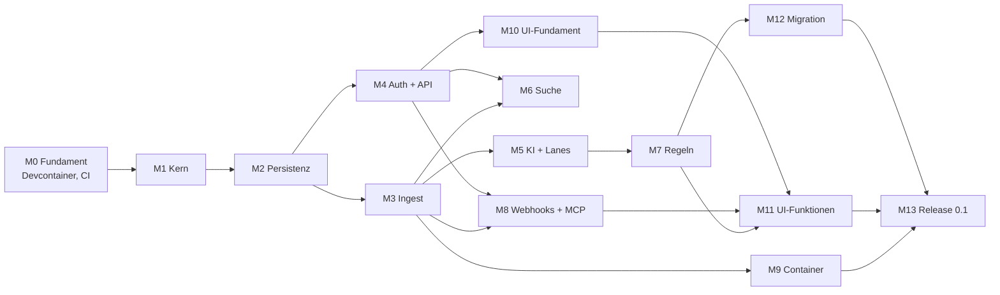

# Papiq – Umsetzungsplan

Stand: 06.10.2026 · Grundlage: [architektur.md](architektur.md)

Papiq wird API-first in 14 Meilensteinen (M0–M13) gebaut. Ab M3 lassen sich Dokumente per API einliefern; ab M11 ist Papiq über die Web-UI vollständig nutzbar; M13 schließt mit Release 0.1 und den ersten 100 Dokumenten ab.

## Abhängigkeiten

## Übersicht

| Kürzel | Meilenstein | Modell | Effort |
| --- | --- | --- | --- |
| M0 | Fundament: Devcontainer, CI, Konfiguration | Sonnet 5.5 | high |
| M1 | Domänenkern und Ports | Opus 5.5 | high |
| M2 | Persistenz (SQLite, Postgres), Jobs, Outbox | Opus 5.5 | high |
| M3 | Ingest-Pipeline: Speicher, OCR, Parsing, Worker, SSE | Opus 5.5 | high |
| M4 | Authentifizierung, Rechte, REST-API | Opus 5.5 | high (+ Review Fable 5.1 · high) |
| M5 | KI-Klassifizierung, Konfidenz, Lanes, Posteingang | Opus 5.5 | high |
| M6 | Suche mit Meilisearch | Sonnet 5.5 | high |
| M7 | Regel-Engine | Opus 5.5 | high |
| M8 | Webhooks und MCP-Server | Sonnet 5.5 | high |
| M9 | Papiq-Image mit s6-overlay | Sonnet 5.5 | high |
| M10 | Web-UI-Fundament und Design | Opus 5.5 | high |
| M11 | Web-UI-Funktionen | Sonnet 5.5 | medium (Regel-Baukasten: Opus 5.5 · high) |
| M12 | Migration aus Paperless-ngx | Sonnet 5.5 | high |
| M13 | Härtung und Release 0.1 | Fable 5.1 | high |
| M14 | Ingest-Graph: Knoten, Zustand je Knoten, Ereignisse, Sichtbarkeit in der UI (`ingest-v2.md`) | Opus 5.5 | high |
| M15 | Verstehen: Kennungen, Klassifikator, Nachbarn, Urteil, Titelmuster | Opus 5.5 | high |
| M16 | Lesen: Seitenbilder, VLM-Lesung, Bilder im Modellaufruf | Sonnet 5.5 | high |
| M17 | Grounding in der Prüfansicht (vorgezogen mit der neuen Dokumentansicht) | Sonnet 5.5 | medium |
| M18 | Eskalation und Kalibrierung | Opus 5.5 | high |

**Faustregel für die Modellwahl**

- **Opus 5.5** für alles, was Struktur festlegt oder schwer zu korrigieren ist: Kern, Datenmodell, Nebenläufigkeit, Sicherheit, Regel-Logik, Design-System.
- **Sonnet 5.5** für klar umrissene Integrationen nach festem Muster: Adapter, Container, Webhooks, Bildschirme nach Vorlage.
- **Fable 5.1** für unabhängige Prüfungen und lange, verifikationslastige Abschnitte (Sicherheits-Review, Release-Härtung).
- **Effort:** `medium` bei klarem Umfang, `high`, wenn Verifikation zählt (Default bei den meisten Modellen; Opus 5.5 startet bei `medium`). `xhigh`/`max` nur gezielt für einzelne harte Probleme, z. B. per `ultrathink` im Prompt. ([Quelle](https://code.claude.com/docs/en/model-config))
- Jeder Meilenstein beginnt mit einem Plan (Plan-Modus) und endet mit einem Review durch einen separaten Agenten, der die Umsetzung nicht geschrieben hat.

## Meilensteine

### M0 – Fundament: Devcontainer, CI, Konfiguration

**Ziel:** Entwickeln und Testen vollständig im Devcontainer; alle Abhängigkeiten starten mit.

- Devcontainer wie im Abschnitt [Devcontainer](#devcontainer) beschrieben.
- Mehrstufiges `Dockerfile` mit Ziel `dev` (Devcontainer) und `runtime` (M9), damit Entwicklung und Betrieb dieselben Systempakete nutzen.
- Konfiguration: `PAPIQ_`-Variablen mit Pydantic Settings, `_FILE`-Variablen für Docker Secrets, Abbruch bei ungültiger Konfiguration.
- Composition Root als Gerüst; strukturiertes Logging.
- CI: Lint, Typen, Import-Verträge, Tests; Testmatrix SQLite/Postgres vorbereitet.

**Fertig, wenn:** „Reopen in Container" startet Postgres, Garage und Meilisearch; `uv run pytest` läuft im Container grün; CI ist grün.

**Modell:** Sonnet 5.5 · high – viel bekanntes Muster, aber die Garage-Initialisierung und Netzwerk-Details brauchen Verifikation.

### M1 – Domänenkern und Ports

**Ziel:** Fachlogik ohne jede Technik, vollständig testbar.

- Entitäten: Nutzer, Rolle, Dokument, Kontakt, Dokumenttyp, Tag, Felddefinition und -wert, Schublade, Freigabe, Lane, Verarbeitungsschritt.
- Rechteprüfung (Besitzer, Schublade, Freigabe lesen/schreiben).
- Zustandsautomat der Pipeline und Lane-Berechnung (schlechtestes Schrittergebnis).
- Ports mit echten async Signaturen; In-Memory-Adapter für jeden Port; Vertragstest-Suiten.

**Vorher klären:** Felddatentypen.

**Fertig, wenn:** Kern-Tests decken Rechte, Zustandsautomat und Lanes ab; Import-Verträge grün.

**Modell:** Opus 5.5 · high – legt die Struktur fest, auf der alles aufbaut.

### M2 – Persistenz, Jobs, Outbox

**Ziel:** Repository-, Job-Queue- und Event-Bus-Adapter auf SQLite und Postgres.

- SQLAlchemy 2 async (aiosqlite, asyncpg), Alembic-Migrationen für beide Datenbanken.
- Job-Tabelle mit Retries, Sperren und Idempotenz.
- Outbox-Tabelle, Verteilung im Prozess; Polling (SQLite) und optional `LISTEN/NOTIFY` (Postgres).

**Fertig, wenn:** Vertragstests aus M1 laufen gegen SQLite und Postgres grün.

**Modell:** Opus 5.5 · high – die Verträge aus M1 verlangen u. a. lückenlose Ereigniszustellung trotz abweichender Commit-Reihenfolge und sicheres paralleles Claimen; das auf zwei Datenbanken braucht Verifikation.

### M3 – Ingest-Pipeline

**Ziel:** Ein Dokument per API einliefern und bis „Parsen" verarbeiten.

- Objektspeicher-Adapter: Dateisystem und S3 (Garage); SHA-256 als Schlüssel, Dublettenprüfung.
- `POST /documents` mit `202 Accepted`; Worker-Dienst; Schritte Empfangen → OCR → Parsen mit Retries.
- OCRmyPDF- und Docling-Adapter, rechenlastig in eigenen Prozessen.
- Verarbeitungsprotokoll je Schritt; „Schritt wiederholen", „ab Schritt X neu verarbeiten".
- Server-Sent Events für Fortschritt.

**Übernommen aus M2** (bewusst offen gelassen, in M3 entscheiden bzw. umsetzen):

- Outbox-Verteilung: Der Worker ruft `EventBus.dispatch` per Polling auf. Postgres `LISTEN/NOTIFY` ist nicht umgesetzt; nur ergänzen, wenn die Latenz des Pollings stört.
- Aufräumen: Erledigte und aufgegebene Jobs sowie Outbox-Einträge, die alle Abonnenten erhalten haben, wachsen unbegrenzt. Aufräum-Job vorsehen.
- Lebenszyklus: Der Container schließt die Datenbank-Engine (`Database.dispose`) noch nicht; mit dem Start und Stopp von Worker und API regeln.
- Fehlgeschlagene Zustellungen werden unbegrenzt wiederholt (`event_retries` zählt die Versuche); Obergrenze oder wachsender Abstand bei Bedarf.
- Mehrere Dispatcher mit demselben Abonnentennamen stellen ggf. doppelt zu (mindestens einmal ist erlaubt).
- SQLite hat einen Schreiber: Ein Task darf keine zweite schreibende Unit of Work öffnen, solange seine erste offen ist (wartet sonst bis zum Busy-Timeout).

**Fertig, wenn:** Ein PDF und ein Foto laufen durch, Archiv-PDF und Docling-Ausgabe liegen im Speicher, ein abgebrochener Schritt lässt sich einzeln wiederholen.

**Modell:** Opus 5.5 · high – Idempotenz, Prozesse und Fehlerpfade.

### M4 – Authentifizierung, Rechte, REST-API

**Ziel:** Mehrbenutzerbetrieb und vollständige API für Stammdaten und Schubladen.

- Nativer Login (Argon2id), TOTP optional, Session-Cookie, persönliche API-Tokens mit Stufen.
- OIDC über Authlib, Verknüpfung mit lokalem Konto.
- Endpunkte: Nutzer (Admin), Stammdaten (Admin), Schubladen und Freigaben, Dokumente; OpenAPI-Spezifikation sauber gepflegt.

**Fertig, wenn:** Rechte-Tests zeigen, dass kein Nutzer fremde Dokumente ohne Freigabe sieht; OpenAPI ist vollständig.

**Modell:** Opus 5.5 · high; danach Sicherheits-Review mit Fable 5.1 · high – sicherheitskritisch, unabhängige Prüfung lohnt.

**Review und Behebung:** Das unabhängige Sicherheits-Review (`reviews/M4-security.md`) fand keine kritischen, einen hohen, vier mittlere und sieben geringe Befunde. Behoben vor dem Merge: Quellen-Drossel sperrt nur noch falsche Anmeldungen, `PAPIQ_FORWARDED_ALLOW_IPS` ist mit `Secure`-Cookies Pflicht (M4-01); Fehlversuche werden atomar vor der Prüfung gezählt (M4-02); Admin-Endpunkte für Anmeldedaten nur per Session, kein Selbstbezug (M4-03); Request-Bodies begrenzt, `PAPIQ_REQUEST_MAX_SIZE` (M4-04); dazu M4-06 bis M4-11. M4-05 (Token-Widerruf bei Passwortwechsel als Default) bewusst nicht geändert, M4-12 akzeptiert. Auftrag: `prompts/M4-fixes.md`.

### M5 – KI-Klassifizierung, Konfidenz, Lanes

**Ziel:** Dokumente werden klassifiziert und landen in Grün, Gelb oder Rot.

- LLM- und Embedding-Adapter (OpenAI-kompatibel), strukturierte Ausgabe mit festem Schema.
- Klassifizierung (Kontakt, Typ, Tags), Feldextraktion je Dokumenttyp.
- Konfidenz aus prüfbaren Fakten (Abgleich, Liste, Wert im Text); neue Gegebenheiten → Gelb.
- Posteingang (API): gelbe und rote Dokumente nur für den Besitzer.
- Kleiner Bewertungssatz aus Beispieldokumenten, um Modelle vergleichen zu können.

**Vorher klären:** LLM und Embedding-Modell, Konfidenz-Schwellen, Anzahl Retries.

**Fertig, wenn:** Der Bewertungssatz läuft reproduzierbar; Lanes stimmen mit den Erwartungen überein.

**Modell:** Opus 5.5 · high – Prompt- und Schema-Design, Bewertung.

**Review und Behebung:** Das Review durch einen separaten Agenten fand keine Blocker. Behoben vor dem Merge: Ein Kontakt wird nur grün, wenn er selbst im Text steht (ähnliche Schreibweise → Vorschlag); Belege nur als ganze Wörter, nur ISO-4217-Codes als Währung, Ja/Nein- und Auswahlwerte brauchen eine Belegstelle von mindestens 4 Zeichen; Tags aus der Klassifizierung werden ergänzt statt ersetzt; beim Bestätigen gelten Werte, die das Dokument schon hat, als entschieden (Vorschläge füllen nur leere Felder); die Bewertung zählt „grün mit falschem Wert" und bricht dann mit Status 1 ab. Als Restrisiko akzeptiert (Tobi, 07.10.2026): siehe „Übernommen aus M5" unter M6.

### M6 – Suche

**Ziel:** Hybride Suche, gefiltert nach Rechten.

- Meilisearch-Adapter, Index-Aktualisierung per Ereignis, vollständiger Neuaufbau per Job.
- Jede Suche gefiltert auf sichtbare Schubladen.

**Übernommen aus M5** (offen bzw. für spätere Meilensteine festgehalten):

- Embedding-Port und OpenAI-kompatibler Adapter existieren (`PAPIQ_EMBEDDING_*`), werden aber noch nicht genutzt; die hybride Suche baut darauf auf.
- Echter Bewertungslauf (07.10.2026, Ergebnis in `architektur.md`): `qwen3:8b` mit 8192 Kontext, nur 5 der 28 Dokumente (Tobis Wahl). Offen: der volle Lauf (auf dem NUC etwa 1,5 bis 2,5 Stunden). Auf dem NUC liegt dafür die Modellvariante `qwen3:8b-ctx8k` (`num_ctx` 8192); für den Betrieb `OLLAMA_CONTEXT_LENGTH=8192` auf dem NUC setzen.
- Laufzeit 3 bis 10 Minuten pro Dokument auf der CPU des NUC: für die Migration (M12) mit vielen Dokumenten einplanen (Klassifizierung abschaltbar oder nachgelagert?).
- `bge-m3` ist auf dem NUC geladen, aber ungeprüft; die Wahl in M6 bestätigen.
- Restrisiko (akzeptiert): Eine Anweisung im Dokumenttext kann einen falschen, aber vorhandenen Kontakt grün machen, wenn der Text diesen Kontakt nennt. Tags aus der Klassifizierung werden ohne Textprüfung gesetzt. Für M7: Regeln dürfen Kontakt und Tags, die das Modell gesetzt hat, nicht allein vertrauen.
- Für M7: `inbox.field_checks(log)` liefert die Vorschläge und Prüfungen des letzten Modelllaufs je Feld; Bestätigungen stehen mit `model_version="person"` im Verarbeitungsprotokoll. Ohne Regeln setzt `confirm` nach dem Bestätigen bei `apply_rules` fort.
- Bestätigen ab `extract_fields` ersetzt die Felder, die der Besitzer eingetragen hat (dokumentiert, bewusst so).
- Feldprüfungen werden als bestanden protokolliert, auch wenn die Änderung danach an fehlenden Stammdaten scheitert (der Schritt wird dann unsicher).
- Fehlender Test: Klassifizierung auf Postgres im Integrationstest (bisher nur Speicher-Adapter und Rundlauf des Status `review`).

**Fertig, wenn:** Rechte-Tests für die Suche grün; Neuaufbau aus Datenbank und Speicher funktioniert.

**Modell:** Sonnet 5.5 · high – bekannte Integration, der Rechtefilter braucht Sorgfalt.

**Umsetzung und Review:** Index-Port `SearchIndex` mit Speicher- und Meilisearch-Adapter (httpx2, kein SDK), Vektoren über den Embedding-Port (`userProvided`), Abschnitte statt eines Vektors je Dokument, `GET /documents/search`, `POST /search/reindex`, Befehl `reindex`, `evaluate-search` mit 48 Anfragen. Das Review durch einen separaten Agenten fand keine Rechte-Lücke. Behoben vor dem Merge: Embedding-Ausfall hält ein Dokument nicht mehr aus dem Index; Umbenennungen während eines Neuaufbaus gehen nicht verloren; Abgleich bei jedem Start des Workers; Vektoren falscher Länge fallen auf Wörter zurück; Paging mit Bedeutung; ein Index ohne Einstellungen wird neu eingerichtet; `/health` meldet eine gestörte Suche als `degraded` (Tobi, 07.10.2026). Embedding-Modell: `snowflake-arctic-embed2` (Tobi, 07.10.2026, Bewertung in `architektur.md` unter „Suche“). Der Test der Klassifizierung auf SQL-Persistenz (Übergabe aus M5) liegt in `tests/integration/test_classification_evaluation.py`.

### M7 – Regel-Engine

**Ziel:** Globale und Nutzer-Regeln wie spezifiziert.

- Bedingungsbaum, Operatoren, Aktionen, Priorität, Konflikte → Gelb (auch Regel gegen LLM).
- Versionierung, Protokoll, Probelauf bei Dokumentänderungen.
- Rückwirkendes Anwenden: Ermittlung der betroffenen Dokumente und Ausführung als Job (Auswahl in der UI folgt in M11).

**Fertig, wenn:** Tests decken Konflikte, Schleifenschutz und Rechtegrenzen globaler Regeln ab.

**Übernommen aus M6** (offen bzw. für spätere Meilensteine festgehalten):

- Jede Dokumentänderung (auch durch Regeln oder rückwirkendes Anwenden) löst über das Ereignis `document.updated`/`lane_changed`/`filed` einen Index-Job aus; Regeln müssen nichts am Index tun. Ändert eine Regel viele Dokumente, entstehen viele Index-Jobs und Embeddings: auf dem NUC etwa 0,6 s je Abschnitt.
- Für M8 (MCP-Tool `search`): `SearchService.search(actor, text, filter, offset=, limit=, semantic_ratio=)` prüft Rechte selbst; der MCP-Server ruft ihn mit dem Besitzer des Tokens auf. Eine Seite kann weniger Treffer als `limit` enthalten.
- Die hybride Suche hat keine Schwelle: Meilisearch liefert auch bei Unsinn die nächsten Nachbarn. Eine Schwelle (`rankingScoreThreshold`) wäre eine eigene Entscheidung, am besten mit dem Bewertungssatz erweitert um Anfragen ohne Treffer.
- Der Neuaufbau belegt eine Worker-Schleife; seine Leihe (`PAPIQ_SEARCH_REBUILD_TIMEOUT`) wird nicht verlängert. Der Befehl `reindex` und ein laufender Neuaufbau-Job dürfen nicht gleichzeitig laufen (nur in der Dokumentation, nicht erzwungen).
- Ein Modellwechsel oder eine andere Vektorlänge braucht einen Neuaufbau; der Adapter bricht ab, wenn ein Index mit anderem Embedder Dokumente enthält.
- `PAPIQ_SEARCH_LOCALES` prüft nur das Format, nicht ob Meilisearch die Sprache kennt.
- Nicht in dieser Umgebung geprüft (läuft in der CI): der Rundlauf `test_search_end_to_end` mit Postgres und S3 und die Postgres-Variante von `test_classification_evaluation`.
- Für `evaluate-search` ist `PAPIQ_EMBEDDING_DIMENSIONS` irgendein Wert, weil die Konfiguration zuerst geprüft wird; Präfixe gelten für alle Modelle eines Laufs.

**Modell:** Opus 5.5 · high – viele Randfälle, Wechselwirkung mit Rechten.

**Review und Behebung:** Das Review durch einen separaten Agenten fand keine Blocker. Behoben vor dem Merge: Rückwirkend gilt Ablegen in eine geteilte Schublade auf unbestätigte Modellwerte als Konflikt (nur mit Annahme); eine beim Upload oder durch Verschieben gewählte Schublade und früher von der Person gesetzte Tags und Felder ändert keine Regel mehr (Protokoll `person:drawer`); Bestätigen beantwortet nur die gesehenen erzwungenen Prüfungen; Bestätigen verlangt eine Schublade, wenn die Ablage sonst wieder scheitert; ein Bearbeiter, dem eine Änderung die Sicht nimmt, erhält nur `id` und `access: null`; Regex-Suchen teilen sich ein Zeitbudget (2 s je Lauf, 20 s je Vorschau-Seite); rückwirkende Anwendungen enden bei einem unerwarteten Fehler; SQL lädt nur die aktuelle Regelversion.

### M8 – Webhooks und MCP-Server

**Ziel:** Externe Systeme informieren und Claude anbinden.

- Webhook-Abonnements pro Nutzer, schlanke Ereignisse, HMAC-SHA256, Retries, Zustellprotokoll.
- MCP-Server über HTTP mit API-Token: `search`, `get_document`, `get_text`, `update_metadata`, `list_tags`.

**Fertig, wenn:** Ein Test-Empfänger erhält signierte Ereignisse; ein lokaler MCP-Client kann suchen und Metadaten ändern.

**Übernommen aus M6 und M7** (offen bzw. für spätere Meilensteine festgehalten):

- Aus M6: Für das MCP-Tool `search` prüft `SearchService.search(actor, text, filter, offset=, limit=, semantic_ratio=)` die Rechte selbst; der MCP-Server ruft ihn mit dem Besitzer des Tokens auf. Eine Seite kann weniger Treffer als `limit` enthalten. Die übrigen Punkte aus „Übernommen aus M6" unter M7 (Schwelle der hybriden Suche, Neuaufbau, Modellwechsel, Locales, Postgres-Läufe in der CI) gelten weiter.
- MCP-Tool `update_metadata`: über `DocumentService.change_metadata(actor, id, changes)` gehen, nicht über `update_metadata`; nur so laufen die Änderungs-Regeln (Flanke), und das Ergebnis enthält den Regelbericht (`rules`, nur für den Besitzer) und `access` (None, wenn die Regeln das Dokument aus der Sicht des Aufrufers abgelegt haben: dann nichts weiter zurückgeben, wie REST).
- Webhooks: `document.filed` kommt auch, wenn eine Regel in `apply_rules` oder `confirm(drawer_id)` das Dokument verschiebt, solange es noch keine Lane hat (früher als die endgültige Ablage). Für Abonnenten zählt erst `document.filed` bei grüner Lane; ggf. im Ereignis die Lane mitgeben oder `move_to` vor der Ablage kein `filed` melden lassen.
- Webhooks: Regeländerungen und rückwirkende Anwendungen erzeugen keine eigenen Ereignisse; Fortschritt nur per `GET /rule-applications/{id}`.
- Offen aus M7: Kein In-Memory-Adapter für `PatternMatcher` (der Speicher-Container nutzt den `regex`-Adapter, der ohne Dienst läuft). `RuleApplication` schreibt `documents`/`skipped` je Dokument neu (quadratisch, bei `PAPIQ_RULES_APPLY_MAX_DOCUMENTS` nahe 100 000 relevant). Kleines Zeitfenster: Text und Muster werden vor der Transaktion für die dann gesehenen Regeln vorbereitet; eine dazwischen aktivierte Textregel wird ohne Text ausgewertet. Keine Obergrenze für Regeln je Nutzer (das Zeitbudget begrenzt die Kosten).
- Nicht in dieser Umgebung geprüft (läuft in der CI): Regel-Vertragstests und `test_rules_end_to_end` auf Postgres.

**Modell:** Sonnet 5.5 · high.

**Umsetzung und Review:** Webhooks (`/webhooks`, Zustellprotokoll, `POST /webhooks/{id}/test`): Abonnent `webhooks.fanout` und Job `webhooks.deliver` im Worker, Rechte beim Einreihen und vor jedem Versuch (sonst `dropped`), `document.deleted` an die Leser zum Zeitpunkt des Löschens (`DocumentDeleted.readers`, auch für SSE), Signatur nach Standard Webhooks (`webhook-id`, `-timestamp`, `-signature`, zwei Signaturen während der Übergangszeit nach dem Erneuern), Geheimnis AES-GCM-verschlüsselt, Wiederholung 10 Versuche ab 30 s verdoppelnd bis 1 h, Abschalten nach 20 aufgegebenen in Folge, Aufräumen des Protokolls über `PAPIQ_RETENTION`. MCP unter `/api/v1/mcp` mit dem offiziellen SDK (`mcp==2.3.0`), fünf Tools, Namen statt IDs, Bearer-Token mit Stufen. Admins haben alle Rechte an allen Webhooks: lesen, ändern, löschen, testen, Geheimnis erneuern (Tobi, 08.10.2026); ein von ihnen erneuertes Geheimnis sehen sie einmal. Das Review durch einen separaten Agenten fand keine Rechte-Lücke bei Ereignissen und MCP. Behoben vor dem Merge: Der HTTP-Client protokollierte die volle Ziel-URL (kann ein Zugangsdatum enthalten) – die Logger `httpx`, `httpx2` und `httpcore` zeigen nur noch Warnungen; `dropped` nennt für gelöschte und nicht mehr sichtbare Dokumente denselben Grund; Geheimnisse stehen nicht mehr in `repr`.

### M9 – Papiq-Image mit s6-overlay

**Ziel:** Ein betriebsfertiges Image.

- `runtime`-Ziel im Dockerfile: Debian slim, OCRmyPDF-Abhängigkeiten, Docling mit PyTorch (CPU).
- s6-Dienste: `init-papiq`, `init-migrations`, `svc-api`, `svc-worker`; `PAPIQ_ROLE`, `PUID`/`PGID`, Healthchecks.
- Beispiel-Compose für SQLite + Dateisystem und für Postgres + Garage.
- CI baut Images für amd64 und arm64.

**Vorher klären:** Backup-Strategie.

**Übernommen aus M8:**

- Der Worker braucht jetzt `PAPIQ_SECRET_KEY` (Webhook-Geheimnisse); die Einstellungen verlangen ihn für jede Rolle, auch für `check` und `migrate`. Das Image muss ihn (oder `PAPIQ_SECRET_KEY_FILE`) allen s6-Diensten geben.
- Neue Variablen: `PAPIQ_WEBHOOKS_PER_USER`, `PAPIQ_WEBHOOK_SECRET_GRACE`, `PAPIQ_WEBHOOK_TIMEOUT`, `PAPIQ_WEBHOOK_MAX_ATTEMPTS`, `PAPIQ_WEBHOOK_RETRY_DELAY`, `PAPIQ_WEBHOOK_DISABLE_AFTER`, `PAPIQ_WEBHOOK_CONCURRENCY`, `PAPIQ_MCP_ENABLED`, `PAPIQ_MCP_TEXT_MAX`; in die Beispiel-Compose-Dateien und die Doku des Images aufnehmen.
- MCP liegt im API-Prozess unter `/api/v1/mcp` (Streamable HTTP, zustandslos). Ein Reverse Proxy darf es nicht puffern oder auf eine Antwortzeit begrenzen; Anfragen sind einfache `POST`s.
- Die Worker-Rolle stellt Webhooks zu und braucht Netzzugang zu den Zielen (auch im eigenen Netz, das ist entschieden). Weiterleitungen werden nie verfolgt, Proxy-Umgebungsvariablen nie ausgewertet.
- Ein toter Empfänger belegt eine Zustellschleife bis zum Zeitlimit je Versuch (`PAPIQ_WEBHOOK_CONCURRENCY`); die Pipeline bleibt unberührt.
- Offen (M8): `POST /webhooks/{id}/test` ohne Ratenbegrenzung (ein Token mit Schreibstufe kann interne Adressen anstoßen, akzeptiert); `Webhook.previous_secret` bleibt nach Ablauf der Übergangszeit verschlüsselt in der Datenbank bis zum nächsten Erneuern; Admins sehen in Zustellprotokollen Dokument-IDs und die Ziel-URL fremder Webhooks (entschieden, so gewollt).
- Nicht in dieser Umgebung geprüft (läuft in der CI): die Vertragstests für Webhooks auf Postgres, die Migration `v0006` auf Postgres, ein echter MCP-Client (Claude Code, Inspector) gegen einen laufenden API-Prozess.

**Fertig, wenn:** Beide Beispiel-Stacks starten, migrieren und verarbeiten ein Dokument.

**Modell:** Sonnet 5.5 · high.

**Umsetzung und Review:** Stufen `deps` (gesperrte Abhängigkeiten ohne Dev-Gruppe), `app`, `s6` (s6-overlay 3.2.3.2, SHA-256 je Architektur) und `runtime`; `docling-models` baut auf `deps` (ein `uv sync` für `dev` und `runtime`). Dienste `init-papiq`, `init-migrations`, `svc-api`, `svc-worker` unter `deploy/image/rootfs`; die Rolle (`PAPIQ_ROLE`) prüft jedes Dienstskript (`s6-svc -Od .`, s6-rc ist statisch); der Worker wartet in `svc-worker` mit dem neuen, schreibfreien Befehl `check-schema --wait 600` auf das Schema (nicht in `init-migrations`: ein Oneshot ließe sich mit `docker stop` nicht unterbrechen; Review-Befund). Papiq-Prozesse laufen über `papiq-run` als `PUID`:`PGID` (Default 1000, `0` abgelehnt, kein passwd-Eintrag); `/data` ist das Volume (Pfade per Image-`ENV`, `settings.py` unverändert); `init-papiq` lehnt relative Pfade, `/` und Systemordner ab. Herunterfahren: Worker 30 s, `S6_SERVICES_GRACETIME` 40 s, `S6_KILL_GRACETIME` 1 s (s6 wartet sie immer ganz ab), Compose `stop_grace_period` 60 s. Healthcheck: API über `/api/v1/health`, Worker über `s6-svstat` (mindestens 10 s oben) und eine Marke, dass das Warten auf das Schema vorbei ist. Hilfsbefehl `papiq` (`docker exec … papiq reindex`). Beispiel-Stacks `deploy/compose.sqlite.yml` und `compose.postgres.yml` mit Secrets als Dateien (`create-secrets.sh`), `deploy/test-image.sh` (31 Prüfungen, auch in der CI; seit M13 über 40), `deploy/README.md` mit Betrieb, Reverse Proxy, Webhooks, MCP, Backup und Wiederherstellung. Größe laut `docker image inspect` in der CI: 3,19 GB (amd64), 3,02 GB (arm64); OrbStack auf dem Mac zeigt 4,57 GB.

Echtläufe auf Tobis Mac (Ollama am NUC, `qwen3:8b-ctx8k` und `snowflake-arctic-embed2`): beide Stacks, je zwei PDFs (gerenderte Stromrechnung und Handwerkerrechnung aus dem Bewertungssatz) bis Lane Gelb in 66 bis 96 s (Kontakt und Typ unbekannt, Stammdaten leer), Suche semantisch; MCP gegen den laufenden Container mit dem MCP-SDK-Client (alle fünf Tools, `update_metadata` eingeschlossen) und mit Claude Code (`claude -p` mit `--mcp-config`); Backup und Wiederherstellung mit beiden Stacks durchgespielt (Dokument, Original, Archiv und Suche nach `reindex` wieder da). CI-Zeiten des Image-Jobs (Pull Request, je Architektur nativ): kalt 4:05 bis 4:17 (Bau 2:27 bis 2:28, Test 75 bis 83 s); mit GHA-Layer-Cache nicht schneller (Wiederherstellen rund 1 min, Schreiben aus `main` weitere 2 min), deshalb ohne Cache und nur im Pull Request. Pull Requests ohne Image-Pfad bleiben unberührt (Job `changes` 4 bis 5 s, `backend` 1:00, `integration` 2:47). Das Review durch einen separaten Agenten fand keine Lücke bei Geheimnissen (alle Beispielgeheimnisse in Logs und `docker inspect` gesucht) und Rechten (nur `s6-supervise` läuft als root). Behoben vor dem Merge: das Warten des Workers (siehe oben), Pfadprüfung in `init-papiq`, Angaben der Backup-Doku (Originale unveränderlich, Ableitungen nicht; Wiederherstellung ersetzt Objekte; `alpine` gepinnt), Hinweis, Geheimnisse nur als `_FILE` zu übergeben.

### M10 – Web-UI-Fundament

**Ziel:** Cleanes, modernes Grundgerüst, auf dem alle Bildschirme aufbauen.

- SvelteKit (statisch), Tailwind, shadcn-svelte; TypeScript-Client aus OpenAPI generiert.
- Gestaltungsrichtung, Farben, Typografie, Dark Mode; Login inkl. TOTP; Navigation.

**Fertig, wenn:** Login funktioniert, Design-System steht, Uvicorn liefert die gebaute UI aus.

**Modell:** Opus 5.5 · high – Gestaltungsentscheidungen prägen die ganze UI.

**Übernommen aus M9:**

- Die UI kommt ins Image: eine Node-Stufe im `Dockerfile` baut die statischen Dateien, die Stufe `runtime` kopiert sie; `.dockerignore` lässt `web/` durch (heute nur `backend/pyproject.toml`, `uv.lock`, `README.md`, `src/`, `deploy/image/`). Wie Uvicorn sie ausliefert (Pfad, Einstellung `PAPIQ_…`, Vorrang der API-Pfade unter `/api/v1`), entscheidet M10; `deploy/README.md` und der Reverse-Proxy-Abschnitt (Cache-Header, Pfade) nachziehen.
- CI: Der Job `image` löst bei `web/` heute nicht aus (Pfade in `changes`: `Dockerfile`, `.dockerignore`, `deploy/` ohne Markdown, `backend/pyproject.toml`, `backend/uv.lock`, `ci.yml`). Sobald die UI im Image steckt, `web/` (ohne Tests und Markdown) und die Lock-Datei der UI aufnehmen und `deploy/test-image.sh` um einen Abruf der Startseite erweitern.
- Das Betriebsbild für die UI-Entwicklung bleibt der Devcontainer; das Image wird nur gebaut, nicht für Vite genutzt.
- Offen aus M8 (unverändert weitergetragen): `POST /webhooks/{id}/test` ohne Ratenbegrenzung, `Webhook.previous_secret` bleibt nach der Übergangszeit verschlüsselt liegen, Admins sehen Dokument-IDs und Ziel-URL fremder Webhooks (entschieden); dazu die Punkte aus „Übernommen aus M6 und M7" (Schwelle der hybriden Suche, Neuaufbau-Leihe, Modellwechsel, `PAPIQ_SEARCH_LOCALES`, `PatternMatcher` ohne In-Memory-Adapter, quadratisches Schreiben in `RuleApplication`, Zeitfenster bei Textregeln, keine Obergrenze für Regeln je Nutzer).

**Umsetzung und Review:** SvelteKit 3.0.1 als Single-Page-App (`adapter-static`, Fallback `index.html`, kein SSR) unter `/ui`, Svelte 5, Vite 8, TypeScript 6, Tailwind 4, shadcn-svelte (bits-ui), Paraglide JS 2 (Englisch als Basis, Deutsch; Wahl im Browser gespeichert, Formate nach Browser-Region, sonst de-DE/en-US), Schriften Geist und Geist Mono lokal, alles exakt gepinnt (`pnpm-lock.yaml`, pnpm 12.9.1, Node 24.21.0). Gestaltung Richtung B „Papier" (Tobi, 08.10.2026; Artifact mit drei Richtungen): Petrol `#0d6b6b` als einziger Akzent, Papierweiß, runde Formen, Kopfnavigation mit Pillen, Lanes „Erledigt/Prüfen/Eingreifen/Läuft" immer mit Symbol und Wort. Client: `openapi-typescript` aus dem eingecheckten `web/openapi.json` (Befehl `python -m papiq.composition.openapi`, ein Backend-Test vergleicht) und `openapi-fetch` mit eigenem `fetch` (Cookie der Seite, `X-CSRF-Token` nur bei Änderungen, ein Wiederholversuch bei veraltetem Token, 401 außerhalb der Anmeldung → Login mit `next`). Anmeldung mit Passwort, TOTP, Wiederherstellungscode und OIDC-Knopf (nur wenn eingerichtet); `next` nur auf Seiten unter `/ui/`. Auslieferung: `PAPIQ_UI_DIR` (im Image `/opt/papiq/ui`; gesetzt ohne `index.html` ist ein Konfigurationsfehler), `adapters/inbound/rest/ui.py` nach allen API-Routen, `/` → 302 `/ui/`, `/ui` → 308; Dateien des Builds, sonst `index.html` für Seitenpfade ohne Endung, 404-Problem für fehlende Dateien, alles unter `_app/`, versteckte Namen, Pfade außerhalb; nur GET/HEAD. `_app/immutable` ein Jahr `immutable`, alles andere `no-cache` mit ETag/304. CSP per Meta-Tag aus SvelteKit (Hash-Modus), als Header `frame-ancestors 'none'`, `nosniff`, `Referrer-Policy: same-origin`. Image: Stufe `web` auf der Bauplattform, `runtime` ohne Node. CI: Job `web` (ESLint, Prettier, svelte-check, Vitest, Client-Abgleich, Build), nur bei `web/`; `image` auch bei `web/` ohne Tests. Tests: 172 Vitest (u. a. kein fester Text im Markup, gleiche Schlüssel und Platzhalter in beiden Sprachen, `next`-Prüfung), 30 Backend-Tests der Auslieferung, Playwright-Rauchtest nur lokal (gelaufen: Anmeldung mit TOTP, Navigation, Neuladen, Abmelden, Rücksprung nach Sitzungsende). Das Review durch einen separaten Agenten fand keinen offenen Weg aus `next` heraus und keinen Pfadausbruch. Behoben vor dem Merge: die CSRF-Wiederholung lief nach einer Anmeldung in einem anderen Tab als die andere Person (jetzt nur bei gleicher Nutzer-ID, sonst neu laden); API-Änderungen ohne UI-Bezug lösten den Image-Job aus (`openapi.json`, `schema.ts` ausgenommen); Tastaturfokus zu blass (jetzt 2-px-Umriss in Petrol mit Abstand, 6:1); Fehler beim Laden einer Seite zeigten Englisch „Internal Error“ ohne das Detail der API (`hooks.client.ts`; dabei gefunden: `openapi-fetch` liest den Fehlerkörper selbst, `apiError` nimmt ihn jetzt entgegen); doppelte Schrägstriche umgingen die Regeln für `_app/`; 405 hatte den Titel „405“; Fokus und `aria-describedby` auf der Anmeldeseite; CSRF-Kopf nur an die eigene Seite.

### M11 – Web-UI-Funktionen

**Ziel:** Papiq vollständig über die Oberfläche nutzbar.

- Dokumentliste und -detail mit PDF.js, Upload, Fortschritt per SSE.
- Posteingang mit Lanes, Bestätigen und Korrigieren.
- Schubladen und Freigaben, Stammdaten (Admin), Webhooks, API-Tokens, Einstellungen.
- Regel-Baukasten mit Probelauf und Auswahldialog für rückwirkendes Anwenden.

**Übernommen aus M10:**

- Gerüst: `web/README.md`. Neue Seiten liegen unter `src/routes/(app)/…` (Layout prüft die Sitzung), Bereiche in `src/lib/sections.ts`; die Platzhalterseiten (`Placeholder.svelte`) werden ersetzt. Bausteine aus shadcn-svelte per CLI (`pnpm dlx shadcn-svelte@1.7.0 add …`, `components.json`), danach Texte über Paraglide; die Bausteinseite `/ui/dev/components` (nur `pnpm dev`) zeigt den Stand.
- Importe heißen `#lib/…` mit Dateiendung (SvelteKit 3 hat `$lib` entfernt; `imports` in `package.json`), `$app/env` statt `$app/environment`.
- Jeder sichtbare Text in `messages/{en,de}.json`; die Tests schlagen bei festem Text im Markup (auch `aria-label`, `title`, `placeholder`, `alt`) und bei fehlenden Schlüsseln an. Fehlertexte der API (Problem-Details) bleiben, wie die API sie schreibt.
- API-Aufrufe nur über `api` aus `#lib/api/client.ts`; Fehler mit `describeError`/`reportError` (`#lib/errors.ts`), 429 nennt die Wartezeit. Nach einer API-Änderung `web/openapi.json` neu schreiben und `pnpm gen:api`.
- Formate über `formatDate`, `formatNumber`, `formatMoney` (`#lib/i18n.ts`); Lanes über `LaneBadge`.
- CSP: `img-src` erlaubt `data:` und `blob:` (PDF-Vorschau), `connect-src 'self'` (SSE unter `/api/v1/events` passt). PDF.js braucht vermutlich einen Worker (`worker-src`) und darf kein CDN nutzen; die Direktiven stehen in `web/vite.config.ts`.
- Neue Abhängigkeiten nur nach Absprache und exakt gepinnt; pnpm 12 lehnt Pakete jünger als einen Tag ab (`minimumReleaseAge`).
- Nicht gebaut: Superforms, Zod, TanStack (E6); bei Formularen mit vielen Feldern neu entscheiden.
- Beobachtet: Bricht die OIDC-Anmeldung beim Anbieter ab, zeigt `/api/v1/auth/oidc/callback` ein Problem-JSON statt einer Seite der UI.
- Seitenpfade dürfen im letzten Abschnitt keinen Punkt enthalten (`/ui/users/john.doe`): die Auslieferung hält ihn für eine Datei und antwortet 404. IDs (UUID) sind unkritisch; Namen nicht als Pfadparameter.
- CSP: `style-src 'unsafe-inline'` ist weiter als nötig; laut Review erzeugt das Bündel keine `<style>`-Elemente, `style-src 'self'; style-src-attr 'unsafe-inline'` könnte reichen (im Browser prüfen, auch mit PDF.js).
- Playwright läuft nur lokal (`pnpm e2e`, `web/README.md`), die CI installiert keine Browser.

**Fertig, wenn:** Alle Abläufe aus dem Architektur-Dokument sind in der UI erreichbar.

**Modell:** Sonnet 5.5 · medium für Bildschirme nach Vorlage; Regel-Baukasten mit Opus 5.5 · high.

**Umsetzung und Review (M11a, ohne Regelbereich):** Tobis Entscheidungen (08.10.2026): Regeln komplett M11b (der Probelauf für Dokumente gehört zu M11a); Formulare ohne Superforms, Zod, TanStack; QR-Code für TOTP mit `uqr` 0.1.3 als SVG; OIDC-Fehler leitet auf `/ui/login?error=<code>` (Codes `denied`, `failed`, `conflict`, `provider`; bei verknüpfendem Aufruf mit Sitzung auf `/ui/settings?error=<code>`); Dokumentliste ohne Sortierung, „Mehr laden“; Suche ohne Gewichtungsregler; keine neue Design-Runde. Neue Abhängigkeiten: `pdfjs-dist` 6.4.299 (Legacy-Build, weil der normale `Map.getOrInsertComputed` braucht), `uqr` 0.1.3. Umgesetzt: Dokumentliste mit Filtern und Ereignisstrom (eine `EventSource`, Neuladen nach Wiederverbindung), Upload (3 parallel, nur Status „lädt hoch“, dann SSE), Detail mit schlankem PDF-Viewer, Bearbeiten mit Probelauf vor dem Speichern, Verarbeitungsprotokoll, Wiederholen, Neuverarbeiten, Verschieben, Löschen; Posteingang mit Zähler und Bestätigen/Korrigieren; Suche; Schubladen mit Freigaben; Stammdaten (Kontakte, Dokumenttypen, Schlagwörter, Felder); Benutzerverwaltung; Webhooks mit Zustellprotokoll; Einstellungen (Passwort, TOTP mit QR und Wiederherstellungscodes, OIDC verknüpfen, andere Sitzungen beenden, API-Tokens). Einzige API-Änderung: der OIDC-Callback (mit Test, `openapi.json` und Client neu erzeugt). CSP: `style-src 'self'` plus `style-src-attr 'unsafe-inline'` und `worker-src 'self'`, im Browser mit PDF.js ohne Verstöße; `wasm-unsafe-eval` war nicht nötig. Tests: 259 Vitest, 1973 Backend-Unit-Tests, Playwright lokal (`areas.spec.ts` öffnet alle Bereiche ohne Konsolenfehler und legt Kontakt, Schublade, Webhook und Token an und wieder weg). Das Review durch einen separaten Agenten fand und behoben vor dem Merge: `loading` blieb nach `refresh()` während `more()` für immer gesetzt (Test ergänzt); Webhook-Test und Geheimnis erneuern sowie das Verarbeitungsprotokoll wurden auch gezeigt, wo die API „nur Eigentümer“ sagt; das Formular wurde bei jedem Ereignis zurückgesetzt und löschte Eingaben (jetzt nur, wenn nichts geändert ist); Admins bekamen für Upload und Prüfen Schubladen angeboten, in die sie nicht schreiben dürfen; späte Antworten eines früheren Dokuments konnten das aktuelle überschreiben; Uploads blieben nach Abmelden stehen; Neustart des Ereignisstroms nach Abmeldung; zwei Layouts des PDF-Viewers konnten sich überholen; Namensabruf der Webhook-Seite ohne Fehlerbehandlung.

**Übergaben an M11b:**

- Die Seite `/ui/rules` ist weiter ein Platzhalter (`Placeholder.svelte`, Eintrag in `src/lib/sections.ts`). Wiederverwendbar: `PagedList` (`paging.svelte.ts`), `NativeSelect`, `ConfirmDialog`, `NameDialog`, `FieldValueInput`, `ReviewFieldInput`, `loadLookup` (Kontakte, Typen, Schlagwörter, Felder, Schubladen, Benutzer; `masterdata.svelte.ts`), `permissions.ts`, `events.svelte.ts` (`generation` nach Wiederverbindung), `fieldErrors` (422-Details je Feld) und der Probelauf-Dialog des `DocumentEditor` als Vorlage für die Vorschau von Regeln.
- Texte: `web/messages/{en,de}.json`, Hilfsskript ist nicht eingecheckt; Schlüssel in beiden Sprachen, sonst schlägt der Test an.
- Rechte zeigt die UI nur als Komfort, die API entscheidet. Laut Endpunktbeschreibung sind „Test senden“ und „Geheimnis erneuern“ eines Webhooks sowie das Verarbeitungsprotokoll eines Dokuments nur für den Eigentümer, auch für Admins; `GET /drawers` liefert Admins nur eigene und freigegebene Schubladen. Das passt nicht zu „Admins haben alle Rechte und sehen alles“: bei Bedarf in der API ändern und die UI nachziehen (`permissions.ts`, `webhooks/+page.svelte`).
- Nur mit abgefangenen API-Antworten geprüft (lokal gibt es weder Meilisearch noch ein Modell): die gelbe Prüfansicht mit Vorschlägen, Suchtreffer, die rote Spur. Beim ersten Lauf mit echten Diensten ansehen.
- Offen: `img-src` erlaubt weiter `blob:`; wahrscheinlich überflüssig, weil kein Code Blob-URLs erzeugt (mit einem PDF mit JBIG2/JPX prüfen, dann streichen). Kein Byte-Fortschritt beim Upload (nur Status). Für Währung gibt es keinen Feldtyp, die API speichert sie je Wert.
- Unverändert weitergetragen: die Punkte aus „Übernommen aus M10“ (offen aus M8, M6 und M7, M9).

**Umsetzung und Review (M11b):** Tobis Entscheidungen (08.10.2026): E1 Admins haben alle Rechte und sehen alles; E2 Probelauf vor dem Einschalten (Regel wird ausgeschaltet gespeichert); E3 Konflikte nie vorausgewählt, eigenes Häkchen (`accept_conflicts`); E4 Versionen nur ansehen; E5 kein JSON-Editor; F1a SSE für Admins zu allen Dokumenten, Webhooks nur Reichweite des Besitzers; F2a Schublade einer Nutzer-Regel gegen deren Besitzer; F3a Listen zeigen die Reichweite, Admins schalten mit `all_users` um; F4a Admins legen in jede Schublade ab, auch beim Bestätigen; F5a neue Regel per POST, dann PATCH `enabled=false`. Umgesetzt: Rechte in `permissions.py` (`can_control_document`, Reichweite für Listen und Webhooks), Ports `DocumentRepository.query` und `Visibility.everything` mit Vertragstests, `all_users` an Dokumentliste, Posteingang und Suche, Admins sehen und verwalten alle Schubladen, Regeln und Webhooks; `architektur.md` angepasst. Fehler beim Speichern einer Regel nennen den Ort. UI: Umschalter „Alle Nutzer“, Besitzer an fremden Dokumenten, fremde Schubladen; Regelliste, Baukasten (verschachtelte Gruppen bis Tiefe 5, alle Felder, Operatoren und Aktionen, Platzhalter, Prüfung vor dem Speichern, API-Fehler am Block), Ansicht, Versionen, Probelauf mit Auswahl, Fortschritt und Ergebnis. Keine neue Abhängigkeit, CSP unverändert. Tests: 300 Vitest (u. a. Hin- und Rückweg jeder Definition), 2049 Backend-Unit-Tests, Playwright lokal grün (`rules.spec.ts`: bauen, Probelauf, anwenden, ändern, Version 1 lesen, unverändert speichern ohne neue Version, abgelehnter Schalter, löschen; `areas.spec.ts`). Das Review durch einen separaten Agenten fand keine Lücke bei Rechten, Suche, SSE und Webhooks; behoben vor dem Merge: Bestätigen durch Admins prüfte gegen den Besitzer (gegen F4a; jetzt jede Schublade, die Ablage akzeptiert die Wahl des Admins); Regelseiten luden Regel und Probelauf doppelt und konnten Eingaben verwerfen; ein abgelehnter Schalter blieb umgelegt; die Prüfung im Browser lehnte Datums- und Zahlschreibweisen, lange Texte und doppelte Listenwerte ab, die die API annimmt; Fehlerzuordnung bei 404 für Dokumenttypen, bei Pydantic-Unions und bei „; “ im Text; `?all=1` galt auch für Nicht-Admins; späte Antworten der Regelliste; stilles Scheitern beim Wiedereinschalten.

### M12 – Migration aus Paperless-ngx

**Ziel:** Bestehendes Paperless-Archiv übernehmen, nur über die Papiq-API.

- CLI liest die Paperless-REST-API, schreibt über die Papiq-API.
- Abbildung von Korrespondenten, Typen, Tags, Custom Fields, Besitzern; Speicherpfade und Berechtigungen auf Schubladen.
- Probelauf mit Bericht, dann Übernahme; wiederaufnehmbar.

**Vorher klären:** Abbildung von Speicherpfaden und Berechtigungen.

**Fertig, wenn:** Eine Paperless-Testinstanz ist vollständig übernommen, der Bericht zeigt keine Verluste.

**Übernommen aus M11:**

- Admin-Rechte (M11b, `architektur.md`): Admins lesen und schreiben jedes Dokument, legen in jede Schublade ab und verwalten jede Schublade, jeden Webhook und jede Regel. Listen, Posteingang und Suche zeigen weiter nur die eigene Reichweite; `all_users=true` (nur Admins) zeigt alle. Für die Migration: ein Admin-Token kann in jede Schublade hochladen, aber `POST /documents` kennt keinen Besitzer, Besitzer wird der Hochladende. Besitzer aus Paperless brauchen also ein Token je Besitzer oder eine API-Erweiterung (in M12 klären).
- Regeln eines Nutzers prüfen die Schublade einer Aktion gegen den Besitzer der Regel, nicht gegen den Aufrufer (F2a).
- Bestätigt ein Admin in eine Schublade, in die der Besitzer nicht schreiben darf, steht seine Wahl im Protokoll (`drawer_id` im Eintrag `person`, ebenso in `person:drawer` bei Upload und Verschieben); die Ablage akzeptiert sie, solange der Admin aktiv ist. Ältere Protokolleinträge nennen keine Schublade.
- Fehler beim Speichern einer Regel nennen den Ort (`conditions.all[1].any[0]: …`, `actions[2]: …`); Fehler der Anfrageprüfung kommen weiter in Pydantics Form (`conditions.AllGroup.all.0.ConditionSchema.op: …`, je versuchter Art ein Fehler; die UI behält nur die passende).
- Offen: Gründe für Konflikte und Hinweise im Probelauf und bei Übersprungenen kommen von der API englisch und mit rohen IDs (etwa eines Kontakts); die UI zeigt sie, wie sie kommen. Die Regelliste ist nicht live (kein Ereignis für Regeln). Zwischen Anlegen und Ausschalten einer neuen Regel liegt ein kurzes Fenster, in dem sie eingeschaltet ist (F5a, entschieden). Die Suche über alle Nutzer (`Visibility.everything`) ist nur in der CI gegen Meilisearch geprüft. Der Baustein `checkbox` des Kits nutzt noch `data-checked`-Varianten (bits-ui setzt `data-state`), wird aber nirgends verwendet.
- Unverändert weitergetragen:
  - Aus M11a: `img-src blob:` wahrscheinlich überflüssig (mit JBIG2/JPX-PDF prüfen); kein Byte-Fortschritt beim Upload; gelbe Prüfansicht, Suchtreffer und rote Spur nur mit abgefangenen Antworten geprüft.
  - Aus M8: `POST /webhooks/{id}/test` ohne Ratenbegrenzung, `Webhook.previous_secret` bleibt nach der Übergangszeit verschlüsselt liegen.
  - Aus M6 und M7: Schwelle der hybriden Suche, Neuaufbau-Leihe, Modellwechsel, `PAPIQ_SEARCH_LOCALES`, `PatternMatcher` ohne In-Memory-Adapter, quadratisches Schreiben in `RuleApplication`, Zeitfenster bei Textregeln, keine Obergrenze für Regeln je Nutzer.
  - Aus M9 für M13: siehe Abschnitt M13 im Umsetzungsplan.

**Umsetzung und Review (M12):** Tobis Entscheidungen (08.10.2026, Prompt `M12.md`) und die Antworten auf die Fragen im Plan: `owner_id` an `POST /drawers`, `POST /users` mit Admin-Token (nur Rolle „Nutzer“, ohne Passwort), `sha256` in den Dokumentdetails, Ablauftests gegen die echte API im Backend. Umgesetzt: `POST /documents` mit `owner` und `metadata` (nur Admins, `metadata` nur mit `channel=migration`; die Metadaten stehen im Protokolleintrag `receive`, eine Hülle um Klassifizieren und Felder (`core/services/imports.py`) wendet sie ohne LLM an, kein Schema und kein Port geändert); CLI `migration/` (`papiq_migration`, nur `httpx2`, SQLite-Zustand) mit `plan`, `run`, `verify`, Berichten als Markdown und JSON; CI-Job `migration`. Tests: 79 für die CLI gegen Attrappen beider APIs, 17 gegen die echte API im Backend (Abbruch und Wiederaufnahme, zweiter Lauf ohne Doppeltes, Rechte je Erweiterung), 2067 Backend-Unit-Tests, 300 Vitest. **Echtlauf gegen die Testinstanz** (Paperless 3.3.0, 1547 Dokumente, Papiq im Devcontainer mit Postgres, Dateisystem-Objektspeicher, OCR und Docling auf CPU, Worker 4, kein LLM): Probelauf 1,4 s; 50 Dokumente 626 s; Abbruch per Strg-C (Exit 130) und Wiederaufnahme bis 100 Dokumente ohne Doppeltes; Gesamtlauf 4 h 27 min für 1311 Uploads (etwa 12 s je Dokument, Pipeline je Dokument von Upload bis fertig: Median 36 s, 90. Perzentil 111 s); `verify` 1,4 s, mit `--rehash` 17 s. Ergebnis: 1525 Dokumente übernommen (1518 grün, 3 gelb wegen PDF/A, 4 rot), `verify` ohne Abweichung bei diesen; 1 Dokument ausgelassen (E-Mail `.eml`, Papiq nimmt nur PDF, JPEG, PNG, TIFF); **21 Dokumente nicht übernommen, weil die Testinstanz die Datei nicht liefert** (HTTP 404 für Original und Archiv, `original_size` null; die Titel enthalten Umlaute, vermutlich ein Dateinamenproblem der Testinstanz). Fehler, die der Echtlauf in Papiq fand: Upload mit Dateiname jenseits von Latin-1 (Gedankenstrich, Euro) antwortete 500 (behoben, Test); fünf Dokumente rot, weil Docling bei vier parallelen Workern auf 8 GB vom Betriebssystem beendet wurde (Exit -9; einzeln neu verarbeitet, grün). Das Review durch einen separaten Agenten fand keine Lücke bei Rechten und Schlüsseln, aber Randfälle, die vor dem Merge behoben wurden: inaktive Paperless-Nutzer werden erst nach den Dokumenten deaktiviert (sonst 404 für Besitzer und Freigaben); eine Freigabe an den ausführenden Admin (der Besitzer ist) brach den Lauf ab; ein Fehler bei Nutzern, Stammdaten oder Schubladen beendete den Lauf ohne Bericht; ein verlorenes Ergebnis nach dem Anlegen eines Nutzers gab 409; ein Upload nach Neustart wurde erneut gesendet statt seine Pipeline abzuwarten; Dubletten bekamen keine Lane; zu große Werte ließen das Dokument scheitern; Papierkorb, Mailkonten, weitere Dateiversionen, „hinzugefügt“ und Verlauf fehlten im Bericht; `verify` prüfte die Standardschublade nicht.

**Modell:** Sonnet 5.5 · high.

### M13 – Härtung und Release 0.1

**Ziel:** Papiq mit den ersten 100 Dokumenten produktiv nutzen.

- Ende-zu-Ende-Lauf mit 100 Dokumenten; Auswertung der Lanes.
- Sicherheits- und Architektur-Review des Gesamtsystems.
- Dokumentation: Installation, Konfiguration (alle `PAPIQ_`-Variablen), Backup.

**Vorher klären:** Verfügbarkeit des Namens.

**Übernommen aus M9:**

- Veröffentlichen des Images (Entscheidung 3 in M9): Tag, Registry, Mehrarchitektur-Manifest (amd64 und arm64 werden in der CI auf getrennten Runnern gebaut), danach die Beispiel-Compose-Dateien auf das veröffentlichte Image umstellen (heute `build:` mit `papiq:local`). Der Image-Job nutzt keinen Layer-Cache (gemessen, siehe oben); für einen Release-Build ist das nur dann zu ändern, wenn die Bauzeit stört.
- Backup: M9 hat nur Doku (`deploy/README.md`). Ein `backup`-Befehl wäre Sache von M13; der Punkt „Backup-Strategie" in `architektur.md` (Offene Punkte) ist noch nicht abgehakt (Tobis Entscheidung).
- Vollständige Variablenliste und Installationsanleitung: `deploy/README.md` nennt nur die Betriebsvariablen, `backend/README.md` die Liste.
- Beobachtet: Uvicorn schreibt jeden Healthcheck-Aufruf (alle 30 s) als INFO in die Logs; den Pfad `/api/v1/health` aus dem Zugriffslog nehmen. Der Worker-Healthcheck erkennt keinen hängenden Worker, nur einen beendeten oder neu startenden (Herzschlag-Datei wäre ein Eingriff in den Worker).
- Nicht geprüft: ein Update von Image zu Image mit getrennten API- und Worker-Containern.

**Übernommen aus M12:**

- Migration von Tobis Archiv (M13): `migration/README.md` beschreibt Aufruf und Berichte. Ablauf wie in M12: erst `plan` (liest nur), dann `run`, dann `verify`; Papiq-Token eines Admins mit Stufe `read_write` (aus der UI unter Einstellungen, oder per Sitzung `POST /auth/tokens`), Paperless-Schlüssel nur aus Umgebung oder Datei. Der Admin muss in Papiq denselben Benutzernamen haben wie der Besitzer der Dokumente in Paperless (Zuordnung über den Benutzernamen), sonst legt die CLI einen zweiten Nutzer an und die Dokumente gehören diesem. Fehlende Nutzer entstehen ohne Passwort und Rolle „Nutzer“; Admin-Rechte und Anmeldung (OIDC oder Passwort) vergibt Tobi. Die CLI liegt nicht im Image; ob sie ins Release kommt, entscheidet M13.
- Dauer: etwa 12 s je Dokument (OCR und Docling auf der CPU, Worker 4, 8 GB RAM, kein LLM); 1500 Dokumente brauchen rund 4,5 Stunden. Mit 8 Workern auf 8 GB wurde es langsamer (Auslagerung), vier Docling-Prozesse wurden vom Betriebssystem beendet. Für 8 GB `PAPIQ_WORKER_CONCURRENCY` höchstens 4, besser 3. Ein hängender oder abgestürzter Lauf lässt sich fortsetzen (`run` erneut), auch nach einem Neustart von API und Worker.
- Fehlerbilder aus dem Echtlauf, die Papiq betreffen: (1) OCR schlägt bei einzelnen PDFs fehl (`ocrmypdf` Exit 1: „color space“ bei einem Dokument; „invalidating the signature“ bei zwei signierten PDFs): rot, die Metadaten aus Paperless werden erst nach einem erfolgreichen Wiederholen angewendet. Zu klären: Rückfall im OCR-Schritt (z. B. ohne PDF/A, Signatur verwerfen) und ob übernommene Metadaten schon vor OCR/Parsen gelten sollen. (2) Drei Dokumente gelb („das Archiv konnte nicht als PDF/A erzeugt werden“). (3) Ein Dokument rot, weil Docling keinen Text findet (leere Seiten). (4) Docling wird bei zu viel Parallelität beendet (Exit -9; die Wiederholung einzeln gelingt): Speicherbedarf je Worker dokumentieren oder begrenzen. (5) Beträge liefert die API in E-Schreibweise (`5.335E+7` für 53350000); die UI formatiert sie, die API sollte feste Schreibweise ausgeben (`field_json` in `schemas.py`).
- Offen aus dem Echtlauf: 21 Dokumente der Testinstanz liefern ihre Datei nicht (404 für Original und Archiv bei `original_size` null); an Tobis Archiv prüfen, ob das auch dort vorkommt (Titel mit Umlauten). Die CLI meldet sie als „failed“ mit dem Grund und holt sie bei einem weiteren `run` nach, sobald Paperless die Datei liefert. Der Embedding-Dienst (Ollama) lief nicht: die Suche arbeitet mit Wörtern; Embeddings entstehen beim ersten Neuaufbau (`reindex`) oder bei der nächsten Dokumentänderung (Fenster höchstens 40 Minuten, ab 23 Uhr CET Ruhe, danach `keep_alive=0`).
- Verhalten der Migration: Dokumente ohne zusätzliche Rechte landen in der Standardschublade ihres Besitzers (Regeln können sie dort wieder ablegen, `verify` meldet das dann als Abweichung der Schublade). Eine Neuverarbeitung ab „Klassifizieren“ wendet Titel, Kontakt, Typ, Datum und Tags aus Paperless erneut an (nicht das Modell) und überschreibt spätere Änderungen von Hand in diesen Feldern. `verify` vergleicht den SHA-256 in Papiq mit der Prüfsumme, die Paperless 3.x je Version führt (`versions[].checksum`); `--rehash` lädt die Originale neu. Ein Papiq-Neuaufbau ohne den Zustand der CLI zu löschen führt zu fälschlich „fertigen“ Dokumenten (README).
- Weitergetragen (nicht Teil von M12, unverändert): die Punkte aus M11b, M11a, M8, M6 und M7 unter „Übernommen aus M11“ in M12.

**Fertig, wenn:** Review-Befunde sind behoben, Release 0.1 ist getaggt.

**Modell:** Fable 5.1 · high – lange, verifikationslastige Prüfung über das ganze System.

**Umsetzung und Review (M13):** Tobis Entscheidungen (09.10.2026, `prompts/M13.md` und Plan-Freigabe): Testinstanz als Quelle, Admin `test`, OCR-Rückfall auch bei Exit 2 mit Signaturhinweis, `OcrResult.note`, Variablen-Doku in `backend/README.md`, Devinstanz-Doku in `.devcontainer/README.md`, Stoppen per VS-Code-Befehl, Bucket-Kopie mit `rclone`, Übernahme ohne Embeddings mit anschließendem `reindex`, rotes Dokument ohne Text als eigener Thread nach 0.1 (siehe unten), Webhook-Test 10 je Nutzer und Minute, Versionstest, alte PRs rückwirkend gelabelt; signierte PDFs grün mit Hinweis, Docling-Textschicht als Rückfall gelb (09.10., 07:06); die vier Einzeiler des Reviews mitgenommen (07:54).

Vier Phasen, je ein Pull Request, jeder vor der nächsten Phase gemergt:

- **Phase A (PR #28):** OCRmyPDF läuft bei signierten PDFs ein zweites Mal mit `--invalidate-digital-signatures` (Archiv PDF/A, Original unverändert, grün mit Hinweis im Protokoll) und bei Exit 1 (Farbraum) ein zweites Mal als einfaches PDF (gelb mit Grund); bei Exit 10 steht Ghostscripts Grund im Protokoll (`-v1`): Overprint-Modus und CID-0-Schriften der Quelldateien, nicht behebbar. Findet Doclings Layout-Modell keinen Text, obwohl OCR welchen fand (die Gehaltsabrechnung aus M12), wird die Textschicht des Archivs als Markdown genommen und der Schritt gelb. Beträge und Zahlen in fester Schreibweise (`format(…, "f")`), Healthcheck aus dem Zugriffslog, Webhook-Test gedrosselt (429 mit `Retry-After`), `previous_secret` nach der Übergangszeit gelöscht, Test für rote Dokumente mit übernommenen Metadaten. Speicher gemessen: Docling 1,1 GB (eine Seite) bis 2,0 GB (zehn Seiten) je Prozess, OCRmyPDF 150 MB; Tabelle `PAPIQ_WORKER_CONCURRENCY` je RAM in `backend/README.md` (8 GB: 3), Default bleibt 2.
- **Phase B (PR #29):** fünf Review-Agenten parallel (`.idea/reviews/M13-review.md`): 1 hoch, 5 mittel, 40 niedrig. Behoben: Admin-Token konnte Konten zum Admin machen und Admins deaktivieren (Rollenwechsel und Admin-Zustand nur mit Sitzung, `bootstrap_admin` prüft aktive Admins); `init-papiq` nahm `/data/../etc` an (`.`/`..`, `/tmp`, `/var` abgelehnt, Prüfung in `test-image.sh`); UI: Ereignisstrom und Uploads überlebten keine Navigation, `generation` nach vom Server geschlossenem Strom, späte Antworten in Prüfansicht, Protokoll und Such-Trefferzahl. Zwei Architektur-Befunde (MCP nutzt REST-Schemas; Regelmuster `re` gegen `regex`) nach Prüfung niedrig. Doku-Korrekturen in `architektur.md` (Kontakt/Typ optional, Worker indexiert, Ports-Tabelle vollständig, Name abgehakt), READMEs.
- **Phase C (PR #30):** `.vscode/tasks.json` (Starten, Stoppen über `workbench.action.tasks.terminate`, API, Worker, UI dev, Schema migrieren, UI bauen, Suche neu aufbauen, Migration plan/run/verify), `.devcontainer/live.env.example`, `live-setup.sh` (Schlüssel, Datenbank `papiq_live`), `garage-init` mit `PAPIQ_S3_EXTRA_BUCKETS=papiq-live`, Index `papiq-live-documents`; Tests bleiben getrennt (`papiq_test_*`, Präfix `tests/`, `papiq-test-*`). `.devcontainer/README.md` (Einrichten, Tasks, Update nach `git pull`, Ollama-Regeln, Speicher, Migration, Backup mit `pg_dump` über `docker exec` und `rclone/rclone:1.75.1`). `backend/README.md`: eine Zeile je Variable mit Rolle (API, Worker, beide), Test gegen `Settings.model_fields`. Version 0.1.0 in Backend, CLI und UI mit Test. Release Drafter `v7.10.0` und `micnncim/action-label-syncer@v1.3.0` mit expliziten `permissions` (der Standard-Token des Repos darf nur lesen), Label-Satz aus pypaperless plus `dev-deps`, Abschnitt „Labels“ in `CLAUDE.md`, neues `README.md`. `img-src data: blob:` gestrichen (im Browser mit JPX-PDF und TOTP-QR geprüft). Die vier Einzeiler: `no-store`/`nosniff` auf allen API-Antworten außer Health und API-Beschreibung, OIDC-Flow-Cookie nach abgelehntem Login, Webhook-Test mit unlesbarem Geheimnis als `gave_up`, Token-Name 100 Zeichen. Die Tasks wurden in einem frisch gebauten Dev-Container neben dem laufenden durchgespielt (Einrichten, Migrieren, UI bauen, Start, Stopp, Neustart, Reindex, `check-schema`); ein Update mit neuer Alembic-Revision gab es in M13 nicht zu testen. `PAPIQ_MIGRATION_*` lösen keine Warnung „unbekannte Variable“ mehr aus. CI je Pull Request: changes 0:06, backend 0:50, migration 0:15, web 1:07–1:44, integration 2:16–2:50, devcontainer 2:49–3:04, image 4:05–5:14 (nur bei Image-Pfaden).
- **Phase D (PR #31):** Devinstanz allein nach `.devcontainer/README.md` aufgesetzt (zwei Lücken dabei behoben: `garage-init` für den neuen Bucket in einem bestehenden Container, Host-Pfade beim Backup). **Dokumentlauf** (`.idea/reviews/M13-lanes.md`): zehn Originale, 1 grün, 9 gelb, 0 rot; Dokumenttyp 8 von 10, Datum 5 von 10, Kontakt 2 von 10 (Vorschläge meist richtig, aber voller Firmenname statt Kurzname; bei Gehalts- und Zeitnachweisen der Empfänger); Felder in der Testinstanz nicht messbar; Ollama über `ollama.tbsch.me` fiel dreimal mit 502 aus, der Lauf wurde auf Tobis Wunsch mit Groq (`openai/gpt-oss-120b`, `json_schema`, 8000 Token/min, `PAPIQ_LLM_INPUT_BUDGET=6000`) beendet: 2 bis 4 s je Anfrage. **Übernahme** der Testinstanz (1547 Dokumente, Paperless 3.3.0) in die Devinstanz mit `plan`, `run` (vier Worker, ohne Embeddings, 13:32 bis 18:57 Uhr mit einer Unterbrechung, etwa 12 s je Dokument) und `verify` (2 s): 1525 übernommen, 1519 grün, 5 gelb (3× kein PDF/A, 1× Farbraum als einfaches PDF, 1× Text aus der OCR-Schicht), 1 rot (Docling Exit -9 bei vier parallelen Uploads und drei Workern; einzeln wiederholt grün); 1 übersprungen (.eml); 21 nicht übernommen, weil die Testinstanz die Datei nicht liefert (HTTP 404, dieselben wie in M12), `verify` nennt genau diese 21 als Abweichung „not migrated (failed)“. Ein Index, der mit Embeddings angelegt war und dann ohne Embeddings beschrieben wurde, lehnt jedes Dokument ab (`vector_embedding_error`, Embedder `userProvided`): für die Übernahme ohne Embeddings den Index vorher löschen oder gar nicht erst mit Embeddings anlegen; der `reindex` danach richtet ihn neu ein. **Backup und Wiederherstellung** nach der Doku durchgespielt (pg_dump, rclone, Bucket geleert und zurückgespielt, `reindex`): `pg_dump` 2,2 MB, Bucket 7630 Objekte / 2,1 GB per `rclone sync` (etwa eine Minute), Datenbank per `dropdb`/`createdb`/`pg_restore` ersetzt, Bucket geleert und aus der Kopie zurückgespielt (wieder 7630 Objekte, gleiche Größe); danach Start und Neuaufbau des Index. Der `reindex` mit Embeddings über `ollama.tbsch.me` lief mit rund 10 s je Dokument (250 Dokumente in 40 Minuten) statt der in M6 gemessenen 0,7 s und wurde nach Tobis 40-Minuten-Regel abgebrochen; die Devinstanz läuft bis zur Klärung ohne Embeddings (Wortsuche), der Index wird vom Abgleich beim Start neu gefüllt. Ein Wechsel zwischen „mit“ und „ohne“ Embeddings verlangt das Löschen des Index (Embedder `userProvided`), sonst `vector_embedding_error`. **UI mit echten Diensten** angesehen: gelbe Prüfansicht mit Vorschlag, Zitat, Konfidenz und Datumswarnung; Suchtreffer mit Hervorhebung und Trefferzahl; rote Spur mit Hinweis, Wiederholen und Protokoll (pdf.js meldet „Invalid PDF structure“ englisch, Befund 5.6). Beobachtung: alle 14 Felder sind nach der Übernahme global und erscheinen an jedem Dokument.

**Release-Entwurf:** Release Drafter 7 legt ohne eine veröffentlichte Vorgängerversion einen Entwurf ohne Änderungsliste an („No changes“, Warnhinweis im Entwurf) und löst die Version als `v0.0.1` auf; die Labels wirken erst ab der zweiten Version. Für 0.1.0 wird der Entwurf deshalb einmal von Hand gesetzt (Tag `v0.1.0`, Notizen aus den gelabelten Pull Requests #1–#31); danach arbeitet der Drafter normal. Die Konfiguration aus pypaperless nutzt die veralteten `version-resolver`-Schlüssel (Warnung im Lauf; funktioniert in 7.10.0).

**Nach 0.1 (Vorschläge; was kommt, entscheidet Tobi):**

- Aus dem Review (`M13-review.md`, alle niedrig): 1-02 OIDC-Verknüpfung nur mit Passwort; 1-03 `channel=migration` nur für Admins; 1-05 Sperrliste oder knappere Rückmeldung für den Webhook-Test; 1-06 Obergrenze für Ereignisströme je Nutzer; 1-08 Kommentar und README zur Konto-Drossel; 2-01 Warnung ohne Meilisearch-Schlüssel und toleranter Abgleich; 2-02 `https` für OIDC-Discovery-Endpunkte; 2-03 LLM-Zeitlimit je Anfrage; 3.4 Setuid-Programme aus dem Image; 3.5 `VOLUME /data`; 3.6 Lücken in `test-image.sh`; 3.7/3.8 Actions und Basis-Images per SHA/Digest, `curl | bash` in der Dev-Stufe; 3.10 `.lock` 0666; A-01 Vertrag für Inbound-Adapter untereinander; A-02 Musterprüfung über den `PatternMatcher`-Port; A-03 Vertrag Outbound→Outbound; A-04 In-Memory-`PatternMatcher`; A-05 Indizes für Listenfilter und Aufräumabfragen; A-06 Test der Fehlerzuordnung; A-09 Meta-Test der Vertragstests; 5.4 Upload-Abbruch, Größenprüfung, Duplikat-Link, `document.deleted`; 5.5 Pluralformen; 5.6 Textkleinigkeiten; 5.9 Zugänglichkeit; 5.10 Rechte-Komfort (Webhook-Knöpfe, Schublade für andere, deaktivierte Nutzer in Freigaben); 5.11 Posteingangs-Reiter und `all_users` in der URL; 5.12 PDF-Viewer bei nachgelieferter Archivdatei; 5.13 `minimumReleaseAge`, `pnpm audit`.
- Rotes Dokument ohne Text (Entscheidung 10): ein Dokument ohne Textschicht geht rot; der Besitzer kann es heute per Bestätigen von Hand ablegen (`Document.confirm` nimmt Rot). Vorschlag für einen eigenen Thread: Hinweis in der UI („kein Text erkannt, von Hand ablegen“), Bildvorschau statt leerem Viewer, ggf. Handschrift-OCR als späterer Adapter.
- Idee: Docling als eigener Dienst statt im Image (Tobi, 09.10.2026). Heute festgelegt in `architektur.md` („ein Papiq-Image“, „Docling ist im Image enthalten“); eine Begründung gegen einen eigenen Container ist nicht dokumentiert. Dafür: Image ohne PyTorch und Modelle deutlich kleiner, Worker leicht, Speicher von Docling getrennt begrenzbar (Exit -9 aus M12/M13 träfe nicht den Worker), Modelle einmal statt je Dokument geladen (Zeitgewinn nicht gemessen), Docling auf anderem Rechner möglich (z. B. NUC). Dagegen: zweiter Dienst, Abbruch bei Zeitlimit und Freigabe des Speichers nicht mehr durch den Prozess je Dokument (`docling/parser.py`), Netzwerk und Versionsabstimmung. Umsetzung ohne Kernänderung: neuer HTTP-Adapter hinter `DocumentParser` (z. B. gegen `docling-serve`), Eintrag in `PARSERS` (`composition/container.py`), Dienst in den Compose-Stacks; verlangt eine Änderung von `architektur.md`.
- Weitergetragen aus M6–M11b (unverändert, keins vom Review als Risiko eingestuft): Schwelle der hybriden Suche, Neuaufbau-Leihe, Modellwechsel braucht Neuaufbau, `PAPIQ_SEARCH_LOCALES` nur formal geprüft, quadratisches Schreiben in `RuleApplication`, Zeitfenster bei Textregeln, keine Obergrenze für Regeln je Nutzer, englische Konfliktgründe mit rohen IDs, Regelliste nicht live, Fenster beim Anlegen einer Regel, Suche über alle Nutzer nur in der CI geprüft, Baustein `checkbox`, kein Byte-Fortschritt beim Upload, Worker-Healthcheck erkennt keinen hängenden Worker, Update von Image zu Image mit getrennten Containern nicht geprüft.
- Veröffentlichen des Images (Registry, Mehrarchitektur-Manifest, Beispiel-Compose auf das veröffentlichte Image), Migrations-CLI im Release (heute nur im Repo), Release-Drafter-Konfiguration auf die neuen `semver-increment`-Schlüssel umstellen, `backup`-Befehl (Entscheidung 7: nur Doku), ein Update-Test mit neuer Alembic-Revision über die Tasks.
- Idee: DocLang als Strukturformat (Tobi, 09.10.2026). DocLang ist kein Parser oder Dienst, sondern eine offene Spezifikation für ein KI-taugliches Dokumentformat (eingeschränktes XML mit Struktur und Seitenlayout, Beispiel `*.dclg.xml`), seit 06/2026 Arbeitsgruppe bei LF AI & Data (IBM, NVIDIA, Red Hat, ABBYY, HumanSignal), baut auf Docling auf; Docling soll es ausgeben können. Spezifikation noch in Arbeit. Bezug zu Papiq: `DocumentParser` legt neben dem Markdown das verlustfreie Docling-JSON ab (`docling/convert.py`, `export_to_dict()`); intern liest es niemand, Klassifizierung und Suche nutzen das Markdown. DocLang könnte dieses Strukturformat ersetzen oder ergänzen, damit Fremdwerkzeuge es lesen. Kein Ersatz für Docling und ohne Einfluss auf die Idee „Docling als eigener Dienst“. Erst sinnvoll, wenn die Spezifikation stabil ist. Quellen: https://doclang.ai/, https://lfaidata.foundation/press-release/2026/06/09/lf-ai-data-foundation-launches-doclang-specification-working-group-to-advance-an-open-standard-for-ai-native-documents/
- Idee: Live-Verarbeitungsstand beim Upload (Tobi, 10.10.2026): Fortschrittsbalken und Anzeige „wartet auf Verarbeitung“. Heute vorhanden: SSE `GET /events` (`document.received`, `document.node_completed`, `document.lane_changed`, `document.filed`), vom UI abonniert (`web/src/lib/events.svelte.ts`); `GET /documents/{id}` mit `processing.status`, `current_node`, `outcomes`; sieben feste Schritte. Das Upload-Fenster (`web/src/lib/upload.svelte.ts`) zeigt nur „wartet“ (Browser-Warteschlange), „lädt hoch“, „wird verarbeitet“ und dann die Lane; Schritt-Events nutzt es nicht. Teil 1, nur UI: Balken nach Schritten (n/7) aus `step_completed` und Dokumentzustand; Upload-Fortschritt in Bytes per `XMLHttpRequest` (`fetch` meldet keinen Upload-Fortschritt), keine neue Abhängigkeit. Teil 2, Backend: „wartet“ und „läuft“ sind heute beide `status=processing` mit `current_node`; ob der Job in der Warteschlange liegt oder ein Worker ihn hält, steht nur in der Job-Queue. Nötig wären ein Feld am Dokument (z. B. `waiting`/`running`, ggf. Position in der Warteschlange) und ein Event „Schritt gestartet“; das ändert den Port `JobQueue` (Abfrage nach Dokument) samt Vertragstests, also nur nach Absprache. Grenzen: kein Fortschritt innerhalb eines Schritts (z. B. OCR-Seiten), der Balken springt; SSE ohne Wiederholung und für eine API-Instanz (nach Reconnect lädt das UI den Stand neu, `recheck()`). WebSocket oder Polling sind nicht nötig.

**Unscharfe Zuordnung (nach 0.1, Tobi 10.10.2026):** Plan und Entscheidungen in `/mnt/project-files/plan/unscharfe-zuordnung-plan.md`. Aliase je Kontakt (Tabelle `contact_aliases`, Revision 0008), automatisch gelernt beim Bestätigen in der Prüfansicht (`learned_alias` im Protokoll), Beschreibung je Dokumenttyp, Vorauswahl von 20 Kontakten im Prompt (`classify-2`, `contacts_listed` im Protokoll). Offen: Aliase für Tags (vorerst nein), Paperless-Match-Regeln bei der Migration (vorerst nein), ähnliche bestätigte Dokumente über die Suche als zweites Signal, Wirkung im Echtlauf messen (M13: Kontakt 2 von 10 richtig). Aus dem Review offen (niedrig): `PATCH /contacts` hat keine Versionsprüfung; speichert ein Admin den Dialog, während ein Alias gelernt wird, geht der gelernte verloren.

### M14 – Ingest-Graph

Zielbild und Entscheidungen: `ingest-v2.md` (Tobi, 12.10.2026). Die sieben Schritte werden Knoten eines Graphen, ohne neue Logik; das Verhalten bleibt, der Bewertungssatz muss dieselben Lanes liefern.

- Kern: `Node` mit Kanten statt `Step` in fester Reihenfolge; `Processing` mit Zustand je Knoten (wartet, läuft, ok, unsicher, fehlgeschlagen, Dauer); „ab Knoten X neu“ setzt X und die Nachfolger zurück; Lanes unverändert; Protokoll je Knoten.
- Jobs: ein Job je Knoten, Knoten ohne gegenseitige Abhängigkeit parallel; `pages` und `archive` laufen nebeneinander, `read` wartet auf beide. Leihe, Wiederholung und Idempotenz wie heute.
- Ereignisse `document.node_started` und `document.node_completed`; `GET /documents/{id}` mit dem Zustand je Knoten; die Idee „Live-Verarbeitungsstand beim Upload“ geht hier auf.
- Web-UI: Graph mit Zustand je Knoten in der Dokumentansicht, Text sofort nach `read`, Hochladefenster nach Knoten. Jedes Zwischenergebnis sichtbar, sobald es vorliegt (Tobi, 12.10.2026).
- Migration des Zustands bestehender Dokumente (Schritt → Knoten) per Alembic-Revision.

**Fertig, wenn:** Bewertungssatz und Echtlauf liefern dieselben Lanes wie 0.1; die UI zeigt den Graphen live; Neuverarbeitung ab jedem Knoten funktioniert.

**Modell:** Opus 5.5 · high.

**Umsetzung (Branch `feature/smart-pipeline-0.2.0`, Tobis Entscheidungen vom 12.10.2026):** Die Schritte heißen in Code, API, Ereignissen, Datenbank und UI-Schlüsseln `Node`/`node` (Revision 0009 benennt Spalten, Job-Art, Nutzlast-Schlüssel und Ereignistyp um); die Texte für Nutzer sagen weiter „Schritt“. Graph `GRAPH` in `core/domain/pipeline.py`: `receive` → `ocr` und `pages` nebeneinander, `ocr` → `parse` → `classify` → `extract_fields` → `apply_rules` → `file`; `file` wartet auch auf `pages`. `Processing` hält je Knoten `status` (`waiting`, `running`, `done`, `skipped`), `outcome`, Start und Ende; `current_node` und `outcomes` entfallen (Revision 0010 übernimmt die Zeiten aus dem Protokoll, `pages` ist für Bestandsdokumente übersprungen; Spalten werden in place gelöscht, nie durch Neuanlegen der Tabelle, weil SQLite bei Fremdschlüsseln sonst Protokoll, Tags und Felder mitlöscht). Scheitert ein Knoten, enden laufende Zweige, nichts Neues startet; `retry` wiederholt alle gescheiterten Knoten, Neuverarbeitung ab X setzt X und seine Nachfolger zurück, Bestätigen übernimmt, was nicht erneut läuft, und lässt nie gelaufene, nicht benötigte Knoten (die Seiten nach gescheiterter OCR) nachlaufen. Der Worker markiert den Knoten beim Beanspruchen als laufend (eigene Transaktion, Ereignis `document.node_started`) und reiht nach einem Ergebnis alle neu fälligen Knoten ein; zwei Knoten eines Dokuments gleichzeitig fängt die optimistische Sperre mit drei Schreibversuchen. `pages`: alle Seiten als WebP 1200 px breit (Bilder behalten kleinere Größen, jede TIFF-Seite ist eine Seite) plus die 400-px-Vorschau, die vorher die OCR aus dem Archiv zog; Port `PageRenderer` statt `PreviewRenderer`, PDFium für PDF, Pillow für Bilder; `page_count` am Dokument (Revision 0011). Bestandsdokumente: Befehl `render-pages` reiht je Dokument einen Nachhol-Job ein (`pipeline.catch_up`), der den übersprungenen Knoten außerhalb der Verarbeitung ausführt und weder Status noch Lane ändert (kein erneutes `document.filed`, kein Rot für Seitenbilder). API: `processing` ist `{status, run, nodes[]}`, neu `GET /pipeline`, `GET /documents/{id}/pages/{n}`, `GET /documents/{id}/text` (wie das MCP-Tool `get_text`), Ereignis `document.node_started`. Web-UI: Graph als Zeilen je Ebene mit Zustand und Dauer (laufende Uhr), Text sobald `parse` fertig ist, Hochladefenster mit Fortschritt „Schritt n von N“ und laufendem Knoten, Protokoll nach Knoten gruppiert; die Neuverarbeitung folgt dem Graphen aus `GET /pipeline`. Der Migrationsclient liest `nodes`. Nicht geprüft in dieser Sitzung (keine Dienste im Container): Integrationstests auf Postgres, Garage und Docling; der Bewertungssatz lief nicht. Das Review durch einen separaten Agenten (12.10.2026) fand keine Rechte-Lücke an `/pipeline`, `/pages/{n}` und `/text` und keine Verletzung der Architekturregeln; behoben vor dem PR: `processing.nodes` kam auf Postgres in JSONB-Schlüsselordnung statt Graphordnung; späte Antworten der UI konnten einen neueren Zustand überschreiben; ein gescheiterter Nachhol-Lauf der Seiten blockierte jede Neuverarbeitung (der Knoten bleibt jetzt übersprungen); Bestätigen bei noch laufendem Knoten hätte dessen Ergebnis über die Entscheidung geschrieben (jetzt 409); ein Knoten, dessen Versuch eine Ausnahme warf, erschien in der Wartezeit als laufend (neues Ereignis `document.node_deferred`); `deploy/test-image.sh` las noch `outcomes`; die TOTP-Zeitschritte und der Anmelde-Assistent waren mit umbenannt; umbenannte Variablen `PAPIQ_STEP_*` werden mit dem neuen Namen abgewiesen statt stillschweigend ignoriert; der Downgrade von 0010 verlor laufende Knoten. Offen gelassen: `catch_up()` lädt alle Dokumente in den Speicher (bei größerem Bestand eine streamende Abfrage).

### M15 – Verstehen

- Kennungen je Kontakt (IBAN, USt-IdNr, Kundennummer, E-Mail-Domain) als Stammdaten mit API und UI; Signal `facts` mit Namen, Aliasen und Kennungen.
- Port `Classifier` mit In-Memory-Adapter und Vertragstest; Adapter auf scikit-learn (neue Abhängigkeit, Entscheidung 2); Job `train` nach N Bestätigungen, Modell versioniert im Objektspeicher; Trainingsbeispiele sind von Personen gesetzte oder bestätigte Metadaten, die Übernahme eingeschlossen (Entscheidung 3).
- Signal `neighbours` über ähnliche Dokumente im Suchindex (`SearchIndex` um die Vektorsuche erweitert, Meilisearch `/similar`).
- Signal `llm`: ein Aufruf mit Kontakt samt Rolle, Typ, Tags, Datum, Titel, Sprache, Zitaten; Felder des Typs gleich mit, wenn der Typ sicher ist.
- `judge` mit der Grün-Regel aus `ingest-v2.md`; Kandidaten mit Quellen und Begründung in Protokoll und Prüfansicht.
- Felder nur, wenn der Typ sie führt (Entscheidung 5); Normalisierung deutscher Zahlen und Daten; Titelmuster je Dokumenttyp (Entscheidung 7); keine Schublade aus dem Klassifikator (Entscheidung 6).
- Bericht: Lanes je Feld, Trefferquote gegen Paperless, Rückkopplungsmaß (automatisch grün, später korrigiert).

**Fertig, wenn:** Der Echtlauf mit den zehn Originalen aus M13 kommt mit trainiertem Klassifikator über neun von zehn Gelb hinaus, ohne ein falsches Grün; der Bewertungssatz läuft mit und ohne Modell.

**Modell:** Opus 5.5 · high.

**Umsetzung (Branch `feature/understanding-0.2.0`, Tobis Entscheidungen vom 13.10.2026):** Lesarten 3, 4 und 7 bestätigt; Lesart 5 ersetzt: Felder sind je Zuordnung zu einem Typ Pflicht oder optional, globale mit eigenem Schalter, nach der Übernahme alle optional (Revision 0013); Pflicht muss gefunden und geprüft sein, ein optionales Feld darf leer bleiben, ein genannter Wert muss die Prüfung bestehen. Tags machen nie gelb. Kennungen von Hand und beim Training gewonnen (in mindestens zwei bestätigten Dokumenten, alle eines Kontakts); eine verworfene bleibt gesperrt, eine gelernte kann von Hand übernommen werden (Revision 0012). Ein Klassifikator für alle Nutzer. Die Knoten heißen `judge` und `fields`, davor `signal_llm`, `signal_classifier`, `signal_neighbours`, `signal_facts` (Revision 0016 benennt in Zustand, Protokoll, Jobs und Outbox um und gibt Bestandsdokumenten übersprungene, laufenden wartende Signale); die Dateien der Modellanfragen heißen `signal_llm.json` und `fields.json`, die alten `classify.json` und `extract_fields.json` gelten beim Lesen weiter. `confirmed_at` am Dokument (Revision 0014, nachgefüllt aus dem Protokoll) macht ein Dokument zum Trainingsbeispiel: Bestätigen, Änderung von Kontakt, Typ, Tags, Datum oder Feldern durch eine Person, die Übernahme; ändert die Verarbeitung Kontakt, Typ oder Tags, fällt es weg. Klassifikator: TF-IDF (Wörter und Wortpaare, `sublinear_tf`, `min_df` 2, `max_df` 0,5) und logistische Regression mit `class_weight=balanced`, Ablage als `npz` ohne Pickle, Vorhersage mit numpy (ein Paritätstest gegen `predict_proba`); Tabelle `classifier_models` (Revision 0015), Prüfjob alle zehn Minuten, `train`, `GET /classifier`, `POST /classifier/train`, Verwaltungsseite. Nachbarn: `SearchIndex.similar` (Meilisearch `/search` mit `vector` und `semanticRatio` 1, gefiltert auf `confirmed` und die Sichtbarkeit des Besitzers), jeder Treffer in der Datenbank nachgeprüft; nach dem Update nimmt der Abgleich beim Start des Workers die Dokumente neu auf (`v0014` erhöht die Version der bestätigten) und behält die Vektoren unveränderten Texts, ohne `reindex`. Ein Modellaufruf je Dokument (Prompt `propose-1`); der Felder-Knoten fragt nur nach Feldern außerhalb dessen, wonach das Modell gefragt hat (nach einer Typkorrektur, Prompt `extract-2`). Beim Bauen entschieden: Ein Signal, das einen anderen Wert nennt, widerspricht immer, auch einem Wert, den es nicht kennt (sonst bliebe der Lohnnachweis grün, dessen Angestellten das Modell für den Absender hält); „abdecken“ entscheidet nur, ob das Modell allein reicht, und die Nachbarn decken nur Werte ab, die ein bestätigtes Dokument trägt (`DocumentRepository.confirmed_labels`), nicht schon, sobald einer gefunden wurde. Ohne Vorschlag des Modells ist das Urteil unsicher statt rot. Titel: Muster des Typs, sonst der des Modells, solange der Titel der Dateiname oder der der Maschine ist; Bestätigen rendert das Muster mit den entschiedenen Werten neu; eine Regel ersetzt den Titel der Maschine ohne Gelb. Prüfansicht mit gereihten Kandidaten und Quellen-Chips (Klick übernimmt), Quellen grüner Werte hinter einem Info-Symbol, Zusammenfassung je Signal im Protokoll, Pflichtfelder markiert. Rückkopplungsmaß: `corrected` im Protokolleintrag jeder Korrektur, auch beim Bestätigen im Posteingang. Bewertungssatz: Trainingskorpus mit 55 Briefen von elf Kontakten im Stil ihrer Fälle, zwei Läufe (kalt und trainiert) mit einer simulierten Person, Bericht nebeneinander; neue Fälle 29–33 (Lohnnachweis mit Angestellter, Kontoauszug mit fremden Kontakten, Absender nur über Kennungen, `2.111,68`, Unsinn im optionalen Feld). Mit Fake-Antworten: kein falsches Grün in beiden Läufen; trainiert werden neue Kontakte und Typen, die der kleine Korpus nicht hat, gelb, weil Nachbarn oder Klassifikator einen anderen Wert nennen (die Nachbarn haben noch keine Mindestähnlichkeit; das gehört zur Kalibrierung in M18). Das Review durch einen separaten Agenten (13.10.2026) fand keine Rechte-Lücke an `/classifier`, an den Kennungen und an den Kandidaten in `/review` und keine Verletzung der Architekturregeln; behoben vor dem PR: Klassen eines Modells, das vor dem Löschen eines Kontakts oder Typs trainiert wurde (zwei zusammengeführt), ließen das Urteil scheitern (rot) oder widersprachen dem richtigen Wert; die Nachbarn deckten Werte aus den bestätigten Dokumenten aller Besitzer ab statt aus denen, die der Besitzer lesen darf; eine Neuverarbeitung ab `judge` las die alten Fakten, Vorhersagen und Nachbarn (jetzt laufen die Signale ohne Modellaufruf mit, `CURRENT_SIGNALS`), sodass ein neuer Alias oder eine neue Kennung nicht wirkte; ein Versionskonflikt beim Speichern des Trainings galt als verlorener Job und blockierte ihn für die Leihe, zwei Trainings zugleich konnten dieselbe Nummer nehmen (jetzt unter Sperre, mit Wiederholung); ohne Sprachmodell war der Felder-Knoten auch bei nur optionalen Feldern unsicher; die Signale übernommener Dokumente enthielten sich nicht; ein Absender, der zwei Kontakten gleich ähnlich ist, machte mit dem Klassifikator einen davon grün; der Titel des Modells kam mit Zeilenumbrüchen; das Zitat hinter einem Quellen-Chip war nur per Maus erreichbar; zwei API-Beschreibungen nannten noch `extract_fields`. Offen gelassen: Bestätigte Dokumente ohne Text zählen für die Schwellen des Trainings mit, bei sehr kleinem Bestand scheitert der Trainingsjob dann alle zehn Minuten mit „zu wenige“; Klassifikator und Nachbarn schreiben je Lauf ihre bekannten Klassen ins Protokoll (bei Hunderten Kontakten einige zehn KB je Dokument). Echtlauf (14.10.2026, `reviews/M15-lanes.md`, Kopie der Devinstanz mit 1516 bestätigten Dokumenten, Groq `qwen/qwen3.8-27b`): mit Klassifikator ohne Nachbarn 3 grün, 7 gelb; mit Klassifikator und Nachbarn 1 grün, 9 gelb (M13: 1 grün, 9 gelb); in keinem Durchgang ein falsches Grün (die vier grünen Datumsabweichungen sind Ausstellungsdaten gegen Paperless' Zeitraumsende oder Zuwendungstag). Der Kontakt ist zehnmal richtig (M13: zweimal). Die Nachbarn widersprechen dreimal dem Modell (einmal falsch: gleichförmige Formulare eines anderen Absenders, zweimal Paperless' uneinheitliche Typen), daher ist das Fertig-Kriterium nur ohne Nachbarn erfüllt; Tobi (14.10.2026): die Nachbarn bleiben, wie sie sind (Kalibrierung in M18); Beträge ohne jede Währung im Text gelten in `PAPIQ_DEFAULT_CURRENCY` (EUR, umgesetzt, die Lohnabrechnung wird damit grün: mit Nachbarn 2 grün, 8 gelb); Felder „nur von Hand“ als Idee in Issue #52. Die Lernregel der Kennungen bleibt (eine Anteilsregel hätte bei den zehn nur richtige Belege gestrichen). Beim Lauf gefunden und behoben: die UI-Komponenten fragten Attribute ab, die bits-ui nicht setzt (Reiter der Stammdaten, Zustände), das Suchfeld verdeckte den dritten Admin-Eintrag, gelernte Kennungen und Protokollkarten auf schmalen Schirmen. Offen: der Worker bedient die Indexierung vor der Pipeline, nach einem großen Abgleich warten neue Uploads.

### Zwischenschritt: Layout-Text statt Docling

**Anlass:** Im Test des M15-Stands las das Modell auf einer Lohnabrechnung das Grundgehalt statt des Gesamtbruttos, und sein Zitat zum Netto stand nicht im Text. Ursache war Docling: Es nahm die Seite für eine zweispaltige Tabelle, legte mehrere Zeilen in eine Zelle und ließ die letzte Zeile als Fußzeile weg. Tobis Frage (14.10.2026), ob es Docling überhaupt braucht, führte zu einem Vergleich.

**Vergleich (`ocr_test`, lokal, nicht im Repository):** Sechs Varianten an vier echten Dokumenten (Lohnabrechnung, Versicherungsrechnung, Arztrechnung, Zeitnachweis) und fünf synthetischen mit bekanntem Text (Brief mit Seitenleiste, derselbe gescannt, Rechnung gescannt, schlechter Scan eines Kontoauszugs, Handyfoto eines Kassenbons).

| | Wörter (synthetisch, Mittel) | Werte (Beträge, Daten, IBAN, USt-IdNr) | Betrag bei seiner Beschriftung | Dauer je Dokument |
| --- | --- | --- | --- | --- |
| Textebene von OCRmyPDF | 62 % | 53 von 81 | 12 von 27 | 1 bis 6 s (OCR) |
| Docling (bisher) | 48 % | 45 von 81 | 8 von 27 | 6 bis 72 s |
| Docling mit eigener OCR | 46 % | 41 von 81 | 7 von 27 | 7 bis 71 s |
| MarkItDown | 62 % | 53 von 81 | 7 von 27 | 1 bis 2 s |
| Layout-Text (PDFium) | 62 % | 53 von 81 | 12 von 27 | unter 0,1 s |
| VLM (`anthropic.claude-sonnet-5-5` über Open WebUI) | 99 % | 81 von 81 | 26 von 27 | 4 bis 37 s, 2.400 Eingabe-Token je Seite |

Die Lücke der textbasierten Varianten kommt fast ganz aus dem schlechten Scan (Tesseract las 17 % der Wörter, `55,08 S` wurde `55,088`) und dem Foto (Tesseracts Seitenanalyse fand gar keinen Text); auf lesbaren Seiten las der Layout-Text alles. Docling ließ Kopf- und Fußzeilen weg: In einer Stichprobe von 250 Dokumenten der Devinstanz standen bei 89 Kennungen (USt-IdNr, IBAN, Mail-Domain) nur dort. Seine gepolsterten Tabellen füllten das Eingabebudget (die Lohnabrechnung: 11.445 Zeichen, ohne Leerzeichen 3.510; im Prompt fehlten 5.718). MarkItDown verklebte die Wörter eines Arztbriefs, dessen PDF keine Leerzeichen setzt. Das VLM las auch Text in Logos, schrieb aber auf der echten Lohnabrechnung einmal falsch, ließ eine Angabe aus und kommentierte in seiner Ausgabe.

**Entscheidungen (Tobi, 14.10.2026):** Docling ganz entfernen; der Text wird als Klartext gespeichert und in Festbreite gezeigt; `GET /documents/{id}/structure` liefert eine eigene Struktur (Seiten, Zeilen, Wörter mit Boxen); der Bestand wird von Hand neu ausgelesen (`reparse`). Das VLM als Leser schwer lesbarer Seiten ist Issue #53.

**Umsetzung (Branch `feature/layout-parser`, von `feature/understanding-0.2.0`):** Parser `adapters/outbound/pdfium/layout.py` auf den Zeichen und Zeilen von `chars.py` (aus dem Festbreiten-Modul gelöst): Wortgrenzen an den Lücken der Zeichenboxen, Spalten auf dem Raster der üblichen Zeichenbreite, Festbreiten-Blöcke mit ihrem eigenen Raster, eine Seite, deren Text überwiegend quer läuft, in dieser Richtung gelesen (`reading_turn`; hilft auch, wenn OCRmyPDF eine Seite wegen zu geringer Sicherheit nicht dreht), schräger Text am Rand in seiner Richtung. Docling, PyTorch, die Modelle, die Image-Stufe `docling-models`, die CI-Schritte und der Marker `docling` entfallen, ebenso `PAPIQ_PARSE_TIMEOUT` und `PAPIQ_DOCLING_MODELS_PATH`; das Image schrumpft von 4,6 auf 1,4 GB. Der Text heißt `content.txt` (`text/plain`); Leser nehmen `content.md` eines alten Dokuments, bis es neu ausgelesen ist. Ohne Docling fällt kein Parser mehr zurück: `ParseResult.note` und der unsichere Ausgang des Parse-Knotens entfallen (leere Seiten machen nichts gelb). Das Eingabebudget zählt einen Lauf von Leerzeichen einmal. `reparse` (Befehl und `POST /pipeline/reparse`) reiht je Dokument einen Job ein, der den Parse-Knoten neben der Verarbeitung ausführt und protokolliert (`input.reparse`). Der Inhalt-Tab zeigt den Text seitenweise in Festbreite; die Markdown-Ansicht und `marked` entfallen.

**Beobachtungen:** Ein seitlich liegender Scan wurde von OCRmyPDF nicht gedreht (Sicherheit der Ausrichtung 11,4 unter der Schwelle 14); bei 90° und 180° las Tesseract dann nichts Brauchbares, bei 270° liest der Layout-Text die Seite richtig. `test_api_end_to_end` (bisher nur mit dem Marker `docling`) scheiterte zweimal unter Volllast an seiner Frist von 10 s für die SSE-Ereignisse und lief danach dreimal grün. `deploy/test-image.sh` läuft im Devcontainer nicht (docker-outside-of-docker bindet die Temp-Dateien nicht ein); ein Rauchtest des Images über die API lief: OCR ok, Parsen ok mit `layout 1`.

**Uneinige Nachbarn (Tobi, 14.10.2026):** In der neuen, leeren Devinstanz wurde die erste Lohnabrechnung eines neuen Arbeitgebers gelb: Modell und Name im Text nannten ihn, die fünf ähnlichsten bestätigten Dokumente waren Abrechnungen früherer Arbeitgeber (drei des einen, zwei des anderen), und drei von fünf galten als Widerspruch. Neu: Bekommt unter den Nachbarn ein zweiter Kontakt ebenfalls zwei Stimmen, nennen sie keinen Kontakt. Ein Kontoauszug, auf dem das Modell einen Zahlungsempfänger als Absender nimmt, bleibt gelb (dort sind sich die Nachbarn einig). Die angezeigte Konfidenz von 89 % war die Obergrenze unsicherer Felder (`_UNSURE`), keine Messung.

**Offen:** Die Messung in der Kopie der Devinstanz (Bestand neu auslesen, die zehn Originale und eine Stichprobe ab den Signalen neu verarbeiten, Lanes, Felder und Zitatfehler gegen den Docling-Stand), danach die Entscheidung, den Branch zurück nach `feature/understanding-0.2.0` zu mergen.

### Zwischenschritt: Felder mit Beschreibung

**Anlass (Tobi, 14.10.2026):** Dokumente werden oft gelb, „weil die Namen der Felder im Text nicht gefunden werden“; die Feldnamen (`LA_Brutto`, `LA_Netto`) vergeben wir intern. Gemessen: Gelb machte fast immer das Zitat, nicht der Name. 70 von 74 Feldprüfungen an 37 Lohnabrechnungen scheiterten daran, dass das Modell Beschriftung und Wert aus verschiedenen Stellen zusammensetzte oder Beträge umschrieb. In 59 der 70 Fälle war der Wert trotzdem richtig. Eine gelockerte Prüfung hätte 10 der 11 falschen Werte grün gemacht.

**Entscheidungen (Tobi, 14.10.2026):**
- Beschreibung als Freitext am Feld (bis 300 Zeichen, in beiden Prompts, in Feldverwaltung und Formular).
- Prompt schärfen und messen, die Prüfung bleibt streng.
- Nach dem falschen Grün der Messung zusätzlich:
  - A: Das Zitat muss den Wert zeigen.
  - B: Ein Betrag zählt im Zitat nur als Betrag.
  - D: Werte auf schwach gelesenen Seiten sind nur Vorschläge; die Schwelle steht in `PAPIQ_POOR_READING_THRESHOLD`.
  - C (die Beschriftung beim Wert) ist Issue #55.
- Eine fremde OCR-Schicht liest Papiq selbst neu (`--redo-ocr`).
- Das Modell der Devinstanz ist `anthropic.claude-sonnet-5-5`, mit Testläufen von höchstens 15 Dokumenten.

**Umsetzung (Branch `feature/field-hints-0.2.0`, von `release/0.2.0`):**
- **Feld und Schema:** `FieldDefinition.description` (Revision 0017), REST `description` an Feldern.
- **Prompts** `propose-2` und `extract-3`: Beschreibung hinter Name und Optionen, Zitat „wie es dasteht“, bei getrennter Beschriftung die Zeile des Werts.
- **Weboberfläche:** Textfeld in der Feldverwaltung, Hinweis unter dem Feld im Formular.
- **Bewertungssatz:** Felder mit Beschreibung, Fall 35 (Grundgehalt und Gesamtbrutto).
- **Prüfungen A und B:** in `_check_field` und `_check_date` (auch für das Dokumentdatum), dazu `amounts_in`.
- **D, Lesung je Seite:** Sie kommt aus dem hOCR, das OCRmyPDF mit `--keep-temporary-files` in einem eigenen Arbeitsordner behält (`OcrResult.readings`, Protokoll `readings`). Unsicher ist ein Wort unter 60 % Sicherheit; weniger als 10 Wörter sagen nichts.
- **D, Wirkung:** Felder-Knoten und Urteil machen einen grünen Wert auf einer schwach gelesenen Seite zum Vorschlag (die Seite des Zitats, ohne Fundstelle jede gelesene).
- **Fremde OCR:** Ein PDF mit unsichtbarem Text bekommt `--redo-ocr` statt `--skip-text` und `--deskew`; das Protokoll vermerkt `read_again`.
- **Sonnet 5.5:**
  - `PAPIQ_LLM_TEMPERATURE=none` lässt die Temperatur weg.
  - Die Schemas schreiben „eins aus der Liste oder null“ als `anyOf` und haben keine Grenzen für Listen.
- **Protokoll-Ansicht:** Sie zeigt die Lesung je Seite.

**Messung (`reviews/field-hints.md`, 15 Dokumente):**
- alter Stand: 0 grün;
- neuer Prompt mit A und B: 10 grün;
- dazu eigene OCR und D: 10 grün, die fünf schwach gelesenen gelb;
- in keinem Lauf ein echtes falsches Grün. Grüne Abweichungen gab es nur bei den Bestätigungen, die Tobi prüft.

**Beobachtungen:**
- Die Originale der Lohnabrechnungen tragen die OCR von ecoDMS, die bisher ungeprüft blieb.
- Groqs Tageskontingent reichte für 45 Dokumente, und es teilt sich den Schlüssel mit der Devinstanz.
- `-k` druckt den Ort der Dateien mitten in die Ausgabe vor den Fehler; der Adapter entfernt die Zeilen.

**Offen:**
- Tobis eigene Beschreibungen für LA_Brutto und LA_Netto.
- Die Prüfung der fraglichen Bestätigungen.
- Der Bestand liest erst nach „ab OCR neu verarbeiten“ neu.
- Die Kalibrierung der Schwelle (M18).

### Zwischenschritt: Titelmuster als Regel, Liquid als Template-Sprache

**Anlass (Tobi, 14.10.2026):** Ein Titelmuster soll kein eigener Code sein, sondern die Abkürzung für eine vorgefertigte Regel: sichtbar unter Regeln, schreibgeschützt, mit dem Dokumenttyp als verlinktem Eigentümer. Regeln (und Muster) bekommen eine echte Template-Sprache mit allen Dokumentdaten und Feldern (`field.la_brutto`).

**Entscheidungen (Tobi, 14.10.2026):**
- Liquid (`python-liquid` 2.3, neue Abhängigkeit) statt Jinja2: Regeln schreiben auch Nutzer, Liquid ist dafür gebaut (nur übergebene Daten, Grenzen), die Sandbox von Jinja2 hatte 2024/2025 zwei Ausbrüche und kennt keine Schleifengrenze.
- Feldschlüssel aus dem Namen; Umbenennen schreibt Templates um.
- Eine Nutzerregel, die den Titel setzt, hat Vorrang vor der Typ-Regel.
- Templates in „Titel setzen“, „Feld setzen“ für Textfelder und im Grund von „Prüfung erzwingen“; Bedingungen bleiben ein Baukasten.
- Locale und Währung der Templates nur aus Einstellungen (`PAPIQ_TEMPLATE_LOCALE`, `PAPIQ_DEFAULT_CURRENCY`), keine Vorgabe im Adapter.

**Umsetzung (Branch `feature/templates-0.2.0`, von `release/0.2.0`):**
- **Port und Adapter:** Port `TemplateRenderer` (`check`: genutzte Pfade, `render`: Text oder `MissingValueError`), Adapter `adapters/outbound/liquid`.
  - Ohne `include`/`render`; Grenzen 1.000 Schleifendurchläufe und 10.000 Zeichen.
  - `FalsyStrictUndefined`: Ein fehlender Wert lässt sich prüfen, wirft aber bei der Ausgabe.
  - Zahlen als Gleitkommazahl, die ihren genauen Dezimaltext schreibt (Liquids Rechenfilter kennen kein `Decimal`); Beträge als Objekt mit `amount` und `currency`; Daten ohne Zeitzonenverschiebung; Babel-Filter.
  - Wie `regex` auch im Speicher-Container (Ausnahme in `architektur.md`).
- **Domäne:** `FieldDefinition.key` (`template_key`) mit Eindeutigkeit.
- **Engine:** Der Regel-Planer rendert mit dem Renderer, nachdem Typ, Kontakt, Ablage, Felder und Tags aufgelöst sind; die Namen von Tags, Schublade und Besitzer kommen über die Situation dazu. Fehlende Werte erzeugen eine Notiz `skipped`; eine erzwungene Prüfung hält mit dem rohen Grund.
- **Speichern:** Prüfung von Syntax und Werten, Ablehnung alter Platzhalter mit Hinweis.
- **Felder:** Umbenennen schreibt Regeln und Muster um; Löschen und Einengen sind gesperrt, solange ein Template das Feld nutzt.
- **Revisionen:**
  - 0018 übersetzt gespeicherte Regeln so, dass sie tun, was sie taten (`| default: ''`, ``).
  - 0019 übersetzt die Typmuster und legt je Muster eine Regel an. Die Zuordnung steht in einer eigenen Tabelle `title_pattern_rules`, weil SQLite eine Spalte mit Fremdschlüssel an `rules` nicht ohne Kopie der Tabelle wieder entfernen kann; die Regelversionen hängen an `rules`.
- **Typ-Regel:** global, Bedingung „Dokumenttyp ist X“, Aktion „Titel setzen“, Priorität 0, Eingang und Änderung; schreibgeschützt (409), weicht anderen Titeln (`yielded`).
- **Felder-Knoten und Bestätigen:** Der Felder-Knoten gibt nur den Titel des Modells; Bestätigen rendert kein Muster mehr (die Regeln laufen nach dem Bestätigen ohnehin).
- **Vorschau und Weboberfläche:**
  - `POST /templates/preview`.
  - Ein Template-Feld in Festbreite mit Werten und Feldschlüsseln zum Einfügen und der Vorschau am neuesten Dokument des Typs, im Typ-Dialog und im Regel-Editor.
  - Abzeichen „Titelmuster von …“ mit Link zum Typ (`?type=` öffnet den Dialog).
  - Der Feldschlüssel in der Feldverwaltung.

**Prüfung an echten Daten:**
- Eine Kopie von `papiq_live` (3 Typen mit `{document_date:YYYY/MM}`, keine Regeln) lief auf 0019: drei Muster in Liquid, drei Typ-Regeln.
- Im Browser (hell, dunkel, Handybreite):
  - Liste und Detail schreibgeschützt mit Link.
  - Der Typ-Dialog zeigt die Vorschau am neuesten Dokument, mit deutschem Monatsnamen und Betrag.
  - Die alte Schreibweise wird mit Hinweis abgelehnt.
- Die Kopie ist gelöscht.

**Beobachtungen:**
- Ein Muster in alter Schreibweise ist gültiges Liquid und erschiene wörtlich im Titel; darum lehnt das Speichern es ab.
- Fehlermeldungen des Servers bleiben englisch wie alle Meldungen der API.

**Offen:**
- Bestehende Dokumente tragen ihren alten Titel, bis die Regel angewendet wird („auf bestehende Dokumente anwenden“) oder sie neu verarbeitet werden.

### M16 – Lesen

- `PageRenderer` statt `PreviewRenderer`: alle Seiten als WebP-Derivate; Endpunkt `GET /documents/{id}/pages/{n}`.
- `DocumentParser` mit Betriebsarten `ocr`, `vlm`, `auto` (`PAPIQ_READ_MODE`); Docling-VLM-Pipeline lokal (`granite-docling-258M`) und entfernt über einen OpenAI-kompatiblen Endpunkt; Qualitätsmaß je Lesung im Protokoll.
- Hinweis (14.10.2026): Mit dem Layout-Text statt Docling entfällt die Docling-VLM-Pipeline; das VLM als Leser schwer lesbarer Seiten über Open WebUI ist Issue #53.
- `LanguageModel` mit Bildern in der Anfrage (`PAPIQ_LLM_VISION_MODEL`, `PAPIQ_LLM_PAGES`).
- Messungen: granite-docling auf dem NUC je Seite; Vision-Modelle über OpenWebUI (Claude, Groq); Bewertungssatz um Seitenbilder erweitert.

**Fertig, wenn:** Ein Scan ohne Textschicht und ein Formular aus dem Bewertungssatz werden in `vlm` gelesen; `auto` wählt die VLM-Lesung nur bei schwacher Tesseract-Lesung; die Laufzeiten stehen im Bericht.

**Modell:** Sonnet 5.5 · high.

### M17 – Grounding

- Zitate der Signale und Felder auf Seite und Box abgebildet (Docling-Provenienz); Prüfansicht zeigt die Seite mit Hervorhebung je Wert.
- Seitenansicht aus den WebP-Derivaten, PDF.js bleibt für das Archiv.

**Fertig, wenn:** In der Prüfansicht führt jeder Wert mit Zitat zur Stelle auf der Seite.

**Modell:** Sonnet 5.5 · medium.

**Vorgezogen mit der neuen Dokumentansicht (Tobi, 13.10.2026; Branch `feature/document-view-0.2.0`, ein PR):** Entwurf als Design-Fläche „Papiq Dokumentansicht“ (Artifact, privat). Entscheidungen:

- Fundstellen aus der Textebene des Archiv-PDFs mit PDFium statt aus der Docling-Provenienz: Docling kennt nur Boxen je Textblock, PDFium die Zeichen des Zitats. Neuer Port `TextLocator` mit In-Memory-Adapter und Vertragstest; Klassifizierung und Felder legen je Zitat Seite und Boxen im Ergebnis ab (`/review`, Protokoll), Bestandsdokumente erst nach Neuverarbeitung. Zu jedem Zitat die Angabe, ob es den Wert selbst zeigt; die UI unterscheidet Zitat, Abgeleitet und Kein Beleg.
- Seitenansicht: PDF.js auf dem Archiv mit Overlay; bis das Archiv da ist, die WebP-Seitenbilder ohne Markierung. Grund: OCRmyPDF dreht und entzerrt Seiten (`--rotate-pages`, `--deskew`), die WebP-Bilder entstehen aus dem Original, Boxen des Archivs passen auf sie nicht.
- Eine Dokumentansicht für Posteingang und Dokumente (`/documents/{id}`, `/inbox/{id}` leitet weiter) mit den Tabs Details, Inhalt, Protokoll. Details: Seiten links, rechts Grunddaten, Globale Felder und „Felder für ‹Typ›“ als getrennte Gruppen; zu prüfende Felder als große Karten; Überfahren markiert die Fundstelle, ein Klick auf die Quellenangabe springt hin. Bestätigen im Posteingang mit „danach das nächste Dokument öffnen“. In den Stammdaten bleibt „Felder“ mit „Gilt für“, kein neuer Oberbegriff.
- Inhalt: Text (Markdown gerendert mit `marked`, nur der Lexer, Ausgabe ohne `{@html}`), Markdown-Quelle, Docling-JSON über neu `GET /documents/{id}/structure`.
- Protokoll: Graph und Protokoll in einer Liste je Schritt, Uhrzeit vorne; Info-Icon mit allen Token-Angaben des Anbieters (`StructuredAnswer` übernimmt das ganze `usage`); Fenster „Prompt“ mit System, Nachricht und Antwort, Tokens hinter der Zeichenzahl (Eingabe-Tokens je Teil geschätzt). Die Prompts liegen je Knoten und Lauf im Objektspeicher (`documents/{id}/exchanges/<knoten>.json`, alle Läufe), neu `GET /documents/{id}/exchanges/{node}`.
- Menü: Posteingang, Dokumente, Schubladen, Regeln, Webhooks | Stammdaten, Nutzer; Suche als Feld oben rechts (`/`), Startseite Posteingang.
- Behoben: Der PDF-Viewer zeichnete nur die erste Seite (der Observer nutzte den Callback der ersten Seite für alle).

**Umsetzung und Review (13.10.2026, Branch `feature/document-view-0.2.0`):** Backend: `StructuredAnswer.usage` mit dem ganzen Bericht des Anbieters (je Versuch in `output.tokens`); Prompts je Knoten und Lauf unter `documents/{id}/exchanges/<knoten>.json` (in `derivative_keys`, Fehler beim Ablegen lassen den Knoten nie scheitern), `GET /documents/{id}/exchanges/{node}` (Besitzer und Admins), `GET /documents/{id}/structure` (Leserecht, 409 vor dem Auslesen); Port `TextLocator` mit PDFium-Adapter (Abgleich erst mit angeglichenem Leerraum, Trennstrichen am Zeilenende und Groß- und Kleinschreibung, dann nur auf Buchstaben und Ziffern; höchstens fünf Stellen je Zitat; Wortboxen der OCR-Textebene zu einer Box je Zeile zusammengefasst; Seitendreh beachtet; unlesbare Seiten übersprungen), Fake und Vertragstest; `FieldCheck.locations` und `quote_shows_value` (gleiche Prüfung wie gegen den Text, nur gegen das Zitat; Ja/Nein zeigt nie den Wert). Web-UI: Menü und Suchfeld (`/`), Startseite Posteingang, eine Dokumentansicht mit Tabs, Prüfkarten mit den drei Belegfällen, Markieren und Springen, Bestätigen mit „danach das nächste Dokument“ (auch im Posteingang aller Nutzer), Inhalt mit `marked` 18.0.14 (neue Abhängigkeit, nur der Lexer), Protokoll mit Token-Tooltip und Prompt-Fenster, Token `--surface`. Tests: 2260 Backend-Unit-Tests, 352 Vitest; Integrationstests ohne Docling 228 grün. Im Browser geprüft (Chromium über Playwright gegen eine eigene API auf Port 8001 mit den Entwicklungsdaten und einem Ersatz-Modell): ein gescannter Zweiseiter durch Texterkennung, Docling und PDFium, Markieren, Springen auf Seite 2, abgeleitetes Zitat gestrichelt, Inhalt, Protokoll, Prompt, Bestätigen mit Wechsel zum nächsten Dokument, Dark Mode, Handybreite; keine Konsolenfehler, keine CSP-Verstöße. Das Review durch einen separaten Agenten fand und behoben vor dem PR: Bestätigen fehlte bei gelben oder roten Dokumenten mit Status `completed` (Ablage wartet auf die Schublade), ein fehlgeschlagenes Dokument ohne offene Felder ließ sich nicht mehr ändern; nach einer Größenänderung zeichnete der Viewer keine Seiten mehr; das Protokoll lud bei jedem Ereignis neu; doppelte Token-Schlüssel bei zwei Versuchen; nach einem korrigierten Typ gingen Vorschläge als Werte des Besitzers mit; Markierungen konnten auf dem Original statt dem Archiv liegen; Admins mit „Alle Nutzer“ landeten nach dem Bestätigen bei einem fremden Dokument; das Ablegen der Prompts und das Suchen der Stellen konnten den Knoten scheitern lassen.

Nach Tobis Review (13.10.2026): Tabellen der Textansicht in voller Breite; Markdown ohne HTML-Entities (Entscheidung B und C): Docling exportiert mit `escape_html=False`; Textprüfung (`normalise`, damit auch Namensabgleich und Textbedingungen der Regeln) und Fundstellen lösen Entities älterer Texte auf, ohne Neuverarbeitung. Ein `|` in der Zelle einer von Docling erkannten Tabelle bleibt Doclings `&#124;` (die Leser des Texts lösen es auf); das Ersetzen im Markdown-Text (`\|`) ist verworfen.

Text in fester Zeichenbreite (Tobi, 13.10.2026, Variante 2): Ausdrucke aus Fachprogrammen (Zeitnachweis, Liste) richten Spalten mit Leerzeichen aus und zeichnen Tabellen aus `|` und `-`; Docling las sie als Absätze und Tabellen mit verschobenen Zellen. Jetzt setzt der Docling-Kindprozess solche Stellen aus den Zeichen der Textebene neu zusammen (PDFium, `adapters/outbound/pdfium/fixed_pitch.py`): mindestens drei aufeinanderfolgende Zeilen, deren Zeichen alle in Schriften fester Breite mit gleichem Vorschub stehen, werden ein Block; jedes Zeichen kommt in seine Spalte, ein weiter Zeilenabstand wird eine Leerzeile. Feste Breite ist gemessen (gleicher Vorschub über mindestens fünf verschiedene Buchstaben), sonst entscheidet das FixedPitch-Flag der Schrift; ein Testdokument hatte Courier ohne Flag. Im DoclingDocument ersetzt je Block ein Code-Element die Elemente, die ganz im Block liegen (`adapters/outbound/docling/fixed_pitch.py`); das Markdown hat dort einen Codeblock, JSON und Markdown bleiben gleich. Ragt ein Element nur teilweise hinein (eine Tabelle mit Kopf in anderer Schrift), bleibt Doclings Lesung der Stelle ganz erhalten. Nicht betroffen: Scans (die OCR-Textebene ist proportional gesetzt), gedrehte Seiten, Tabellen in Proportionalschrift. In der Textansicht ist Code wörtlich (keine Entities aufgelöst). Neues Beispiel `tests/samples/printout.pdf`; geprüft an Tobis Zeitnachweis (beide Seiten spaltengenau) und an den 20 Dokumenten des M13-Probelaufs (zwei weitere Treffer, einer davon bleibt bei Doclings guter Tabelle).

Behoben auf diesem Branch (Tests aus M14, auf `release/0.2.0` ebenso rot): `TestPostgresMigrations::test_attributes_become_fields_and_back` las die Knotenzustände in JSONB-Schlüsselordnung statt Graphordnung; `test_api_end_to_end.py` erwartete die Läufe ohne den Knoten `pages`, der neben der Texterkennung läuft; `test_search_end_to_end.py` änderte ein Dokument, während noch Knoten liefen (gelegentlich 409). Alle 240 Integrationstests grün, mit Docling, auf SQLite und Postgres. Bestandsdokumente bekommen Stellen, Prompts und den ganzen Token-Bericht erst mit einer Neuverarbeitung (kein Nachhol-Befehl). Die Eingabe-Tokens je Teil des Prompts sind nach Zeichen geschätzt. Überfahren scrollt nicht zu einer Stelle außerhalb der Sicht (nur der Klick auf die Seite). Gründe der Prüfungen kommen weiter englisch aus der API.

### M18 – Eskalation und Kalibrierung

Aus dem M15-Echtlauf (`reviews/M15-lanes.md`): wie stark ähnliche Dokumente widersprechen dürfen. Gleichförmige Formulare (Lohnsteuerbescheinigungen verschiedener Arbeitgeber) stimmen einstimmig für einen anderen Absender; eine Mindestähnlichkeit oder ein geringeres Gewicht der Nachbarn gegen Namen und Kennungen im Text ist am Rückkopplungsmaß zu kalibrieren (Tobi, 14.10.2026).

- Bei Widerspruch zwischen Signalen ein zweiter Aufruf mit den Kandidaten an ein stärkeres Modell (konfigurierbar, optional).
- Schwellen des Klassifikators und des Namensabgleichs am Rückkopplungsmaß kalibriert; Bericht über mehrere Läufe.

**Fertig, wenn:** Das Rückkopplungsmaß je Feld liegt im Echtlauf unter der festgelegten Grenze, und der Anteil Gelb sinkt gegenüber M15 messbar.

**Modell:** Opus 5.5 · high.

## Devcontainer

Entwickelt und getestet wird im Devcontainer; er startet alle Abhängigkeiten per Docker Compose mit.

**Dienste** (`.devcontainer/compose.yml`)

| Dienst | Zweck |
| --- | --- |
| `dev` | Arbeitsumgebung: Ziel `dev` aus dem Papiq-Dockerfile, also dieselben Systempakete wie im Betrieb (Tesseract mit Deutsch und Englisch, Ghostscript u. a.); dazu Python 3.13 mit uv, Node.js mit pnpm |
| `postgres` | Datenbank für Postgres-Tests |
| `garage` | S3-Speicher; ein Init-Schritt legt Layout, Schlüssel und Bucket an |
| `meilisearch` | Suche |

**Weitere Punkte**

- Funktion „Docker outside of Docker", damit sich aus dem Devcontainer das Papiq-Image bauen und starten lässt (M9).
- Weitergeleitete Ports: API, Vite-Entwicklungsserver, Meilisearch, Garage.
- Nach dem Erstellen: `uv sync` und `pnpm install` automatisch.
- Tests: Kern-Tests mit In-Memory-Adaptern; Vertragstests gegen SQLite, Postgres, Dateisystem, Garage und Meilisearch aus dem Compose-Netz.
- LLM: kein Modell im Devcontainer. Tests nutzen einen Fake-Adapter; für echte Läufe zeigt `PAPIQ_LLM_BASE_URL` auf ein vorhandenes Ollama (z. B. auf dem Host über `host.docker.internal`). Docker auf macOS hat keinen GPU-Zugriff, ein Ollama im Container wäre dort langsam.
- Alle Images müssen amd64 und arm64 unterstützen.
- Versionen der Abhängigkeiten werden gepinnt.
